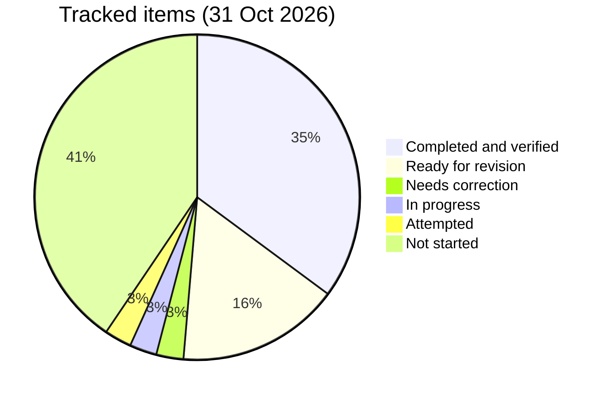

# 📈 Progress Log

   

> [!IMPORTANT]
> The single progress tracker for the 12-week plan to switch back to a Java backend role (started 23 Oct 2026). Progress is measured by verified work, and pending work never disappears.

> [!NOTE]
> **Legend:** ⬜ Not started · 🟡 In progress · 🟠 Attempted · 🔴 Needs correction · 🔵 Ready for revision · ✅ Completed and verified · 🔥 active section · 🧩 DSA · 🐞 buggy round · 🗄️ SQL · 🌱 Spring · 🏦 banking.

## 🗂️ Layout (Maven project, Java 17, JUnit 5)
| | Path | What |
|---|---|---|
| 🧩 | `src/main/java/com/prashant/dsa/<topic>/` | DSA solutions, tests in `src/test/java/...` |
| 🐞 | `src/main/java/com/prashant/dailytests/` | fix-the-buggy-code rounds, tests in `src/test/java/...` |
| 🗄️ | `sql/` | SQL queries, one file per day |
| 🎓 | `sql/learn/` | guided SQL lessons with an auto-checker (see the SQL learn track section) |
| 📋 | `tasks/` | all daily task files (one file per day, `dayNN.md`, with Morning and Evening sections; earlier days are `dayNN-morning.md`) |
| 🌱 | `spring-boot/` | Spring Boot and microservices notes |
| 📘 | `spring-boot/spring-boot-revision-sheet.md` | the **single Spring revision workbook** (concept notes + questions, no answers; sections map to the prerequisite §1-§8 numbering in the table below, plus Milestone 1 extras). `spring-boot/prerequisites.md` stays only as the §-numbering and Revision-log reference the `tasks/` files point to |
| 🔁 | `revision/` | per-section mistake logs (`revision/mistakes/dsa.md`, `sql.md`, `spring.md`; `mistake-log.md` is the index) and weekly revision notes |

> [!TIP]
> Run all tests with `mvn test`.

```bash
mvn test
```

## 🧭 Operating agreement (short)
> [!IMPORTANT]
> - 📌 Nothing is complete unless **my own work is in the repo and verified** (tests pass / answers graded).
> - 📌 Statuses: ⬜ Not started · 🟡 In progress · 🟠 Attempted · 🔴 Needs correction · 🔵 Ready for revision · ✅ Completed and verified
> - 📌 Spring Boot and SQL are paired. One Spring prerequisite section at a time. Pending work never disappears.
> - 📌 Cosmetic slips (typos, stale comments, missing braces, unused imports, stray `main()`) are fixed directly by Lumi and not logged. Only **conceptual** mistakes are highlighted and added to the per-section log in `revision/mistakes/` (`dsa.md`, `sql.md`, `spring.md`).

## 🎯 Current phase
- **Phase:** Week 1 foundations — Spring Boot prerequisites (`course-practice` Students API) + SQL (banking-flavoured) + DSA Stack. Banking app setup is done (health UP); hand-written V2 migrations have not started.
- 🔥 **Active Spring section:** §5 Validation & error handling (Day 04 Part B). §3 and §4 are code-verified (Part A ✅, 28 Oct), pending revision because the Day 03 Q1/Q2 answers scored 5/10. Part B1 is ✅ (31 Oct); B2 is next.
- ✅ **Sections completed:** none yet. The Revision log in `spring-boot/prerequisites.md` is still empty.

| Section | Status |
|---|---|
| §1 Core: IoC, DI, beans | 🔵 Ready for revision (Day 02 answers graded 5/7/5) |
| §2 Request flow | 🟡 In progress (Day 04 Q1 pending) |
| §3 Request mapping | 🔵 Ready for revision (code verified 28 Oct, `course-practice` 12/12; Q3 7/10) |
| §4 HTTP semantics | 🔵 Ready for revision (code verified 28 Oct; Day 03 Q1/Q2 scored 5/10) |
| §5 Validation & error handling | 🟡 In progress (Part B1 ✅ 31 Oct; B2 and the workbook answers pending) |
| §6 JPA · §7 Testing · §8 Config | ⬜ Not started |

## 🧩 DSA & 🐞 buggy rounds
> [!NOTE]
> Verified by running each test class against my current code on 26 Oct 2026. Authorship from git log (`Day NN: ...` commits are the routine's stubs).

| Item | Type | Tests | My commit | Status |
|---|---|---|---|---|
| ValidParentheses | DSA | 2/2 | starter | ✅ Completed and verified |
| MinStack | DSA | 10/10 | 156a339 | ✅ Completed and verified |
| ScoreOfParentheses | DSA | 37/37 | c909bb8 | ✅ Completed and verified · follow-up Qs ⬜ pending |
| RemoveKAdjacentDuplicates | DSA (Day 01) | 26/26 | 2d36911 | ✅ Completed and verified (29 Oct) · O(n) quiz 3/5 (missed the push/pop-once reasoning), re-ask |
| AsteroidCollision | DSA (Day 02) | 28/28 | 6ddde32 + Lumi's cosmetic clean-up | ✅ Completed and verified (31 Oct) · O(n) stack, `long` for `Integer.MIN_VALUE`, input not modified · stray `+6` in the Javadoc and missing braces fixed by Lumi (cosmetic, not logged) |
| CarFleet | DSA (Day 04) | 2/37 | — (stub only) | ⬜ Not started |
| Day01ArrayStack | 🐞 Buggy round | 17/17 | 71ae03f | ✅ Fixed (with hints) · 🔵 redo due 26 Oct + 30 Oct |
| Day02RpnEvaluator | 🐞 Buggy round | 44/44 | 1f1be84 | ✅ Fixed (hint on `-3`) · 🔵 redo due 27 Oct + 31 Oct |
| Day02RpnEvaluatorRedo | 🔁 Redo (day 3) | 44/44 | bddf14c | 🟠 Attempted · passes, but done by re-reading the original, not from memory · 🔵 cold redo due 31 Oct |
| Day01ArrayStackRedo | 🔁 Redo (overdue from 26 Oct) | 17/17 | af4f8e7 | ✅ Completed and verified (cold redo, 28 Oct) · next revision 30 Oct stays |
| Day03NextGreaterIndex | 🐞 Buggy round | 37/37 | 2d36911 + bcb37f3 | ✅ Completed and verified (29 Oct, both bugs found) · stray `main()` repeated, removed in bcb37f3 |
| Day04LargestRectangle | 🐞 Buggy round | 15/36 | — | ⬜ Not started |
| Day01ArrayStackRedo7 | 🔁 Day-7 redo (cold) | 17/17 | d5c0ee9 | ✅ Completed and verified (31 Oct, no conceptual issue; Lumi removed the stale TODO comments) · closes the 23 Oct day-7 row |
| Day02RpnEvaluatorRedo7 | 🔁 Day-7 redo (cold) | 43/44 | fe6827d | 🔴 Needs correction · operator fall-through and the end check are fixed; `evaluate(null)` still throws `NullPointerException` instead of `IllegalArgumentException` (`nullArray`) · logged in `revision/mistakes/dsa.md`, redo on 3 Nov |

> [!TIP]
> Stub tests that pass by accident (e.g. empty-input cases) don't count as progress.

## 🧭 NeetCode 150 tracker
> [!NOTE]
> Pattern order from [neetcode.io/practice](https://neetcode.io/practice). The next pattern starts only when every problem here is ✅. Buggy rounds use the current pattern.

| Pattern | Status |
|---|---|
| Arrays & Hashing | ⬜ Not started (skipped for now; started at Stack) |
| Two Pointers · Sliding Window | ⬜ Not started |
| 🔥 **Stack** (current) | 🟡 In progress: Valid Parentheses ✅ · Min Stack ✅ · Car Fleet ⬜ · Evaluate RPN, Generate Parentheses, Daily Temperatures, Largest Rectangle ⬜ not yet assigned as problems |

## 🐞 Daily-test bug backlog
| Day | Problem | Topic | Original mistake | Correct approach | Status | Next revision |
|---|---|---|---|---|---|---|
| 01 | Day01ArrayStack | Array stack | Grow check `>` vs `>=`, `size < 0` empty check, zero capacity never grows | Trace checks with 0, 1, full array | 🔵 Ready for revision | 26 Oct, 30 Oct |
| 02 | Day02RpnEvaluator | Stack / RPN | `-3` treated as operator; overflow; end check | Check whole token; `multiplyExact`; `size() != 1` | 🔵 Ready for revision | 27 Oct, 31 Oct |
| 03 | Day03NextGreaterIndex | Monotonic stack | Found both bugs; repeat stray `main()`, unused `java.beans` import | Clean the file before pushing | ✅ Completed and verified | 1 Nov, 5 Nov |
| 04 | Day04LargestRectangle | Monotonic stack | not attempted | — | ⬜ Not started | — |

## 🗄️ SQL
| Exercise | File | Answers in file? | Status |
|---|---|---|---|
| Day 01 practice | `sql/day01.sql` | no (examples only) | ⬜ Not started |
| SQL 01 test | `sql/day01-test.sql` | no | ⬜ Not started |
| SQL 02 | `sql/day02.sql` | no | ⬜ Not started |
| SQL 03 (branch max + net flow) | `sql/day03.sql` | no | ⬜ Not started · Q1 assigned Day 05 and Day 06 evenings, still no `sql/day03-answers.md` · assigned Day 07 evening too, no push by the 10 PM check · 🔥 assigned again Day 08 evening (fourth evening) |
| SQL 04 (loans + anti-join) | `sql/day04.sql` | no | ⬜ Not started |

## 🎓 SQL learn track (`sql/learn/`)
> [!NOTE]
> Bite-size guided lessons (15-20 min each) on the banking domain, checked by `mvn test -Dtest=SqlLessonCheckTest -Dlesson=NN`. See [sql/learn/README.md](sql/learn/README.md). Status only becomes ✅ after the checker passes on my own queries and Lumi has reviewed them.

| Lesson | Topic | Files | Checker | Status |
|---|---|---|---|---|
| 01 | SELECT, WHERE, ORDER BY, LIMIT | `sql/learn/lesson01.md` | 5/5 | ✅ Completed and verified (735056a, checker `LESSON 01 COMPLETE` and queries reviewed, 30 Oct) |
| 02 | NULL handling and CASE | `sql/learn/lesson02.md` | 5/5 | ✅ Completed and verified (f2e5a58, checker `LESSON 02 COMPLETE` and queries reviewed, 31 Oct) · `ORDER BY customer_id` added to ex 1 · mistake-log redo rows stay (2 Nov, 6 Nov) |
| 03 | Aggregates, GROUP BY, HAVING | `sql/learn/lesson03.md` | 0/5 | ⬜ Not started |
| 04 | INNER JOIN and LEFT JOIN | `sql/learn/lesson04.md` | 0/5 | ⬜ Not started |
| 05 | Subqueries and EXISTS | `sql/learn/lesson05.md` | 0/5 | ⬜ Not started |

## 🌱 Spring tasks (`spring-boot/course-practice`)
| Task | Status | Notes |
|---|---|---|
| Day 02 endpoints | ✅ Rolled into Day 03 Part A | Verified together with Part A |
| Day 03 / Day 04 Part A (endpoint fixes) | ✅ Completed and verified (28 Oct) | 11dfcc8 → 27b70d6 → bddf14c → af4f8e7 → 6e3d6be → c047571. `course-practice` 12/12 (`StudentControllerTest` 11 + context test 1). `/search` mapping, DELETE 204, not-found in service, PUT unknown id → 404, search without `name` → 400, `@Valid`/dead branch removed from `search`, stray `main()` removed from `Day02RpnEvaluator`. See [day06.md](tasks/day06.md) |
| Day 04 Part B1 (`@Size` message, `exists...` queries, 409 for duplicate email, +2 tests) | ✅ Completed and verified (31 Oct) · 71a5f07 + c344203 · `course-practice` 15/15 (`StudentControllerTest` 14 + context 1) | `@Size(min=2, max=50, message="name must be between {min} and {max} characters")` (checked: a 1-char name returns exactly `name must be between 2 and 50 characters`), `existsByEmailIgnoreCase` and `...AndIdNot` queries, `DuplicateEmailException` in create and update, 409 handler, tests for POST duplicate → 409, PUT own email → 200, PUT another student's email → 409. Open note: no unique constraint on `email` yet (race), a JPA topic for §6 |
| Day 04 Part B2 (`ProblemDetail` in every handler, malformed JSON 400, +3 tests) | ⬜ Not started | B1 is verified; starts once the backlog is under about 8 open items |

## 🏦 Banking-app milestones (`banking-app/`)
| # | Milestone | Status |
|---|---|---|
| 0 | Setup: Docker Postgres 5433, Flyway, health UP | ✅ Completed and verified |
| 1 | Auth tables (V2: users, roles, permissions) + login returning a JWT | ⬜ Not started · §3/§4 code-verified · waits for §5 (Day 04 Part B) |
| 2 | Customers and accounts | ⬜ Not started |
| 3 | Transactions with locking and idempotency | ⬜ Not started |
| 4 | Admin and audit | ⬜ Not started |

> [!NOTE]
> 🔗 SQL pairing: §3/§4 pair with `sql/day03.sql` (branch max + net flow, banking tables). Milestone 1 will pair with SQL on the auth tables.

## 🎤 Interview Q&A → see [interview-answers.md](interview-answers.md)
| Set | Status |
|---|---|
| Day 01 | ⬜ Not started (no graded file found) |
| Day 02 | ✅ Graded (5 / 7 / 5) · 🔵 Q1, Q3 ready for revision |
| Day 03 | ✅ Graded 17/30 (5 / 5 / 7) · 🔵 Q1, Q2 ready for revision · [day03-answers.md](spring-boot/interview-answers/day03-answers.md) |
| Day 04 | ⬜ Pending · Q3 assigned Day 07 morning ([day07.md](tasks/day07.md)), carried to the next free slot after B1 |
| Score of Parentheses follow-up | ⬜ Pending |

## 📊 Status counts


> [!NOTE]
> Counts are adjusted from the 30 Oct tally: SQL learn lesson 02, `AsteroidCollision` and Day 04 Part B1 are now Completed and verified; `Day02RpnEvaluatorRedo7` (43/44, missing `null` guard) is in Needs correction (31 Oct review).

## ▶️ Next session starts with
> [!IMPORTANT]
> **Next task (see [day09.md](tasks/day09.md)):** add the `null` guard to `Day02RpnEvaluatorRedo7` (43/44, 🔴 Needs correction). `Day01ArrayStackRedo7` is ✅ (17/17). Day 04 **Q3** in chat at the next free slot. Part B2 (`ProblemDetail` in every handler, malformed JSON 400, +3 tests) comes after the backlog is under about 8 open items.
>
> **Evening (31 Oct):** 🗄️ `sql/day03.sql` **Q1** (answer in `sql/day03-answers.md`), then SQL learn lesson 03. The `.postman/` clean-up is done (see the Log).
>
> 🔁 Revision due: `Day02RpnEvaluator` redo again on 3 Nov (after the fix), Day 03 Q1/Q2 re-answers, and the count-stack O(n) question (scored 3/5) on 1 Nov.
>
> No new DSA stub while a DSA problem is not started (`CarFleet`); no new SQL file while 5 are unanswered.

## 📝 Log
| Date | Week/Day | Done | Notes |
|------|----------|------|-------|
| 23 Oct 2026 | W1 D1 | Valid Parentheses (understood); Min Stack done, 10/10 tests passing | Two-stack approach, O(1) ops. Next: space-optimized version (push to mins only when x <= min) |
| 25 Oct 2026 | W1 D3 | ScoreOfParentheses 37/37 (c909bb8) | Got help writing; dry-ran line by line. Follow-up Qs pending |
| 26 Oct 2026 | W1 D4 | Day 03 Spring Part A pushed (11dfcc8) | Needs correction: /search, DELETE 204, tests |
| 26 Oct 2026 | — | Backlog reconciliation | This file + interview-answers.md |
| 27 Oct 2026 | W1 D5 | Morning round assigned (backlog only) | Day 03 Part A corrections + Day02 RPN redo stub. No new buggy round (Day 03/04 unattempted), no new Spring task (§3/§4 open) |
| 27 Oct 2026 | W1 D5 | Spring Part A mostly fixed (27b70d6, bddf14c); RPN redo 44/44 but not from memory | Evening: backlog only — RemoveKAdjacentDuplicates + SQL 03 Q1. Verified with `mvn test` (328 tests; my finished classes all green) |
| 27 Oct 2026 | W1 D5 | 10 PM check: no new pushes after the evening assignment | `RemoveKAdjacentDuplicates` still 0/26, no `sql/day03-answers.md`; both carried to Day 06 evening. Re-verified: Day02RpnEvaluator 44/44, Redo 44/44 (🟠 Attempted), StudentControllerTest 9/9 |
| 28 Oct 2026 | W1 D6 | Morning round assigned (backlog only) | Finish Part A (2 tests + 2 clean-ups) + `Day01ArrayStackRedo` stub (0/17, verified 17/17 against a correct version). No new buggy round (Day 03/04 unattempted), no new Spring task (§3/§4 open) |
| 28 Oct 2026 | W1 D6 | Day 03/04 Part A ✅ verified (af4f8e7, 6e3d6be, c047571); `Day01ArrayStackRedo` 17/17 ✅; Day 03 Q&A graded 17/30 | Verified with `mvn test`: `course-practice` 12/12, `Day01ArrayStackRedoTest` 17/17, `Day02RpnEvaluatorTest` 44/44, `Day02RpnEvaluatorRedoTest` 44/44 (still 🟠 Attempted, cold redo 31 Oct). `tasks/` moved to the repo root. §3/§4 Ready for revision (Q1/Q2 5/10); active section is now §5 |
| 28 Oct 2026 | W1 D6 | Evening session assigned (backlog only) | Re-checked at 8 PM: `RemoveKAdjacentDuplicatesTest` 0/26, no `sql/day03-answers.md`. Both assigned again in `tasks/day06.md` (renamed from `day06-morning.md`, now Morning + Evening). No new stub or SQL file (3 DSA not started, 5 SQL unanswered) |
| 28 Oct 2026 | W1 D6 | 10 PM check: no new pushes after the evening assignment | Re-verified with `mvn test`: `course-practice` 12/12, `Day01ArrayStackRedoTest` 17/17, `Day02RpnEvaluatorTest` 44/44, `Day02RpnEvaluatorRedoTest` 44/44. `RemoveKAdjacentDuplicatesTest` still 0/26, no `sql/day03-answers.md`; both carried to Day 07 evening. No new mistakes. Next: Day 04 Part B |
| 29 Oct 2026 | W1 D7 | Morning round assigned (backlog only) | Re-checked: no pushes since cf74132, `course-practice` still green (`StudentControllerTest` 11). Part B split: B1 (`@Size` message, `exists...` queries, 409, +2 tests) + Day 04 Q3 in [day07.md](tasks/day07.md). No new buggy round (Day 03/04 unattempted), no new Spring task (§5 open) |
| 29 Oct 2026 | W1 D7 | ✅ `RemoveKAdjacentDuplicates` 26/26 and `Day03NextGreaterIndex` 37/37 (2d36911, bcb37f3); SQL learn track lessons 01-05 added | 10 PM check: no pushes from me after the 8 PM evening assignment. Part B1 and Day 04 Q3 (morning), `AsteroidCollision` 8/28, SQL 03 Q1 and the `.postman` clean-up (evening) all carried. No new mistakes beyond the two logged this afternoon. Next: Part B1 on 30 Oct 6 AM |
| 30 Oct 2026 | W2 D8 | ✅ SQL learn lesson 01 5/5 (735056a); Spring revision workbook added (d12849e, 9bfb07d); morning round assigned (backlog only) | Ran the lesson 01 checker on a scratch Postgres: `LESSON 01 COMPLETE`, queries reviewed. No Spring push since c047571, so Part B1 is assigned again in [day08.md](tasks/day08.md) with the `Day01ArrayStackRedo7` day-7 redo (stub 0/17, tests verified 17/17 against a correct version). No new buggy round, no new Spring task (§5 open) |
| 30 Oct 2026 | W2 D8 | Evening session assigned (backlog only) | Re-checked at 8 PM with `mvn test`: no pushes since the morning, `AsteroidCollisionTest` 8/28, `Day01ArrayStackRedo7Test` 0/17, `CarFleetTest` 2/37, no `sql/day03-answers.md`. `AsteroidCollision`, SQL 03 Q1 and the `.postman` clean-up assigned in the Evening section of [day08.md](tasks/day08.md). No new stub or SQL file (2 DSA not started, 5 SQL unanswered) |
| 30 Oct 2026 | W2 D8 | 10 PM check: no new verified work | No pushes from me after the 8 PM evening assignment (only Markdown restyle commits today, presentation only). Part B1, `Day01ArrayStackRedo7` (0/17) and Day 04 Q3 carried to 31 Oct morning; `AsteroidCollision` 8/28, SQL 03 Q1 and the `.postman` clean-up carried to 31 Oct evening. No new mistakes. Next: Part B1 on 31 Oct 6 AM |
| 30 Oct 2026 | W2 D8 | 11:40 PM review of 6ddde32 + b26bfc8: `AsteroidCollision` 28/28 and SQL learn lesson 02 5/5, both 🔴 Needs correction (one-line fixes) | Ran `AsteroidCollisionTest` 28/28 and the lesson 02 checker 5/5 (`LESSON 02 COMPLETE`) on a scratch Postgres. Code is correct; review found a stray `+6` in the `AsteroidCollision` Javadoc and a missing `ORDER BY` in lesson 02 ex 1. Still not pushed: Part B1, `Day01ArrayStackRedo7` (0/17), Day 04 Q3, SQL 03 Q1, `.postman` clean-up. Logged in the mistake log |
| 31 Oct 2026 | W2 D8 | 12:15 AM review of f2e5a58 + 71a5f07: ✅ SQL learn lesson 02 5/5; Part B1 pushed, 🔴 Needs correction | Lesson 02 checker 5/5 (ex 1 now has `ORDER BY`). `course-practice` 14/14, `AsteroidCollisionTest` 28/28 but `+6` still in the Javadoc (🔴), `Day01ArrayStackRedo7Test` 0/17. B1: queries, 409 in create/update and 2 tests done; `@Size` has no `message`, no PUT-conflict test. Still pending: Redo7, Day 04 Q3, SQL 03 Q1, `.postman` untracking (both files still tracked, `.gitignore` lacks `postman/globals/`) |
| 31 Oct 2026 | W2 D8 | ✅ `AsteroidCollision` 28/28 after Lumi's cosmetic clean-up; mistake log split per section | Standing rules from Prashant: Lumi fixes cosmetic issues directly (removed `+6` and added braces in `AsteroidCollision`, removed the stale 409 comment in `StudentServiceImpl`); only conceptual mistakes are logged. Re-ran `AsteroidCollisionTest` 28/28 and `course-practice` 14/14. `revision/mistake-log.md` is now an index of `revision/mistakes/dsa.md`, `sql.md`, `spring.md`; the purely cosmetic rows (AsteroidCollision, Day03NextGreaterIndex hygiene) were dropped, all conceptual rows kept with their redo dates. Still his: B1 `@Size` message + PUT-conflict test, `Day01ArrayStackRedo7`, Day 04 Q3, SQL 03 Q1, `.postman` untracking |
| 31 Oct 2026 | W2 D8 | 12:35 AM review of c344203: ✅ Day 04 Part B1 15/15 | `@Size` message added and checked (a 1-char name returns `name must be between 2 and 50 characters`); PUT with another student's email → 409 test added and passing. `course-practice` 15/15. No cosmetic issues found. Still his: `Day01ArrayStackRedo7` (0/17), Day 04 Q3, SQL 03 Q1, `.postman` untracking |
| 31 Oct 2026 | W2 D8 | ✅ Housekeeping: `.postman/` and `postman/globals/` untracked | Done by Lumi at Prashant's request: `.gitignore` now lists `.postman/` and `postman/globals/` (a7ec8aa), and `.postman/resources.yaml` (f0b2c33) and `postman/globals/workspace.globals.yaml` (637e772) were deleted from the repo; `git ls-files` no longer lists them. His local copies are removed by his next `git pull`, so he copies them aside first (see [day08.md](tasks/day08.md)). `spring-boot/course-practice/postman/course-practice-students.postman_collection.json` stays tracked on purpose (a real collection, not workspace metadata) |
| 31 Oct 2026 | W2 D9 | Morning round assigned (backlog only) | Re-checked with `mvn test`: `Day01ArrayStackRedo7Test` 0/17. New stub `redo/Day02RpnEvaluatorRedo7.java` for the cold day-7 RPN redo (0/44, tests checked 44/44 against a correct version). Both in [day09.md](tasks/day09.md). No new buggy round (`Day04LargestRectangle` unattempted, two redos open), no new Spring task (§5 open, B2 next) |
| 31 Oct 2026 | W2 D9 | Review of d5c0ee9: ✅ `Day01ArrayStackRedo7` 17/17; 🔴 `Day02RpnEvaluatorRedo7` 15/44 Needs correction | Ran both suites with `mvn test`. ArrayStack: no conceptual issue. RPN: after an operator the code still runs `Integer.parseInt(token)` (27 `NumberFormatException`/"no result" failures), the end check pops and compares with `1` instead of `size() != 1`, and null/empty input is not guarded. Lumi removed the unused `java.awt.image` import and the stale `TODO` comments in both files. Logged in the DSA mistake log (redo 3 Nov) |
| 31 Oct 2026 | W2 D9 | Review of fe6827d: `Day02RpnEvaluatorRedo7` 43/44, still 🔴 Needs correction | Ran `Day02RpnEvaluatorRedo7Test` with `mvn test`: 43/44. Fall-through fixed with `else`, end check now `stack.size() != 1`, empty array now throws `IllegalArgumentException`. Only `nullArray` fails: `for (String token : tokens)` on a `null` array throws `NullPointerException`; it needs an explicit `tokens == null` check at the top. Chat quiz: he got the stack after `2 3 +` right (5); on the fall-through he first said it pushes the operator token and needed a hint that `parseInt` throws; he explained correctly that `pop()` returns the top value, so `pop() != 1` compares it with 1. No new cosmetic issues |
