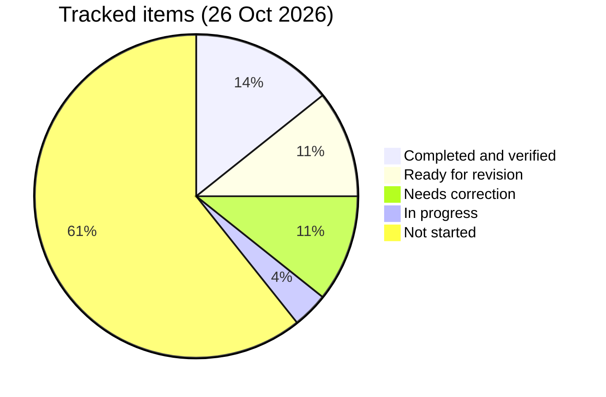

# 📈 Progress Log

   

> [!NOTE]
> 12-week plan to switch back to a Java backend role (started 23 Oct 2026).

## 🗂️ Layout (Maven project, Java 17, JUnit 5)
- 🧩 `src/main/java/com/prashant/dsa/<topic>/` : DSA solutions, tests in `src/test/java/...`
- 🐞 `src/main/java/com/prashant/dailytests/` : fix-the-buggy-code rounds, tests in `src/test/java/...`
- 🗄️ `sql/` : SQL queries, one file per day
- 🌱 `spring-boot/` : Spring Boot and microservices notes
- 🔁 `revision/` : mistake log and weekly revision notes

> [!TIP]
> Run all tests with `mvn test`.

```bash
mvn test
```

## 🧭 Operating agreement (short)
> [!IMPORTANT]
> - 📌 Nothing is complete unless **my own work is in the repo and verified** (tests pass / answers graded).
> - 📌 Statuses: ⬜ Not started · 🟡 In progress · 🟠 Attempted · 🔴 Needs correction · 🔵 Ready for revision · ✅ Completed and verified
> - 📌 Spring Boot and SQL are paired. One Spring prerequisite section at a time. Pending work never disappears.

## 🎯 Current phase
- **Phase:** Week 1 foundations — Spring Boot prerequisites (`course-practice` Students API) + SQL (banking-flavoured) + DSA Stack. Banking app setup is done (health UP); hand-written V2 migrations have not started.
- 🔥 **Active Spring section:** §3 Request mapping, paired with §4 HTTP semantics (Day 03 task). §5 Validation & error handling (Day 04) waits until §3/§4 are verified.
- ✅ **Sections completed:** none yet. The Revision log in `spring-boot/prerequisites.md` is still empty.

| Section | Status |
|---|---|
| §1 Core: IoC, DI, beans | 🔵 Ready for revision (Day 02 answers graded 5/7/5) |
| §2 Request flow | 🟡 In progress (Day 04 Q1 pending) |
| §3 Request mapping | 🔴 Needs correction (`/search` mapping) |
| §4 HTTP semantics | 🔴 Needs correction (DELETE 200 vs 204; Day 03 Qs pending) |
| §5 Validation & error handling | ⬜ Not started (Day 04 Part B) |
| §6 JPA · §7 Testing · §8 Config | ⬜ Not started |

## 🧩 DSA & 🐞 buggy rounds
> [!NOTE]
> Verified by running each test class against my current code on 26 Oct 2026. Authorship from git log (`Day NN: ...` commits are the routine's stubs).

| Item | Type | Tests | My commit | Status |
|---|---|---|---|---|
| ValidParentheses | DSA | 2/2 | starter | ✅ Completed and verified |
| MinStack | DSA | 10/10 | 156a339 | ✅ Completed and verified |
| ScoreOfParentheses | DSA | 37/37 | c909bb8 | ✅ Completed and verified · follow-up Qs ⬜ pending |
| RemoveKAdjacentDuplicates | DSA (Day 01) | 0/26 | — (stub only) | ⬜ Not started |
| AsteroidCollision | DSA (Day 02) | 8/28 | — (stub only) | ⬜ Not started |
| CarFleet | DSA (Day 04) | 2/37 | — (stub only) | ⬜ Not started |
| Day01ArrayStack | 🐞 Buggy round | 17/17 | 71ae03f | ✅ Fixed (with hints) · 🔵 redo due 26 Oct + 30 Oct |
| Day02RpnEvaluator | 🐞 Buggy round | 44/44 | 1f1be84 | ✅ Fixed (hint on `-3`) · 🔵 redo due 27 Oct + 31 Oct |
| Day03NextGreaterIndex | 🐞 Buggy round | 13/37 | — | ⬜ Not started |
| Day04LargestRectangle | 🐞 Buggy round | 15/36 | — | ⬜ Not started |

> [!TIP]
> Stub tests that pass by accident (e.g. empty-input cases) don't count as progress.

## 🐞 Daily-test bug backlog
| Day | Problem | Topic | Original mistake | Correct approach | Status | Next revision |
|---|---|---|---|---|---|---|
| 01 | Day01ArrayStack | Array stack | Grow check `>` vs `>=`, `size < 0` empty check, zero capacity never grows | Trace checks with 0, 1, full array | 🔵 Ready for revision | 26 Oct, 30 Oct |
| 02 | Day02RpnEvaluator | Stack / RPN | `-3` treated as operator; overflow; end check | Check whole token; `multiplyExact`; `size() != 1` | 🔵 Ready for revision | 27 Oct, 31 Oct |
| 03 | Day03NextGreaterIndex | Monotonic stack | not attempted | — | ⬜ Not started | — |
| 04 | Day04LargestRectangle | Monotonic stack | not attempted | — | ⬜ Not started | — |

## 🗄️ SQL
| Exercise | File | Answers in file? | Status |
|---|---|---|---|
| Day 01 practice | `sql/day01.sql` | no (examples only) | ⬜ Not started |
| SQL 01 test | `sql/day01-test.sql` | no | ⬜ Not started |
| SQL 02 | `sql/day02.sql` | no | ⬜ Not started |
| SQL 03 (branch max + net flow) | `sql/day03.sql` | no | ⬜ Not started |
| SQL 04 (loans + anti-join) | `sql/day04.sql` | no | ⬜ Not started |

## 🌱 Spring tasks (`spring-boot/course-practice`)
| Task | Status | Notes |
|---|---|---|
| Day 02 endpoints | 🔴 Needs correction | Rolled into Day 03 Part A |
| Day 03 / Day 04 Part A (endpoint fixes) | 🔴 Needs correction | Pushed 11dfcc8. ❌ `/search` → 400 (query string in mapping) · ❌ DELETE 200 not 204 · not-found check still in controller · ❌ still 3 controller tests (need +6) |
| Day 04 Part B (`@Size`, 409, ProblemDetail, +5 tests) | ⬜ Not started | After §3/§4 verified |

## 🎤 Interview Q&A → see [interview-answers.md](interview-answers.md)
| Set | Status |
|---|---|
| Day 01 | ⬜ Not started (no graded file found) |
| Day 02 | ✅ Graded (5 / 7 / 5) · 🔵 Q1, Q3 ready for revision |
| Day 03 | ⬜ Pending |
| Day 04 | ⬜ Pending |
| Score of Parentheses follow-up | ⬜ Pending |

## 📊 Status counts


## ▶️ Next session starts with
> [!IMPORTANT]
> 1. 🌱 Fix Day 03 Part A: `/search` mapping, DELETE → 204, move not-found check into the service, add ≥6 controller tests. Then answer the 3 Day 03 questions in chat.
> 2. 🗄️ Paired SQL: `sql/day03.sql` Q1 (then `day02.sql`).
> 3. 🔁 Day01ArrayStack redo from memory (due 26 Oct).

## 📝 Log
| Date | Week/Day | Done | Notes |
|------|----------|------|-------|
| 23 Oct 2026 | W1 D1 | Valid Parentheses (understood); Min Stack done, 10/10 tests passing | Two-stack approach, O(1) ops. Next: space-optimized version (push to mins only when x <= min) |
| 25 Oct 2026 | W1 D3 | ScoreOfParentheses 37/37 (c909bb8) | Got help writing; dry-ran line by line. Follow-up Qs pending |
| 26 Oct 2026 | W1 D4 | Day 03 Spring Part A pushed (11dfcc8) | Needs correction: /search, DELETE 204, tests |
| 26 Oct 2026 | — | Backlog reconciliation | This file + interview-answers.md |
