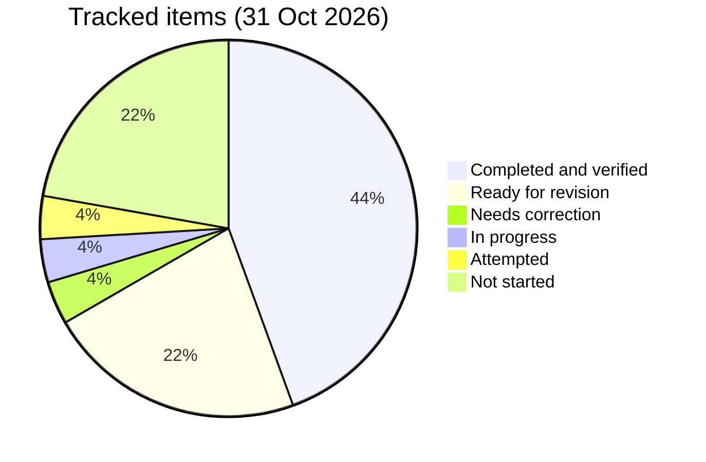

# 📈 Progress Log

   

> [!IMPORTANT]
> The single progress tracker for the 12-week plan to switch back to a Java backend role (started 23 Oct 2026). Progress is measured by verified work, and pending work never disappears.

> [!NOTE]
> **Legend:** ⬜ Not started · 🟡 In progress · 🟠 Attempted · 🔴 Needs correction · 🔵 Ready for revision · ✅ Completed and verified · 🔥 active section · 🧩 DSA · 🐞 buggy round · 🌱 Spring · 🏦 banking.

## 🗂️ Layout (Maven project, Java 17, JUnit 5)
| | Path | What |
|---|---|---|
| 🧩 | `src/main/java/com/prashant/dsa/<topic>/` | DSA solutions, tests in `src/test/java/...` |
| 🐞 | `src/main/java/com/prashant/dailytests/` | fix-the-buggy-code rounds, tests in `src/test/java/...` |
| 📋 | `tasks/` | all daily task files (one file per day, `dayNN.md`, with Morning and Evening sections; earlier days are `dayNN-morning.md`) |
| 🌱 | `spring-boot/` | Spring Boot and microservices notes |
| 📘 | `spring-boot/spring-boot-revision-sheet.md` | the **single Spring revision workbook** (concept notes + questions, no answers; sections map to the prerequisite §1-§8 numbering in the table below, plus Milestone 1 extras). `spring-boot/prerequisites.md` stays only as the §-numbering and Revision-log reference the `tasks/` files point to |
| 🔁 | `revision/` | per-section mistake logs (`revision/mistakes/dsa.md`, `spring.md`; `mistake-log.md` is the index) and weekly revision notes |
| 🗄️ | `archive/` | the retired SQL track (31 Oct 2026), kept for history: not tracked, not in `mvn test` ([archive/README.md](archive/README.md)) |

> [!TIP]
> Run all tests with `mvn test`.

```bash
mvn test
```

## 🧭 Operating agreement (short)
> [!IMPORTANT]
> - 📌 Nothing is complete unless **my own work is in the repo and verified** (tests pass / answers graded).
> - 📌 Statuses: ⬜ Not started · 🟡 In progress · 🟠 Attempted · 🔴 Needs correction · 🔵 Ready for revision · ✅ Completed and verified
> - 📌 One Spring prerequisite section at a time (SQL is retired, see the Archive section). Pending work never disappears.
> - 📌 Cosmetic slips (typos, stale comments, missing braces, unused imports, stray `main()`) are fixed directly by Lumi and not logged. Only **conceptual** mistakes are highlighted and added to the per-section log in `revision/mistakes/` (`dsa.md`, `spring.md`).

## 🎯 Current phase
- **Phase:** Week 1 foundations — Spring Boot prerequisites (`course-practice` Students API) + DSA Stack (SQL retired 31 Oct 2026). Banking app setup is done (health UP); hand-written V2 migrations have not started.
- 🔥 **Active Spring section:** §5 Validation & error handling (Day 04 Part B). §3 and §4 are code-verified (Part A ✅, 28 Oct), pending revision because the Day 03 Q1/Q2 answers scored 5/10. Part B1 is ✅ (31 Oct); B2 is next.
- ✅ **Sections completed:** none yet. The Revision log in `spring-boot/prerequisites.md` is still empty.

| Section | Status |
|---|---|
| §1 Core: IoC, DI, beans | 🔵 Ready for revision (Day 02 answers graded 5/7/5) |
| §2 Request flow | 🟡 In progress (Day 04 Q1 5/10 🔴 Needs correction, re-answer by 3 Nov) |
| §3 Request mapping | 🔵 Ready for revision (code verified 28 Oct, `course-practice` 12/12; Q3 7/10) |
| §4 HTTP semantics | 🔵 Ready for revision (code verified 28 Oct; Day 03 Q1/Q2 scored 5/10) |
| §5 Validation & error handling | 🟡 In progress (Part B1 ✅ 31 Oct; Day 04 Q1-Q3 15/30 🔴 Needs correction; B2 and the workbook answers pending) |
| §6 JPA · §7 Testing · §8 Config | ⬜ Not started |

## 🧩 DSA & 🐞 buggy rounds
> [!NOTE]
> Verified by running each test class against my current code on 26 Oct 2026. Authorship from git log (`Day NN: ...` commits are the routine's stubs).

| Item | Type | Tests | My commit | Status |
|---|---|---|---|---|
| ValidParentheses | DSA | 2/2 | starter | ✅ Completed and verified |
| MinStack | DSA | 10/10 | 156a339 | ✅ Completed and verified |
| ScoreOfParentheses | DSA | 37/37 | c909bb8 | ✅ Completed and verified · follow-up Qs ⬜ pending |
| RemoveKAdjacentDuplicates | DSA (Day 01) | 26/26 | 2d36911 | ✅ Completed and verified (29 Oct) · O(n) quiz 3/5 (missed the push/pop-once reasoning), re-ask |
| AsteroidCollision | DSA (Day 02) | 28/28 | 6ddde32 + Lumi's cosmetic clean-up | ✅ Completed and verified (31 Oct) · O(n) stack, `long` for `Integer.MIN_VALUE`, input not modified · stray `+6` in the Javadoc and missing braces fixed by Lumi (cosmetic, not logged) |
| CarFleet | DSA (Day 04) | 2/37 | — (stub only) | ⬜ Not started · assigned Day 09 evening |
| Day01ArrayStack | 🐞 Buggy round | 17/17 | 71ae03f | ✅ Fixed (with hints) · 🔵 redo due 26 Oct + 30 Oct |
| Day02RpnEvaluator | 🐞 Buggy round | 44/44 | 1f1be84 | ✅ Fixed (hint on `-3`) · 🔵 redo due 27 Oct + 31 Oct |
| Day02RpnEvaluatorRedo | 🔁 Redo (day 3) | 44/44 | bddf14c | 🟠 Attempted · passes, but done by re-reading the original, not from memory · 🔵 cold redo due 31 Oct |
| Day01ArrayStackRedo | 🔁 Redo (overdue from 26 Oct) | 17/17 | af4f8e7 | ✅ Completed and verified (cold redo, 28 Oct) · next revision 30 Oct stays |
| Day03NextGreaterIndex | 🐞 Buggy round | 37/37 | 2d36911 + bcb37f3 | ✅ Completed and verified (29 Oct, both bugs found) · stray `main()` repeated, removed in bcb37f3 |
| Day04LargestRectangle | 🐞 Buggy round | 15/36 | — | ⬜ Not started |
| Day01ArrayStackRedo7 | 🔁 Day-7 redo (cold) | 17/17 | d5c0ee9 | ✅ Completed and verified (31 Oct, no conceptual issue; Lumi removed the stale TODO comments) · closes the 23 Oct day-7 row |
| Day02RpnEvaluatorRedo7 | 🔁 Day-7 redo (cold) | 44/44 | 37f6c11 | ✅ Completed and verified (31 Oct; fixed after 3 review rounds: fall-through, end check, null guard) · logged in `revision/mistakes/dsa.md` · reset to day 1, next redo 1 Nov ([redo-schedule.md](revision/redo-schedule.md)) |

> [!TIP]
> Stub tests that pass by accident (e.g. empty-input cases) don't count as progress.

> [!IMPORTANT]
> 🔁 **Spaced repetition:** every DSA problem and buggy round is redone cold, and each result sets the next gap (clean pass: 1 → 3 → 7 → 14 → 30; hint or fix: same gap; conceptual miss: back to day 1), at most 2 a day. The calendar and the next due dates are in [revision/redo-schedule.md](revision/redo-schedule.md).

## 🧭 NeetCode 150 tracker
> [!NOTE]
> Pattern order from [neetcode.io/practice](https://neetcode.io/practice). The next pattern starts only when every problem here is ✅. Buggy rounds use the current pattern.

| Pattern | Status |
|---|---|
| Arrays & Hashing | ⬜ Not started (skipped for now; started at Stack) |
| Two Pointers · Sliding Window | ⬜ Not started |
| 🔥 **Stack** (current) | 🟡 In progress: Valid Parentheses ✅ · Min Stack ✅ · Car Fleet ⬜ · Evaluate RPN, Generate Parentheses, Daily Temperatures, Largest Rectangle ⬜ not yet assigned as problems |

## 🐞 Daily-test bug backlog
| Day | Problem | Topic | Original mistake | Correct approach | Status | Next revision |
|---|---|---|---|---|---|---|
| 01 | Day01ArrayStack | Array stack | Grow check `>` vs `>=`, `size < 0` empty check, zero capacity never grows | Trace checks with 0, 1, full array | 🔵 Ready for revision | 26 Oct, 30 Oct |
| 02 | Day02RpnEvaluator | Stack / RPN | `-3` treated as operator; overflow; end check | Check whole token; `multiplyExact`; `size() != 1` | 🔵 Ready for revision | 27 Oct, 31 Oct |
| 03 | Day03NextGreaterIndex | Monotonic stack | Found both bugs; repeat stray `main()`, unused `java.beans` import | Clean the file before pushing | ✅ Completed and verified | 1 Nov, 5 Nov |
| 04 | Day04LargestRectangle | Monotonic stack | not attempted | — | ⬜ Not started | — |

## 🗄️ Archive: SQL retired
> [!NOTE]
> **SQL was retired on 31 Oct 2026** (Prashant now practises only Spring Boot, DSA and buggy rounds). Everything was **archived, not deleted**: [archive/README.md](archive/README.md). It is no longer assigned, tracked, graded or counted below. It stood at learn lessons 01-02 ✅ (5/5 each), lessons 03-05 and the five daily files ⬜ Not started. The checker moved to `archive/sql/tests/` so `mvn test` no longer needs PostgreSQL. Basic JOIN/GROUP BY questions still come up in interviews, so Spring Data/JPA (§6) is where SQL gets used again.

## 🌱 Spring tasks (`spring-boot/course-practice`)
| Task | Status | Notes |
|---|---|---|
| Day 02 endpoints | ✅ Rolled into Day 03 Part A | Verified together with Part A |
| Day 03 / Day 04 Part A (endpoint fixes) | ✅ Completed and verified (28 Oct) | 11dfcc8 → 27b70d6 → bddf14c → af4f8e7 → 6e3d6be → c047571. `course-practice` 12/12 (`StudentControllerTest` 11 + context test 1). `/search` mapping, DELETE 204, not-found in service, PUT unknown id → 404, search without `name` → 400, `@Valid`/dead branch removed from `search`, stray `main()` removed from `Day02RpnEvaluator`. See [day06.md](tasks/day06.md) |
| Day 04 Part B1 (`@Size` message, `exists...` queries, 409 for duplicate email, +2 tests) | ✅ Completed and verified (31 Oct) · 71a5f07 + c344203 · `course-practice` 15/15 (`StudentControllerTest` 14 + context 1) | `@Size(min=2, max=50, message="name must be between {min} and {max} characters")` (checked: a 1-char name returns exactly `name must be between 2 and 50 characters`), `existsByEmailIgnoreCase` and `...AndIdNot` queries, `DuplicateEmailException` in create and update, 409 handler, tests for POST duplicate → 409, PUT own email → 200, PUT another student's email → 409. Open note: no unique constraint on `email` yet (race), a JPA topic for §6 |
| Day 04 Part B2 (`ProblemDetail` in every handler, malformed JSON 400, +3 tests) | ⬜ Not started | B1 is verified; starts once the backlog is under about 8 open items |

## 🏦 Banking-app milestones (`banking-app/`)
| # | Milestone | Status |
|---|---|---|
| 0 | Setup: Docker Postgres 5433, Flyway, health UP | ✅ Completed and verified |
| 1 | Auth tables (V2: users, roles, permissions) + login returning a JWT | ⬜ Not started · §3/§4 code-verified · waits for §5 (Day 04 Part B) |
| 2 | Customers and accounts | ⬜ Not started |
| 3 | Transactions with locking and idempotency | ⬜ Not started |
| 4 | Admin and audit | ⬜ Not started |

## 🎤 Interview Q&A → see [interview-answers.md](interview-answers.md)
| Set | Status |
|---|---|
| Day 01 | ⬜ Not started (no graded file found) |
| Day 02 | ✅ Graded (5 / 7 / 5) · 🔵 Q1, Q3 ready for revision |
| Day 03 | ✅ Graded 17/30 (5 / 5 / 7) · 🔵 Q1, Q2 ready for revision · [day03-answers.md](spring-boot/interview-answers/day03-answers.md) |
| Day 04 | 🔴 Needs correction · graded 15/30 on 31 Oct (5 / 4 / 6) · re-answer Q1-Q3 by 3 Nov · [day04-answers.md](spring-boot/interview-answers/day04-answers.md) |
| Score of Parentheses follow-up | ⬜ Pending |

## 📊 Status counts


> [!NOTE]
> Counts are adjusted from the 30 Oct tally: `AsteroidCollision` and Day 04 Part B1 are now Completed and verified; `Day01ArrayStackRedo7` and `Day02RpnEvaluatorRedo7` are Completed and verified (31 Oct); the Day 04 Q&A set (15/30) is in Needs correction. On 31 Oct the SQL items were removed (2 Completed, 8 Not started) because SQL is archived.

## ▶️ Next session starts with
> [!IMPORTANT]
> **Next task (Sun 1 Nov, 6 AM):** the two cold redos due on 1 Nov from [redo-schedule.md](revision/redo-schedule.md): `Day02RpnEvaluator` (+1, reset after the 31 Oct misses) and `ValidParentheses` (+1, late). Then re-answer Day 04 Q1-Q3 (15/30, 🔴 Needs correction) in chat by Tue 3 Nov; Q1 and Q3 redo on 3 Nov and 7 Nov. Part B2 (`ProblemDetail` in every handler, malformed JSON 400, +3 tests) comes after the backlog is under about 8 open items.
>
> **Evening (1 Nov):** carried from 31 Oct, 🧩 `CarFleet` (2/37 → 37/37). The ~20 minutes that SQL used are now free for the backlog (Day 04 re-answers, redos); SQL is retired.
>
> 🔁 Revision also due 1 Nov: Day 03 Q1/Q2 re-answers and the count-stack O(n) question (scored 3/5).
>
> No new DSA stub while a DSA problem is not started (`CarFleet`).

## 🔮 Plan projection
> [!WARNING]
> **Estimate, not a promise.** Built only from this file, the [redo schedule](revision/redo-schedule.md) and the `tasks/` files, at the pace of the first 9 days. It is **refreshed every Sunday by the 10 PM check** (last refresh: Sat 31 Oct 2026, W2 D9; next: Sun 1 Nov, 10 PM). Weeks count from 23 Oct: W1 = 23-29 Oct, W2 = 30 Oct-5 Nov, W12 = 8-14 Jan 2027.

### 📊 Verified per week
| Week | Dates | 🧩 DSA | 🐞 Buggy | 🌱 Spring | 🏦 Banking | Total | 🔁 Cold redos (separate) |
|---|---|---|---|---|---|---|---|
| W1 | 23-29 Oct | 4 | 3 | 1 | 1 | 9 | 1 |
| W2 (2 of 7 days) | 30-31 Oct | 1 | 0 | 1 | 0 | 2 | 2 |
| **Total** | 9 days | **5** | **3** | **2** | **1** | **11** | **3** |
| Pace per week (total × 7 / 9) | | 3.9 | 2.3 | 1.6 | 0.8 | 8.6 | 2.3 |

> [!NOTE]
> **Counted from the log and verified dates.** 🧩 `ValidParentheses` 23 Oct, `MinStack` 23 Oct, `ScoreOfParentheses` 25 Oct, `RemoveKAdjacentDuplicates` 29 Oct, `AsteroidCollision` 31 Oct. 🐞 `Day01ArrayStack` 23 Oct, `Day02RpnEvaluator` 24 Oct, `Day03NextGreaterIndex` 29 Oct. (The 2 SQL learn lessons, 30 and 31 Oct, are archived and no longer counted: 13 → 11 verified items.) 🌱 Part A (28 Oct), Part B1 (31 Oct). 🏦 milestone 0 (setup, 24 Oct). 🔁 `Day01ArrayStackRedo` (28 Oct), `Day01ArrayStackRedo7` and `Day02RpnEvaluatorRedo7` (31 Oct). Attempted or Needs-correction items are not counted.

### 🧮 What remains
| Section | Done | Left | Detail |
|---|---|---|---|
| 🧩 NeetCode 150 | 2 problems (`ValidParentheses`, `MinStack`) | **148** | Tracker lists 3 patterns: Arrays & Hashing ⬜, Two Pointers · Sliding Window ⬜, Stack 🟡 (5 of 7 left: Car Fleet, Evaluate RPN, Generate Parentheses, Daily Temperatures, Largest Rectangle). `ScoreOfParentheses`, `RemoveKAdjacentDuplicates` and `AsteroidCollision` are extras, not among the 150 |
| 🐞 Buggy rounds | 3 | **2** | `Day04LargestRectangle` (15/36) and the `Day00BuggyExample` warm-up (4/10), both ⬜ |
| 🌱 Spring prerequisites | 0 of 8 sections ✅ | **8** | 3 are 🔵 (§1, §3, §4), 2 are 🟡 (§2, §5), 3 are ⬜ (§6 JPA, §7 Testing, §8 Config). Part B2 ⬜; Day 04 Q1-Q3 answered 15/30 and 🔴 Needs correction (re-answer by 3 Nov) |
| 🏦 Banking app | milestone 0 | **4 of 5** | Milestones 1-4 ⬜; milestone 1 waits for §5 (Part B2) |

### 🔁 Redo load (from [redo-schedule.md](revision/redo-schedule.md))
| Measure | Number |
|---|---|
| Problems on the schedule | 8 scheduled + 3 not started (join at gap 1 once verified) · gaps are results-based since 31 Oct |
| Redos scheduled 1-30 Nov (if every redo is a clean pass) | **30**, on 19 of 30 days, never more than 2 a day · 38 until everyone graduates (last on 29 Dec) |
| Next 7 days (1-7 Nov) | **14 redos**, about 5.8 h at 25 min each, which is **42%** of the ~14 h a week the daily files budget (about 2 × 60 min a day) |
| Peak day | 2 redos = 50 min of ~120 min (42%) |
| November average | 30 × 25 min = 750 min of ~3,600 min (**21%**) |
| Cost of each new DSA problem | +5 redos (about 2 h over the following 30 days) |

> [!NOTE]
> The redos cost new-problem time: the DSA and buggy pace below is multiplied by **0.79** (the November average of 21% redo time). It is lower in the first week (0.58) and rises as redos graduate. Load refreshed 31 Oct for the results-based gaps (it was 27 redos, 39% and 19% before); a 🟠 or ❌ redo adds more.

### 🎯 Estimated finish
| Section | Pace used per week (best / slow) | Finish week (range) | Dates |
|---|---|---|---|
| 🧩 Stack pattern (5 left) | 4.9 / 1.2 | **W3-W6** | 6 Nov-3 Dec |
| 🧩 Full NeetCode 150 (148 left) | 4.9 / 1.2 | **not inside the 12 weeks** · by W12 about **55 / 15** of 150 done | best case W32 (about 29 May 2027) |
| 🐞 Buggy rounds (2 left) | 4.9 shared with DSA / 1 a week after Stack | **W3-W5** | 6-26 Nov |
| 🌱 Spring, all 8 sections ✅ | 2.3 sections to 🔵 a week + 1 revision week / 1.15 + 1 revision week | **W5-W7** | 20 Nov-10 Dec |
| 🏦 Banking, milestones 1-4 | no data yet · each takes 1.5 weeks / 3 weeks | **W10-W17** | 25 Dec-18 Feb |
| ⭐ **Overall** (everything except the full NeetCode 150) | set by banking | **W10-W17** | 25 Dec-18 Feb · the 12-week target (W12, ends 14 Jan) is met only at the best end · **unchanged by dropping SQL** (see the note below) |

> [!IMPORTANT]
> **Assumptions**
> - Pace is the 9-day average above (11 verified items once the 2 archived SQL lessons are dropped, 8.6 a week; it was 10.1 with SQL). The best case uses the all-sections average, the slow case uses the slowest recent rate seen for that section (for example W2 so far has 1 DSA, 0 buggy).
> - A conceptual miss moves a problem back to day 1 and a hint or fix repeats its gap, both add load; the numbers assume every redo is a clean pass.
> - Part B2 gets done in W3-W4 (the backlog under about 8 items), so banking milestone 1 starts W4-W5. Banking milestone length is a guess, since 0 of 4 are started.
> - Spring sections need one revision pass before they count as ✅.
> - The NeetCode 150 count uses "150" from the tracker title and only the 2 problems that are on the tracker and ✅. It is a generous bound, because the buggy rounds and extras share the same pace.
> - **Why the overall finish did not move:** SQL was never the last section to finish, banking is (W10-W17), and the banking length is a per-milestone guess, not a pace calculation. The ~25 minutes a day SQL used (about 2.9 of ~14 h a week, roughly 20%) are **not counted** as extra speed. If they go fully into Spring and banking, the best end could move about 1 week earlier (to roughly 18-25 Dec) and the slow end by up to 2 (to about 4 Feb). This only becomes the plan once two weekly reviews show a higher verified pace.
> - About 2 hours of study a day (morning and evening files ~60 min each), 25 min per redo, no missed days.

## 📝 Log
| Date | Week/Day | Done | Notes |
|------|----------|------|-------|
| 23 Oct 2026 | W1 D1 | Valid Parentheses (understood); Min Stack done, 10/10 tests passing | Two-stack approach, O(1) ops. Next: space-optimized version (push to mins only when x <= min) |
| 25 Oct 2026 | W1 D3 | ScoreOfParentheses 37/37 (c909bb8) | Got help writing; dry-ran line by line. Follow-up Qs pending |
| 26 Oct 2026 | W1 D4 | Day 03 Spring Part A pushed (11dfcc8) | Needs correction: /search, DELETE 204, tests |
| 26 Oct 2026 | — | Backlog reconciliation | This file + interview-answers.md |
| 27 Oct 2026 | W1 D5 | Morning round assigned (backlog only) | Day 03 Part A corrections + Day02 RPN redo stub. No new buggy round (Day 03/04 unattempted), no new Spring task (§3/§4 open) |
| 27 Oct 2026 | W1 D5 | Spring Part A mostly fixed (27b70d6, bddf14c); RPN redo 44/44 but not from memory | Evening: backlog only — RemoveKAdjacentDuplicates + SQL 03 Q1. Verified with `mvn test` (328 tests; my finished classes all green) |
| 27 Oct 2026 | W1 D5 | 10 PM check: no new pushes after the evening assignment | `RemoveKAdjacentDuplicates` still 0/26, no `sql/day03-answers.md`; both carried to Day 06 evening. Re-verified: Day02RpnEvaluator 44/44, Redo 44/44 (🟠 Attempted), StudentControllerTest 9/9 |
| 28 Oct 2026 | W1 D6 | Morning round assigned (backlog only) | Finish Part A (2 tests + 2 clean-ups) + `Day01ArrayStackRedo` stub (0/17, verified 17/17 against a correct version). No new buggy round (Day 03/04 unattempted), no new Spring task (§3/§4 open) |
| 28 Oct 2026 | W1 D6 | Day 03/04 Part A ✅ verified (af4f8e7, 6e3d6be, c047571); `Day01ArrayStackRedo` 17/17 ✅; Day 03 Q&A graded 17/30 | Verified with `mvn test`: `course-practice` 12/12, `Day01ArrayStackRedoTest` 17/17, `Day02RpnEvaluatorTest` 44/44, `Day02RpnEvaluatorRedoTest` 44/44 (still 🟠 Attempted, cold redo 31 Oct). `tasks/` moved to the repo root. §3/§4 Ready for revision (Q1/Q2 5/10); active section is now §5 |
| 28 Oct 2026 | W1 D6 | Evening session assigned (backlog only) | Re-checked at 8 PM: `RemoveKAdjacentDuplicatesTest` 0/26, no `sql/day03-answers.md`. Both assigned again in `tasks/day06.md` (renamed from `day06-morning.md`, now Morning + Evening). No new stub or SQL file (3 DSA not started, 5 SQL unanswered) |
| 28 Oct 2026 | W1 D6 | 10 PM check: no new pushes after the evening assignment | Re-verified with `mvn test`: `course-practice` 12/12, `Day01ArrayStackRedoTest` 17/17, `Day02RpnEvaluatorTest` 44/44, `Day02RpnEvaluatorRedoTest` 44/44. `RemoveKAdjacentDuplicatesTest` still 0/26, no `sql/day03-answers.md`; both carried to Day 07 evening. No new mistakes. Next: Day 04 Part B |
| 29 Oct 2026 | W1 D7 | Morning round assigned (backlog only) | Re-checked: no pushes since cf74132, `course-practice` still green (`StudentControllerTest` 11). Part B split: B1 (`@Size` message, `exists...` queries, 409, +2 tests) + Day 04 Q3 in [day07.md](tasks/day07.md). No new buggy round (Day 03/04 unattempted), no new Spring task (§5 open) |
| 29 Oct 2026 | W1 D7 | ✅ `RemoveKAdjacentDuplicates` 26/26 and `Day03NextGreaterIndex` 37/37 (2d36911, bcb37f3); SQL learn track lessons 01-05 added | 10 PM check: no pushes from me after the 8 PM evening assignment. Part B1 and Day 04 Q3 (morning), `AsteroidCollision` 8/28, SQL 03 Q1 and the `.postman` clean-up (evening) all carried. No new mistakes beyond the two logged this afternoon. Next: Part B1 on 30 Oct 6 AM |
| 30 Oct 2026 | W2 D8 | ✅ SQL learn lesson 01 5/5 (735056a); Spring revision workbook added (d12849e, 9bfb07d); morning round assigned (backlog only) | Ran the lesson 01 checker on a scratch Postgres: `LESSON 01 COMPLETE`, queries reviewed. No Spring push since c047571, so Part B1 is assigned again in [day08.md](tasks/day08.md) with the `Day01ArrayStackRedo7` day-7 redo (stub 0/17, tests verified 17/17 against a correct version). No new buggy round, no new Spring task (§5 open) |
| 30 Oct 2026 | W2 D8 | Evening session assigned (backlog only) | Re-checked at 8 PM with `mvn test`: no pushes since the morning, `AsteroidCollisionTest` 8/28, `Day01ArrayStackRedo7Test` 0/17, `CarFleetTest` 2/37, no `sql/day03-answers.md`. `AsteroidCollision`, SQL 03 Q1 and the `.postman` clean-up assigned in the Evening section of [day08.md](tasks/day08.md). No new stub or SQL file (2 DSA not started, 5 SQL unanswered) |
| 30 Oct 2026 | W2 D8 | 10 PM check: no new verified work | No pushes from me after the 8 PM evening assignment (only Markdown restyle commits today, presentation only). Part B1, `Day01ArrayStackRedo7` (0/17) and Day 04 Q3 carried to 31 Oct morning; `AsteroidCollision` 8/28, SQL 03 Q1 and the `.postman` clean-up carried to 31 Oct evening. No new mistakes. Next: Part B1 on 31 Oct 6 AM |
| 30 Oct 2026 | W2 D8 | 11:40 PM review of 6ddde32 + b26bfc8: `AsteroidCollision` 28/28 and SQL learn lesson 02 5/5, both 🔴 Needs correction (one-line fixes) | Ran `AsteroidCollisionTest` 28/28 and the lesson 02 checker 5/5 (`LESSON 02 COMPLETE`) on a scratch Postgres. Code is correct; review found a stray `+6` in the `AsteroidCollision` Javadoc and a missing `ORDER BY` in lesson 02 ex 1. Still not pushed: Part B1, `Day01ArrayStackRedo7` (0/17), Day 04 Q3, SQL 03 Q1, `.postman` clean-up. Logged in the mistake log |
| 31 Oct 2026 | W2 D8 | 12:15 AM review of f2e5a58 + 71a5f07: ✅ SQL learn lesson 02 5/5; Part B1 pushed, 🔴 Needs correction | Lesson 02 checker 5/5 (ex 1 now has `ORDER BY`). `course-practice` 14/14, `AsteroidCollisionTest` 28/28 but `+6` still in the Javadoc (🔴), `Day01ArrayStackRedo7Test` 0/17. B1: queries, 409 in create/update and 2 tests done; `@Size` has no `message`, no PUT-conflict test. Still pending: Redo7, Day 04 Q3, SQL 03 Q1, `.postman` untracking (both files still tracked, `.gitignore` lacks `postman/globals/`) |
| 31 Oct 2026 | W2 D8 | ✅ `AsteroidCollision` 28/28 after Lumi's cosmetic clean-up; mistake log split per section | Standing rules from Prashant: Lumi fixes cosmetic issues directly (removed `+6` and added braces in `AsteroidCollision`, removed the stale 409 comment in `StudentServiceImpl`); only conceptual mistakes are logged. Re-ran `AsteroidCollisionTest` 28/28 and `course-practice` 14/14. `revision/mistake-log.md` is now an index of `revision/mistakes/dsa.md`, `sql.md`, `spring.md`; the purely cosmetic rows (AsteroidCollision, Day03NextGreaterIndex hygiene) were dropped, all conceptual rows kept with their redo dates. Still his: B1 `@Size` message + PUT-conflict test, `Day01ArrayStackRedo7`, Day 04 Q3, SQL 03 Q1, `.postman` untracking |
| 31 Oct 2026 | W2 D8 | 12:35 AM review of c344203: ✅ Day 04 Part B1 15/15 | `@Size` message added and checked (a 1-char name returns `name must be between 2 and 50 characters`); PUT with another student's email → 409 test added and passing. `course-practice` 15/15. No cosmetic issues found. Still his: `Day01ArrayStackRedo7` (0/17), Day 04 Q3, SQL 03 Q1, `.postman` untracking |
| 31 Oct 2026 | W2 D8 | ✅ Housekeeping: `.postman/` and `postman/globals/` untracked | Done by Lumi at Prashant's request: `.gitignore` now lists `.postman/` and `postman/globals/` (a7ec8aa), and `.postman/resources.yaml` (f0b2c33) and `postman/globals/workspace.globals.yaml` (637e772) were deleted from the repo; `git ls-files` no longer lists them. His local copies are removed by his next `git pull`, so he copies them aside first (see [day08.md](tasks/day08.md)). `spring-boot/course-practice/postman/course-practice-students.postman_collection.json` stays tracked on purpose (a real collection, not workspace metadata) |
| 31 Oct 2026 | W2 D9 | Morning round assigned (backlog only) | Re-checked with `mvn test`: `Day01ArrayStackRedo7Test` 0/17. New stub `redo/Day02RpnEvaluatorRedo7.java` for the cold day-7 RPN redo (0/44, tests checked 44/44 against a correct version). Both in [day09.md](tasks/day09.md). No new buggy round (`Day04LargestRectangle` unattempted, two redos open), no new Spring task (§5 open, B2 next) |
| 31 Oct 2026 | W2 D9 | Review of d5c0ee9: ✅ `Day01ArrayStackRedo7` 17/17; 🔴 `Day02RpnEvaluatorRedo7` 15/44 Needs correction | Ran both suites with `mvn test`. ArrayStack: no conceptual issue. RPN: after an operator the code still runs `Integer.parseInt(token)` (27 `NumberFormatException`/"no result" failures), the end check pops and compares with `1` instead of `size() != 1`, and null/empty input is not guarded. Lumi removed the unused `java.awt.image` import and the stale `TODO` comments in both files. Logged in the DSA mistake log (redo 3 Nov) |
| 31 Oct 2026 | W2 D9 | Review of fe6827d: `Day02RpnEvaluatorRedo7` 43/44, still 🔴 Needs correction | Ran `Day02RpnEvaluatorRedo7Test` with `mvn test`: 43/44. Fall-through fixed with `else`, end check now `stack.size() != 1`, empty array now throws `IllegalArgumentException`. Only `nullArray` fails: `for (String token : tokens)` on a `null` array throws `NullPointerException`; it needs an explicit `tokens == null` check at the top. Chat quiz: he got the stack after `2 3 +` right (5); on the fall-through he first said it pushes the operator token and needed a hint that `parseInt` throws; he explained correctly that `pop()` returns the top value, so `pop() != 1` compares it with 1. No new cosmetic issues |
| 31 Oct 2026 | W2 D9 | Review of 37f6c11: ✅ `Day02RpnEvaluatorRedo7` 44/44 Completed and verified | Ran `Day02RpnEvaluatorRedo7Test` with `mvn test`: 44/44. The null guard `tokens == null \|\| tokens.length == 0` is in, so all three conceptual bugs are fixed. Lumi re-indented the method body and spaced the two helper methods (cosmetic). Redo dates in the DSA mistake log stay (3 Nov, 7 Nov) |
| 31 Oct 2026 | W2 D9 | 🔁 Spaced-repetition calendar added: [revision/redo-schedule.md](revision/redo-schedule.md) | 11 DSA problems and buggy rounds (8 scheduled, 3 not started). Redos at +1, +3, +7, +14, +30 days from the last verified solve, at most 2 a day, most overdue first, a miss resets to +1. Mistake-log dates kept (`RemoveKAdjacentDuplicates` 1 Nov and 5 Nov, `Day02RpnEvaluator` 3 Nov and 7 Nov). Next 7 days: 1 Nov `RemoveK` + `Rpn`, 2 Nov `ValidParentheses` + `MinStack`, 3 Nov `Rpn` + `ScoreOfParentheses`, 4 Nov `Day03NextGreaterIndex` + `AsteroidCollision`, 5 Nov `RemoveK`, 6 Nov `Day01ArrayStack` + `ValidParentheses`, 7 Nov `Rpn` + `MinStack` |
| 31 Oct 2026 | W2 D9 | 🔮 Plan projection added (section above the Log) | 13 verified items in 9 days (DSA 5, buggy 3, SQL 2, Spring 2, banking 1; 3 cold redos on top). Remaining: NeetCode 148, buggy 2, SQL 8, Spring 8 sections, banking 4 milestones. 13 redos in the next 7 days (39% of study time). Estimated finish: Stack W3-W6, buggy W3-W5, SQL W4-W7, Spring W5-W7, banking W10-W17, overall W10-W17 (target W12). Refreshed every Sunday by the 10 PM check |
| 31 Oct 2026 | W2 D9 | 🔁 Redo schedule switched to results-based gaps (approved by Prashant): [revision/redo-schedule.md](revision/redo-schedule.md) | Clean cold pass moves up one step (1 → 3 → 7 → 14 → 30); a hint or fix repeats the gap; a conceptual miss resets to day 1; two clean passes ≥14 days apart skip to 30; max 2 redos a day. Recomputed from real history: `Day01ArrayStack` clean 17/17 → +7, due 7 Nov; `Day02RpnEvaluator` 3 conceptual misses → day 1, due 1 Nov; never-redone items are due since 24-30 Oct and queued. Next 7 days: 14 redos (42% of study time); November 30 redos on 19 days (21%). Plan projection redo load and pace refreshed (Stack W3-W6, NeetCode by W12 about 15-55 of 150) |
| 31 Oct 2026 | W2 D9 | 🎤 Day 04 Q&A answered in chat and graded: 🔴 Needs correction, 15/30 (Q1 5/10 · Q2 4/10 · Q3 6/10) | Saved verbatim in [day04-answers.md](spring-boot/interview-answers/day04-answers.md), linked from [interview-answers.md](interview-answers.md). Q1: missed `MethodArgumentNotValidException` (named the malformed-JSON exception). Q2: vague, mass assignment half-got, missed leaking internal fields or lazy relations and schema coupling. Q3: `ProblemDetail` and 400 vs 409 right, but not the race condition (unique constraint + `DataIntegrityViolationException` → 409). Conceptual rows for Q1 and Q3 added to `revision/mistakes/spring.md` (redo 3 Nov and 7 Nov). Re-answer all three by 3 Nov |
| 31 Oct 2026 | W2 D9 | Evening session assigned (backlog only) | Re-checked at 8 PM with `mvn test`: `CarFleetTest` 2/37, lesson 03 exercises empty, no `sql/day03-answers.md`. Assigned `CarFleet` and SQL learn lesson 03 in the Evening section of [day09.md](tasks/day09.md). `sql/day03.sql` Q1 moved after lesson 04 (needs GROUP BY + LEFT JOIN). No new stub or SQL file (2 DSA not started, 5 SQL unanswered) |
| 31 Oct 2026 | W2 D9 | 10 PM check: ✅ two cold day-7 redos verified today; no pushes after the 8 PM assignment | Today's verified work (`Day01ArrayStackRedo7` 17/17, `Day02RpnEvaluatorRedo7` 44/44) and the Day 04 Q&A grading (15/30, 🔴) were already recorded. No commits from me after the evening assignment, so `CarFleet` (2/37) and SQL learn lesson 03 carry to 1 Nov evening. No new mistakes. End of day added to [day09.md](tasks/day09.md). Next: `Day02RpnEvaluator` + `ValidParentheses` redos on 1 Nov 6 AM |
| 31 Oct 2026 | W2 D9 | 🗄️ SQL retired and archived (Prashant's decision: only Spring Boot, DSA and buggy rounds) | `sql/` moved to `archive/sql/` (history kept), the SQL mistake log to `archive/sql/mistakes-sql.md`, the lesson checker to `archive/sql/tests/` (out of `src/test/java`, so `mvn test` no longer needs PostgreSQL; the test-scope PostgreSQL dependency was removed from `pom.xml`). SQL removed from tracking, next task, the Plan projection and `tasks/day09.md`. Overall projection stays **W10-W17 (25 Dec-18 Feb)** because banking, not SQL, sets it; verified pace without SQL is 8.6 items a week (11 items in 9 days), and the freed ~25 min a day is not counted until the weekly reviews show it. Routines no longer assign SQL |
