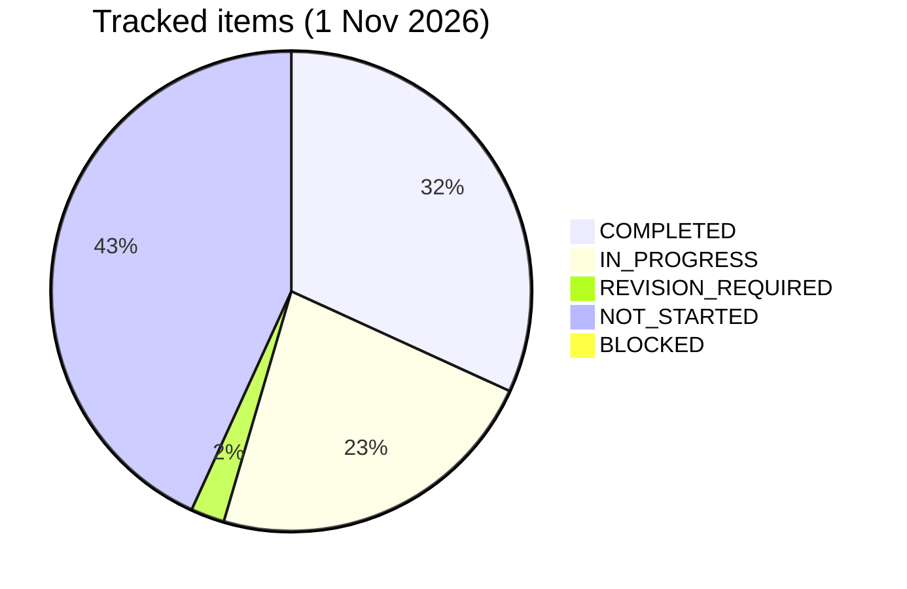

# 📈 Progress Log

   

> [!IMPORTANT]
> The single progress tracker, organised around the three tracks of [docs/PROGRAM.md](docs/PROGRAM.md): 🏦 Spring Boot banking project, 🧩 DSA (NeetCode by pattern) and 🐞 buggy problems, plus spaced repetition. Nothing is ✅ COMPLETED unless my own work is in the repo and verified. Progress, not the calendar, decides the next task.

> [!NOTE]
> **Legend:** ⬜ `NOT_STARTED` · 🟡 `IN_PROGRESS` · ✅ `COMPLETED` (verified) · 🔴 `REVISION_REQUIRED` · ⛔ `BLOCKED` · 🔥 active · 🧩 DSA · 🐞 buggy · 🏦 banking · 🌱 Spring · 🔁 redo. Old names map: Completed and verified → COMPLETED; Needs correction → REVISION_REQUIRED; Attempted / In progress / Ready for revision → IN_PROGRESS; Not started → NOT_STARTED. The Log at the bottom keeps the words it was written with.

## 🧭 Overall status
| Track | Status | Verified so far | Open now | Next |
|---|---|---|---|---|
| 🏦 **Spring Boot banking** | 🟡 IN_PROGRESS | foundation: `course-practice` Part A, B1 and **B2 ✅ (5 Nov, `1c9c6aa` + Lumi `7b7c725`, 23/23)**; Day 04 Q1-Q3 re-answers ✅ (26/30); banking setup (milestone 0) ✅; **0 of 10 modules** started; Spring slot in [`spring-boot-labs`](https://github.com/PrashantSury/spring-boot-labs) | Q3 and Q6 of the B2 questions; module 1 step 1 and Drills 2 and 3 **parked**; **labs Chapter 1 🟡 18/19** (`5c366dc` on `main`, 12 Nov 8:04 PM IST; only `task1c` version red; interview Q not answered) | [day21.md late push](tasks/day21.md#-late-push-review-12-nov-804-pm-ist-first-spring-boot-labs-push) · Fri 13 Nov: one slot, fix `task1c` → 19/19, then the Ch 1 interview Q in chat |
| 🧩 **DSA, Stack pattern** | 🟡 IN_PROGRESS | 6 problems ✅; `CarFleet` ✅ 37/37; count-stack re-ask ✅; RPN redo ✅ 44/44; CarFleet time/space reasons ✅ in chat (5–6 Nov); Lumi CarFleet comment PR [#1](https://github.com/PrashantSury/java-switch-journey/pull/1) open | single-pair CarFleet follow-up; **Daily Temperatures** still stub 0/18; ValidParen redo **18/18** 🔶 (post-feedback, same +1) | [day20.md](tasks/day20.md) (optional today: pseudocode comments only) |
| 🐞 **Buggy rounds** | 🟡 IN_PROGRESS | 5 rounds with code ✅ (`Day00BuggyExample` **10/10**, `c0f5d64`, 6 Nov; `Day04LargestRectangle` 36/36); LargestRect write-up **graded in chat 7 Nov (supported)** | empty-stack width geometric why still soft; Day00 symptom groups absent; no new buggy until those settle | [day20.md](tasks/day20.md) (optional) |
| 🔁 **Spaced repetition** | 🟡 IN_PROGRESS | 4 cold redos ✅; `Day00BuggyExample` joins at +1 | 10 Nov 10 PM check: `ValidParenthesesRedoNov08` 0/18 and `MinStackRedoNov01` 0/10 not attempted again → both move to **Wed 11 Nov**; queue moved one day (last graduation Thu 7 Jan); 11 Nov: still 0/18 and 0/10, not attempted → **queue on hold** during one-slot days, resumes Sat 14 Nov at the earliest (last graduation Sun 10 Jan at the earliest) | [redo-schedule.md](revision/redo-schedule.md) · [day20.md](tasks/day20.md) |
| 🎤 **Interview Q&A** | 🟡 IN_PROGRESS | Day 02-04 graded (5/7/5, 5/5/7, 5/4/6); Day 04 re-answers 8/9/9 (26/30) ✅ | `ScoreOfParentheses` follow-ups; labs Ch 1 Qs; B2 Q3/Q6; Day 02 and Day 03 re-answers | [interview-answers.md](interview-answers.md) |

> [!TIP]
> The day is 2 h morning (all new work: Spring about 50 min, DSA about 35, buggy about 15) plus 1 h evening (review and score each track out of 10, finish pending work, then redos). Details: [docs/PROGRAM.md](docs/PROGRAM.md). Today's plan: [tasks/day20.md](tasks/day20.md) (11 Nov morning, **lighter day** after three days with no pushes: one must-do = labs Ch 1 **Task 1, the coordinates** (`com.ledgerly : ledgerly-core : 0.1.0-SNAPSHOT`), pushed on `my-solutions` by 6:20 AM even if red; optional: Task 2+ → DailyTemperatures pseudocode comments → LargestRect width sentence; evening redos ValidParen (blank Nov08) + MinStack). Spring slot: [`spring-boot-labs` Chapter 1](https://github.com/PrashantSury/spring-boot-labs/tree/main/chapters/01-maven-and-the-pom). Last student code: `3019054` (7 Nov 14:11 IST) / tip `9e7058c` (10 Nov 10 PM check); 11 Nov 6 AM re-run unchanged (514 run, 46 red = the three untouched stubs; labs `Chapter01CheckTest` 1/19, no `my-solutions`). 11 Nov 8 PM evening review: no push (fourth day with no work), re-run unchanged, all tracks unscored → **one-slot days from Thu 12 Nov** (one 45-min block: labs Ch 1 Task 1). Note: day16-day19 called Task 1 "the parent"; in the chapter it is the coordinates, Task 2 is the parent. **12 Nov morning: [tasks/day21.md](tasks/day21.md)**, first one-slot day: one 45-min block, labs Ch 1 Task 1 on `my-solutions` (Task 2 only if time); DSA, buggy and redos resting; no student commits since `3019054` at 6 AM (tip `0979813`). 12 Nov 8 PM evening review: no push (fifth day with no work), re-run unchanged (514 run, 46 red), all tracks unscored → Fri 13 Nov stays one-slot but **15 minutes**: Task 1 only.

```bash
mvn test          # root project: DSA and buggy rounds
```

## 🗂️ Layout
| | Path | What |
|---|---|---|
| 🧭 | `docs/PROGRAM.md`, `docs/STYLE-GUIDE.md` | operating model; markdown and spec style |
| 🧩 | `src/main/java/com/prashant/dsa/<pattern>/` | DSA solutions, tests in `src/test/java/...` |
| 🐞 | `src/main/java/com/prashant/dailytests/` and `.../redo/` | buggy rounds and redos, tests in `src/test/java/...` |
| 🏦 | `banking-app/` | the banking project ([design](banking-app/project-architecture.md)) |
| 🌱 | `spring-boot/` | `course-practice` (foundation ✅ B2), revision workbook, graded answers — **active Spring slot from 6 Nov:** [`PrashantSury/spring-boot-labs`](https://github.com/PrashantSury/spring-boot-labs) |
| 📋 | `tasks/` | one file per day, `dayNN.md` |
| 🔁 | `revision/` | `redo-schedule.md`, `mistakes/dsa.md`, `mistakes/spring.md`, index `mistake-log.md` |
| 🗄️ | `archive/` | retired SQL and the early `day02-05-morning` files ([archive/README.md](archive/README.md)) |

## 🏦 Spring Boot track
### 🧱 Banking modules (the project)
> [!NOTE]
> Order follows the concepts each module introduces ([project-architecture.md](banking-app/project-architecture.md)). A module is ✅ COMPLETED only after its tests pass and the review has read the code. Milestone 0 (setup: Docker Postgres 5433, Flyway V1, health UP) is ✅ COMPLETED (24 Oct).

| # | Module | Concepts introduced | Status |
|---|---|---|---|
| 0 | Setup | Docker, Flyway V1, two DB roles, Testcontainers | ✅ COMPLETED |
| 1 | AuthN / AuthZ | Flyway V2, password hashing, JWT issue and verify, `@PreAuthorize` | ⬜ NOT_STARTED (starts after Part B2 is ✅) |
| 2 | Customer | JPA entities, validation, KYC maker-checker | ⬜ NOT_STARTED |
| 3 | Account | `NUMERIC` money, ownership checks, `@Version`, pagination | ⬜ NOT_STARTED |
| 4 | Beneficiary | uniqueness rules, soft delete, `Clock` | ⬜ NOT_STARTED |
| 5 | Transactions | `@Transactional`, optimistic vs pessimistic locking | ⬜ NOT_STARTED |
| 6 | Fund Transfers | lock ordering, idempotency, conflicts | ⬜ NOT_STARTED |
| 7 | Transaction History | projections, keyset pagination, N+1 | ⬜ NOT_STARTED |
| 8 | Notifications | domain events, `@TransactionalEventListener`, async | ⬜ NOT_STARTED |
| 9 | Statements / Reports | scheduling, batch reads, file generation | ⬜ NOT_STARTED |
| 10 | Audit / Compliance | append-only audit, trigger, `REVOKE` | ⬜ NOT_STARTED |

### 🌱 Foundation: `course-practice` and the Spring sections
| Section | Status | Evidence |
|---|---|---|
| §1 Core: IoC, DI, beans | 🟡 IN_PROGRESS | Day 02 answers 5/7/5; revision pending |
| §2 Request flow | 🟡 IN_PROGRESS | Day 04 Q1 5/10, re-answered 8/10 on 1 Nov ✅ |
| §3 Request mapping | 🟡 IN_PROGRESS | code verified 28 Oct, `course-practice` 12/12; Q3 7/10; revision pending |
| §4 HTTP semantics | 🟡 IN_PROGRESS | code verified 28 Oct; Day 03 Q1/Q2 5/10; revision pending |
| 🔥 §5 Validation and error handling | ✅ COMPLETED (5 Nov) | Part B1 ✅ (31 Oct, 15/15); **B2 ✅ (5 Nov, `1c9c6aa` + Lumi `7b7c725`)**: `course-practice` **23/23** (`StudentControllerTest` 19 + `SpringDefaultsDrillTest` 3 + context 1); `/abc` → 400 `INVALID_PARAMETER`, unknown path → 404 `RESOURCE_NOT_FOUND`, 405 keeps `Allow`; Day 04 Q1-Q3 re-answered 26/30 ✅. Q3 and Q6 of the B2 questions are still unanswered (interview side, in Pending) |
| §6 JPA · §7 Testing · §8 Config | ⬜ NOT_STARTED | taught inside the banking modules (JPA with modules 2-3, testing with every module, config with module 1); their workbook sections are answered when each is reached |

| `course-practice` task | Status | Notes |
|---|---|---|
| Day 02 endpoints | ✅ COMPLETED | rolled into Part A, verified with it |
| Day 03 / Day 04 Part A (endpoint fixes) | ✅ COMPLETED (28 Oct) | 11dfcc8 → 27b70d6 → bddf14c → af4f8e7 → 6e3d6be → c047571; `course-practice` 12/12; see [day06.md](tasks/day06.md) |
| Day 04 Part B1 (`@Size` message, `exists...` queries, 409, +2 tests) | ✅ COMPLETED (31 Oct) | 71a5f07 + c344203; `course-practice` 15/15 (`StudentControllerTest` 14 + context 1). Open note: no unique constraint on `email` yet (the race), a JPA topic |
| Day 04 Part B2 (`ProblemDetail` everywhere, malformed JSON 400, +3 tests) | ✅ COMPLETED (5 Nov) | [spec](tasks/day10.md#-day-04-part-b2-problemdetail-in-every-error-response). `f4cb8b9` → `0600df2` → `ff79dbf` (+ Lumi's tidy-ups) → **`1c9c6aa` (5 Nov, 15:53 IST, Drill 1)**: `MethodArgumentTypeMismatchException` → 400 `INVALID_PARAMETER`, `NoResourceFoundException` → 404 `RESOURCE_NOT_FOUND`, catch-all left last and untouched, 3 drill tests written by hand; Lumi's minor fixes `7b7c725` (stale comments, one extra assertion). **23/23.** Open note: the 404 test only asserts that `errorCode` exists, not its value |

## 🧩 DSA track (NeetCode 150 by pattern)
> [!NOTE]
> Pattern order from [neetcode.io/practice](https://neetcode.io/practice). The next pattern starts only when every problem of the current one is ✅ COMPLETED. Stub tests that pass by accident (an empty-input case on an empty method) do not count.

| Pattern | Status | Detail |
|---|---|---|
| Arrays & Hashing · Two Pointers · Sliding Window | ⬜ NOT_STARTED | skipped for now; the program started at Stack |
| 🔥 **Stack** (current) | 🟡 IN_PROGRESS | Valid Parentheses ✅ · Min Stack ✅ · Car Fleet ✅ (3 Nov, with hints) · **Daily Temperatures** 🟡 stub assigned (Day 15, 0/18) · Evaluate RPN, Generate Parentheses, Largest Rectangle ⬜ not yet assigned as DSA problems |

| Problem | Tests | My commit | Status | Notes |
|---|---|---|---|---|
| ValidParentheses | 2/2 | starter | ✅ COMPLETED | on the redo ladder |
| MinStack | 10/10 | 156a339 | ✅ COMPLETED | on the redo ladder |
| ScoreOfParentheses | 37/37 | c909bb8 | ✅ COMPLETED | follow-up questions ⬜ NOT_STARTED (answers pending) |
| RemoveKAdjacentDuplicates (Day 01) | 26/26 | 2d36911 | ✅ COMPLETED (29 Oct) | O(n) quiz 3/5 (missed the push/pop-once reasoning) → re-ask ✅ answered 5 Nov (each character pushed at most once, popped at most once, so at most 2n steps); problem itself still due its +1 redo on 7 Nov |
| AsteroidCollision (Day 02) | 28/28 | 6ddde32 + Lumi's cosmetic clean-up | ✅ COMPLETED (31 Oct) | O(n) stack, `long` for `Integer.MIN_VALUE`, input not modified |
| CarFleet (Day 04) | 37/37 | 91cb817 + Lumi's minor fixes; comment lines in `1c9c6aa` | ✅ COMPLETED (3 Nov, with hints) | sort by position descending, cross-multiplied `long` comparison, `Deque<long[]>`; hint-assisted (pairing, exact comparison). The 3 comment lines are in; **time and space reasons accepted in chat** (5–6 Nov); Lumi refined comments on PR #1 (open, not on `main`); single-pair follow-up still owed · [review](tasks/day12.md#-midday-push-review-3-nov-1737-ist) |
| DailyTemperatures (Day 15) | 0/18 | stub only | 🟡 IN_PROGRESS (assigned 6 Nov; **still not started** as of 11 Nov morning) | monotonic stack of indices; stub untouched on tip `9e7058c`; 3-5 lines of plain-English pseudocode first · [day20.md](tasks/day20.md) |

## 🐞 Buggy problems (on the current pattern: Stack)
| Round or redo | Type | Tests | My commit | Status | Notes |
|---|---|---|---|---|---|
| Day01ArrayStack | 🐞 buggy | 17/17 | 71ae03f | ✅ COMPLETED | fixed with hints; on the redo ladder |
| Day02RpnEvaluator | 🐞 buggy | 44/44 | 1f1be84 | ✅ COMPLETED | fixed with a hint on `-3`; on the redo ladder (reset to +1) |
| Day03NextGreaterIndex | 🐞 buggy | 37/37 | 2d36911 + bcb37f3 | ✅ COMPLETED (29 Oct) | both bugs found; stray `main()` repeated and removed |
| Day04LargestRectangle | 🐞 buggy | 36/36 | d8306e2 | ✅ COMPLETED (5 Nov) | three exact, minimal changes took 15/36 to 36/36 in one push; symptom table + `[2, 1, 2]` hand trace **graded in chat 7 Nov (supported)** — sentinel rows corrected after feedback, max 3 accepted; empty-stack width geometric why still soft; joins the redo ladder at +1 · [spec](tasks/day09.md#-day04largestrectangle-buggy-round) |
| Day00BuggyExample (warm-up) | 🐞 buggy | **10/10** | c0f5d64 | ✅ COMPLETED (6 Nov) | null/empty → IAE, `Integer.MIN_VALUE` seed, loop from 0; no written symptom groups; joins redo ladder at +1 · [spec](tasks/day09.md#-day00buggyexample-buggy-warm-up) |
| Day01ArrayStackRedo | 🔁 redo (day 3) | 17/17 | af4f8e7 | ✅ COMPLETED (cold, 28 Oct) | |
| Day01ArrayStackRedo7 | 🔁 redo (day 7) | 17/17 | d5c0ee9 | ✅ COMPLETED (31 Oct) | clean cold pass; Lumi removed stale TODO comments |
| Day02RpnEvaluatorRedo | 🔁 redo (day 3) | 44/44 | bddf14c | 🟡 IN_PROGRESS | passes, but done by re-reading the original, not from memory |
| Day02RpnEvaluatorRedo7 | 🔁 redo (day 7) | 44/44 | 37f6c11 | ✅ COMPLETED (31 Oct) | fixed after 3 review rounds (fall-through, end check, null guard); logged in `revision/mistakes/dsa.md`; reset to +1 |
| Day02RpnEvaluatorRedoNov01 | 🔁 redo (+1) | 44/44 | 800ad4f | ✅ COMPLETED (cold, 5 Nov) | clean cold pass, no hint: 3 comment lines, exact-match operators, `size() < 2` guard before the pops, `a` below `b`, `size() != 1` end check, null guards, `Math.*Exact`; none of the 31 Oct slips came back; moves +1 → +3 (due Sun 8 Nov) |
| ValidParenthesesRedoNov01 | 🔁 redo (+1) | **18/18** | c0f5d64 (body) · **3019054** null→IAE **in the redo** (tip `f61c7d3`) | 🟡 IN_PROGRESS 🔶 | 7 Nov post-feedback **18/18**; **not** cold-clean — same +1 gap; the cold retry is `ValidParenthesesRedoNov08` |
| MinStackRedoNov01 | 🔁 redo (+1) | 0/10 | stub only | 🟡 IN_PROGRESS (assigned 6 Nov) | not attempted 6–10 Nov; due **Wed 11 Nov** evening (same file) · [day20.md](tasks/day20.md) |
| ValidParenthesesRedoNov08 | 🔁 redo (+1, repeated) | 0/18 | blank stub (8 Nov morning session) | ⬜ NOT_STARTED | cold redo on a blank file, because `ValidParenthesesRedoNov01` already holds the 7 Nov answer; not attempted 8–10 Nov; due **Wed 11 Nov** evening · [day20.md](tasks/day20.md) |

> [!IMPORTANT]
> 🔁 Every DSA problem and buggy round is redone cold, and each result sets the next gap (clean pass 1 → 3 → 7 → 14 → 30; hint or fix repeats the gap; conceptual miss resets to day 1), at most 2 a day. A problem keeps ✅ COMPLETED for its first verified solve; the calendar and next due dates are in [redo-schedule.md](revision/redo-schedule.md).

## 🎤 Interview Q&A (see [interview-answers.md](interview-answers.md))
| Set | Status | Detail |
|---|---|---|
| Day 01 | ⬜ NOT_STARTED | no graded record |
| Day 02 | 🟡 IN_PROGRESS | 5 / 7 / 5; re-answer Q1, Q3 |
| Day 03 | 🟡 IN_PROGRESS | 17/30 (5 / 5 / 7); re-answer Q1, Q2 · [day03-answers.md](spring-boot/interview-answers/day03-answers.md) |
| Day 04 | ✅ COMPLETED (1 Nov) | first attempt 15/30 (5 / 4 / 6); re-answers 26/30 (Q1 8, Q2 9, Q3 9), graded in chat · [day04-answers.md](spring-boot/interview-answers/day04-answers.md) |
| Score of Parentheses follow-up | ⬜ NOT_STARTED | answers pending |

## 📌 Pending
> [!NOTE]
> Everything not ✅ COMPLETED, in the order to work it. Pending work never disappears until it is verified. Full specs: [tasks/day09.md](tasks/day09.md). Re-confirmed by the 11 Nov 6 AM session ([day20.md](tasks/day20.md)): no pushes since 7 Nov, every item still open. **Next recommended (lighter day):** item 1 **Task 1 only** (the coordinates, three lines) pushed on `my-solutions` by 6:20 AM, even if red, is the one must-do; then, optional, Task 2 (parent) onward, item 2 as pseudocode comments only, item 3 in chat; evening item 4 (ValidParen first if only one fits).

| # | Item | Track | Status |
|---|---|---|---|
| 1 | `spring-boot-labs` Chapter 1 (Maven / pom, 6 tasks + interview Q) | 🌱 | 🟡 IN_PROGRESS (**18/19** on `main` `5c366dc`, 12 Nov 8:04 PM IST; Tasks 2-6 ✅, Task 1 2/3: `task1c` version still `0.0.1-SNAPSHOT`; interview Q not answered; no `my-solutions` branch) |
| 2 | `DailyTemperatures` (0/18 stub) | 🧩 | 🟡 IN_PROGRESS (not started; finish before any new Stack problem) |
| 3 | Empty-stack width geometric sentence + ASCII for LargestRect `[2,1,2]` | 🐞 | 🟡 IN_PROGRESS (table/trace graded supported 7 Nov; width-why soft) |
| 4 | Evening: cold `ValidParenthesesRedoNov08` (blank, 0/18) then cold `MinStackRedoNov01` (0/10) | 🔁 | 🟡 IN_PROGRESS (missed 8-11 Nov; on hold during one-slot days, earliest **Sat 14 Nov**) |
| 5 | `CarFleet` single-pair follow-up in chat; written reasons await PR [#1](https://github.com/PrashantSury/java-switch-journey/pull/1) merge | 🧩 | 🟡 IN_PROGRESS |
| 6 | Q3 and Q6 of the B2 interview questions, and the one-sentence "why the catch-all hid Spring's own answers" | 🌱 | ⬜ NOT_STARTED |
| 7 | Banking module 1 step 1, Drills 2 and 3: **parked** (Spring slot is `spring-boot-labs`); nothing is deleted | 🏦🌱 | ⬜ NOT_STARTED (parked) |
| 8 | `ScoreOfParentheses` follow-up questions | 🧩 | ⬜ NOT_STARTED |
| 9 | Day 02 and Day 03 re-answers (Q1, Q3 / Q1, Q2) | 🌱 | 🟡 IN_PROGRESS |
| 10 | Redos queued after 11 Nov: `ScoreOfParentheses`, `RemoveKAdjacentDuplicates` (**15 Nov** earliest); `Day03NextGreaterIndex`, `AsteroidCollision` (**16 Nov** earliest) | 🔁 | 🟡 IN_PROGRESS |

## 🎯 Weak topics
> [!NOTE]
> Classified from graded evidence so far, using the rubric in [docs/PROGRAM.md](docs/PROGRAM.md) (Strong 8-10, Moderate 6-7, Weak 0-5). The first scored evening review refreshes this table; a **weak-topic pack** (notes, 1 conceptual question, 1 implementation, 1 debugging, 1 interview scenario) is generated for each 🔴 Weak row when it is picked up.

| Track | Topic | Evidence | Class | Pack |
|---|---|---|---|---|
| 🌱 | DTO vs entity (what leaks, mass assignment) | Day 04 Q2 4/10, re-answer 9/10 (1 Nov) | 🟢 Strong | ⬜ not generated |
| 🌱 | JSON → validated DTO: which exception at which step | Day 04 Q1 5/10, re-answer 8/10 (1 Nov) | 🟢 Strong | ⬜ not generated |
| 🌱 | HTTP semantics: idempotency, DELETE twice, PUT vs PATCH, status codes | Day 02 Q3 5/10, Day 03 Q1 5/10 | 🔴 Weak | ⬜ not generated |
| 🌱 | `ResponseEntity` vs `@ResponseStatus`, `Location` header | Day 03 Q2 5/10 | 🔴 Weak | ⬜ not generated |
| 🌱 | `@PathVariable` / `@RequestParam` / `@RequestBody` | Day 02 Q1 5/10 | 🔴 Weak | ⬜ not generated |
| 🌱 | Race on unique data: check-then-save vs a DB constraint | Day 04 Q3 6/10, re-answer 9/10 (1 Nov) | 🟢 Strong | ⬜ not generated |
| 🧩 | Amortised O(n) reasoning for stack solutions | count-stack quiz 3/5 (29 Oct); re-ask answered 5 Nov: pushed at most once, popped at most once, at most 2n steps; CarFleet time/space reasons accepted in chat 5–6 Nov; written comments await PR #1 merge | 🟡 Moderate (was 🔴 Weak; habit improving) | ✅ generated 1 Nov ([day10.md evening](tasks/day10.md#-weak-topic-pack-amortised-on-for-stack-solutions)); re-use it if it slips again |
| 🧩🐞 | RPN evaluation: operand order, `"-3"` token, end check, null guard | 3 conceptual misses on 31 Oct (day-7 redo); **5 Nov cold redo 44/44, no hint, none of the 3 misses repeated** (`800ad4f`) | 🟡 Moderate (was 🔴 Weak; Strong after a second clean pass at +3 on 8 Nov) | ✅ generated 4 Nov ([day13.md evening](tasks/day13.md#️-weak-topic-pack-rpn-evaluation-new-tonight)), kept for the +3 redo |
| 🐞 | Array-backed stack boundaries (grow check, empty, capacity 0) | clean cold redo 28 Oct and 31 Oct | 🟢 Strong | none needed |
| 🐞 | Largest-rectangle empty-stack width (`width = i` vs `i - peek - 1`) | 7 Nov chat write-up: table + `[2,1,2]` accepted (supported); geometric left/right-bound why still needed | 🟡 Moderate | none (Moderate); optional ASCII + one sentence in [day16.md](tasks/day16.md) evening |
| 🌱 | §5 `ProblemDetail` error contract (Part B2) | 1 Nov evening 7/10: four handlers clean, but the contract changed without its tests (`main` 11/15) and the malformed-body handler is missing | 🟡 Moderate (weakest: implementation 6) | none (Moderate) |
| 🌱 | Catch-all `@ExceptionHandler(Exception.class)` and what it swallows (405, 415, type mismatch, unknown path) | 2 Nov: 500 for 405, 415 and a bad id; 3 Nov: 405/415 fixed; **5 Nov Drill 1 (`1c9c6aa`): added only the two missing handlers (type mismatch → 400, no resource → 404), catch-all untouched and last, 23/23** | 🟡 Moderate (concept 7, closed; Strong needs the one-sentence "why it hid Spring's answers" and Q6) | none (Moderate) |

### 📝 Evening scores (out of 10, rubric in [PROGRAM.md](docs/PROGRAM.md#-evening-scoring-rubric))
| Date | 🌱 Spring | 🧩 DSA | 🐞 Buggy | Evidence |
|---|---|---|---|---|
| Sun 1 Nov | **7** (concept 8 · implementation 6 · problem solving 7 · interview 7) | not scored, no work | not scored, no work | Day 04 re-answers 26/30; `f4cb8b9` four `ProblemDetail` handlers, `course-practice` 11/15; `CarFleet` 2/37 and `Day04LargestRectangle` 15/36 untouched · [day10.md evening](tasks/day10.md#-evening-1-nov-review-scores-and-tonights-work) |
| Mon 2 Nov | not scored, no work | not scored, no work | not scored, no work | no pushes from Prashant today (only the 6 AM session commit `f1dd0e5`); all suites unchanged (`course-practice` 11/15, `CarFleet` 2/37, `Day04LargestRectangle` 15/36, redos 0/44 and 0/18) · [day11.md evening](tasks/day11.md#-evening-2-nov-review-scores-and-tonights-work) |
| Mon 2 Nov, late push (22:35 IST) | **6** (concept 6 · implementation 6) | not scored, no work | not scored, no work | `0600df2`: B2 handler, 4 assertions moved, 3 tests; as pushed 16/18; with Lumi's minor fixes `3d85c55` 18/18; catch-all handler is a conceptual miss; `CarFleet`, `Day04LargestRectangle` and both redos untouched · [day11.md late push review](tasks/day11.md#-late-push-review-2-nov-2235-ist) |
| Tue 3 Nov, midday push (17:37 IST) | not scored, no work | **7** (concept 8 · implementation 8 · problem solving 6) | not scored, no work | `91cb817`: `CarFleet` 2/37 → **37/37** (clean `long` cross-multiply, sorted copy, input untouched); needed several hints for the pairing and the exact comparison; complexity not stated yet (skipped); `course-practice` 18/18, `Day04LargestRectangle` 15/36, redos 0/44 and 0/18 unchanged · [day12.md midday push review](tasks/day12.md#-midday-push-review-3-nov-1737-ist) |
| Tue 3 Nov, evening review (8 PM) | not scored, no work | **7** (unchanged, no new evidence since `91cb817`) | not scored, no work | `CarFleet` 37/37 re-verified; `course-practice` 18/18 (catch-all open), `Day04LargestRectangle` 15/36, redos 0/44 and 0/18; no pushes after 17:37 IST; owed: 3 comment lines, catch-all fix, symptom table · [day12.md evening](tasks/day12.md#-evening-3-nov-review-scores-and-tonights-work) |
| Tue 3 Nov, late push (22:39 IST) | **6** (concept 6 · implementation 7 · problem solving 6 · interview 6), scored in the 4 Nov evening review | not scored, no work | not scored, no work | `ff79dbf` + Lumi's tidy-ups `5918263`, `80d98f1` (23:08 and 23:15 IST), pushed after the 10 PM check: `course-practice` **19/19**; catch-all fixed for 405/415, still 500 for `/abc` and an unknown path; reviewed in [day13.md](tasks/day13.md#-morning) |
| Wed 4 Nov, evening review (8 PM) | not scored again (no new Spring work; last score 6) | not scored, no work (last 7) | not scored, no work | no commit from Prashant today (only the 6 AM session commit `4d1db80`); suites unchanged: `course-practice` 19/19, `CarFleet` 37/37, `Day04LargestRectangle` 15/36, redos 0/44 and 0/18; Drill 1, module 1 step 1, the `CarFleet` comment lines and the RPN redo all open · [day13.md evening](tasks/day13.md#-evening-4-nov-review-scores-and-tonights-work) |
| Thu 5 Nov, evening review (8 PM) | **7** (concept 7 · implementation 7 · problem solving 7 · interview 6) | **8** (concept 8 · implementation 9 · problem solving 7 · complexity 7 · interview 7) | **7** (concept 7 · implementation 9 · debugging 7 · interview 6) | `1c9c6aa` + `7b7c725` Drill 1, `course-practice` **23/23**; `800ad4f` cold RPN **44/44** no hint; count-stack re-ask closed; `d8306e2` `Day04LargestRectangle` **36/36**; `CarFleetTest` 37/37 re-run; `ValidParenthesesRedoNov01Test` 0/18 (not attempted yet) · [day14.md evening](tasks/day14.md#-evening-5-nov-review-scores-and-tonights-work) |
| Fri 6 Nov, catch-up evening review (~8:30 PM) | **unscored** (⬜ no labs push) | **6** (concept 7 · implementation 6 · problem solving 5 · complexity 8 · interview 6) | **7** (concept 7 · implementation 9 · debugging 6 · interview 6) | Tip `ec608e3`: `Day00BuggyExampleTest` **10/10**, `ValidParenthesesRedoNov01Test` **17/18**, `ValidParenthesesTest` 2/2, `CarFleetTest` 37/37, `DailyTemperaturesTest` 0/18, `MinStackRedoNov01Test` 0/10, `Day04LargestRectangleTest` 36/36; labs Ch 1 ⬜; PR #1 open · [day15.md evening](tasks/day15.md#-evening-6-nov-catch-up-review-routine-missed-8-pm) |
| Sat 7 Nov, evening review (~8:00 PM) | **unscored** (⬜ no labs push) | **6** (concept 7 · implementation 8 · problem solving 4 · interview 6) | **7** (concept 7 · implementation 9 · debugging 7 · interview 6) | Tip `f61c7d3`: ValidParen redo **18/18** (`3019054`, post-feedback 🔶); LargestRect write-up graded in chat (supported); `MinStackRedo` 0/10; `DailyTemperatures` 0/18; `CarFleet` 37/37; labs Ch 1 ⬜ · [day16.md evening](tasks/day16.md#-evening-7-nov-review-scores-tonight-and-tomorrow) |
| Sun 8 Nov, evening review (~7:58 PM) | **unscored** (⬜ no labs push) | **unscored** (⬜ no work today) | **unscored** (⬜ no work today) | Tip `73a1fd7`: no student commits or chat answers after the 6 AM session; last student code `3019054`. Re-verified: ValidParen redo **18/18**, `ValidParentheses` 2/2, `CarFleet` 37/37, `Day04LargestRectangle` 36/36, `Day00` 10/10, RPN redo 44/44, `DailyTemperatures` **0/18**, `ValidParenthesesRedoNov08` **0/18**, `MinStackRedo` **0/10**. Labs still `507aaa3`, no `my-solutions` · [day17.md evening](tasks/day17.md#-evening-8-nov-review-scores-tonight-and-tomorrow) |
| Mon 9 Nov, evening review (~8:00 PM) | **unscored** (⬜ no labs push) | **unscored** (⬜ no work today) | **unscored** (⬜ no work today) | Tip `8634131`: no student commits or chat answers after the 6 AM session; last student code `3019054`. Full `mvn test` 514 run, 46 red = exactly the three stubs (`DailyTemperatures` 0/18, `ValidParenthesesRedoNov08` 0/18, `MinStackRedo` 0/10); all else green. Labs still `507aaa3`, no `my-solutions`. Second straight day with no work · [day18.md evening](tasks/day18.md#-evening-9-nov-review-scores-tonight-and-tomorrow) |
| Tue 10 Nov, evening review (~8:00 PM) | **unscored** (⬜ no labs push) | **unscored** (⬜ no work today) | **unscored** (⬜ no work today) | Tip `dc71902`: no student commits or chat answers after the 6 AM session; last student code `3019054`. Full `mvn test` 514 run, 46 red = exactly the three stubs; all else green. Labs still `507aaa3`, no `my-solutions`. Third straight day with no work; slower pace offered · [day19.md evening](tasks/day19.md#-evening-10-nov-review-scores-tonight-and-tomorrow) |
| Wed 11 Nov, evening review (~8:00 PM) | **unscored** (⬜ no labs push) | **unscored** (⬜ no work today) | **unscored** (⬜ no work today) | Tip `fae7a26`: no student commits or chat answers after the 6 AM session; last student code `3019054`. Full `mvn test` 514 run, 46 red = exactly the three stubs; all else green. Labs still `507aaa3`, no `my-solutions`. Fourth straight day with no work, including the lighter day; one-slot days start 12 Nov · [day20.md evening](tasks/day20.md#-evening-11-nov-review-scores-tonight-and-tomorrow) |
| Thu 12 Nov, evening review (~8:00 PM) | **unscored** (⬜ no labs push) | **unscored** (⬜ resting) | **unscored** (⬜ resting) | Tip `3df22ff`: no student commits or chat answers after the 6 AM session; last student code `3019054`. Full `mvn test` 514 run, 46 red = exactly the three stubs. Labs still `507aaa3`, no `my-solutions`. Fifth straight day with no work; Fri 13 Nov block shrinks to 15 min · [day21.md evening](tasks/day21.md#-evening-12-nov-review-scores-tonight-and-tomorrow) |
| Thu 12 Nov, late push (8:04 PM IST) | **7** (concept 8 · implementation 8 · debugging 6) | **unscored** (⬜ resting) | **unscored** (⬜ resting) | labs `5c366dc` on `main` (one file, `lab/pom.xml`): `Chapter01CheckTest` **18/19** (was 1/19); Tasks 2-6 all green; only `task1c` red (version left at `0.0.1-SNAPSHOT`); h2 `groupId` has a leading space (Maven trims it); `dependency:tree` BUILD SUCCESS, `maven.compiler.release` 21; interview Q not answered · [day21.md late push](tasks/day21.md#-late-push-review-12-nov-804-pm-ist-first-spring-boot-labs-push) |

## 📅 Weekly reviews

### 📆 Weekly review · 1–7 Nov 2026

   

> [!IMPORTANT]
> First dated weekly performance review under [docs/PROGRAM.md](docs/PROGRAM.md). Window **Sun 1 Nov 00:00 IST → Sat 7 Nov ~14:07 IST**. Sources only: commits, this file, [redo-schedule.md](revision/redo-schedule.md), [mistakes/dsa.md](revision/mistakes/dsa.md), [mistakes/spring.md](revision/mistakes/spring.md), and evening sections in `tasks/day10.md`–`day16.md`. No live chat answers in this run — graded chat already recorded in those files is used. SQL stays retired and out of scope.

> [!NOTE]
> **Legend:** ✅ verified this week · 🔶 redo needed hint/fix · ❌ missed / not attempted · ⬜ `NOT_STARTED` · 🟡 `IN_PROGRESS` · 🔴 `REVISION_REQUIRED` · ⛔ `BLOCKED` · tip = mentor/session commit · student = Prashant's code. **Last week** for comparison = **Sun 25 Oct – Sat 31 Oct** (prior calendar week). Thin spots are named, not filled.

#### 📊 Verified items this week vs last week

| Track | Last week (25–31 Oct) | This week (1–7 Nov, through ~14:07 IST) | Evening-score trend (scored nights only) |
|---|---|---|---|
| 🌱 Spring Boot | **2** verified: Part A ✅ (28 Oct), Part B1 ✅ (31 Oct). Day 04 Q&A first attempt 15/30 🔴 | **2** verified: Day 04 Q1–Q3 re-answers ✅ 26/30 (1 Nov); Part B2 ✅ closed by Drill 1 (`1c9c6aa` + Lumi `7b7c725`, `course-practice` **23/23**, 5 Nov). **labs Ch 1** ⬜ (no student push on [`spring-boot-labs`](https://github.com/PrashantSury/spring-boot-labs); only mentor roadmap stubs 4 Nov on `main`; no `my-solutions` branch) | **7** (1 Nov) → **6** (2 Nov late) → **6** (3 Nov late, scored 4 Nov) → **7** (5 Nov) → **unscored** (6 Nov, no labs work). Unscored nights: 2 Nov day, 3 Nov evening, 4 Nov |
| 🧩 DSA (Stack) | **3** verified: `ScoreOfParentheses` ✅ (25 Oct), `RemoveKAdjacentDuplicates` ✅ (29 Oct), `AsteroidCollision` ✅ (31 Oct) | **1** verified: `CarFleet` ✅ **37/37** (`91cb817`, 3 Nov, hint-assisted). Count-stack re-ask ✅ in chat (5 Nov). CarFleet time/space reasons ✅ in chat (5–6 Nov; PR [#1](https://github.com/PrashantSury/java-switch-journey/pull/1) still open). **`DailyTemperatures`** still stub **0/18** (assigned 6 Nov, untouched on `ec608e3`) | unscored 1–2 Nov → **7** (3 Nov midday + evening) → unscored 4 Nov → **8** (5 Nov) → **6** (6 Nov). Dip on 6 Nov: ValidParen redo 🔶 + DailyTemps not started |
| 🐞 Buggy | **1** verified: `Day03NextGreaterIndex` ✅ (29 Oct). (Warm-up `Day00` and `Day04LargestRectangle` still open at week end) | **2** verified: `Day04LargestRectangle` ✅ **36/36** (`d8306e2`, 5 Nov); `Day00BuggyExample` ✅ **10/10** (`c0f5d64`, 6 Nov). Both missing written symptom / hand-trace localisation | unscored most nights → **7** (5 Nov) → **7** (6 Nov). Stable Moderate; debugging dimension held down by skipped write-ups |
| 🔁 Cold redos (separate) | `Day01ArrayStackRedo7` ✅ clean 17/17; `Day02RpnEvaluatorRedo7` ✅ after 3 review rounds (conceptual misses logged) | `Day02RpnEvaluatorRedoNov01` ✅ clean **44/44** no hint (`800ad4f`, 5 Nov) → +1→+3. `ValidParenthesesRedoNov01` 🔶 **17/18** (`c0f5d64`; null guard landed on original in `ec608e3`, not the redo) → same +1. `MinStackRedoNov01` ❌ **0/10** not attempted | Ladder: 1 clean step-up, 1 same-gap 🔶, 1 miss. Queue rebuilt from **7 Nov**: ValidParen then MinStack |

> [!NOTE]
> Tip commits this window include morning/evening/10 PM session reviews (`93f5dee`…`3584330`). Last **student** code on tip as of this review: **`ec608e3`** (6 Nov 09:03 IST). Re-verified just now: `Day00` 10/10, ValidParen redo 17/18, `ValidParentheses` 2/2, `CarFleet` 37/37, `Day04LargestRectangle` 36/36, RPN redo 44/44, `DailyTemperatures` 0/18, `MinStackRedo` 0/10, `course-practice` green.

#### 🔁 Redo results

| Result | Problems | Evidence |
|---|---|---|
| ✅ Clean cold | `Day02RpnEvaluator` (+1 → +3) | 5 Nov, `800ad4f`, 44/44, none of the 31 Oct slips repeated |
| 🔶 Needed fix / not cold-clean | `ValidParentheses` (stays +1) | 6 Nov, 17/18; post-feedback null→IAE still missing **in the redo file** |
| ❌ Missed / not attempted | `MinStack` (+1, never redone since 23 Oct) | stub 0/10 through 7 Nov 14:07 IST |
| Keep resetting / slipping | Redo **queue** (not one problem's gap) | 1–4 Nov: both due redos not attempted → queue moved day-by-day; ValidParen then deferred 5→6→7 Nov. Problems that remain overdue behind the cap: `ScoreOfParentheses`, `RemoveKAdjacentDuplicates`, `Day03NextGreaterIndex`, `AsteroidCollision`, `CarFleet`, `Day04LargestRectangle`, `Day00BuggyExample` (see [redo-schedule.md](revision/redo-schedule.md)) |

#### 🧠 Recurring conceptual themes (showed up more than once)

| Theme | Where it showed (≥2 times) | Status now |
|---|---|---|
| Catch-all / Spring defaults: add a handler without asking what Spring already answers | 2 Nov `0600df2` (500 for 405/415/type mismatch); 3 Nov `ff79dbf` (405/415 fixed, `/abc` + unknown path still 500); closed 5 Nov Drill 1 by adding **only** the two missing handlers | 🟡 Moderate — code ✅ 23/23; one-sentence "why it hid Spring's answers" and B2 Q3/Q6 still unanswered |
| Null / empty input guards on stack code | 31 Oct RPN day-7 (null/empty); 6 Nov ValidParen redo (null→IAE missing in redo; guard put on the wrong file) | Still active on the redo ladder |
| Complexity "why" (amortised / where the cost comes from) | 29 Oct count-stack quiz 3/5; 3 Nov CarFleet needed hints for pairing + exact compare; reasons accepted in chat 5–6 Nov | 🟡 Moderate, improving; written reason sentences await PR #1 merge |
| Skipping written localisation after a green buggy fix | 5 Nov `Day04LargestRectangle` (symptom table + `[2,1,2]` trace skipped); 6 Nov `Day00BuggyExample` (no symptom groups) | Both write-ups still carried into Day 16 |

#### 🐢 Where he's lagging

| Item | Status | Evidence |
|---|---|---|
| `spring-boot-labs` Chapter 1 | 🟡 `IN_PROGRESS` (update 12 Nov) | Assigned Fri 6 Nov; first push `5c366dc` 12 Nov 8:04 PM IST: **18/19** (only `task1c`) |
| `DailyTemperatures` | 🟡 `IN_PROGRESS` (not started) | Stub **0/18** since assigned 6 Nov; blocks the next Stack problem |
| `Day04LargestRectangle` write-up | 🟡 carried | Code ✅ 36/36; symptom table + hand trace absent across day14–day16 |
| `ValidParenthesesRedoNov01` | 🟡 🔶 (same +1 gap) | 17/18; wrong-file patch `ec608e3` |
| `MinStackRedoNov01` | 🟡 not attempted | 0/10; due 7 Nov evening |
| Banking modules 1–10 | ⬜ (module 1 parked) | 0 of 10 started; Drills 2–3 parked behind labs |
| Days with no student code push | — | **Wed 4 Nov** (only tip morning `4d1db80`); **Sat 7 Nov** through 14:07 IST (only tip morning `3584330`). Mon 2 Nov had no daytime push (late 22:35 IST only) |
| vs Plan projection | Stack finish aimed **W3–W5**; W3 started 6 Nov with DailyTemps still 0/18 and labs Ch 1 ⬜ | New Stack throughput this week = 1 (`CarFleet`); foundation Spring closed B2 but the new labs slot has not started — Spring **slot time** is the clear bottleneck for W3 |

> [!NOTE]
> ⛔ Blockers table is still empty. Nothing outside the tasks is blocking; the lag is unfinished carried work and the redo queue, not an external blocker. No item is marked 🔴 `REVISION_REQUIRED` in the track tables this week (ValidParen redo is 🟡 with an 🔶 ladder result, not a graded REVISION_REQUIRED row).

#### 🛠️ Two or three concrete improvements for next week

| # | Improvement | Tied evidence | Suggested time-split |
|---|---|---|---|
| 1 | **Close the three carried openers before any new material:** LargestRectangle write-up → labs Ch 1 → DailyTemperatures (pseudocode first), each ending in a push even if red | Same three items open on day14, day15 and day16 tips; DailyTemps 0/18; labs 1/19 stub | Keep unfinished-first morning order; protect the **50 min Spring** slot — on 6 Nov that slot produced **no labs commit** while Day00 (buggy buffer) and a partial redo did land |
| 2 | **Evening redos: edit the redo file, cold, cap 2.** Finish ValidParen null→IAE **in `ValidParenthesesRedoNov01`**, then blank-file MinStack. Do not patch the original class to green a redo suite | `ec608e3` fixed `ValidParentheses.java` while redo stayed 17/18; MinStack 0/10 unused; queue already slipped 1–4 Nov | If morning leftovers eat the evening, still run **one** most-overdue redo (ValidParen) before stopping — better one clean ladder step than two misses |
| 3 | **Keep the Drill 1 habit in writing:** before adding a Spring handler / pom tag, one sentence on what the framework or parent already gives; for every buggy ✅, a symptom table before the next round | Catch-all theme (2–5 Nov); two green buggy rounds with no localisation (5–6 Nov) | ~5 min at the start of Spring and buggy slots — cheaper than another day of catch-all / carried write-ups |

## 🔁 Revision schedule
Full calendar and rules: [revision/redo-schedule.md](revision/redo-schedule.md). Conceptual mistakes: [mistakes/dsa.md](revision/mistakes/dsa.md), [mistakes/spring.md](revision/mistakes/spring.md) (no single mistakes file).

| Date | Redo 1 | Redo 2 |
|---|---|---|
| Thu 5 Nov | `Day02RpnEvaluator` (+1, late) ✅ clean 44/44 → +3 (queued 10 Nov) | `ValidParentheses` (+1) not attempted → moved to 6 Nov |
| Fri 6 Nov | `ValidParentheses` (+1) 🔶 17/18 post-feedback → stays +1 | `MinStack` (+1) not attempted → both due **7 Nov** |
| Sat 7 Nov | `ValidParentheses` (+1) 🔶 **18/18** post-feedback → same +1 | `MinStack` (+1) ❌ not attempted → both **8 Nov** |
| Sun 8 Nov | `ValidParentheses` (+1, 🔶 re-queue) ❌ not attempted | `MinStack` (+1, late) ❌ not attempted → both **9 Nov** |
| Mon 9 Nov | `ValidParentheses` (+1, blank `ValidParenthesesRedoNov08`) ❌ not attempted | `MinStack` (+1, late) ❌ not attempted → both **10 Nov** |
| Tue 10 Nov | `ValidParentheses` (+1, blank `ValidParenthesesRedoNov08`) ❌ not attempted | `MinStack` (+1, late) ❌ not attempted → both **11 Nov** |
| Wed 11 Nov | `ValidParentheses` (+1, blank `ValidParenthesesRedoNov08`) ❌ not attempted | `MinStack` (+1, late) ❌ not attempted → on hold |
| Thu 12 Nov | on hold (one-slot day) | on hold |
| Fri 13 Nov | on hold (one-slot day) | on hold |
| Sat 14 Nov | `ValidParentheses` (+1, earliest resume) | `MinStack` (+1, late) |
| Sun 15 Nov | `ScoreOfParentheses` (+1, late) | `RemoveKAdjacentDuplicates` (+1, late) |
| Mon 16 Nov | `Day03NextGreaterIndex` (+1, late) | `AsteroidCollision` (+1, late) |
| Tue 17 Nov | `CarFleet` (+1, late) | `Day04LargestRectangle` (+1, late) |

> [!WARNING]
> Redos run in the 🌙 evening, after the review and after pending morning work. The 8-11 Nov pairs were not attempted, and one-slot days (from Thu 12 Nov) carry no redo, so the queue is on hold and resumes on the first normal-plan day, Sat 14 Nov at the earliest (last graduation Sun 10 Jan at the earliest, `CarFleet` queued to Tue 17 Nov). The cap of 2 a day and the "most overdue first" rule still decide what waits.

## ⛔ Blockers
| Blocker | Since | Needs |
|---|---|---|
| none | | |

> [!NOTE]
> Waiting is not blocking: banking module 1 starts when Part B2 is ✅ (a dependency in the plan, not an outside obstacle). Open decisions for Prashant: where the `Beneficiary`, `Notification` and `Report` features live in the package layout (before module 4), and whether the cap of 2 redos a day stays when the evening is short.

## ▶️ Next recommended tasks
> [!IMPORTANT]
> **Fri 13 Nov, still one slot, 15-30 minutes ([day21.md late push](tasks/day21.md#-late-push-review-12-nov-804-pm-ist-first-spring-boot-labs-push)).** 12 Nov is the first day with a push (labs `5c366dc`, 18/19, Spring 7/10):
> 1. 🌱 Fix the one red check in `spring-boot-labs` Chapter 1 (`task1c`, the project's own version line; also drop the leading space in h2's `groupId`), re-run `mvn -pl chapters/01-maven-and-the-pom test` → **19/19**, push (on a new `my-solutions` branch if possible).
> 2. 🎤 Chapter 1 interview question in chat: who picks the starter's version and what an upgrade changes; `runtime` vs `provided`.
>
> DSA, buggy and redos still rest. If 13 Nov also has a push (the second push day), the lighter plan and the redo queue (`ValidParenthesesRedoNov08`, then `MinStackRedoNov01`) return **Sat 14 Nov**. The HTTP-semantics weak pack stays parked until the normal plan is back. Ask for a hint after 15 minutes on any step.

## 📊 Status counts


| Track | ✅ COMPLETED | 🟡 IN_PROGRESS | 🔴 REVISION_REQUIRED | ⬜ NOT_STARTED | ⛔ BLOCKED | Items |
|---|---|---|---|---|---|---|
| 🧩 DSA problems | 5 | 0 | 0 | 1 | 0 | 6 |
| 🐞 Buggy rounds | 3 | 0 | 0 | 2 | 0 | 5 |
| 🔁 Redo files | 3 | 3 | 0 | 0 | 0 | 6 |
| 🌱 Spring foundation (8 sections + 3 `course-practice` tasks) | 2 | 5 | 0 | 4 | 0 | 11 |
| 🏦 Banking (milestone 0 + 10 modules) | 1 | 0 | 0 | 10 | 0 | 11 |
| 🎤 Q&A sets | 0 | 2 | 1 | 2 | 0 | 5 |
| **Total** | **14** | **10** | **1** | **19** | **0** | **44** |

> [!NOTE]
> Counted from the tables on this page on 1 Nov 2026. The earlier tally (27 items, 31 Oct) did not list the ten banking modules or the redo files separately, so the totals are not comparable; the old statuses were mapped by the rule in the legend.

## 🔮 Plan projection (3 h a day)

> [!WARNING]
> **Estimate, not a promise.** Built only from this file, the [redo schedule](revision/redo-schedule.md) and the `tasks/` files, at 2 h morning + 1 h evening a day. **Refreshed every Sunday by the 10 PM check** (this one: Sun 8 Nov 2026, 10 PM, W3 D17, from data through 8 Nov; next: Sun 15 Nov). Weeks count from 23 Oct: W1 = 23-29 Oct, W2 = 30 Oct-5 Nov, W3 = 6-12 Nov, W4 = 13-19 Nov, W5 = 20-26 Nov, W6 = 27 Nov-3 Dec, W7 = 4-10 Dec, W8 = 11-17 Dec, W10 = 25-31 Dec, W12 = 8-14 Jan 2027, W15 = 29 Jan-4 Feb 2027.

### 📊 Verified per week (measured, 23 Oct-8 Nov, 17 days)

| Week | Dates | 🧩 DSA | 🐞 Buggy | 🌱 Spring | 🏦 Banking | Total | 🔁 Cold redos (separate) |
|---|---|---|---|---|---|---|---|
| W1 | 23-29 Oct | 4 | 3 | 1 | 1 | 9 | 1 |
| W2 | 30 Oct-5 Nov | 2 (`AsteroidCollision`, `CarFleet`) | 1 (`Day04LargestRectangle`) | 3 (Part B1, Day 04 Q&A, Part B2) | 0 | 6 | 3 (`Day01ArrayStackRedo7`, `Day02RpnEvaluatorRedo7`, `Day02RpnEvaluatorRedoNov01`) |
| W3 (3 of 7 days) | 6-8 Nov | 0 | 1 (`Day00BuggyExample`) | 0 | 0 | 1 | 0 (ValidParen 🔶 twice, not clean) |
| **Total** | 17 days | **6** | **5** | **4** | **1** | **16** | **4** |
| Pace per week (total × 7 / 17) | | 2.5 | 2.1 | 1.6 | 0.4 | 6.6 | 1.6 |

> [!NOTE]
> Measured pace fell from 8.4 a week (1 Nov) to **6.6**. The last 7 days (2-8 Nov) verified 4 items (`CarFleet`, B2, `Day04LargestRectangle`, `Day00BuggyExample`), and 7-8 Nov verified none: labs Chapter 1 and `DailyTemperatures` have sat for three mornings with no push.

### 🧮 What remains

| Section | Done | Left | Detail |
|---|---|---|---|
| 🧩 Stack pattern | 3 NeetCode problems ✅ (+3 extras) | **4** | `DailyTemperatures` (stub 0/18), Evaluate RPN, Generate Parentheses, Largest Rectangle |
| 🧩 NeetCode 150 | 3 | **147** | the 3 extras are not among the 150 |
| 🐞 Buggy rounds | 5 | **about 4 new** | about one per new Stack problem; `Day00` symptom groups and the LargestRect width sentence are write-ups, not rounds |
| 🌱 `spring-boot-labs` (the Spring slot since 6 Nov) | 0 of 41 chapters | **41 chapters** | Chapter 1 ⬜ (checks 1/19, no `my-solutions`); foundation `course-practice` B2 ✅ closed |
| 🏦 Banking | milestone 0 | **10 modules, parked** | not projected while the Spring slot is `spring-boot-labs` |
| 🔁 Redos | 4 clean cold passes | **about 52** until all 11 graduate | 13 in the next 7 days (about 5.4 h of the 7 h evening budget); 25 in 9-30 Nov (about 10.4 h, 47% of the evening hours) |

### 🎯 Estimated finish

| Section | Pace (best / slow, per week) | Finish week (range) | Dates |
|---|---|---|---|
| 🧩 Stack pattern (4 left) | 3.1 / 1.25 | **W4-W6** | about 18 Nov-1 Dec |
| 🐞 Buggy rounds (about 4) | 2.6 / 1.05 | **W5-W7** | about 20 Nov-5 Dec |
| 🧩 Full NeetCode 150 (147 left) | 3.1 / 1.25 | **not inside the 12 weeks**; by W12 about **15-32 of 150** | best case about Oct 2027 |
| 🌱 `spring-boot-labs`, 41 chapters (41 slots best, 82 slow) | 8.75 / 7 slots | **W8-W15** | about 11 Dec-30 Jan |
| ⭐ **Overall** (everything except the full NeetCode 150 and the parked banking modules) | set by `spring-boot-labs` | **W8-W15** | about 11 Dec 2026-30 Jan 2027 · the 12-week target (W12, 14 Jan) is met only if a chapter takes about one Spring slot |

> [!IMPORTANT]
> **Assumptions**
> - Pace is the measured 17-day average (16 verified items), counted from Mon 9 Nov. Best = measured × 1.25 (spare evening time); slow for DSA and buggy = half the measured pace; slow for Spring doubles the effort instead.
> - A labs chapter is a guess of **1 Spring slot (50 min) best, 2 slow**, because none is finished yet; the measured labs pace is **0 chapters in 3 mornings**, so the slow end is the more likely one until Chapter 1 lands.
> - Banking modules 1-10 stay parked; if they return after labs, the old guess (63 / 126 slots) moves the overall finish far past W15.
> - Redos are separate and use the evening hour. No missed days, 7 working days a week, every redo a clean pass; a conceptual miss resets a problem to day 1 and adds load.
> - **Versus the 1 Nov projection (overall W10-W22, set by banking):** the Spring slot switched to `spring-boot-labs`, so the overall range now comes from labs (W8-W15) and banking is no longer counted. Stack moves from W3-W5 to W4-W6 because the measured DSA pace fell from 3.5 to 2.5 a week.

## 🗄️ Archive
> [!NOTE]
> **SQL was retired on 31 Oct 2026**: SQL files, the SQL mistake log, the SQL checker and the SQL interview questions (none were left in the active files) are kept in [archive/](archive/README.md). It is no longer assigned, tracked, graded or counted. Database topics come back only as Spring/JPA/Flyway questions. The four early `day02-05-morning` task files are archived there too (1 Nov 2026).

## 📝 Log
| Date | Week/Day | Done | Notes |
|------|----------|------|-------|
| 23 Oct 2026 | W1 D1 | Valid Parentheses (understood); Min Stack done, 10/10 tests passing | Two-stack approach, O(1) ops. Next: space-optimized version (push to mins only when x <= min) |
| 25 Oct 2026 | W1 D3 | ScoreOfParentheses 37/37 (c909bb8) | Got help writing; dry-ran line by line. Follow-up Qs pending |
| 26 Oct 2026 | W1 D4 | Day 03 Spring Part A pushed (11dfcc8) | Needs correction: /search, DELETE 204, tests |
| 26 Oct 2026 | — | Backlog reconciliation | This file + interview-answers.md |
| 27 Oct 2026 | W1 D5 | Morning round assigned (backlog only) | Day 03 Part A corrections + Day02 RPN redo stub. No new buggy round (Day 03/04 unattempted), no new Spring task (§3/§4 open) |
| 27 Oct 2026 | W1 D5 | Spring Part A mostly fixed (27b70d6, bddf14c); RPN redo 44/44 but not from memory | Evening: backlog only — RemoveKAdjacentDuplicates + SQL 03 Q1. Verified with `mvn test` (328 tests; my finished classes all green) |
| 27 Oct 2026 | W1 D5 | 10 PM check: no new pushes after the evening assignment | `RemoveKAdjacentDuplicates` still 0/26, no `sql/day03-answers.md`; both carried to Day 06 evening. Re-verified: Day02RpnEvaluator 44/44, Redo 44/44 (🟠 Attempted), StudentControllerTest 9/9 |
| 28 Oct 2026 | W1 D6 | Morning round assigned (backlog only) | Finish Part A (2 tests + 2 clean-ups) + `Day01ArrayStackRedo` stub (0/17, verified 17/17 against a correct version). No new buggy round (Day 03/04 unattempted), no new Spring task (§3/§4 open) |
| 28 Oct 2026 | W1 D6 | Day 03/04 Part A ✅ verified (af4f8e7, 6e3d6be, c047571); `Day01ArrayStackRedo` 17/17 ✅; Day 03 Q&A graded 17/30 | Verified with `mvn test`: `course-practice` 12/12, `Day01ArrayStackRedoTest` 17/17, `Day02RpnEvaluatorTest` 44/44, `Day02RpnEvaluatorRedoTest` 44/44 (still 🟠 Attempted, cold redo 31 Oct). `tasks/` moved to the repo root. §3/§4 Ready for revision (Q1/Q2 5/10); active section is now §5 |
| 28 Oct 2026 | W1 D6 | Evening session assigned (backlog only) | Re-checked at 8 PM: `RemoveKAdjacentDuplicatesTest` 0/26, no `sql/day03-answers.md`. Both assigned again in `tasks/day06.md` (renamed from `day06-morning.md`, now Morning + Evening). No new stub or SQL file (3 DSA not started, 5 SQL unanswered) |
| 28 Oct 2026 | W1 D6 | 10 PM check: no new pushes after the evening assignment | Re-verified with `mvn test`: `course-practice` 12/12, `Day01ArrayStackRedoTest` 17/17, `Day02RpnEvaluatorTest` 44/44, `Day02RpnEvaluatorRedoTest` 44/44. `RemoveKAdjacentDuplicatesTest` still 0/26, no `sql/day03-answers.md`; both carried to Day 07 evening. No new mistakes. Next: Day 04 Part B |
| 29 Oct 2026 | W1 D7 | Morning round assigned (backlog only) | Re-checked: no pushes since cf74132, `course-practice` still green (`StudentControllerTest` 11). Part B split: B1 (`@Size` message, `exists...` queries, 409, +2 tests) + Day 04 Q3 in [day07.md](tasks/day07.md). No new buggy round (Day 03/04 unattempted), no new Spring task (§5 open) |
| 29 Oct 2026 | W1 D7 | ✅ `RemoveKAdjacentDuplicates` 26/26 and `Day03NextGreaterIndex` 37/37 (2d36911, bcb37f3); SQL learn track lessons 01-05 added | 10 PM check: no pushes from me after the 8 PM evening assignment. Part B1 and Day 04 Q3 (morning), `AsteroidCollision` 8/28, SQL 03 Q1 and the `.postman` clean-up (evening) all carried. No new mistakes beyond the two logged this afternoon. Next: Part B1 on 30 Oct 6 AM |
| 30 Oct 2026 | W2 D8 | ✅ SQL learn lesson 01 5/5 (735056a); Spring revision workbook added (d12849e, 9bfb07d); morning round assigned (backlog only) | Ran the lesson 01 checker on a scratch Postgres: `LESSON 01 COMPLETE`, queries reviewed. No Spring push since c047571, so Part B1 is assigned again in [day08.md](tasks/day08.md) with the `Day01ArrayStackRedo7` day-7 redo (stub 0/17, tests verified 17/17 against a correct version). No new buggy round, no new Spring task (§5 open) |
| 30 Oct 2026 | W2 D8 | Evening session assigned (backlog only) | Re-checked at 8 PM with `mvn test`: no pushes since the morning, `AsteroidCollisionTest` 8/28, `Day01ArrayStackRedo7Test` 0/17, `CarFleetTest` 2/37, no `sql/day03-answers.md`. `AsteroidCollision`, SQL 03 Q1 and the `.postman` clean-up assigned in the Evening section of [day08.md](tasks/day08.md). No new stub or SQL file (2 DSA not started, 5 SQL unanswered) |
| 30 Oct 2026 | W2 D8 | 10 PM check: no new verified work | No pushes from me after the 8 PM evening assignment (only Markdown restyle commits today, presentation only). Part B1, `Day01ArrayStackRedo7` (0/17) and Day 04 Q3 carried to 31 Oct morning; `AsteroidCollision` 8/28, SQL 03 Q1 and the `.postman` clean-up carried to 31 Oct evening. No new mistakes. Next: Part B1 on 31 Oct 6 AM |
| 30 Oct 2026 | W2 D8 | 11:40 PM review of 6ddde32 + b26bfc8: `AsteroidCollision` 28/28 and SQL learn lesson 02 5/5, both 🔴 Needs correction (one-line fixes) | Ran `AsteroidCollisionTest` 28/28 and the lesson 02 checker 5/5 (`LESSON 02 COMPLETE`) on a scratch Postgres. Code is correct; review found a stray `+6` in the `AsteroidCollision` Javadoc and a missing `ORDER BY` in lesson 02 ex 1. Still not pushed: Part B1, `Day01ArrayStackRedo7` (0/17), Day 04 Q3, SQL 03 Q1, `.postman` clean-up. Logged in the mistake log |
| 31 Oct 2026 | W2 D8 | 12:15 AM review of f2e5a58 + 71a5f07: ✅ SQL learn lesson 02 5/5; Part B1 pushed, 🔴 Needs correction | Lesson 02 checker 5/5 (ex 1 now has `ORDER BY`). `course-practice` 14/14, `AsteroidCollisionTest` 28/28 but `+6` still in the Javadoc (🔴), `Day01ArrayStackRedo7Test` 0/17. B1: queries, 409 in create/update and 2 tests done; `@Size` has no `message`, no PUT-conflict test. Still pending: Redo7, Day 04 Q3, SQL 03 Q1, `.postman` untracking (both files still tracked, `.gitignore` lacks `postman/globals/`) |
| 31 Oct 2026 | W2 D8 | ✅ `AsteroidCollision` 28/28 after Lumi's cosmetic clean-up; mistake log split per section | Standing rules from Prashant: Lumi fixes cosmetic issues directly (removed `+6` and added braces in `AsteroidCollision`, removed the stale 409 comment in `StudentServiceImpl`); only conceptual mistakes are logged. Re-ran `AsteroidCollisionTest` 28/28 and `course-practice` 14/14. `revision/mistake-log.md` is now an index of `revision/mistakes/dsa.md`, `sql.md`, `spring.md`; the purely cosmetic rows (AsteroidCollision, Day03NextGreaterIndex hygiene) were dropped, all conceptual rows kept with their redo dates. Still his: B1 `@Size` message + PUT-conflict test, `Day01ArrayStackRedo7`, Day 04 Q3, SQL 03 Q1, `.postman` untracking |
| 31 Oct 2026 | W2 D8 | 12:35 AM review of c344203: ✅ Day 04 Part B1 15/15 | `@Size` message added and checked (a 1-char name returns `name must be between 2 and 50 characters`); PUT with another student's email → 409 test added and passing. `course-practice` 15/15. No cosmetic issues found. Still his: `Day01ArrayStackRedo7` (0/17), Day 04 Q3, SQL 03 Q1, `.postman` untracking |
| 31 Oct 2026 | W2 D8 | ✅ Housekeeping: `.postman/` and `postman/globals/` untracked | Done by Lumi at Prashant's request: `.gitignore` now lists `.postman/` and `postman/globals/` (a7ec8aa), and `.postman/resources.yaml` (f0b2c33) and `postman/globals/workspace.globals.yaml` (637e772) were deleted from the repo; `git ls-files` no longer lists them. His local copies are removed by his next `git pull`, so he copies them aside first (see [day08.md](tasks/day08.md)). `spring-boot/course-practice/postman/course-practice-students.postman_collection.json` stays tracked on purpose (a real collection, not workspace metadata) |
| 31 Oct 2026 | W2 D9 | Morning round assigned (backlog only) | Re-checked with `mvn test`: `Day01ArrayStackRedo7Test` 0/17. New stub `redo/Day02RpnEvaluatorRedo7.java` for the cold day-7 RPN redo (0/44, tests checked 44/44 against a correct version). Both in [day09.md](tasks/day09.md). No new buggy round (`Day04LargestRectangle` unattempted, two redos open), no new Spring task (§5 open, B2 next) |
| 31 Oct 2026 | W2 D9 | Review of d5c0ee9: ✅ `Day01ArrayStackRedo7` 17/17; 🔴 `Day02RpnEvaluatorRedo7` 15/44 Needs correction | Ran both suites with `mvn test`. ArrayStack: no conceptual issue. RPN: after an operator the code still runs `Integer.parseInt(token)` (27 `NumberFormatException`/"no result" failures), the end check pops and compares with `1` instead of `size() != 1`, and null/empty input is not guarded. Lumi removed the unused `java.awt.image` import and the stale `TODO` comments in both files. Logged in the DSA mistake log (redo 3 Nov) |
| 31 Oct 2026 | W2 D9 | Review of fe6827d: `Day02RpnEvaluatorRedo7` 43/44, still 🔴 Needs correction | Ran `Day02RpnEvaluatorRedo7Test` with `mvn test`: 43/44. Fall-through fixed with `else`, end check now `stack.size() != 1`, empty array now throws `IllegalArgumentException`. Only `nullArray` fails: `for (String token : tokens)` on a `null` array throws `NullPointerException`; it needs an explicit `tokens == null` check at the top. Chat quiz: he got the stack after `2 3 +` right (5); on the fall-through he first said it pushes the operator token and needed a hint that `parseInt` throws; he explained correctly that `pop()` returns the top value, so `pop() != 1` compares it with 1. No new cosmetic issues |
| 31 Oct 2026 | W2 D9 | Review of 37f6c11: ✅ `Day02RpnEvaluatorRedo7` 44/44 Completed and verified | Ran `Day02RpnEvaluatorRedo7Test` with `mvn test`: 44/44. The null guard `tokens == null \|\| tokens.length == 0` is in, so all three conceptual bugs are fixed. Lumi re-indented the method body and spaced the two helper methods (cosmetic). Redo dates in the DSA mistake log stay (3 Nov, 7 Nov) |
| 31 Oct 2026 | W2 D9 | 🔁 Spaced-repetition calendar added: [revision/redo-schedule.md](revision/redo-schedule.md) | 11 DSA problems and buggy rounds (8 scheduled, 3 not started). Redos at +1, +3, +7, +14, +30 days from the last verified solve, at most 2 a day, most overdue first, a miss resets to +1. Mistake-log dates kept (`RemoveKAdjacentDuplicates` 1 Nov and 5 Nov, `Day02RpnEvaluator` 3 Nov and 7 Nov). Next 7 days: 1 Nov `RemoveK` + `Rpn`, 2 Nov `ValidParentheses` + `MinStack`, 3 Nov `Rpn` + `ScoreOfParentheses`, 4 Nov `Day03NextGreaterIndex` + `AsteroidCollision`, 5 Nov `RemoveK`, 6 Nov `Day01ArrayStack` + `ValidParentheses`, 7 Nov `Rpn` + `MinStack` |
| 31 Oct 2026 | W2 D9 | 🔮 Plan projection added (section above the Log) | 13 verified items in 9 days (DSA 5, buggy 3, SQL 2, Spring 2, banking 1; 3 cold redos on top). Remaining: NeetCode 148, buggy 2, SQL 8, Spring 8 sections, banking 4 milestones. 13 redos in the next 7 days (39% of study time). Estimated finish: Stack W3-W6, buggy W3-W5, SQL W4-W7, Spring W5-W7, banking W10-W17, overall W10-W17 (target W12). Refreshed every Sunday by the 10 PM check |
| 31 Oct 2026 | W2 D9 | 🔁 Redo schedule switched to results-based gaps (approved by Prashant): [revision/redo-schedule.md](revision/redo-schedule.md) | Clean cold pass moves up one step (1 → 3 → 7 → 14 → 30); a hint or fix repeats the gap; a conceptual miss resets to day 1; two clean passes ≥14 days apart skip to 30; max 2 redos a day. Recomputed from real history: `Day01ArrayStack` clean 17/17 → +7, due 7 Nov; `Day02RpnEvaluator` 3 conceptual misses → day 1, due 1 Nov; never-redone items are due since 24-30 Oct and queued. Next 7 days: 14 redos (42% of study time); November 30 redos on 19 days (21%). Plan projection redo load and pace refreshed (Stack W3-W6, NeetCode by W12 about 15-55 of 150) |
| 31 Oct 2026 | W2 D9 | 🎤 Day 04 Q&A answered in chat and graded: 🔴 Needs correction, 15/30 (Q1 5/10 · Q2 4/10 · Q3 6/10) | Saved verbatim in [day04-answers.md](spring-boot/interview-answers/day04-answers.md), linked from [interview-answers.md](interview-answers.md). Q1: missed `MethodArgumentNotValidException` (named the malformed-JSON exception). Q2: vague, mass assignment half-got, missed leaking internal fields or lazy relations and schema coupling. Q3: `ProblemDetail` and 400 vs 409 right, but not the race condition (unique constraint + `DataIntegrityViolationException` → 409). Conceptual rows for Q1 and Q3 added to `revision/mistakes/spring.md` (redo 3 Nov and 7 Nov). Re-answer all three by 3 Nov |
| 31 Oct 2026 | W2 D9 | Evening session assigned (backlog only) | Re-checked at 8 PM with `mvn test`: `CarFleetTest` 2/37, lesson 03 exercises empty, no `sql/day03-answers.md`. Assigned `CarFleet` and SQL learn lesson 03 in the Evening section of [day09.md](tasks/day09.md). `sql/day03.sql` Q1 moved after lesson 04 (needs GROUP BY + LEFT JOIN). No new stub or SQL file (2 DSA not started, 5 SQL unanswered) |
| 31 Oct 2026 | W2 D9 | 10 PM check: ✅ two cold day-7 redos verified today; no pushes after the 8 PM assignment | Today's verified work (`Day01ArrayStackRedo7` 17/17, `Day02RpnEvaluatorRedo7` 44/44) and the Day 04 Q&A grading (15/30, 🔴) were already recorded. No commits from me after the evening assignment, so `CarFleet` (2/37) and SQL learn lesson 03 carry to 1 Nov evening. No new mistakes. End of day added to [day09.md](tasks/day09.md). Next: `Day02RpnEvaluator` + `ValidParentheses` redos on 1 Nov 6 AM |
| 31 Oct 2026 | W2 D9 | 🗄️ SQL retired and archived (Prashant's decision: only Spring Boot, DSA and buggy rounds) | `sql/` moved to `archive/sql/` (history kept), the SQL mistake log to `archive/sql/mistakes-sql.md`, the lesson checker to `archive/sql/tests/` (out of `src/test/java`, so `mvn test` no longer needs PostgreSQL; the test-scope PostgreSQL dependency was removed from `pom.xml`). SQL removed from tracking, next task, the Plan projection and `tasks/day09.md`. Overall projection stays **W10-W17 (25 Dec-18 Feb)** because banking, not SQL, sets it; verified pace without SQL is 8.6 items a week (11 items in 9 days), and the freed ~25 min a day is not counted until the weekly reviews show it. Routines no longer assign SQL |
| 1 Nov 2026 | W2 D10 | 🧭 Repository restructured around the Senior Java Backend Interview Mentor program | Three tracks (Spring banking project, DSA by pattern, buggy rounds), 2 h morning + 1 h evening, statuses NOT_STARTED / IN_PROGRESS / COMPLETED / REVISION_REQUIRED / BLOCKED, [docs/PROGRAM.md](docs/PROGRAM.md) and [banking-app/project-architecture.md](banking-app/project-architecture.md) added, the four `day02-05-morning` files archived, `spring-boot/README.md` and `banking-app/STRUCTURE.md` removed (merged), `.gitignore` hardened, and the specs of every pending task rewritten with the new templates in [tasks/day09.md](tasks/day09.md) (Javadoc of `CarFleet`, `Day04LargestRectangle`, `Day00BuggyExample` updated, no code or test changed). Projection recomputed for 3 h a day: overall W10-W22 (28 Dec-23 Mar), Stack W3-W4. No SQL interview questions were found in the active files |
| 1 Nov 2026 | W2 D10 | 🌅 Morning session assigned (carried work only) in [day10.md](tasks/day10.md) | No pushes from me since the 31 Oct evening. Every track has an open item, so no new material: 🌱 Day 04 Q1-Q3 re-answers then Part B2, 🧩 `CarFleet` (2/37), 🐞 `Day04LargestRectangle` (15/36). New blank redo stubs `redo/Day02RpnEvaluatorRedoNov01.java` (0/44) and `redo/ValidParenthesesRedoNov01.java` (0/18, new stricter suite); both test classes verified green against a correct version, redos run in the evening |
| 1 Nov 2026 | W2 D10 | ✅ Day 04 Q1-Q3 re-answers graded in chat: 26/30, COMPLETED | Q1 8/10 (flow right; add `RequestResponseBodyMethodProcessor`, Jackson causes inside `HttpMessageNotReadableException`, `@Valid` vs `@Validated`), Q2 9/10 (mass assignment named; add lazy-loading and API versioning), Q3 9/10 (race condition and DB constraint; add RFC 9457 replaced 7807, check the constraint name before mapping to 409). Was 15/30 (5 / 4 / 6) on the first attempt. Day 04 Q&A set is now ✅; the three weak Spring topics move to 🟢 Strong |
| 1 Nov 2026 | W2 D10 | 🌱 Part B2 started: `f4cb8b9` (08:38 IST) converts 4 handlers to `ProblemDetail`; spec rewritten in [day10.md](tasks/day10.md#-day-04-part-b2-problemdetail-in-every-error-response) | Prashant said B2 was not clear in day10.md (it only linked to day09). Re-ran `mvn test` in `spring-boot/course-practice`: 11/15 green; the 4 failures are the old `$.error` / `$.name` assertions (`createInvalid`, `searchMissingName`, `updateNonExisting`, `deleteUnknown`), an expected contract change, not a regression. Still open: `HttpMessageNotReadableException` handler (malformed JSON gives a 400 with an empty body today), +3 tests, optional 500 handler |
| 1 Nov 2026 | W2 D10 | 🌙 Evening review: 🌱 Spring **7/10** (Moderate); 🧩 DSA and 🐞 buggy not scored (no work) | Ran the tests on `bc6df22` (JDK 21, Maven): `course-practice` 11/15 (same 4 old assertions), `CarFleetTest` 2/37, `Day04LargestRectangleTest` 15/36, `Day02RpnEvaluatorRedoNov01Test` 0/44, `ValidParenthesesRedoNov01Test` 0/18. No new conceptual mistakes; the unused `ResponseStatus` import is left for B2 item 3 (file is mid-edit). Weak-topic pack for amortised O(n) added. Tonight: B2 items 1-6, `CarFleet`, count-stack re-ask, then `Day04LargestRectangle` and the 2 redos if time. No redo graded, so [redo-schedule.md](revision/redo-schedule.md) is unchanged |
| 1 Nov 2026 | W2 D10 | 10 PM check: no pushes after the 8 PM evening review; 🔮 Sunday plan projection refreshed | No commits from me after `bc6df22`, so nothing new to test. B2 (11/15), `CarFleet` (2/37), `Day04LargestRectangle` (15/36) and the count-stack re-ask carry to Mon 2 Nov; the two 1 Nov cold redos were not attempted and move to the 2 Nov evening, so [redo-schedule.md](revision/redo-schedule.md) shifts one day (last graduation 30 Dec). Projection from 12 verified items in 10 days (8.4 a week): Stack W3-W5, buggy W4-W8, overall still **W10-W22 (29 Dec-21 Mar)**. No new mistakes. End of day added to [day10.md](tasks/day10.md). Next: Part B2 items 1-6 on 2 Nov 6 AM |
| 2 Nov 2026 | W2 D11 | 🌅 Morning session assigned (carried work only) in [day11.md](tasks/day11.md) | Re-ran on `5e49e42`: no pushes from me since `bc6df22`; `course-practice` 11/15, `CarFleetTest` 2/37, `Day04LargestRectangleTest` 15/36, `Day02RpnEvaluatorRedoNov01Test` 0/44, `ValidParenthesesRedoNov01Test` 0/18. Every track has an open item, so no new material and no new stubs: B2 items 1-6, `CarFleet`, `Day04LargestRectangle`, each with a first 10-minute step that ends in a push; the two 1 Nov redo stubs run tonight. No cosmetic fixes, no new mistakes |
| 2 Nov 2026 | W2 D11 | 🌙 Evening review: 🌱 Spring, 🧩 DSA and 🐞 buggy all **not scored** (no work today) | Ran the tests on `f1dd0e5` (JDK 21, Maven): no pushes from me today, `course-practice` 11/15, `CarFleetTest` 2/37, `Day04LargestRectangleTest` 15/36, `Day02RpnEvaluatorRedoNov01Test` 0/44, `ValidParenthesesRedoNov01Test` 0/18. No answers in chat, no cosmetic fixes, no new mistakes. Second day without a push, so tonight opens with a 10-minute `CarFleet` first step that ends in a push, then B2 items 1-6, `CarFleet` code, the count-stack re-ask, the `Day04LargestRectangle` symptom table and the 2 redos if time. No redo graded, so [redo-schedule.md](revision/redo-schedule.md) is unchanged |
| 2 Nov 2026 | W2 D11 | 🌱 Late push `0600df2` (22:35 IST) reviewed: Part B2 handler and 3 tests; 🌱 Spring **6/10** (Moderate); 🧩 DSA and 🐞 buggy not scored | Ran the tests (JDK 21, Maven): `course-practice` **16/18** as pushed (2 red: a 404 test asserting 400 and a validation test sending no body), **18/18** after Lumi's minor fixes `3d85c55` (test request bodies and status as in the spec, test renamed to `notFoundIsProblemDetail`, one `ProblemDetail` layout). Conceptual, left to Prashant: `@ExceptionHandler(Exception.class)` returns 500 for a 415, a 405 and `/api/students/abc` (probed, not committed), with a copy-pasted message and no log. `CarFleetTest` 2/37, `Day04LargestRectangleTest` 15/36, redos 0/44 and 0/18 unchanged. Logged in [mistakes/spring.md](revision/mistakes/spring.md); [redo-schedule.md](revision/redo-schedule.md) unchanged (no DSA redo graded) |
| 3 Nov 2026 | W2 D12 | 🌅 Morning session assigned (carried work only) in [day12.md](tasks/day12.md) | Re-ran on `a302cd8`: `course-practice` 18/18 (after Lumi's `3d85c55`), `CarFleetTest` 2/37, `Day04LargestRectangleTest` 15/36, `Day02RpnEvaluatorRedoNov01Test` 0/44, `ValidParenthesesRedoNov01Test` 0/18. Every track has an open item, so no new material and no new stubs: `CarFleet` first 10-minute step pushed first, then the B2 catch-all handler + one 415/405 test + Q3/Q6 out loud, `CarFleet` to 37/37, `Day04LargestRectangle` symptom table; the two 1 Nov redo stubs run tonight. No cosmetic fixes, no new mistakes, [redo-schedule.md](revision/redo-schedule.md) unchanged |
| 3 Nov 2026 | W2 D12 | 🧩 Midday push `91cb817` (17:37 IST) reviewed: `CarFleet` **37/37** ✅ (with hints); 🧩 DSA **7/10** (Moderate) | Ran the tests on `91cb817`: `CarFleetTest` 2/37 → 37/37, `course-practice` 18/18, `Day04LargestRectangleTest` 15/36, `Day02RpnEvaluatorRedoNov01Test` 0/44, `ValidParenthesesRedoNov01Test` 0/18 (all unchanged). Lumi's minor fixes (stale TODO, spacing, null-check message), no conceptual issue in the code; one chat-stage conceptual slip (integer division for the arrival time) logged in [mistakes/dsa.md](revision/mistakes/dsa.md). `CarFleet` joins [redo-schedule.md](revision/redo-schedule.md) as hint-assisted (+1, queued Tue 10 Nov). Open: the 3 comment lines on `CarFleet`, B2 catch-all, `Day04LargestRectangle` |
| 3 Nov 2026 | W2 D12 | 10 PM check: no pushes after the 8 PM evening review; redo queue moved one more day | No commits from me after the evening review (`28516c6` is the review itself; the only code push today is `91cb817`) and no answers in chat, so nothing new to test. `Day02RpnEvaluatorRedoNov01` (0/44) and `ValidParenthesesRedoNov01` (0/18) were not attempted again, so [redo-schedule.md](revision/redo-schedule.md) shifts one more day (4 Nov starts with those two, `CarFleet` queued to 11 Nov, last graduation Mon 4 Jan). Open and carried: the 3 `CarFleet` comment lines and single-pair follow-up, the count-stack re-ask, the B2 catch-all fix with one 415/405 test, Q3 and Q6, the `Day04LargestRectangle` symptom table. No new mistakes, no cosmetic fixes. End of day added to [day12.md](tasks/day12.md) |
| 4 Nov 2026 | W2 D13 | 🌅 Morning session assigned in [day13.md](tasks/day13.md): Drill 1 (closes B2), banking module 1 step 1, carried DSA and buggy items | Re-ran on `80d98f1` (JDK 21, Maven): `course-practice` **19/19** after your `ff79dbf` (22:39 IST) and Lumi's tidy-ups `5918263`, `80d98f1` (pushed after the 10 PM check, so first reviewed here); probed on the pushed code: 405 (`PATCH`) and 415 are right, `GET /api/students/abc` and `GET /api/nothing` still answer 500 `Unexpected error`, so B2 stays 🟡 until Drill 1. `CarFleetTest` 37/37, `Day04LargestRectangleTest` 15/36, `Day02RpnEvaluatorRedoNov01Test` 0/44, `ValidParenthesesRedoNov01Test` 0/18 (unchanged). New stubs: `SpringDefaultsDrillTest` (3 red tests, `course-practice`) and `banking-app/.../auth/AuthSchemaIT` (2 red tests, compiles; Docker is not on the box, so it was not run there); no V2 file committed on purpose (Flyway checksums it). No cosmetic fixes, no new mistakes (the catch-all row of 2 Nov covers it), [redo-schedule.md](revision/redo-schedule.md) unchanged |
| 4 Nov 2026 | W2 D13 | 🌙 Evening review (8 PM): no commit from me today besides the 6 AM session; 🌱 Spring **6/10** scored on the 3 Nov late push `ff79dbf`; 🧩 DSA and 🐞 buggy not scored (no work) | No new commits after `4d1db80`, so nothing new to run: `course-practice` 19/19, `CarFleetTest` 37/37, `Day04LargestRectangleTest` 15/36, `Day02RpnEvaluatorRedoNov01Test` 0/44, `ValidParenthesesRedoNov01Test` 0/18 (unchanged from 6 AM). Morning items all open (CarFleet comment lines, Drill 1, module 1 step 1, count-stack re-ask, RPN redo, symptom table). Tonight: comment lines, Drill 1, re-ask and single-pair follow-up, symptom table, `ValidParentheses` redo if time; module 1 step 1 and the RPN redo move to 5 Nov. RPN weak-topic pack added to [day13.md](tasks/day13.md). No cosmetic fixes, no new mistakes, [redo-schedule.md](revision/redo-schedule.md) unchanged |
| 4 Nov 2026 | W2 D13 | 10 PM check: no pushes after the 8 PM evening review; redo queue moved one more day | No commits from me after the evening review (`210d691` is the review itself; the only other commit today is the 6 AM session `4d1db80`) and no answers in chat, so nothing new to test: `course-practice` 19/19, `CarFleetTest` 37/37, `Day04LargestRectangleTest` 15/36, `Day02RpnEvaluatorRedoNov01Test` 0/44, `ValidParenthesesRedoNov01Test` 0/18 stand from 6 AM. Both redos were not attempted again, so [redo-schedule.md](revision/redo-schedule.md) shifts one more day (5 Nov starts with those two, `CarFleet` queued to 12 Nov, last graduation Tue 5 Jan). Open and carried: the 3 `CarFleet` comment lines and single-pair follow-up, Drill 1, module 1 step 1, the count-stack re-ask, the RPN redo, the `Day04LargestRectangle` symptom table, Q3 and Q6. No new mistakes, no cosmetic fixes. End of day added to [day13.md](tasks/day13.md) |
| 5 Nov 2026 | W2 D14 | 🌅 Morning session assigned (carried work only) in [day14.md](tasks/day14.md) | No commits from me since `75ecfde` and none from Prashant since `80d98f1` (3 Nov, 23:15 IST), so nothing new to run: `course-practice` 19/19 (`SpringDefaultsDrillTest` 3 red stubs), `CarFleetTest` 37/37, `Day04LargestRectangleTest` 15/36, `Day02RpnEvaluatorRedoNov01Test` 0/44, `ValidParenthesesRedoNov01Test` 0/18, `AuthSchemaIT` 2 red stubs. Every track has an open item, so no new material and no new stubs; the seven open items of [day13.md](tasks/day13.md) are re-ordered into six short steps (comment lines, Drill 1, re-ask, RPN redo, symptom table, module 1 step 1), the quick certain wins first. Redo due today: `Day02RpnEvaluatorRedoNov01` (morning), `ValidParenthesesRedoNov01` (evening). No cosmetic fixes, no new mistakes, [redo-schedule.md](revision/redo-schedule.md) unchanged |
| 5 Nov 2026 | W2 D14 | 🌙 Evening review (8 PM): 🌱 Spring **7/10**, 🧩 DSA **8/10**, 🐞 Buggy **7/10**; B2 ✅, RPN redo ✅ (+1 → +3), `Day04LargestRectangle` ✅, count-stack re-ask closed | Ran on `d8306e2` (JDK 21, Maven): `course-practice` **23/23**, `CarFleetTest` 37/37, `Day02RpnEvaluatorRedoNov01Test` **44/44**, `Day04LargestRectangleTest` **36/36** (21 failing on `0a9a400`: 6 zero-height errors, 10 wrong widths, 5 `int` overflow), `ValidParenthesesRedoNov01Test` 0/18 (not attempted yet). Morning pushes: `1c9c6aa` (Drill 1 + `CarFleet` comment lines), `7b7c725` (Lumi's minor fixes), `800ad4f` (RPN), `d8306e2` (`LargestRectangle`). Skipped: symptom table, hand trace, module 1 step 1 (parked). No new conceptual mistakes; [redo-schedule.md](revision/redo-schedule.md) updated (RPN +3, `LargestRectangle` joins at +1) and [mistakes/dsa.md](revision/mistakes/dsa.md) redo cells marked |
| 5 Nov 2026 | W2 D14 | 10 PM check: no pushes after the 8 PM evening review; queue rebuilt from 6 Nov | No commits from me after `56ff10f` (the review itself; the last code push today is `d8306e2`) and no answers in chat, so nothing new to test: `course-practice` 23/23, `Day04LargestRectangleTest` 36/36, `Day02RpnEvaluatorRedoNov01Test` 44/44 stand from the evening, `ValidParenthesesRedoNov01Test` 0/18 not attempted, so no ladder step changed and [redo-schedule.md](revision/redo-schedule.md) is rebuilt from Fri 6 Nov (`ValidParentheses` and `MinStack` first; last graduation Mon 4 Jan). Open and carried: the `Day04LargestRectangle` symptom table and `[2, 1, 2]` trace, the `CarFleet` reasons and single-pair follow-up, Q3 and the catch-all sentence; module 1 step 1 and Drills 2 and 3 stay parked for `spring-boot-labs`. No new mistakes, no cosmetic fixes. End of day added to [day14.md](tasks/day14.md) |
| 6 Nov 2026 | W3 D15 | 🌅 Morning session assigned in [day15.md](tasks/day15.md): labs Ch 1, Daily Temperatures, carried write-ups | No commits from Prashant after `d8306e2` (5 Nov); suites unchanged (`course-practice` 23/23, `CarFleet` 37/37, `Day04LargestRectangle` 36/36, RPN redo 44/44, `ValidParenthesesRedoNov01` 0/18). New stubs: `DailyTemperatures` + `DailyTemperaturesTest` (0/18, verified 18/18 against a correct version), `MinStackRedoNov01` + `MinStackRedoNov01Test` (0/10, verified 10/10). Spring slot moves to `spring-boot-labs` Chapter 1 (READY, stub 1/19). Pending write-ups and `CarFleet` reasons come first. Evening redos: `ValidParenthesesRedoNov01` + `MinStackRedoNov01`. No cosmetic fixes, no new mistakes, [redo-schedule.md](revision/redo-schedule.md) unchanged (already rebuilt from 6 Nov) |
| 6 Nov 2026 | W3 D15 | 🌙 Catch-up evening review (~8:30 PM): 🌱 Spring **unscored**; 🧩 DSA **6/10**; 🐞 Buggy **7/10**; Day00 ✅ 10/10; ValidParen redo 17/18 🔶 (wrong file); labs Ch 1 ⬜; PR #1 open | Tip `ec608e3` (JDK 21): `Day00BuggyExampleTest` 10/10, `ValidParenthesesRedoNov01Test` 17/18, `ValidParenthesesTest` 2/2, `CarFleetTest` 37/37, `DailyTemperaturesTest` 0/18 stub, `MinStackRedoNov01Test` 0/10 stub, `Day04LargestRectangleTest` 36/36. Chat: CarFleet space O(n) accepted. No labs push. No new conceptual mistake. [redo-schedule.md](revision/redo-schedule.md) rebuilt from 7 Nov (`ValidParentheses` + `MinStack`); `Day00` joins at +1. · [day15.md evening](tasks/day15.md#-evening-6-nov-catch-up-review-routine-missed-8-pm) |
| 6 Nov 2026 | W3 D15 | 10 PM check: no pushes after the catch-up evening review; queue unchanged from 7 Nov | No commits from me after `46876f6` (the review itself; the last student code push today is `ec608e3`) and no answers in chat after that review, so nothing new to test: suites stand from the evening (`Day00` 10/10, ValidParen redo 17/18 🔶, `MinStackRedo` 0/10, `DailyTemperatures` 0/18, `CarFleet` 37/37, `Day04LargestRectangle` 36/36). No ladder step changed; [redo-schedule.md](revision/redo-schedule.md) stays rebuilt from Sat 7 Nov (`ValidParentheses` then `MinStack`). Open and carried: labs Ch 1, Daily Temperatures, LargestRectangle write-up, CarFleet single-pair / PR #1 merge, B2 Q3/Q6. No new mistakes, no cosmetic fixes. End of day added to [day15.md](tasks/day15.md). Next: labs Ch 1 on 7 Nov 6 AM |
| 7 Nov 2026 | W3 D16 | 🌅 Morning session assigned in [day16.md](tasks/day16.md): labs Ch 1, Daily Temperatures, LargestRectangle write-up (no new material) | Re-checked on `03a1373` / last student code `ec608e3`: suites unchanged (`Day00` 10/10, ValidParen redo 17/18 🔶, `MinStackRedo` 0/10, `DailyTemperatures` 0/18, `CarFleet` 37/37, `Day04LargestRectangle` 36/36). Labs Ch 1 still 1/19 stub. Every track has an open item, so no new stubs and no new buggy round. Evening redos unchanged: `ValidParenthesesRedoNov01` then `MinStackRedoNov01`. No cosmetic fixes, no new mistakes, [redo-schedule.md](revision/redo-schedule.md) unchanged (already rebuilt from 7 Nov) |
| 7 Nov 2026 | W3 D16 | 📅 Weekly review 1–7 Nov 2026 added (this section) | Window through ~14:07 IST. Verified this week: Spring 2 (Day 04 re-answers, B2/Drill 1), DSA 1 (`CarFleet`), buggy 2 (`Day04LargestRectangle`, `Day00`); redos: RPN ✅, ValidParen 🔶 17/18, MinStack ❌. labs Ch 1 and DailyTemperatures still open. No schedule or task changes. |
| 7 Nov 2026 | W3 D16 | 🌙 Evening review (~8:00 PM): 🌱 Spring **unscored**; 🧩 DSA **6/10**; 🐞 Buggy **7/10**; ValidParen redo ✅ 18/18 🔶 (same +1); LargestRect write-up graded in chat (supported); MinStack ❌ 0/10; labs Ch 1 ⬜; DailyTemps 0/18 | Ran on `f61c7d3` (JDK 21): ValidParen redo **18/18**, `ValidParentheses` 2/2, `CarFleet` 37/37, `Day04LargestRectangle` 36/36, `Day00` 10/10, RPN redo 44/44, `DailyTemperatures` 0/18, `MinStackRedo` 0/10. Student fix `3019054`. No labs push. No new conceptual mistake. [redo-schedule.md](revision/redo-schedule.md) rebuilt from **8 Nov**. · [day16.md evening](tasks/day16.md#-evening-7-nov-review-scores-tonight-and-tomorrow) |
| 7 Nov 2026 | W3 D16 | 10 PM check: no pushes after the 8 PM evening review; redo queue unchanged from 8 Nov | No commits from me after `71728e0` (the review itself; the last student code today is `3019054`) and no answers in chat after that review, so nothing new to test: suites stand from the evening (ValidParen redo 18/18 🔶, `MinStackRedo` 0/10, `DailyTemperatures` 0/18, `CarFleet` 37/37, `Day04LargestRectangle` 36/36, `Day00` 10/10, RPN redo 44/44). No labs push on `spring-boot-labs`. No ladder step changed; [redo-schedule.md](revision/redo-schedule.md) stays rebuilt from Sun 8 Nov (`ValidParentheses` then `MinStack`). Housekeeping: the 6 Nov 10 PM row got its detail cell back (it had slipped into the 7 Nov morning row) and a blank line that split this table was removed. No new mistakes, no cosmetic fixes. End of day added to [day16.md](tasks/day16.md). Next: labs Ch 1 on 8 Nov 6 AM |
| 8 Nov 2026 | W3 D17 | 🌅 Morning session assigned in [day17.md](tasks/day17.md): labs Ch 1, Daily Temperatures, LargestRectangle width sentence (no new material) | No commits from Prashant after `3019054` (tip `795b269`). Re-ran (JDK 21): `ValidParenthesesRedoNov01` 18/18, `ValidParentheses` 2/2, `CarFleet` 37/37, `Day04LargestRectangle` 36/36, `Day00` 10/10, `DailyTemperatures` 0/18, `MinStackRedoNov01` 0/10; labs `Chapter01CheckTest` 1/19, no `my-solutions` branch. New blank redo stub `redo/ValidParenthesesRedoNov08.java` + test (18, verified against a local correct version not pushed) for tonight's cold ValidParen redo; `MinStackRedoNov01` reused. Housekeeping: removed stray wrapper lines from `revision/redo-schedule.md` and `tasks/day14.md`. |
| 8 Nov 2026 | W3 D17 | 🌙 Evening review (~7:58 PM): 🌱 Spring, 🧩 DSA and 🐞 Buggy all **unscored** (no work today); labs Ch 1 ⬜; DailyTemps 0/18; width sentence unanswered; both 8 Nov redos still stubs | Ran on `73a1fd7` (JDK 21): ValidParen redo **18/18**, `ValidParentheses` 2/2, `CarFleet` 37/37, `Day04LargestRectangle` 36/36, `Day00` 10/10, RPN redo 44/44, `DailyTemperatures` 0/18, `ValidParenthesesRedoNov08` 0/18, `MinStackRedo` 0/10. No student commits or chat answers after the 6 AM session; last student code `3019054`. No labs push. No new conceptual mistake. [redo-schedule.md](revision/redo-schedule.md) unchanged (both redos still due tonight). · [day17.md evening](tasks/day17.md#-evening-8-nov-review-scores-tonight-and-tomorrow) |
| 8 Nov 2026 | W3 D17 | 10 PM check: no pushes after the 8 PM evening review; redo queue moved to 9 Nov; 🔮 Sunday plan projection refreshed | No commits from Prashant after `b0ac31f` (the review itself; last student code `3019054`) and no answers in chat, so nothing new to test: suites stand from the evening. `ValidParenthesesRedoNov08` (0/18) and `MinStackRedoNov01` (0/10) were not attempted, so no ladder step changed and [redo-schedule.md](revision/redo-schedule.md) was rebuilt from Mon 9 Nov (last graduation Tue 5 Jan). Projection from 16 verified items in 17 days (6.6 a week): Stack W4-W6, buggy W5-W7, `spring-boot-labs` and overall **W8-W15 (11 Dec-30 Jan)**, banking parked. Housekeeping: extra blank lines removed. No new mistakes, no cosmetic fixes. End of day added to [day17.md](tasks/day17.md#-end-of-day). Next: labs Ch 1 Tasks 1-3 on 9 Nov 6 AM |
| 9 Nov 2026 | W3 D18 | Evening review: no student work today; all three tracks unscored | Tip `8634131`, `mvn test` 514 run / 46 red (only the three untouched stubs). Labs still `507aaa3`. No mistakes logged, no redo graded. Tonight: labs Ch 1 Task 1 push, DailyTemperatures pseudocode, width sentence, then the two redos. Tomorrow: same order with a 15-minute first-push rule |
| 9 Nov 2026 | W3 D18 | 10 PM check: no pushes after the 8 PM evening review; redo queue moved to 10 Nov | No commits from Prashant after `36c79e9` (the review itself; last student code `3019054`, 7 Nov) and no answers in chat, so nothing new to test: suites stand from the evening (`DailyTemperatures` 0/18, `ValidParenthesesRedoNov08` 0/18, `MinStackRedoNov01` 0/10, all else green). Labs still `main` `507aaa3`, no `my-solutions`. No ladder step changed; [redo-schedule.md](revision/redo-schedule.md) moved one day (Tue 10 Nov starts with ValidParen + MinStack; last graduation Wed 6 Jan). No new mistakes, no cosmetic fixes. End of day added to [day18.md](tasks/day18.md#-end-of-day). Next: labs Ch 1 Task 1 on 10 Nov 6 AM |
| 10 Nov 2026 | W3 D19 | Evening review: no student work today; all three tracks unscored; slower pace offered | Tip `dc71902`, `mvn test` 514 run / 46 red (only the three untouched stubs). Labs still `507aaa3`. No mistakes logged, no redo graded. Tonight: labs Ch 1 Task 1 push, DailyTemperatures pseudocode, width sentence, then the two redos. Tomorrow: labs Task 1 as the only must-do; lighter plan if still no push |
| 10 Nov 2026 | W3 D19 | 10 PM check: no pushes after the 8 PM evening review; redo queue moved to 11 Nov | No commits from Prashant after `d311827` (the review itself; last student code `3019054`, 7 Nov) and no answers in chat, so nothing new to test: suites stand from the evening (`DailyTemperatures` 0/18, `ValidParenthesesRedoNov08` 0/18, `MinStackRedoNov01` 0/10, all else green). Labs still `main` `507aaa3`, no `my-solutions`. No ladder step changed; [redo-schedule.md](revision/redo-schedule.md) moved one day (Wed 11 Nov starts with ValidParen + MinStack; last graduation Thu 7 Jan). No new mistakes, no cosmetic fixes. End of day added to [day19.md](tasks/day19.md#-end-of-day). Next: labs Ch 1 Task 1 on 11 Nov 6 AM |
| 11 Nov 2026 | W3 D20 | 🌅 Morning session assigned in [day20.md](tasks/day20.md): lighter day, one must-do (labs Ch 1 Task 1 = coordinates), rest optional; no new material | No commits from Prashant after `9e7058c` (10 Nov 10 PM check; last student code `3019054`, 7 Nov) on either repo. Re-ran (JDK 21): `mvn test` 514 run / 46 red = exactly `DailyTemperatures` 0/18, `ValidParenthesesRedoNov08` 0/18, `MinStackRedoNov01` 0/10; labs `Chapter01CheckTest` 1/19 on `main` `507aaa3`, no `my-solutions`. Housekeeping: day16-day19 named Task 1 "the parent"; corrected (Task 1 = coordinates, Task 2 = parent, per the chapter README); two stale redo rows ("moves to Mon 9 Nov") updated to due 11 Nov. Redo queue unchanged (ValidParen + MinStack tonight); no new stubs, no new mistakes, no cosmetic fixes. |
| 11 Nov 2026 | W3 D20 | Evening review: no student work today; all three tracks unscored; switch to one-slot days | Tip `fae7a26`, `mvn test` 514 run / 46 red (only the three untouched stubs). Labs still `507aaa3`. No mistakes logged, no redo graded. Tonight: labs Ch 1 Task 1, then ValidParen Nov08 redo if time. Tomorrow: one 45-minute block, one item (labs Ch 1 Task 1, Task 2 if time) until pushes restart |
| 11 Nov 2026 | W3 D20 | 10 PM check: no pushes after the 8 PM evening review; redo queue on hold during one-slot days | No commits from Prashant after `757732e` / `18c09e3` (the review itself; last student code `3019054`, 7 Nov) and no answers in chat, so nothing new to test: suites stand from the evening (`DailyTemperatures` 0/18, `ValidParenthesesRedoNov08` 0/18, `MinStackRedoNov01` 0/10, all else green). Labs still `main` `507aaa3`, no `my-solutions`. No ladder step changed; [redo-schedule.md](revision/redo-schedule.md) puts the queue on hold during one-slot days (resumes Sat 14 Nov at the earliest with ValidParen + MinStack; last graduation Sun 10 Jan at the earliest). No new mistakes, no cosmetic fixes. End of day added to [day20.md](tasks/day20.md#-end-of-day). Next: labs Ch 1 Task 1 on Thu 12 Nov (one-slot day) |
| 12 Nov 2026 | W3 D21 | 🌅 Morning session assigned in [day21.md](tasks/day21.md): first one-slot day, one item (labs Ch 1 Task 1 = coordinates; Task 2 only if time); no new material on any track | No commits from Prashant after `0979813` (11 Nov 10 PM check; last student code `3019054`, 7 Nov) on either repo; labs still only `main` `507aaa3`. Only docs changed since the 11 Nov re-run, so suites stand (514 run / 46 red = the three untouched stubs; `Chapter01CheckTest` 1/19). DSA, buggy and redos resting; redo queue on hold until Sat 14 Nov at the earliest |
| 12 Nov 2026 | W3 D21 | 🌌 Late push review: first `spring-boot-labs` push `5c366dc` (8:04 PM IST, on `main`); 🌱 Spring **7/10**; DSA and buggy unscored (resting) | `Chapter01CheckTest` **18/19** (was 1/19) on JDK 21: Tasks 2-6 green, `task1c` red (version still `0.0.1-SNAPSHOT`); interview Q not answered; no new weak topic (miss is cosmetic); no redo graded, redo-schedule unchanged. First push day of two; Fri 13 Nov: fix `task1c` → 19/19 + interview Q in chat |
