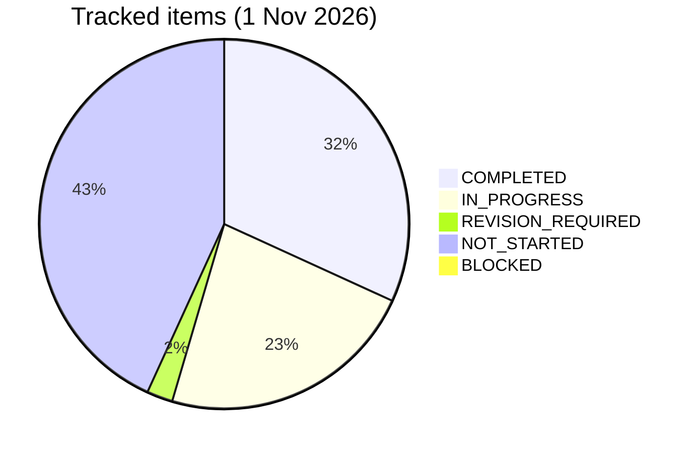

# 🗄️ Progress archive · 23 Oct – 21 Nov 2026

> [!NOTE]
> Moved out of [PROGRESS.md](../PROGRESS.md) on 24 Nov 2026 to keep the live tracker short. Nothing was rewritten: these are the original rows, in the original order. Newer rows keep going into PROGRESS.md; at the end of each month the old ones move here (or into a new `progress-YYYY-MM.md`).

## 📝 Evening scores, 1–21 Nov 2026

| Date | 🌱 Spring | 🧩 DSA | 🐞 Buggy | Evidence |
|---|---|---|---|---|
| Sun 1 Nov | **7** (concept 8 · implementation 6 · problem solving 7 · interview 7) | not scored, no work | not scored, no work | Day 04 re-answers 26/30; `f4cb8b9` four `ProblemDetail` handlers, `course-practice` 11/15; `CarFleet` 2/37 and `Day04LargestRectangle` 15/36 untouched · [day10.md evening](tasks/day10.md#-evening-1-nov-review-scores-and-tonights-work) |
| Mon 2 Nov | not scored, no work | not scored, no work | not scored, no work | no pushes from Prashant today (only the 6 AM session commit `f1dd0e5`); all suites unchanged (`course-practice` 11/15, `CarFleet` 2/37, `Day04LargestRectangle` 15/36, redos 0/44 and 0/18) · [day11.md evening](tasks/day11.md#-evening-2-nov-review-scores-and-tonights-work) |
| Mon 2 Nov, late push (22:35 IST) | **6** (concept 6 · implementation 6) | not scored, no work | not scored, no work | `0600df2`: B2 handler, 4 assertions moved, 3 tests; as pushed 16/18; with Lumi's minor fixes `3d85c55` 18/18; catch-all handler is a conceptual miss; `CarFleet`, `Day04LargestRectangle` and both redos untouched · [day11.md late push review](tasks/day11.md#-late-push-review-2-nov-2235-ist) |
| Tue 3 Nov, midday push (17:37 IST) | not scored, no work | **7** (concept 8 · implementation 8 · problem solving 6) | not scored, no work | `91cb817`: `CarFleet` 2/37 → **37/37** (clean `long` cross-multiply, sorted copy, input untouched); needed several hints for the pairing and the exact comparison; complexity not stated yet (skipped); `course-practice` 18/18, `Day04LargestRectangle` 15/36, redos 0/44 and 0/18 unchanged · [day12.md midday push review](tasks/day12.md#-midday-push-review-3-nov-1737-ist) |
| Tue 3 Nov, evening review (8 PM) | not scored, no work | **7** (unchanged, no new evidence since `91cb817`) | not scored, no work | `CarFleet` 37/37 re-verified; `course-practice` 18/18 (catch-all open), `Day04LargestRectangle` 15/36, redos 0/44 and 0/18; no pushes after 17:37 IST; owed: 3 comment lines, catch-all fix, symptom table · [day12.md evening](tasks/day12.md#-evening-3-nov-review-scores-and-tonights-work) |
| Tue 3 Nov, late push (22:39 IST) | **6** (concept 6 · implementation 7 · problem solving 6 · interview 6), scored in the 4 Nov evening review | not scored, no work | not scored, no work | `ff79dbf` + Lumi's tidy-ups `5918263`, `80d98f1` (23:08 and 23:15 IST), pushed after the 10 PM check: `course-practice` **19/19**; catch-all fixed for 405/415, still 500 for `/abc` and an unknown path; reviewed in [day13.md](tasks/day13.md#-morning) |
| Wed 4 Nov, evening review (8 PM) | not scored again (no new Spring work; last score 6) | not scored, no work (last 7) | not scored, no work | no commit from Prashant today (only the 6 AM session commit `4d1db80`); suites unchanged: `course-practice` 19/19, `CarFleet` 37/37, `Day04LargestRectangle` 15/36, redos 0/44 and 0/18; Drill 1, module 1 step 1, the `CarFleet` comment lines and the RPN redo all open · [day13.md evening](tasks/day13.md#-evening-4-nov-review-scores-and-tonights-work) |
| Thu 5 Nov, evening review (8 PM) | **7** (concept 7 · implementation 7 · problem solving 7 · interview 6) | **8** (concept 8 · implementation 9 · problem solving 7 · complexity 7 · interview 7) | **7** (concept 7 · implementation 9 · debugging 7 · interview 6) | `1c9c6aa` + `7b7c725` Drill 1, `course-practice` **23/23**; `800ad4f` cold RPN **44/44** no hint; count-stack re-ask closed; `d8306e2` `Day04LargestRectangle` **36/36**; `CarFleetTest` 37/37 re-run; `ValidParenthesesRedoNov01Test` 0/18 (not attempted yet) · [day14.md evening](tasks/day14.md#-evening-5-nov-review-scores-and-tonights-work) |
| Fri 6 Nov, catch-up evening review (~8:30 PM) | **unscored** (⬜ no labs push) | **6** (concept 7 · implementation 6 · problem solving 5 · complexity 8 · interview 6) | **7** (concept 7 · implementation 9 · debugging 6 · interview 6) | Tip `ec608e3`: `Day00BuggyExampleTest` **10/10**, `ValidParenthesesRedoNov01Test` **17/18**, `ValidParenthesesTest` 2/2, `CarFleetTest` 37/37, `DailyTemperaturesTest` 0/18, `MinStackRedoNov01Test` 0/10, `Day04LargestRectangleTest` 36/36; labs Ch 1 ⬜; PR #1 open · [day15.md evening](tasks/day15.md#-evening-6-nov-catch-up-review-routine-missed-8-pm) |
| Sat 7 Nov, evening review (~8:00 PM) | **unscored** (⬜ no labs push) | **6** (concept 7 · implementation 8 · problem solving 4 · interview 6) | **7** (concept 7 · implementation 9 · debugging 7 · interview 6) | Tip `f61c7d3`: ValidParen redo **18/18** (`3019054`, post-feedback 🔶); LargestRect write-up graded in chat (supported); `MinStackRedo` 0/10; `DailyTemperatures` 0/18; `CarFleet` 37/37; labs Ch 1 ⬜ · [day16.md evening](tasks/day16.md#-evening-7-nov-review-scores-tonight-and-tomorrow) |
| Sun 8 Nov, evening review (~7:58 PM) | **unscored** (⬜ no labs push) | **unscored** (⬜ no work today) | **unscored** (⬜ no work today) | Tip `73a1fd7`: no student commits or chat answers after the 6 AM session; last student code `3019054`. Re-verified: ValidParen redo **18/18**, `ValidParentheses` 2/2, `CarFleet` 37/37, `Day04LargestRectangle` 36/36, `Day00` 10/10, RPN redo 44/44, `DailyTemperatures` **0/18**, `ValidParenthesesRedoNov08` **0/18**, `MinStackRedo` **0/10**. Labs still `507aaa3`, no `my-solutions` · [day17.md evening](tasks/day17.md#-evening-8-nov-review-scores-tonight-and-tomorrow) |
| Mon 9 Nov, evening review (~8:00 PM) | **unscored** (⬜ no labs push) | **unscored** (⬜ no work today) | **unscored** (⬜ no work today) | Tip `8634131`: no student commits or chat answers after the 6 AM session; last student code `3019054`. Full `mvn test` 514 run, 46 red = exactly the three stubs (`DailyTemperatures` 0/18, `ValidParenthesesRedoNov08` 0/18, `MinStackRedo` 0/10); all else green. Labs still `507aaa3`, no `my-solutions`. Second straight day with no work · [day18.md evening](tasks/day18.md#-evening-9-nov-review-scores-tonight-and-tomorrow) |
| Tue 10 Nov, evening review (~8:00 PM) | **unscored** (⬜ no labs push) | **unscored** (⬜ no work today) | **unscored** (⬜ no work today) | Tip `dc71902`: no student commits or chat answers after the 6 AM session; last student code `3019054`. Full `mvn test` 514 run, 46 red = exactly the three stubs; all else green. Labs still `507aaa3`, no `my-solutions`. Third straight day with no work; slower pace offered · [day19.md evening](tasks/day19.md#-evening-10-nov-review-scores-tonight-and-tomorrow) |
| Wed 11 Nov, evening review (~8:00 PM) | **unscored** (⬜ no labs push) | **unscored** (⬜ no work today) | **unscored** (⬜ no work today) | Tip `fae7a26`: no student commits or chat answers after the 6 AM session; last student code `3019054`. Full `mvn test` 514 run, 46 red = exactly the three stubs; all else green. Labs still `507aaa3`, no `my-solutions`. Fourth straight day with no work, including the lighter day; one-slot days start 12 Nov · [day20.md evening](tasks/day20.md#-evening-11-nov-review-scores-tonight-and-tomorrow) |
| Thu 12 Nov, evening review (~8:00 PM) | **unscored** (⬜ no labs push) | **unscored** (⬜ resting) | **unscored** (⬜ resting) | Tip `3df22ff`: no student commits or chat answers after the 6 AM session; last student code `3019054`. Full `mvn test` 514 run, 46 red = exactly the three stubs. Labs still `507aaa3`, no `my-solutions`. Fifth straight day with no work; Fri 13 Nov block shrinks to 15 min · [day21.md evening](tasks/day21.md#-evening-12-nov-review-scores-tonight-and-tomorrow) |
| Thu 12 Nov, late push (8:04 PM IST) | **7** (concept 8 · implementation 8 · debugging 6) | **unscored** (⬜ resting) | **unscored** (⬜ resting) | labs `5c366dc` on `main` (one file, `lab/pom.xml`): `Chapter01CheckTest` **18/19** (was 1/19); Tasks 2-6 all green; only `task1c` red (version left at `0.0.1-SNAPSHOT`); h2 `groupId` has a leading space (Maven trims it); `dependency:tree` BUILD SUCCESS, `maven.compiler.release` 21; interview Q not answered · [day21.md late push](tasks/day21.md#-late-push-review-12-nov-804-pm-ist-first-spring-boot-labs-push) |
| Thu 12 Nov, late push 2 (9:01 PM IST) | unchanged (7, labs not touched) | **8** (concept 8 · implementation 10 · problem solving 6 · complexity 9) | **unscored** (⬜ width sentence still open) | `d6ca103` on `main`: `DailyTemperaturesTest` **18/18**, `ValidParenthesesRedoNov08Test` **18/18**, `MinStackRedoNov01Test` **10/10**; full `mvn test` **514 run, 0 red**; both redos clean cold → +3; pseudocode/brute-force comments not written · [day21.md late push 2](tasks/day21.md#-late-push-review-12-nov-901-pm-ist-dailytemperatures--both-redos) |
| Thu 12 Nov, labs re-check (10:26 PM IST) | **8** (concept 8 · implementation 9 · debugging 7), up from 7 | unchanged (8) | unchanged | labs `4384b9c` (`lab/pom.xml` +2/−2: version → `0.1.0-SNAPSHOT`, h2 `groupId` space removed): `Chapter01CheckTest` **19/19**, 0 errors, 0 skipped; `dependency:tree` root `ledgerly-core:0.1.0-SNAPSHOT`; fix followed feedback; interview Q still open · [day21.md late re-check](tasks/day21.md#-late-labs-re-check-12-nov-1026-pm-ist-chapter-1-fix) |
| Fri 13 Nov, evening review (~8:00 PM) | **unscored** (⬜ no work today; last 8) | **unscored** (⬜ resting; last 8) | **unscored** (⬜ resting) | Tip `f46e9f5`: no student commits in either repo, no chat answers; labs Ch1 19/19, Ch2 0/19 re-run on JDK 21 · [day22.md evening](tasks/day22.md#-evening-13-nov-review-scores-tonight-and-tomorrow) |
| Sat 14 Nov, evening review (~8:00 PM) | **unscored** (⬜ no work today; last 8) | **unscored** (⬜ resting; last 8) | **unscored** (⬜ resting) | Tip `7325500`: no student commits in either repo, no chat answers; last scores Spring 8, DSA 8, Buggy 7; suites stand (Ch1 19/19, Ch2 0/19, `mvn test` 514/0 red) · [day23.md evening](tasks/day23.md#-evening-14-nov-review-scores-tonight-and-tomorrow) |
| Sun 15 Nov, Ch 1 interview (~8:07-8:15 AM IST) | interview **7/10**; Spring score stays **8** | unchanged (8) | unchanged | Chapter 1 ✅ closed (tasks already 19/19). Part 1 BOM with a hint, part 2 upgrade risk + tests with a hint, part 3 scopes corrected then examples right. A chat answer is not a push day · [day24.md interview](tasks/day24.md#-chapter-1-interview-grade-807-815-am-ist) |
| Sun 15 Nov, Ch 2 Task 1 (`1ded3b3`, 8:35 AM IST) | **9** (concept 9 · implementation 10 · debugging n/a), up from 8 | unchanged (8) | unchanged | labs `my-solutions` `1ded3b3` (`AccountController` `@GetMapping("/status")` → `"Ledgerly is open"`): `Chapter01CheckTest` 19/19, `Chapter02CheckTest` **3/19** (task1a/b/c green; 405 from Spring default, no extra handler); tasks 2-6 not started (`task2a_list` 404). First unprompted Spring-defaults win. **Second push day** (first was 12 Nov); normal plan returns Mon 16 Nov · [day24.md Task 1](tasks/day24.md#-chapter-2-task-1-grade-1ded3b3-835-am-ist) |
| Sun 15 Nov, evening review (~8:00 PM) | **8** for the day (code 9 · explain-it 7) | **unscored** (⬜ resting; last 8) | **unscored** (⬜ resting; last 7) | Tip `fd7b9eb`: no student commits after `1ded3b3`; re-verified `Chapter01CheckTest` 19/19, `Chapter02CheckTest` 3/19; no new weak topic (scopes stays 🟡); redo-schedule unchanged · [day24.md evening](tasks/day24.md#-evening-15-nov-review-scores-tonight-and-tomorrow) |
| Sun 15 Nov, late chat (~10:00-10:27 PM IST) | scopes taught, not graded (recall retry Mon 16) | unchanged (8) | sentence **8/10** after a correction; buggy score stays **7** | LargestRect empty-stack width ✅ closed. First sentence had the comparison backwards; `[2,1,2]` pop flow right but height came from the current bar. After a correction: empty stack → width is `i` because no bar to the left is smaller than the popped one. Mistake logged: height from the popped bar · [day24.md late chat](tasks/day24.md#-late-chat-1000-1027-pm-ist-scopes-grid--largestrect) |
| Mon 16 Nov, evening review (~8:00 PM) | **8** (concept 7 · implementation 9 · problem solving 8 · interview 7) | **unscored** (copied redos are not evidence; `GenerateParentheses` 0/17 untouched; last 8) | **unscored** (`DailyTemperatures` comments not pushed; last 7) | Re-verified on fresh clones: labs `Chapter02CheckTest` **7/19** (`8f48e9b`), `ScoreOfParenthesesRedoNov16Test` 37/37 and `RemoveKAdjacentDuplicatesRedoNov16Test` 26/26 (both copied, 🔶 2/10 each, graded in the afternoon, not double-counted), `GenerateParenthesesTest` 0/17. New Spring mistake: query string in a path pattern. Weak packs generated for `@RequestParam`, HTTP semantics, `ResponseEntity` · [day25.md evening](tasks/day25.md#-evening-16-nov-review-scores-tonight-and-tomorrow) |
| Mon 16 Nov, late chat (~9:05 PM IST) | scopes recall **10/10**, WAR MCQ ❌; Spring score stays **8** | unchanged (unscored) | unchanged (unscored) | Grid from memory, 12/12 cells, no hint. MCQ: servlet API at `compile` in a WAR for an external Tomcat picked C; answer B (the WAR ships its own servlet-api copy next to Tomcat's, and they can clash). Logged as a conceptual mistake |
| Tue 17 Nov, evening review (~8:00 PM IST) | **6** | **8** (`GenerateParentheses` 17/17, 9/10) | **unscored** (`Day05DecodeString` 12/25 untouched) | labs `393608c` (7:43 PM IST) Ch 2 **12/19**: Task 4 exact (fixes the 16 Nov path-pattern mistake); Task 5 `Math.min(amount / 100, 10)` for a minimum fee, `task5a`-`c` red although the commit said completed → [mistakes/spring.md](../revision/mistakes/spring.md). `ContainsDuplicate` 0/17, both redos untouched. Records recovered 18 Nov morning (last night's push did not land) · [day26.md evening](tasks/day26.md#-evening-17-nov-review-scores-tonight-and-tomorrow) |
| Tue 17 Nov, 10 PM check | **7** (up from 6 after the fix) | unchanged (8) | unchanged (unscored) | labs `00bd2eb` (9:33 PM IST): `Math.max` + `defaultValue = "false"` → `Chapter02CheckTest` **15/19** on a fresh clone, only Task 6 red; redos not attempted, queue moved one day · [day26.md end of day](tasks/day26.md#-end-of-day) |
| Wed 18 Nov, evening review (~8:00 PM IST) | **unscored** (no work today; last 7) | **unscored** (`ContainsDuplicate` 0/17 untouched; last 8) | **unscored** (`Day05DecodeString` 12/25, comments not pushed; last 7) | No student commits today in either repo and no chat answers; fresh-clone re-run unchanged: labs `Chapter02CheckTest` 15/19 (Task 6 red), `ContainsDuplicateTest` 0/17, `Day05DecodeStringTest` 12/25, redos 0/37 + 0/28. No new weak topic, no blocker · [day27.md evening](tasks/day27.md#-evening-18-nov-review-scores-tonight-and-tomorrow) |
| Wed 18 Nov, 10 PM check | unchanged (unscored; last 7) | unchanged (unscored; last 8) | unchanged (unscored; last 7) | No student commits after the evening review (labs `00bd2eb`, this repo `221069b`). Chat 8:20 PM IST: Task 6 location answered (`LedgerlyApplication.java`); findability, not a concept gap. Redos not attempted → queue moved one day · [day27.md end of day](tasks/day27.md#-end-of-day) |
| Thu 19 Nov, evening review (~8:00 PM IST) | **6** (concept 5 · implementation 8 · problem solving 6 · interview: not answered) | **6** (concept 6 · implementation 8 · problem solving 5 · complexity 5 · interview 5) | **7** (concept 8 · implementation 9 · debugging 6 · interview 5) | Fresh clones, JDK 21: labs `b4a3717` Ch 2 **19/19** (Task 6 = one annotation, day-3 skeleton + location given in chat; interview Q and KCs unanswered). `eeb8bb9` ContainsDuplicate **17/17** (skeleton 🔶); ValidAnagram first push used a char sum (conceptual), fixed `97dbc9f` → **18/18**. `c61da8e` DecodeString **25/25** (3 minimal fixes + `k` clamp; no symptom-group write-up). Redo `2c0c2fb` Day03 **37/37** clean cold → +3. Suite **719 run, 28 red = only the untouched Asteroid redo stub**. DailyTemperatures comments still not pushed · [day28.md evening](tasks/day28.md#-evening-19-nov-review-scores-tonight-and-tomorrow) |
| Thu 19 Nov, 10 PM check | unchanged (6) | unchanged (6) | unchanged (7) | No student commits after the evening review (labs `my-solutions` still `b4a3717`; this repo's student code still `b207444`, tip `4242f4b` = the evening-review commit); no answers in chat. Lumi removed the unused `import java.util.Arrays` from `ValidAnagram.java` (cosmetic), re-run 18/18. Asteroid redo → Fri 20 Nov |
| Fri 20 Nov, evening review (~8:00 PM IST) | **7** (concept 6 · implementation 9 · problem solving 7 · interview 5) | **unscored** (no work today; last 6) | **unscored** (no work today; last 7) | Labs `my-solutions` `e619f82` (1:04 PM IST): `Chapter03CheckTest` **15/15** on a fresh clone, all six tasks first push, no hint; written interview answer 5/10 (thread-safety fix wrong, logged); Ch 2 Task 6 answer still owed. This repo: no student commits (`TwoSum` 0/19, `Day06` 6/20, redo stubs 0/28 + 0/37) · [day29.md evening](tasks/day29.md#-evening-20-nov-review-scores-tonight-and-tomorrow) |
| Sat 21 Nov, evening review (~8:05 PM IST) | **unscored** (no work today; last 7) | **unscored** (no work today; last 6) | **unscored** (no work today; last 7) | No student commits today in either repo (labs `my-solutions` still `e619f82`; this repo still `a9ec0d4`) and no chat answers; morning re-run stands at 795 run / 98 red (`TwoSum` 0/19, `Day06` 6/20, redo stubs 0/28 + 0/37). No new mistakes or weak topics · [day30.md evening](tasks/day30.md#-evening-21-nov-review-scores-tonight-and-tomorrow) |
| Sat 21 Nov, 10 PM check | **7** (interview 7: Ch 2 Task 6 answer 7/10 in chat after two corrections, the only Spring evidence today) | **unscored** (no work today; last 6) | **5** (concept 4 · implementation 6 · debugging 6) | `41abb48` (9:21 PM IST) `Day06FirstUniqueCode` **16/20** re-run on the updated tree: validation and loop-start fixes right; the last loop mixes alphabet index with string position (conceptual, logged; 🔴 frequency counting missed twice); no symptom groups. Chat 9:38-9:40 PM IST: Ch 2 Task 6 answer 7/10 → **Chapter 2 ✅**. `TwoSum` 0/19, redo stubs 0/28 + 0/37 · [day30.md end of day](tasks/day30.md#-end-of-day) |

## 📅 Weekly reviews, 1–14 Nov 2026

### 📆 Weekly review · 1–7 Nov 2026

   

> [!IMPORTANT]
> First dated weekly performance review under [docs/PROGRAM.md](../docs/PROGRAM.md). Window **Sun 1 Nov 00:00 IST → Sat 7 Nov ~14:07 IST**. Sources only: commits, this file, [redo-schedule.md](../revision/redo-schedule.md), [mistakes/dsa.md](../revision/mistakes/dsa.md), [mistakes/spring.md](../revision/mistakes/spring.md), and evening sections in `tasks/day10.md`–`day16.md`. No live chat answers in this run — graded chat already recorded in those files is used. SQL stays retired and out of scope.

> [!NOTE]
> **Legend:** ✅ verified this week · 🔶 redo needed hint/fix · ❌ missed / not attempted · ⬜ `NOT_STARTED` · 🟡 `IN_PROGRESS` · 🔴 `REVISION_REQUIRED` · ⛔ `BLOCKED` · tip = mentor/session commit · student = Prashant's code. **Last week** for comparison = **Sun 25 Oct – Sat 31 Oct** (prior calendar week). Thin spots are named, not filled.

#### 📊 Verified items this week vs last week

| Track | Last week (25–31 Oct) | This week (1–7 Nov, through ~14:07 IST) | Evening-score trend (scored nights only) |
|---|---|---|---|
| 🌱 Spring Boot | **2** verified: Part A ✅ (28 Oct), Part B1 ✅ (31 Oct). Day 04 Q&A first attempt 15/30 🔴 | **2** verified: Day 04 Q1–Q3 re-answers ✅ 26/30 (1 Nov); Part B2 ✅ closed by Drill 1 (`1c9c6aa` + Lumi `7b7c725`, `course-practice` **23/23**, 5 Nov). **labs Ch 1** ⬜ (no student push on [`spring-boot-labs`](https://github.com/PrashantSury/spring-boot-labs); only mentor roadmap stubs 4 Nov on `main`; no `my-solutions` branch) | **7** (1 Nov) → **6** (2 Nov late) → **6** (3 Nov late, scored 4 Nov) → **7** (5 Nov) → **unscored** (6 Nov, no labs work). Unscored nights: 2 Nov day, 3 Nov evening, 4 Nov |
| 🧩 DSA (Stack) | **3** verified: `ScoreOfParentheses` ✅ (25 Oct), `RemoveKAdjacentDuplicates` ✅ (29 Oct), `AsteroidCollision` ✅ (31 Oct) | **1** verified: `CarFleet` ✅ **37/37** (`91cb817`, 3 Nov, hint-assisted). Count-stack re-ask ✅ in chat (5 Nov). CarFleet time/space reasons ✅ in chat (5–6 Nov; PR [#1](https://github.com/PrashantSury/java-switch-journey/pull/1) still open). **`DailyTemperatures`** still stub **0/18** (assigned 6 Nov, untouched on `ec608e3`) | unscored 1–2 Nov → **7** (3 Nov midday + evening) → unscored 4 Nov → **8** (5 Nov) → **6** (6 Nov). Dip on 6 Nov: ValidParen redo 🔶 + DailyTemps not started |
| 🐞 Buggy | **1** verified: `Day03NextGreaterIndex` ✅ (29 Oct). (Warm-up `Day00` and `Day04LargestRectangle` still open at week end) | **2** verified: `Day04LargestRectangle` ✅ **36/36** (`d8306e2`, 5 Nov); `Day00BuggyExample` ✅ **10/10** (`c0f5d64`, 6 Nov). Both missing written symptom / hand-trace localisation | unscored most nights → **7** (5 Nov) → **7** (6 Nov). Stable Moderate; debugging dimension held down by skipped write-ups |
| 🔁 Cold redos (separate) | `Day01ArrayStackRedo7` ✅ clean 17/17; `Day02RpnEvaluatorRedo7` ✅ after 3 review rounds (conceptual misses logged) | `Day02RpnEvaluatorRedoNov01` ✅ clean **44/44** no hint (`800ad4f`, 5 Nov) → +1→+3. `ValidParenthesesRedoNov01` 🔶 **17/18** (`c0f5d64`; null guard landed on original in `ec608e3`, not the redo) → same +1. `MinStackRedoNov01` ❌ **0/10** not attempted | Ladder: 1 clean step-up, 1 same-gap 🔶, 1 miss. Queue rebuilt from **7 Nov**: ValidParen then MinStack |

> [!NOTE]
> Tip commits this window include morning/evening/10 PM session reviews (`93f5dee`…`3584330`). Last **student** code on tip as of this review: **`ec608e3`** (6 Nov 09:03 IST). Re-verified just now: `Day00` 10/10, ValidParen redo 17/18, `ValidParentheses` 2/2, `CarFleet` 37/37, `Day04LargestRectangle` 36/36, RPN redo 44/44, `DailyTemperatures` 0/18, `MinStackRedo` 0/10, `course-practice` green.

#### 🔁 Redo results

| Result | Problems | Evidence |
|---|---|---|
| ✅ Clean cold | `Day02RpnEvaluator` (+1 → +3) | 5 Nov, `800ad4f`, 44/44, none of the 31 Oct slips repeated |
| 🔶 Needed fix / not cold-clean | `ValidParentheses` (stays +1) | 6 Nov, 17/18; post-feedback null→IAE still missing **in the redo file** |
| ❌ Missed / not attempted | `MinStack` (+1, never redone since 23 Oct) | stub 0/10 through 7 Nov 14:07 IST |
| Keep resetting / slipping | Redo **queue** (not one problem's gap) | 1–4 Nov: both due redos not attempted → queue moved day-by-day; ValidParen then deferred 5→6→7 Nov. Problems that remain overdue behind the cap: `ScoreOfParentheses`, `RemoveKAdjacentDuplicates`, `Day03NextGreaterIndex`, `AsteroidCollision`, `CarFleet`, `Day04LargestRectangle`, `Day00BuggyExample` (see [redo-schedule.md](../revision/redo-schedule.md)) |

#### 🧠 Recurring conceptual themes (showed up more than once)

| Theme | Where it showed (≥2 times) | Status now |
|---|---|---|
| Catch-all / Spring defaults: add a handler without asking what Spring already answers | 2 Nov `0600df2` (500 for 405/415/type mismatch); 3 Nov `ff79dbf` (405/415 fixed, `/abc` + unknown path still 500); closed 5 Nov Drill 1 by adding **only** the two missing handlers | 🟡 Moderate — code ✅ 23/23; one-sentence "why it hid Spring's answers" and B2 Q3/Q6 still unanswered |
| Null / empty input guards on stack code | 31 Oct RPN day-7 (null/empty); 6 Nov ValidParen redo (null→IAE missing in redo; guard put on the wrong file) | Still active on the redo ladder |
| Complexity "why" (amortised / where the cost comes from) | 29 Oct count-stack quiz 3/5; 3 Nov CarFleet needed hints for pairing + exact compare; reasons accepted in chat 5–6 Nov | 🟡 Moderate, improving; written reason sentences await PR #1 merge |
| Skipping written localisation after a green buggy fix | 5 Nov `Day04LargestRectangle` (symptom table + `[2,1,2]` trace skipped); 6 Nov `Day00BuggyExample` (no symptom groups) | Both write-ups still carried into Day 16 |

#### 🐢 Where he's lagging

| Item | Status | Evidence |
|---|---|---|
| `spring-boot-labs` Chapter 1 | 🟡 `IN_PROGRESS` (update 12 Nov) | Assigned Fri 6 Nov; first push `5c366dc` 12 Nov 8:04 PM IST: 18/19; fix `4384b9c` 10:26 PM IST: **19/19**; interview Q open |
| `DailyTemperatures` | 🟡 `IN_PROGRESS` (not started) | Stub **0/18** since assigned 6 Nov; blocks the next Stack problem |
| `Day04LargestRectangle` write-up | 🟡 carried | Code ✅ 36/36; symptom table + hand trace absent across day14–day16 |
| `ValidParenthesesRedoNov01` | 🟡 🔶 (same +1 gap) | 17/18; wrong-file patch `ec608e3` |
| `MinStackRedoNov01` | 🟡 not attempted | 0/10; due 7 Nov evening |
| Banking modules 1–10 | ⬜ (module 1 parked) | 0 of 10 started; Drills 2–3 parked behind labs |
| Days with no student code push | — | **Wed 4 Nov** (only tip morning `4d1db80`); **Sat 7 Nov** through 14:07 IST (only tip morning `3584330`). Mon 2 Nov had no daytime push (late 22:35 IST only) |
| vs Plan projection | Stack finish aimed **W3–W5**; W3 started 6 Nov with DailyTemps still 0/18 and labs Ch 1 ⬜ | New Stack throughput this week = 1 (`CarFleet`); foundation Spring closed B2 but the new labs slot has not started — Spring **slot time** is the clear bottleneck for W3 |

> [!NOTE]
> ⛔ Blockers table is still empty. Nothing outside the tasks is blocking; the lag is unfinished carried work and the redo queue, not an external blocker. No item is marked 🔴 `REVISION_REQUIRED` in the track tables this week (ValidParen redo is 🟡 with an 🔶 ladder result, not a graded REVISION_REQUIRED row).

#### 🛠️ Two or three concrete improvements for next week

| # | Improvement | Tied evidence | Suggested time-split |
|---|---|---|---|
| 1 | **Close the three carried openers before any new material:** LargestRectangle write-up → labs Ch 1 → DailyTemperatures (pseudocode first), each ending in a push even if red | Same three items open on day14, day15 and day16 tips; DailyTemps 0/18; labs 1/19 stub | Keep unfinished-first morning order; protect the **50 min Spring** slot — on 6 Nov that slot produced **no labs commit** while Day00 (buggy buffer) and a partial redo did land |
| 2 | **Evening redos: edit the redo file, cold, cap 2.** Finish ValidParen null→IAE **in `ValidParenthesesRedoNov01`**, then blank-file MinStack. Do not patch the original class to green a redo suite | `ec608e3` fixed `ValidParentheses.java` while redo stayed 17/18; MinStack 0/10 unused; queue already slipped 1–4 Nov | If morning leftovers eat the evening, still run **one** most-overdue redo (ValidParen) before stopping — better one clean ladder step than two misses |
| 3 | **Keep the Drill 1 habit in writing:** before adding a Spring handler / pom tag, one sentence on what the framework or parent already gives; for every buggy ✅, a symptom table before the next round | Catch-all theme (2–5 Nov); two green buggy rounds with no localisation (5–6 Nov) | ~5 min at the start of Spring and buggy slots — cheaper than another day of catch-all / carried write-ups |

### 📆 Weekly review · 8–14 Nov 2026

   

> [!IMPORTANT]
> Second dated weekly performance review under [docs/PROGRAM.md](../docs/PROGRAM.md). Window **Sun 8 Nov 00:00 IST → Sat 14 Nov ~14:10 IST**. Sources only: commits in this repo and in [`spring-boot-labs`](https://github.com/PrashantSury/spring-boot-labs), this file, [redo-schedule.md](../revision/redo-schedule.md), [mistakes/dsa.md](../revision/mistakes/dsa.md), [mistakes/spring.md](../revision/mistakes/spring.md), and the Morning, Evening and End of day sections of `tasks/day17.md`–`day23.md`. Graded chat already recorded in those files is used; nothing is invented. SQL stays retired and out of scope. **Data is thin this week:** all student work landed on one evening (Thu 12 Nov), so trends rest on one or two scored nights per track.

> [!NOTE]
> **Legend:** ✅ verified this week · 🔶 redo needed hint/fix · ❌ missed / not attempted · ⬜ `NOT_STARTED` · 🟡 `IN_PROGRESS` · 🔴 `REVISION_REQUIRED` · ⛔ `BLOCKED` · tip = mentor/session commit · student = Prashant's code. **Last week** = the [1–7 Nov review](#-weekly-review--17-nov-2026). Commits in the window: this repo **25** (1 student: `d6ca103`; 24 session records: 6 AM sessions, 8 PM evening reviews, 10 PM checks and the 12 Nov grading notes), `spring-boot-labs` **2** (both student: `5c366dc`, `4384b9c`, on `main`; no `my-solutions` branch). Between the two windows: `3019054` (7 Nov 2:11 PM IST, after last week's 2:07 PM cut-off) took the ValidParen redo to 18/18 🔶 post-feedback; it was graded in the 7 Nov evening and is counted in neither week.

#### 📊 Verified items this week vs last week

| Track | Last week (1–7 Nov) | This week (8–14 Nov, through ~14:10 IST) | Evening-score trend (scored nights only) |
|---|---|---|---|
| 🌱 Spring Boot | **2** verified: Day 04 re-answers 26/30; Part B2 ✅ via Drill 1 (`course-practice` 23/23) | **1** verified: labs **Chapter 1 tasks ✅ 19/19** (`5c366dc` 12 Nov 8:04 PM IST 18/19 → `4384b9c` 10:26 PM IST 19/19). Chapter 1 stays 🟡 only for the **interview question (task 4), unanswered** since 12 Nov. Chapter 2 0/19 (stub, not started) | last week 7 → 6 → 6 → 7 → unscored · this week **unscored** 8–12 Nov evenings (no labs push) → **7** (12 Nov 8:04 PM, debugging 6) → **8** (12 Nov 10:26 PM, debugging 7) → unscored 13 Nov. Best Spring score so far, from one evening |
| 🧩 DSA (Stack) | **1** verified: `CarFleet` 37/37 (hint-assisted) | **1** verified: **`DailyTemperatures` ✅ 18/18** (`d6ca103`, 12 Nov 9:01 PM IST, first push, amortised O(n) reason written unprompted). Brute force, re-scan question and 3–5 lines of pseudocode **skipped** | last week 7 → 8 → 6 → 6 · this week unscored 8–11 Nov (no work), 12 Nov evening (resting) → **8** (12 Nov late, problem solving 6) → unscored 13 Nov (resting) |
| 🐞 Buggy | **2** verified: `Day04LargestRectangle` 36/36; `Day00BuggyExample` 10/10 | **0**. No buggy commit or chat answer. Open item: LargestRect empty-stack width sentence + `[2,1,2]` ASCII (carried since 7 Nov); `Day00` symptom groups still absent | last week 7 → 7 · this week **unscored every night** (8–13 Nov); last score 7 (7 Nov). Data thin |
| 🔁 Cold redos (separate) | 1 clean (RPN 44/44), 1 🔶 (ValidParen 17/18), 1 ❌ (MinStack) | **2 clean**: `ValidParenthesesRedoNov08` **18/18** (null→IAE first try) and `MinStackRedoNov01` **10/10**, both cold on a one-slot day (`d6ca103`) → +1 → +3 | Ladder: 2 clean step-ups, 0 🔶, but **4 evenings missed** first (8–11 Nov) |
| **Total** | **5** verified + 1 clean redo | **2** verified + 2 clean redos | full `mvn test` **514 run, 0 red** after `d6ca103` (was 46 red = three stubs, 9–12 Nov) |

> [!NOTE]
> Re-checked at this review: no student commit in either repo after `4384b9c` (labs, 12 Nov 10:26 PM IST) and `d6ca103` (this repo, 12 Nov 9:01 PM IST); tip `364396b` (14 Nov 6:17 AM IST session record). Suites stand as recorded on 13–14 Nov: `mvn test` 514/0 red, labs `Chapter01CheckTest` 19/19, `Chapter02CheckTest` 0/19. No Chapter 1 interview answer is recorded in the repo.

#### 🔁 Redo results

| Result | Problems | Evidence |
|---|---|---|
| ✅ Clean cold | `ValidParentheses` (+1 → +3), `MinStack` (+1 → +3; first redo since 23 Oct) | 12 Nov `d6ca103`: 18/18 and 10/10 on blank files, no hint, no post-push fix; the 7 Nov null-guard miss did not come back. Both queued Thu 19 Nov |
| 🔶 Needed fix | none this week | (7 Nov `3019054` 🔶 sits between the windows, see note above) |
| ❌ Missed / not attempted | the same pair, **4 evenings in a row** (8, 9, 10, 11 Nov) = 8 missed redo slots | queue moved one day at each 10 PM check (day17–day20 end of day); on hold on one-slot days from 12 Nov |
| Keep slipping (overdue, never redone) | `ScoreOfParentheses` (due 26 Oct), `RemoveKAdjacentDuplicates` (30 Oct), `Day03NextGreaterIndex` (30 Oct), `AsteroidCollision` (1 Nov), `CarFleet` (4 Nov), `Day04LargestRectangle` (6 Nov), `Day00BuggyExample` (7 Nov), `Day01ArrayStack` (+7, 7 Nov), `Day02RpnEvaluator` (+3, 8 Nov) | **9 of 12** ladder items are overdue. `ScoreOfParentheses` + `RemoveKAdjacentDuplicates` were first in line on 14 Nov but wait for the normal plan. No problem reset to day 1 this week (no ❌ conceptual slip) |

#### 🧠 Recurring themes (showed up more than once)

> [!NOTE]
> No new row in [mistakes/dsa.md](../revision/mistakes/dsa.md) (last 3 Nov) or [mistakes/spring.md](../revision/mistakes/spring.md) (last 2 Nov) this week, and every miss graded this week was called a process gap, not a conceptual one. So there is **no new conceptual theme**; the two below are process habits that repeat across weeks.

| Theme | Where it showed (≥2 times) | Status now |
|---|---|---|
| Pushing before a final self-check; the fix comes after feedback | 12 Nov `5c366dc` 18/19 with the red `task1c` message naming the fix → `4384b9c` after feedback (debugging 6 → 7); 7 Nov `3019054` ValidParen 🔶 post-feedback; 6 Nov null guard put on the wrong file (`ec608e3`); 2 Nov B2 contract changed without its tests | 🟡 active; the two cold redos on 12 Nov were green on the first push, so it is not every time |
| Skipping the written thinking step (pseudocode, brute force, complexity reasons, write-ups) | 12 Nov `DailyTemperatures`: brute force + pseudocode skipped (problem solving 6); 12 Nov ValidParen redo: complexity lines without reasons (cosmetic); 3 Nov `CarFleet` complexity skipped; 5–6 Nov buggy symptom table / `Day00` groups skipped | 🟡 active; LargestRect width sentence and `Day00` groups still carried |
| Complexity "why" (improving, not a slip this week) | 29 Oct count-stack quiz 3/5 → 5 Nov re-ask ✅ → 12 Nov `DailyTemperatures` and `MinStack` reasons written unprompted | 🟢 trending to Strong; stays 🟡 in Weak topics until a quiz confirms |

#### 🐢 Where he's lagging

| Item | Status | Evidence |
|---|---|---|
| Days with no student activity | — | **5 of 6 full days** (Sun 8, Mon 9, Tue 10, Wed 11, Fri 13 Nov) had no student commit in either repo and no graded chat answer; Sat 14 Nov also none through ~14:10 IST. Thu 12 Nov had all of the week's work (3 commits between 8:04 and 10:26 PM IST). Last week: 1 full day (Wed 4 Nov) + Sat 7 Nov morning |
| 🔴 `REVISION_REQUIRED` / ⛔ `BLOCKED` | none new | No track-table item is 🔴; Blockers table empty. The three 🔴 Weak Spring topics (HTTP semantics, `ResponseEntity`, `@PathVariable`) are still un-packed, parked until Chapter 2 |
| labs Chapter 1 interview question | 🟡 carried 3 days | asked 12 Nov; must-do on 13 and 14 Nov; unanswered |
| labs Chapter 2 | ⬜ `NOT_STARTED` | `Chapter02CheckTest` 0/19; optional on 13–14 Nov; `my-solutions` branch never created |
| `Day04LargestRectangle` width sentence + `[2,1,2]` ASCII | 🟡 carried since 7 Nov | buggy track has no other open work, so the whole track is idle behind it |
| `DailyTemperatures` pseudocode / brute-force comments | 🟡 carried | asked 9–12 Nov; code went in without them |
| Older carried backlog | 🟡 / ⬜ | `CarFleet` single-pair follow-up + PR [#1](https://github.com/PrashantSury/java-switch-journey/pull/1) open; B2 Q3/Q6; `ScoreOfParentheses` follow-ups; Day 02/03 re-answers; banking module 1 + Drills 2–3 parked |
| Plan mode | one-slot days since Thu 12 Nov | the normal plan needs a second push day; none on 13 Nov or 14 Nov so far |
| vs Plan projection (8 Nov refresh) | 🔻 behind on Spring and buggy, slow end on Stack | **labs** (sets the overall W8–W15): projection assumes 1–2 Spring slots a chapter, about 3.5–8.75 chapters a week; actual **1 chapter's tasks in 7 days**, 40 left → at this pace the W15 end is not reachable. **Stack** (4 left on 8 Nov, W4–W6 at 1.25–3.1 a week): 1 done, 3 left, on the slow end. **Buggy** (W5–W7 at 1.05–2.6 a week): 0 this week, behind |

#### 🛠️ Two or three concrete improvements for next week

| # | Improvement | Tied evidence | Suggested time-split |
|---|---|---|---|
| 1 | **One small push every day, even red.** The one active evening produced 3 commits and 4 green suites (19/19, 18/18, 18/18, 10/10); the gap is how many days start, not ability. Smallest unit: the next labs task on `my-solutions`, pushed | 5 of 6 full days with no student commit; 8 redo slots missed 8–11 Nov; one-slot mode since 12 Nov | On a busy day, the 15-min one-slot block is the floor, not zero |
| 2 | **Run the check and read the red line before pushing.** `mvn -pl chapters/NN-… test` (or `-Dtest=…`) until green; aim for the first push green, like both cold redos were | `5c366dc` 18/19 whose failure named the fix; 7 Nov ValidParen 🔶 post-feedback; debugging is the lowest Spring dimension (6 → 7) | ~2 min at the end of each slot |
| 3 | **Write first, then code; close the one-sentence items.** 3–5 lines of pseudocode + the brute force before Java on the next Stack problem; answer the Chapter 1 interview question and the LargestRect width sentence in chat before new material | `DailyTemperatures` problem solving 6 (steps skipped); interview Q open 3 days; width sentence open 7 days; buggy track idle all week | First 5 min of the DSA slot; chat answers fit the evening |

> [!TIP]
> **Time-split suggestion (not a schedule change):** `spring-boot-labs` is the bottleneck: it sets the overall finish and moved 1 chapter this week against a 3.5+ chapter-a-week assumption, while buggy has only a write-up open. For next week, about **Spring 60 / DSA 30 / buggy 10** minutes of the morning, with buggy's 10 minutes spent on the width sentence until a new round is assigned, and the evening hour kept for review + the two most overdue redos. Revisit at the next weekly review.


## 📝 Log, 23 Oct – 21 Nov 2026

| Date | Week/Day | Done | Notes |
|------|----------|------|-------|
| 23 Oct 2026 | W1 D1 | Valid Parentheses (understood); Min Stack done, 10/10 tests passing | Two-stack approach, O(1) ops. Next: space-optimized version (push to mins only when x <= min) |
| 25 Oct 2026 | W1 D3 | ScoreOfParentheses 37/37 (c909bb8) | Got help writing; dry-ran line by line. Follow-up Qs pending |
| 26 Oct 2026 | W1 D4 | Day 03 Spring Part A pushed (11dfcc8) | Needs correction: /search, DELETE 204, tests |
| 26 Oct 2026 | — | Backlog reconciliation | This file + interview-answers.md |
| 27 Oct 2026 | W1 D5 | Morning round assigned (backlog only) | Day 03 Part A corrections + Day02 RPN redo stub. No new buggy round (Day 03/04 unattempted), no new Spring task (`3/`4 open) |
| 27 Oct 2026 | W1 D5 | Spring Part A mostly fixed (27b70d6, bddf14c); RPN redo 44/44 but not from memory | Evening: backlog only — RemoveKAdjacentDuplicates + SQL 03 Q1. Verified with `mvn test` (328 tests; my finished classes all green) |
| 27 Oct 2026 | W1 D5 | 10 PM check: no new pushes after the evening assignment | `RemoveKAdjacentDuplicates` still 0/26, no `sql/day03-answers.md`; both carried to Day 06 evening. Re-verified: Day02RpnEvaluator 44/44, Redo 44/44 (🟠 Attempted), StudentControllerTest 9/9 |
| 28 Oct 2026 | W1 D6 | Morning round assigned (backlog only) | Finish Part A (2 tests + 2 clean-ups) + `Day01ArrayStackRedo` stub (0/17, verified 17/17 against a correct version). No new buggy round (Day 03/04 unattempted), no new Spring task (`3/`4 open) |
| 28 Oct 2026 | W1 D6 | Day 03/04 Part A ✅ verified (af4f8e7, 6e3d6be, c047571); `Day01ArrayStackRedo` 17/17 ✅; Day 03 Q&A graded 17/30 | Verified with `mvn test`: `course-practice` 12/12, `Day01ArrayStackRedoTest` 17/17, `Day02RpnEvaluatorTest` 44/44, `Day02RpnEvaluatorRedoTest` 44/44 (still 🟠 Attempted, cold redo 31 Oct). `tasks/` moved to the repo root. `3/`4 Ready for revision (Q1/Q2 5/10); active section is now `5 |
| 28 Oct 2026 | W1 D6 | Evening session assigned (backlog only) | Re-checked at 8 PM: `RemoveKAdjacentDuplicatesTest` 0/26, no `sql/day03-answers.md`. Both assigned again in `tasks/day06.md` (renamed from `day06-morning.md`, now Morning + Evening). No new stub or SQL file (3 DSA not started, 5 SQL unanswered) |
| 28 Oct 2026 | W1 D6 | 10 PM check: no new pushes after the evening assignment | Re-verified with `mvn test`: `course-practice` 12/12, `Day01ArrayStackRedoTest` 17/17, `Day02RpnEvaluatorTest` 44/44, `Day02RpnEvaluatorRedoTest` 44/44. `RemoveKAdjacentDuplicatesTest` still 0/26, no `sql/day03-answers.md`; both carried to Day 07 evening. No new mistakes. Next: Day 04 Part B |
| 29 Oct 2026 | W1 D7 | Morning round assigned (backlog only) | Re-checked: no pushes since cf74132, `course-practice` still green (`StudentControllerTest` 11). Part B split: B1 (`@Size` message, `exists...` queries, 409, +2 tests) + Day 04 Q3 in [day07.md](tasks/day07.md). No new buggy round (Day 03/04 unattempted), no new Spring task (`5 open) |
| 29 Oct 2026 | W1 D7 | ✅ `RemoveKAdjacentDuplicates` 26/26 and `Day03NextGreaterIndex` 37/37 (2d36911, bcb37f3); SQL learn track lessons 01-05 added | 10 PM check: no pushes from me after the 8 PM evening assignment. Part B1 and Day 04 Q3 (morning), `AsteroidCollision` 8/28, SQL 03 Q1 and the `.postman` clean-up (evening) all carried. No new mistakes beyond the two logged this afternoon. Next: Part B1 on 30 Oct 6 AM |
| 30 Oct 2026 | W2 D8 | ✅ SQL learn lesson 01 5/5 (735056a); Spring revision workbook added (d12849e, 9bfb07d); morning round assigned (backlog only) | Ran the lesson 01 checker on a scratch Postgres: `LESSON 01 COMPLETE`, queries reviewed. No Spring push since c047571, so Part B1 is assigned again in [day08.md](tasks/day08.md) with the `Day01ArrayStackRedo7` day-7 redo (stub 0/17, tests verified 17/17 against a correct version). No new buggy round, no new Spring task (`5 open) |
| 30 Oct 2026 | W2 D8 | Evening session assigned (backlog only) | Re-checked at 8 PM with `mvn test`: no pushes since the morning, `AsteroidCollisionTest` 8/28, `Day01ArrayStackRedo7Test` 0/17, `CarFleetTest` 2/37, no `sql/day03-answers.md`. `AsteroidCollision`, SQL 03 Q1 and the `.postman` clean-up assigned in the Evening section of [day08.md](tasks/day08.md). No new stub or SQL file (2 DSA not started, 5 SQL unanswered) |
| 30 Oct 2026 | W2 D8 | 10 PM check: no new verified work | No pushes from me after the 8 PM evening assignment (only Markdown restyle commits today, presentation only). Part B1, `Day01ArrayStackRedo7` (0/17) and Day 04 Q3 carried to 31 Oct morning; `AsteroidCollision` 8/28, SQL 03 Q1 and the `.postman` clean-up carried to 31 Oct evening. No new mistakes. Next: Part B1 on 31 Oct 6 AM |
| 30 Oct 2026 | W2 D8 | 11:40 PM review of 6ddde32 + b26bfc8: `AsteroidCollision` 28/28 and SQL learn lesson 02 5/5, both 🔴 Needs correction (one-line fixes) | Ran `AsteroidCollisionTest` 28/28 and the lesson 02 checker 5/5 (`LESSON 02 COMPLETE`) on a scratch Postgres. Code is correct; review found a stray `+6` in the `AsteroidCollision` Javadoc and a missing `ORDER BY` in lesson 02 ex 1. Still not pushed: Part B1, `Day01ArrayStackRedo7` (0/17), Day 04 Q3, SQL 03 Q1, `.postman` clean-up. Logged in the mistake log |
| 31 Oct 2026 | W2 D8 | 12:15 AM review of f2e5a58 + 71a5f07: ✅ SQL learn lesson 02 5/5; Part B1 pushed, 🔴 Needs correction | Lesson 02 checker 5/5 (ex 1 now has `ORDER BY`). `course-practice` 14/14, `AsteroidCollisionTest` 28/28 but `+6` still in the Javadoc (🔴), `Day01ArrayStackRedo7Test` 0/17. B1: queries, 409 in create/update and 2 tests done; `@Size` has no `message`, no PUT-conflict test. Still pending: Redo7, Day 04 Q3, SQL 03 Q1, `.postman` untracking (both files still tracked, `.gitignore` lacks `postman/globals/`) |
| 31 Oct 2026 | W2 D8 | ✅ `AsteroidCollision` 28/28 after Lumi's cosmetic clean-up; mistake log split per section | Standing rules from Prashant: Lumi fixes cosmetic issues directly (removed `+6` and added braces in `AsteroidCollision`, removed the stale 409 comment in `StudentServiceImpl`); only conceptual mistakes are logged. Re-ran `AsteroidCollisionTest` 28/28 and `course-practice` 14/14. `revision/mistake-log.md` is now an index of `revision/mistakes/dsa.md`, `sql.md`, `spring.md`; the purely cosmetic rows (AsteroidCollision, Day03NextGreaterIndex hygiene) were dropped, all conceptual rows kept with their redo dates. Still his: B1 `@Size` message + PUT-conflict test, `Day01ArrayStackRedo7`, Day 04 Q3, SQL 03 Q1, `.postman` untracking |
| 31 Oct 2026 | W2 D8 | 12:35 AM review of c344203: ✅ Day 04 Part B1 15/15 | `@Size` message added and checked (a 1-char name returns `name must be between 2 and 50 characters`); PUT with another student's email → 409 test added and passing. `course-practice` 15/15. No cosmetic issues found. Still his: `Day01ArrayStackRedo7` (0/17), Day 04 Q3, SQL 03 Q1, `.postman` untracking |
| 31 Oct 2026 | W2 D8 | ✅ Housekeeping: `.postman/` and `postman/globals/` untracked | Done by Lumi at Prashant's request: `.gitignore` now lists `.postman/` and `postman/globals/` (a7ec8aa), and `.postman/resources.yaml` (f0b2c33) and `postman/globals/workspace.globals.yaml` (637e772) were deleted from the repo; `git ls-files` no longer lists them. His local copies are removed by his next `git pull`, so he copies them aside first (see [day08.md](tasks/day08.md)). `spring-boot/course-practice/postman/course-practice-students.postman_collection.json` stays tracked on purpose (a real collection, not workspace metadata) |
| 31 Oct 2026 | W2 D9 | Morning round assigned (backlog only) | Re-checked with `mvn test`: `Day01ArrayStackRedo7Test` 0/17. New stub `redo/Day02RpnEvaluatorRedo7.java` for the cold day-7 RPN redo (0/44, tests checked 44/44 against a correct version). Both in [day09.md](tasks/day09.md). No new buggy round (`Day04LargestRectangle` unattempted, two redos open), no new Spring task (`5 open, B2 next) |
| 31 Oct 2026 | W2 D9 | Review of d5c0ee9: ✅ `Day01ArrayStackRedo7` 17/17; 🔴 `Day02RpnEvaluatorRedo7` 15/44 Needs correction | Ran both suites with `mvn test`. ArrayStack: no conceptual issue. RPN: after an operator the code still runs `Integer.parseInt(token)` (27 `NumberFormatException`/"no result" failures), the end check pops and compares with `1` instead of `size() != 1`, and null/empty input is not guarded. Lumi removed the unused `java.awt.image` import and the stale `TODO` comments in both files. Logged in the DSA mistake log (redo 3 Nov) |
| 31 Oct 2026 | W2 D9 | Review of fe6827d: `Day02RpnEvaluatorRedo7` 43/44, still 🔴 Needs correction | Ran `Day02RpnEvaluatorRedo7Test` with `mvn test`: 43/44. Fall-through fixed with `else`, end check now `stack.size() != 1`, empty array now throws `IllegalArgumentException`. Only `nullArray` fails: `for (String token : tokens)` on a `null` array throws `NullPointerException`; it needs an explicit `tokens == null` check at the top. Chat quiz: he got the stack after `2 3 +` right (5); on the fall-through he first said it pushes the operator token and needed a hint that `parseInt` throws; he explained correctly that `pop()` returns the top value, so `pop() != 1` compares it with 1. No new cosmetic issues |
| 31 Oct 2026 | W2 D9 | Review of 37f6c11: ✅ `Day02RpnEvaluatorRedo7` 44/44 Completed and verified | Ran `Day02RpnEvaluatorRedo7Test` with `mvn test`: 44/44. The null guard `tokens == null \|\| tokens.length == 0` is in, so all three conceptual bugs are fixed. Lumi re-indented the method body and spaced the two helper methods (cosmetic). Redo dates in the DSA mistake log stay (3 Nov, 7 Nov) |
| 31 Oct 2026 | W2 D9 | 🔁 Spaced-repetition calendar added: [revision/redo-schedule.md](../revision/redo-schedule.md) | 11 DSA problems and buggy rounds (8 scheduled, 3 not started). Redos at +1, +3, +7, +14, +30 days from the last verified solve, at most 2 a day, most overdue first, a miss resets to +1. Mistake-log dates kept (`RemoveKAdjacentDuplicates` 1 Nov and 5 Nov, `Day02RpnEvaluator` 3 Nov and 7 Nov). Next 7 days: 1 Nov `RemoveK` + `Rpn`, 2 Nov `ValidParentheses` + `MinStack`, 3 Nov `Rpn` + `ScoreOfParentheses`, 4 Nov `Day03NextGreaterIndex` + `AsteroidCollision`, 5 Nov `RemoveK`, 6 Nov `Day01ArrayStack` + `ValidParentheses`, 7 Nov `Rpn` + `MinStack` |
| 31 Oct 2026 | W2 D9 | 🔮 Plan projection added (section above the Log) | 13 verified items in 9 days (DSA 5, buggy 3, SQL 2, Spring 2, banking 1; 3 cold redos on top). Remaining: NeetCode 148, buggy 2, SQL 8, Spring 8 sections, banking 4 milestones. 13 redos in the next 7 days (39% of study time). Estimated finish: Stack W3-W6, buggy W3-W5, SQL W4-W7, Spring W5-W7, banking W10-W17, overall W10-W17 (target W12). Refreshed every Sunday by the 10 PM check |
| 31 Oct 2026 | W2 D9 | 🔁 Redo schedule switched to results-based gaps (approved by Prashant): [revision/redo-schedule.md](../revision/redo-schedule.md) | Clean cold pass moves up one step (1 → 3 → 7 → 14 → 30); a hint or fix repeats the gap; a conceptual miss resets to day 1; two clean passes ≥14 days apart skip to 30; max 2 redos a day. Recomputed from real history: `Day01ArrayStack` clean 17/17 → +7, due 7 Nov; `Day02RpnEvaluator` 3 conceptual misses → day 1, due 1 Nov; never-redone items are due since 24-30 Oct and queued. Next 7 days: 14 redos (42% of study time); November 30 redos on 19 days (21%). Plan projection redo load and pace refreshed (Stack W3-W6, NeetCode by W12 about 15-55 of 150) |
| 31 Oct 2026 | W2 D9 | 🎤 Day 04 Q&A answered in chat and graded: 🔴 Needs correction, 15/30 (Q1 5/10 · Q2 4/10 · Q3 6/10) | Saved verbatim in [day04-answers.md](spring-boot/interview-answers/day04-answers.md), linked from [interview-answers.md](../interview-answers.md). Q1: missed `MethodArgumentNotValidException` (named the malformed-JSON exception). Q2: vague, mass assignment half-got, missed leaking internal fields or lazy relations and schema coupling. Q3: `ProblemDetail` and 400 vs 409 right, but not the race condition (unique constraint + `DataIntegrityViolationException` → 409). Conceptual rows for Q1 and Q3 added to `revision/mistakes/spring.md` (redo 3 Nov and 7 Nov). Re-answer all three by 3 Nov |
| 31 Oct 2026 | W2 D9 | Evening session assigned (backlog only) | Re-checked at 8 PM with `mvn test`: `CarFleetTest` 2/37, lesson 03 exercises empty, no `sql/day03-answers.md`. Assigned `CarFleet` and SQL learn lesson 03 in the Evening section of [day09.md](tasks/day09.md). `sql/day03.sql` Q1 moved after lesson 04 (needs GROUP BY + LEFT JOIN). No new stub or SQL file (2 DSA not started, 5 SQL unanswered) |
| 31 Oct 2026 | W2 D9 | 10 PM check: ✅ two cold day-7 redos verified today; no pushes after the 8 PM assignment | Today's verified work (`Day01ArrayStackRedo7` 17/17, `Day02RpnEvaluatorRedo7` 44/44) and the Day 04 Q&A grading (15/30, 🔴) were already recorded. No commits from me after the evening assignment, so `CarFleet` (2/37) and SQL learn lesson 03 carry to 1 Nov evening. No new mistakes. End of day added to [day09.md](tasks/day09.md). Next: `Day02RpnEvaluator` + `ValidParentheses` redos on 1 Nov 6 AM |
| 31 Oct 2026 | W2 D9 | 🗄️ SQL retired and archived (Prashant's decision: only Spring Boot, DSA and buggy rounds) | `sql/` moved to `archive/sql/` (history kept), the SQL mistake log to `archive/sql/mistakes-sql.md`, the lesson checker to `archive/sql/tests/` (out of `src/test/java`, so `mvn test` no longer needs PostgreSQL; the test-scope PostgreSQL dependency was removed from `pom.xml`). SQL removed from tracking, next task, the Plan projection and `tasks/day09.md`. Overall projection stays **W10-W17 (25 Dec-18 Feb)** because banking, not SQL, sets it; verified pace without SQL is 8.6 items a week (11 items in 9 days), and the freed ~25 min a day is not counted until the weekly reviews show it. Routines no longer assign SQL |
| 1 Nov 2026 | W2 D10 | 🧭 Repository restructured around the Senior Java Backend Interview Mentor program | Three tracks (Spring banking project, DSA by pattern, buggy rounds), 2 h morning + 1 h evening, statuses NOT_STARTED / IN_PROGRESS / COMPLETED / REVISION_REQUIRED / BLOCKED, [docs/PROGRAM.md](../docs/PROGRAM.md) and [banking-app/project-architecture.md](../banking-app/project-architecture.md) added, the four `day02-05-morning` files archived, `spring-boot/README.md` and `banking-app/STRUCTURE.md` removed (merged), `.gitignore` hardened, and the specs of every pending task rewritten with the new templates in [tasks/day09.md](tasks/day09.md) (Javadoc of `CarFleet`, `Day04LargestRectangle`, `Day00BuggyExample` updated, no code or test changed). Projection recomputed for 3 h a day: overall W10-W22 (28 Dec-23 Mar), Stack W3-W4. No SQL interview questions were found in the active files |
| 1 Nov 2026 | W2 D10 | 🌅 Morning session assigned (carried work only) in [day10.md](tasks/day10.md) | No pushes from me since the 31 Oct evening. Every track has an open item, so no new material: 🌱 Day 04 Q1-Q3 re-answers then Part B2, 🧩 `CarFleet` (2/37), 🐞 `Day04LargestRectangle` (15/36). New blank redo stubs `redo/Day02RpnEvaluatorRedoNov01.java` (0/44) and `redo/ValidParenthesesRedoNov01.java` (0/18, new stricter suite); both test classes verified green against a correct version, redos run in the evening |
| 1 Nov 2026 | W2 D10 | ✅ Day 04 Q1-Q3 re-answers graded in chat: 26/30, COMPLETED | Q1 8/10 (flow right; add `RequestResponseBodyMethodProcessor`, Jackson causes inside `HttpMessageNotReadableException`, `@Valid` vs `@Validated`), Q2 9/10 (mass assignment named; add lazy-loading and API versioning), Q3 9/10 (race condition and DB constraint; add RFC 9457 replaced 7807, check the constraint name before mapping to 409). Was 15/30 (5 / 4 / 6) on the first attempt. Day 04 Q&A set is now ✅; the three weak Spring topics move to 🟢 Strong |
| 1 Nov 2026 | W2 D10 | 🌱 Part B2 started: `f4cb8b9` (08:38 IST) converts 4 handlers to `ProblemDetail`; spec rewritten in [day10.md](tasks/day10.md#-day-04-part-b2-problemdetail-in-every-error-response) | Prashant said B2 was not clear in day10.md (it only linked to day09). Re-ran `mvn test` in `spring-boot/course-practice`: 11/15 green; the 4 failures are the old `$.error` / `$.name` assertions (`createInvalid`, `searchMissingName`, `updateNonExisting`, `deleteUnknown`), an expected contract change, not a regression. Still open: `HttpMessageNotReadableException` handler (malformed JSON gives a 400 with an empty body today), +3 tests, optional 500 handler |
| 1 Nov 2026 | W2 D10 | 🌙 Evening review: 🌱 Spring **7/10** (Moderate); 🧩 DSA and 🐞 buggy not scored (no work) | Ran the tests on `bc6df22` (JDK 21, Maven): `course-practice` 11/15 (same 4 old assertions), `CarFleetTest` 2/37, `Day04LargestRectangleTest` 15/36, `Day02RpnEvaluatorRedoNov01Test` 0/44, `ValidParenthesesRedoNov01Test` 0/18. No new conceptual mistakes; the unused `ResponseStatus` import is left for B2 item 3 (file is mid-edit). Weak-topic pack for amortised O(n) added. Tonight: B2 items 1-6, `CarFleet`, count-stack re-ask, then `Day04LargestRectangle` and the 2 redos if time. No redo graded, so [redo-schedule.md](../revision/redo-schedule.md) is unchanged |
| 1 Nov 2026 | W2 D10 | 10 PM check: no pushes after the 8 PM evening review; 🔮 Sunday plan projection refreshed | No commits from me after `bc6df22`, so nothing new to test. B2 (11/15), `CarFleet` (2/37), `Day04LargestRectangle` (15/36) and the count-stack re-ask carry to Mon 2 Nov; the two 1 Nov cold redos were not attempted and move to the 2 Nov evening, so [redo-schedule.md](../revision/redo-schedule.md) shifts one day (last graduation 30 Dec). Projection from 12 verified items in 10 days (8.4 a week): Stack W3-W5, buggy W4-W8, overall still **W10-W22 (29 Dec-21 Mar)**. No new mistakes. End of day added to [day10.md](tasks/day10.md). Next: Part B2 items 1-6 on 2 Nov 6 AM |
| 2 Nov 2026 | W2 D11 | 🌅 Morning session assigned (carried work only) in [day11.md](tasks/day11.md) | Re-ran on `5e49e42`: no pushes from me since `bc6df22`; `course-practice` 11/15, `CarFleetTest` 2/37, `Day04LargestRectangleTest` 15/36, `Day02RpnEvaluatorRedoNov01Test` 0/44, `ValidParenthesesRedoNov01Test` 0/18. Every track has an open item, so no new material and no new stubs: B2 items 1-6, `CarFleet`, `Day04LargestRectangle`, each with a first 10-minute step that ends in a push; the two 1 Nov redo stubs run tonight. No cosmetic fixes, no new mistakes |
| 2 Nov 2026 | W2 D11 | 🌙 Evening review: 🌱 Spring, 🧩 DSA and 🐞 buggy all **not scored** (no work today) | Ran the tests on `f1dd0e5` (JDK 21, Maven): no pushes from me today, `course-practice` 11/15, `CarFleetTest` 2/37, `Day04LargestRectangleTest` 15/36, `Day02RpnEvaluatorRedoNov01Test` 0/44, `ValidParenthesesRedoNov01Test` 0/18. No answers in chat, no cosmetic fixes, no new mistakes. Second day without a push, so tonight opens with a 10-minute `CarFleet` first step that ends in a push, then B2 items 1-6, `CarFleet` code, the count-stack re-ask, the `Day04LargestRectangle` symptom table and the 2 redos if time. No redo graded, so [redo-schedule.md](../revision/redo-schedule.md) is unchanged |
| 2 Nov 2026 | W2 D11 | 🌱 Late push `0600df2` (22:35 IST) reviewed: Part B2 handler and 3 tests; 🌱 Spring **6/10** (Moderate); 🧩 DSA and 🐞 buggy not scored | Ran the tests (JDK 21, Maven): `course-practice` **16/18** as pushed (2 red: a 404 test asserting 400 and a validation test sending no body), **18/18** after Lumi's minor fixes `3d85c55` (test request bodies and status as in the spec, test renamed to `notFoundIsProblemDetail`, one `ProblemDetail` layout). Conceptual, left to Prashant: `@ExceptionHandler(Exception.class)` returns 500 for a 415, a 405 and `/api/students/abc` (probed, not committed), with a copy-pasted message and no log. `CarFleetTest` 2/37, `Day04LargestRectangleTest` 15/36, redos 0/44 and 0/18 unchanged. Logged in [mistakes/spring.md](../revision/mistakes/spring.md); [redo-schedule.md](../revision/redo-schedule.md) unchanged (no DSA redo graded) |
| 3 Nov 2026 | W2 D12 | 🌅 Morning session assigned (carried work only) in [day12.md](tasks/day12.md) | Re-ran on `a302cd8`: `course-practice` 18/18 (after Lumi's `3d85c55`), `CarFleetTest` 2/37, `Day04LargestRectangleTest` 15/36, `Day02RpnEvaluatorRedoNov01Test` 0/44, `ValidParenthesesRedoNov01Test` 0/18. Every track has an open item, so no new material and no new stubs: `CarFleet` first 10-minute step pushed first, then the B2 catch-all handler + one 415/405 test + Q3/Q6 out loud, `CarFleet` to 37/37, `Day04LargestRectangle` symptom table; the two 1 Nov redo stubs run tonight. No cosmetic fixes, no new mistakes, [redo-schedule.md](../revision/redo-schedule.md) unchanged |
| 3 Nov 2026 | W2 D12 | 🧩 Midday push `91cb817` (17:37 IST) reviewed: `CarFleet` **37/37** ✅ (with hints); 🧩 DSA **7/10** (Moderate) | Ran the tests on `91cb817`: `CarFleetTest` 2/37 → 37/37, `course-practice` 18/18, `Day04LargestRectangleTest` 15/36, `Day02RpnEvaluatorRedoNov01Test` 0/44, `ValidParenthesesRedoNov01Test` 0/18 (all unchanged). Lumi's minor fixes (stale TODO, spacing, null-check message), no conceptual issue in the code; one chat-stage conceptual slip (integer division for the arrival time) logged in [mistakes/dsa.md](../revision/mistakes/dsa.md). `CarFleet` joins [redo-schedule.md](../revision/redo-schedule.md) as hint-assisted (+1, queued Tue 10 Nov). Open: the 3 comment lines on `CarFleet`, B2 catch-all, `Day04LargestRectangle` |
| 3 Nov 2026 | W2 D12 | 10 PM check: no pushes after the 8 PM evening review; redo queue moved one more day | No commits from me after the evening review (`28516c6` is the review itself; the only code push today is `91cb817`) and no answers in chat, so nothing new to test. `Day02RpnEvaluatorRedoNov01` (0/44) and `ValidParenthesesRedoNov01` (0/18) were not attempted again, so [redo-schedule.md](../revision/redo-schedule.md) shifts one more day (4 Nov starts with those two, `CarFleet` queued to 11 Nov, last graduation Mon 4 Jan). Open and carried: the 3 `CarFleet` comment lines and single-pair follow-up, the count-stack re-ask, the B2 catch-all fix with one 415/405 test, Q3 and Q6, the `Day04LargestRectangle` symptom table. No new mistakes, no cosmetic fixes. End of day added to [day12.md](tasks/day12.md) |
| 4 Nov 2026 | W2 D13 | 🌅 Morning session assigned in [day13.md](tasks/day13.md): Drill 1 (closes B2), banking module 1 step 1, carried DSA and buggy items | Re-ran on `80d98f1` (JDK 21, Maven): `course-practice` **19/19** after your `ff79dbf` (22:39 IST) and Lumi's tidy-ups `5918263`, `80d98f1` (pushed after the 10 PM check, so first reviewed here); probed on the pushed code: 405 (`PATCH`) and 415 are right, `GET /api/students/abc` and `GET /api/nothing` still answer 500 `Unexpected error`, so B2 stays 🟡 until Drill 1. `CarFleetTest` 37/37, `Day04LargestRectangleTest` 15/36, `Day02RpnEvaluatorRedoNov01Test` 0/44, `ValidParenthesesRedoNov01Test` 0/18 (unchanged). New stubs: `SpringDefaultsDrillTest` (3 red tests, `course-practice`) and `banking-app/.../auth/AuthSchemaIT` (2 red tests, compiles; Docker is not on the box, so it was not run there); no V2 file committed on purpose (Flyway checksums it). No cosmetic fixes, no new mistakes (the catch-all row of 2 Nov covers it), [redo-schedule.md](../revision/redo-schedule.md) unchanged |
| 4 Nov 2026 | W2 D13 | 🌙 Evening review (8 PM): no commit from me today besides the 6 AM session; 🌱 Spring **6/10** scored on the 3 Nov late push `ff79dbf`; 🧩 DSA and 🐞 buggy not scored (no work) | No new commits after `4d1db80`, so nothing new to run: `course-practice` 19/19, `CarFleetTest` 37/37, `Day04LargestRectangleTest` 15/36, `Day02RpnEvaluatorRedoNov01Test` 0/44, `ValidParenthesesRedoNov01Test` 0/18 (unchanged from 6 AM). Morning items all open (CarFleet comment lines, Drill 1, module 1 step 1, count-stack re-ask, RPN redo, symptom table). Tonight: comment lines, Drill 1, re-ask and single-pair follow-up, symptom table, `ValidParentheses` redo if time; module 1 step 1 and the RPN redo move to 5 Nov. RPN weak-topic pack added to [day13.md](tasks/day13.md). No cosmetic fixes, no new mistakes, [redo-schedule.md](../revision/redo-schedule.md) unchanged |
| 4 Nov 2026 | W2 D13 | 10 PM check: no pushes after the 8 PM evening review; redo queue moved one more day | No commits from me after the evening review (`210d691` is the review itself; the only other commit today is the 6 AM session `4d1db80`) and no answers in chat, so nothing new to test: `course-practice` 19/19, `CarFleetTest` 37/37, `Day04LargestRectangleTest` 15/36, `Day02RpnEvaluatorRedoNov01Test` 0/44, `ValidParenthesesRedoNov01Test` 0/18 stand from 6 AM. Both redos were not attempted again, so [redo-schedule.md](../revision/redo-schedule.md) shifts one more day (5 Nov starts with those two, `CarFleet` queued to 12 Nov, last graduation Tue 5 Jan). Open and carried: the 3 `CarFleet` comment lines and single-pair follow-up, Drill 1, module 1 step 1, the count-stack re-ask, the RPN redo, the `Day04LargestRectangle` symptom table, Q3 and Q6. No new mistakes, no cosmetic fixes. End of day added to [day13.md](tasks/day13.md) |
| 5 Nov 2026 | W2 D14 | 🌅 Morning session assigned (carried work only) in [day14.md](tasks/day14.md) | No commits from me since `75ecfde` and none from Prashant since `80d98f1` (3 Nov, 23:15 IST), so nothing new to run: `course-practice` 19/19 (`SpringDefaultsDrillTest` 3 red stubs), `CarFleetTest` 37/37, `Day04LargestRectangleTest` 15/36, `Day02RpnEvaluatorRedoNov01Test` 0/44, `ValidParenthesesRedoNov01Test` 0/18, `AuthSchemaIT` 2 red stubs. Every track has an open item, so no new material and no new stubs; the seven open items of [day13.md](tasks/day13.md) are re-ordered into six short steps (comment lines, Drill 1, re-ask, RPN redo, symptom table, module 1 step 1), the quick certain wins first. Redo due today: `Day02RpnEvaluatorRedoNov01` (morning), `ValidParenthesesRedoNov01` (evening). No cosmetic fixes, no new mistakes, [redo-schedule.md](../revision/redo-schedule.md) unchanged |
| 5 Nov 2026 | W2 D14 | 🌙 Evening review (8 PM): 🌱 Spring **7/10**, 🧩 DSA **8/10**, 🐞 Buggy **7/10**; B2 ✅, RPN redo ✅ (+1 → +3), `Day04LargestRectangle` ✅, count-stack re-ask closed | Ran on `d8306e2` (JDK 21, Maven): `course-practice` **23/23**, `CarFleetTest` 37/37, `Day02RpnEvaluatorRedoNov01Test` **44/44**, `Day04LargestRectangleTest` **36/36** (21 failing on `0a9a400`: 6 zero-height errors, 10 wrong widths, 5 `int` overflow), `ValidParenthesesRedoNov01Test` 0/18 (not attempted yet). Morning pushes: `1c9c6aa` (Drill 1 + `CarFleet` comment lines), `7b7c725` (Lumi's minor fixes), `800ad4f` (RPN), `d8306e2` (`LargestRectangle`). Skipped: symptom table, hand trace, module 1 step 1 (parked). No new conceptual mistakes; [redo-schedule.md](../revision/redo-schedule.md) updated (RPN +3, `LargestRectangle` joins at +1) and [mistakes/dsa.md](../revision/mistakes/dsa.md) redo cells marked |
| 5 Nov 2026 | W2 D14 | 10 PM check: no pushes after the 8 PM evening review; queue rebuilt from 6 Nov | No commits from me after `56ff10f` (the review itself; the last code push today is `d8306e2`) and no answers in chat, so nothing new to test: `course-practice` 23/23, `Day04LargestRectangleTest` 36/36, `Day02RpnEvaluatorRedoNov01Test` 44/44 stand from the evening, `ValidParenthesesRedoNov01Test` 0/18 not attempted, so no ladder step changed and [redo-schedule.md](../revision/redo-schedule.md) is rebuilt from Fri 6 Nov (`ValidParentheses` and `MinStack` first; last graduation Mon 4 Jan). Open and carried: the `Day04LargestRectangle` symptom table and `[2, 1, 2]` trace, the `CarFleet` reasons and single-pair follow-up, Q3 and the catch-all sentence; module 1 step 1 and Drills 2 and 3 stay parked for `spring-boot-labs`. No new mistakes, no cosmetic fixes. End of day added to [day14.md](tasks/day14.md) |
| 6 Nov 2026 | W3 D15 | 🌅 Morning session assigned in [day15.md](tasks/day15.md): labs Ch 1, Daily Temperatures, carried write-ups | No commits from Prashant after `d8306e2` (5 Nov); suites unchanged (`course-practice` 23/23, `CarFleet` 37/37, `Day04LargestRectangle` 36/36, RPN redo 44/44, `ValidParenthesesRedoNov01` 0/18). New stubs: `DailyTemperatures` + `DailyTemperaturesTest` (0/18, verified 18/18 against a correct version), `MinStackRedoNov01` + `MinStackRedoNov01Test` (0/10, verified 10/10). Spring slot moves to `spring-boot-labs` Chapter 1 (READY, stub 1/19). Pending write-ups and `CarFleet` reasons come first. Evening redos: `ValidParenthesesRedoNov01` + `MinStackRedoNov01`. No cosmetic fixes, no new mistakes, [redo-schedule.md](../revision/redo-schedule.md) unchanged (already rebuilt from 6 Nov) |
| 6 Nov 2026 | W3 D15 | 🌙 Catch-up evening review (~8:30 PM): 🌱 Spring **unscored**; 🧩 DSA **6/10**; 🐞 Buggy **7/10**; Day00 ✅ 10/10; ValidParen redo 17/18 🔶 (wrong file); labs Ch 1 ⬜; PR #1 open | Tip `ec608e3` (JDK 21): `Day00BuggyExampleTest` 10/10, `ValidParenthesesRedoNov01Test` 17/18, `ValidParenthesesTest` 2/2, `CarFleetTest` 37/37, `DailyTemperaturesTest` 0/18 stub, `MinStackRedoNov01Test` 0/10 stub, `Day04LargestRectangleTest` 36/36. Chat: CarFleet space O(n) accepted. No labs push. No new conceptual mistake. [redo-schedule.md](../revision/redo-schedule.md) rebuilt from 7 Nov (`ValidParentheses` + `MinStack`); `Day00` joins at +1. · [day15.md evening](tasks/day15.md#-evening-6-nov-catch-up-review-routine-missed-8-pm) |
| 6 Nov 2026 | W3 D15 | 10 PM check: no pushes after the catch-up evening review; queue unchanged from 7 Nov | No commits from me after `46876f6` (the review itself; the last student code push today is `ec608e3`) and no answers in chat after that review, so nothing new to test: suites stand from the evening (`Day00` 10/10, ValidParen redo 17/18 🔶, `MinStackRedo` 0/10, `DailyTemperatures` 0/18, `CarFleet` 37/37, `Day04LargestRectangle` 36/36). No ladder step changed; [redo-schedule.md](../revision/redo-schedule.md) stays rebuilt from Sat 7 Nov (`ValidParentheses` then `MinStack`). Open and carried: labs Ch 1, Daily Temperatures, LargestRectangle write-up, CarFleet single-pair / PR #1 merge, B2 Q3/Q6. No new mistakes, no cosmetic fixes. End of day added to [day15.md](tasks/day15.md). Next: labs Ch 1 on 7 Nov 6 AM |
| 7 Nov 2026 | W3 D16 | 🌅 Morning session assigned in [day16.md](tasks/day16.md): labs Ch 1, Daily Temperatures, LargestRectangle write-up (no new material) | Re-checked on `03a1373` / last student code `ec608e3`: suites unchanged (`Day00` 10/10, ValidParen redo 17/18 🔶, `MinStackRedo` 0/10, `DailyTemperatures` 0/18, `CarFleet` 37/37, `Day04LargestRectangle` 36/36). Labs Ch 1 still 1/19 stub. Every track has an open item, so no new stubs and no new buggy round. Evening redos unchanged: `ValidParenthesesRedoNov01` then `MinStackRedoNov01`. No cosmetic fixes, no new mistakes, [redo-schedule.md](../revision/redo-schedule.md) unchanged (already rebuilt from 7 Nov) |
| 7 Nov 2026 | W3 D16 | 📅 Weekly review 1–7 Nov 2026 added (this section) | Window through ~14:07 IST. Verified this week: Spring 2 (Day 04 re-answers, B2/Drill 1), DSA 1 (`CarFleet`), buggy 2 (`Day04LargestRectangle`, `Day00`); redos: RPN ✅, ValidParen 🔶 17/18, MinStack ❌. labs Ch 1 and DailyTemperatures still open. No schedule or task changes. |
| 7 Nov 2026 | W3 D16 | 🌙 Evening review (~8:00 PM): 🌱 Spring **unscored**; 🧩 DSA **6/10**; 🐞 Buggy **7/10**; ValidParen redo ✅ 18/18 🔶 (same +1); LargestRect write-up graded in chat (supported); MinStack ❌ 0/10; labs Ch 1 ⬜; DailyTemps 0/18 | Ran on `f61c7d3` (JDK 21): ValidParen redo **18/18**, `ValidParentheses` 2/2, `CarFleet` 37/37, `Day04LargestRectangle` 36/36, `Day00` 10/10, RPN redo 44/44, `DailyTemperatures` 0/18, `MinStackRedo` 0/10. Student fix `3019054`. No labs push. No new conceptual mistake. [redo-schedule.md](../revision/redo-schedule.md) rebuilt from **8 Nov**. · [day16.md evening](tasks/day16.md#-evening-7-nov-review-scores-tonight-and-tomorrow) |
| 7 Nov 2026 | W3 D16 | 10 PM check: no pushes after the 8 PM evening review; redo queue unchanged from 8 Nov | No commits from me after `71728e0` (the review itself; the last student code today is `3019054`) and no answers in chat after that review, so nothing new to test: suites stand from the evening (ValidParen redo 18/18 🔶, `MinStackRedo` 0/10, `DailyTemperatures` 0/18, `CarFleet` 37/37, `Day04LargestRectangle` 36/36, `Day00` 10/10, RPN redo 44/44). No labs push on `spring-boot-labs`. No ladder step changed; [redo-schedule.md](../revision/redo-schedule.md) stays rebuilt from Sun 8 Nov (`ValidParentheses` then `MinStack`). Housekeeping: the 6 Nov 10 PM row got its detail cell back (it had slipped into the 7 Nov morning row) and a blank line that split this table was removed. No new mistakes, no cosmetic fixes. End of day added to [day16.md](tasks/day16.md). Next: labs Ch 1 on 8 Nov 6 AM |
| 8 Nov 2026 | W3 D17 | 🌅 Morning session assigned in [day17.md](tasks/day17.md): labs Ch 1, Daily Temperatures, LargestRectangle width sentence (no new material) | No commits from Prashant after `3019054` (tip `795b269`). Re-ran (JDK 21): `ValidParenthesesRedoNov01` 18/18, `ValidParentheses` 2/2, `CarFleet` 37/37, `Day04LargestRectangle` 36/36, `Day00` 10/10, `DailyTemperatures` 0/18, `MinStackRedoNov01` 0/10; labs `Chapter01CheckTest` 1/19, no `my-solutions` branch. New blank redo stub `redo/ValidParenthesesRedoNov08.java` + test (18, verified against a local correct version not pushed) for tonight's cold ValidParen redo; `MinStackRedoNov01` reused. Housekeeping: removed stray wrapper lines from `revision/redo-schedule.md` and `tasks/day14.md`. |
| 8 Nov 2026 | W3 D17 | 🌙 Evening review (~7:58 PM): 🌱 Spring, 🧩 DSA and 🐞 Buggy all **unscored** (no work today); labs Ch 1 ⬜; DailyTemps 0/18; width sentence unanswered; both 8 Nov redos still stubs | Ran on `73a1fd7` (JDK 21): ValidParen redo **18/18**, `ValidParentheses` 2/2, `CarFleet` 37/37, `Day04LargestRectangle` 36/36, `Day00` 10/10, RPN redo 44/44, `DailyTemperatures` 0/18, `ValidParenthesesRedoNov08` 0/18, `MinStackRedo` 0/10. No student commits or chat answers after the 6 AM session; last student code `3019054`. No labs push. No new conceptual mistake. [redo-schedule.md](../revision/redo-schedule.md) unchanged (both redos still due tonight). · [day17.md evening](tasks/day17.md#-evening-8-nov-review-scores-tonight-and-tomorrow) |
| 8 Nov 2026 | W3 D17 | 10 PM check: no pushes after the 8 PM evening review; redo queue moved to 9 Nov; 🔮 Sunday plan projection refreshed | No commits from Prashant after `b0ac31f` (the review itself; last student code `3019054`) and no answers in chat, so nothing new to test: suites stand from the evening. `ValidParenthesesRedoNov08` (0/18) and `MinStackRedoNov01` (0/10) were not attempted, so no ladder step changed and [redo-schedule.md](../revision/redo-schedule.md) was rebuilt from Mon 9 Nov (last graduation Tue 5 Jan). Projection from 16 verified items in 17 days (6.6 a week): Stack W4-W6, buggy W5-W7, `spring-boot-labs` and overall **W8-W15 (11 Dec-30 Jan)**, banking parked. Housekeeping: extra blank lines removed. No new mistakes, no cosmetic fixes. End of day added to [day17.md](tasks/day17.md#-end-of-day). Next: labs Ch 1 Tasks 1-3 on 9 Nov 6 AM |
| 9 Nov 2026 | W3 D18 | Evening review: no student work today; all three tracks unscored | Tip `8634131`, `mvn test` 514 run / 46 red (only the three untouched stubs). Labs still `507aaa3`. No mistakes logged, no redo graded. Tonight: labs Ch 1 Task 1 push, DailyTemperatures pseudocode, width sentence, then the two redos. Tomorrow: same order with a 15-minute first-push rule |
| 9 Nov 2026 | W3 D18 | 10 PM check: no pushes after the 8 PM evening review; redo queue moved to 10 Nov | No commits from Prashant after `36c79e9` (the review itself; last student code `3019054`, 7 Nov) and no answers in chat, so nothing new to test: suites stand from the evening (`DailyTemperatures` 0/18, `ValidParenthesesRedoNov08` 0/18, `MinStackRedoNov01` 0/10, all else green). Labs still `main` `507aaa3`, no `my-solutions`. No ladder step changed; [redo-schedule.md](../revision/redo-schedule.md) moved one day (Tue 10 Nov starts with ValidParen + MinStack; last graduation Wed 6 Jan). No new mistakes, no cosmetic fixes. End of day added to [day18.md](tasks/day18.md#-end-of-day). Next: labs Ch 1 Task 1 on 10 Nov 6 AM |
| 10 Nov 2026 | W3 D19 | Evening review: no student work today; all three tracks unscored; slower pace offered | Tip `dc71902`, `mvn test` 514 run / 46 red (only the three untouched stubs). Labs still `507aaa3`. No mistakes logged, no redo graded. Tonight: labs Ch 1 Task 1 push, DailyTemperatures pseudocode, width sentence, then the two redos. Tomorrow: labs Task 1 as the only must-do; lighter plan if still no push |
| 10 Nov 2026 | W3 D19 | 10 PM check: no pushes after the 8 PM evening review; redo queue moved to 11 Nov | No commits from Prashant after `d311827` (the review itself; last student code `3019054`, 7 Nov) and no answers in chat, so nothing new to test: suites stand from the evening (`DailyTemperatures` 0/18, `ValidParenthesesRedoNov08` 0/18, `MinStackRedoNov01` 0/10, all else green). Labs still `main` `507aaa3`, no `my-solutions`. No ladder step changed; [redo-schedule.md](../revision/redo-schedule.md) moved one day (Wed 11 Nov starts with ValidParen + MinStack; last graduation Thu 7 Jan). No new mistakes, no cosmetic fixes. End of day added to [day19.md](tasks/day19.md#-end-of-day). Next: labs Ch 1 Task 1 on 11 Nov 6 AM |
| 11 Nov 2026 | W3 D20 | 🌅 Morning session assigned in [day20.md](tasks/day20.md): lighter day, one must-do (labs Ch 1 Task 1 = coordinates), rest optional; no new material | No commits from Prashant after `9e7058c` (10 Nov 10 PM check; last student code `3019054`, 7 Nov) on either repo. Re-ran (JDK 21): `mvn test` 514 run / 46 red = exactly `DailyTemperatures` 0/18, `ValidParenthesesRedoNov08` 0/18, `MinStackRedoNov01` 0/10; labs `Chapter01CheckTest` 1/19 on `main` `507aaa3`, no `my-solutions`. Housekeeping: day16-day19 named Task 1 "the parent"; corrected (Task 1 = coordinates, Task 2 = parent, per the chapter README); two stale redo rows ("moves to Mon 9 Nov") updated to due 11 Nov. Redo queue unchanged (ValidParen + MinStack tonight); no new stubs, no new mistakes, no cosmetic fixes. |
| 11 Nov 2026 | W3 D20 | Evening review: no student work today; all three tracks unscored; switch to one-slot days | Tip `fae7a26`, `mvn test` 514 run / 46 red (only the three untouched stubs). Labs still `507aaa3`. No mistakes logged, no redo graded. Tonight: labs Ch 1 Task 1, then ValidParen Nov08 redo if time. Tomorrow: one 45-minute block, one item (labs Ch 1 Task 1, Task 2 if time) until pushes restart |
| 11 Nov 2026 | W3 D20 | 10 PM check: no pushes after the 8 PM evening review; redo queue on hold during one-slot days | No commits from Prashant after `757732e` / `18c09e3` (the review itself; last student code `3019054`, 7 Nov) and no answers in chat, so nothing new to test: suites stand from the evening (`DailyTemperatures` 0/18, `ValidParenthesesRedoNov08` 0/18, `MinStackRedoNov01` 0/10, all else green). Labs still `main` `507aaa3`, no `my-solutions`. No ladder step changed; [redo-schedule.md](../revision/redo-schedule.md) puts the queue on hold during one-slot days (resumes Sat 14 Nov at the earliest with ValidParen + MinStack; last graduation Sun 10 Jan at the earliest). No new mistakes, no cosmetic fixes. End of day added to [day20.md](tasks/day20.md#-end-of-day). Next: labs Ch 1 Task 1 on Thu 12 Nov (one-slot day) |
| 12 Nov 2026 | W3 D21 | 🌅 Morning session assigned in [day21.md](tasks/day21.md): first one-slot day, one item (labs Ch 1 Task 1 = coordinates; Task 2 only if time); no new material on any track | No commits from Prashant after `0979813` (11 Nov 10 PM check; last student code `3019054`, 7 Nov) on either repo; labs still only `main` `507aaa3`. Only docs changed since the 11 Nov re-run, so suites stand (514 run / 46 red = the three untouched stubs; `Chapter01CheckTest` 1/19). DSA, buggy and redos resting; redo queue on hold until Sat 14 Nov at the earliest |
| 12 Nov 2026 | W3 D21 | 🌌 Late push review: first `spring-boot-labs` push `5c366dc` (8:04 PM IST, on `main`); 🌱 Spring **7/10**; DSA and buggy unscored (resting) | `Chapter01CheckTest` **18/19** (was 1/19) on JDK 21: Tasks 2-6 green, `task1c` red (version still `0.0.1-SNAPSHOT`); interview Q not answered; no new weak topic (miss is cosmetic); no redo graded, redo-schedule unchanged. First push day of two; Fri 13 Nov: fix `task1c` → 19/19 + interview Q in chat |
| 12 Nov 2026 | W3 D21 | 🌃 Late push review 2: `d6ca103` (9:01 PM IST, `main`): 🧩 DSA **8/10**; both redos ✅ clean cold → +3; buggy unscored | `DailyTemperaturesTest` **18/18**, `ValidParenthesesRedoNov08Test` **18/18**, `MinStackRedoNov01Test` **10/10** on JDK 21; full `mvn test` **514 run, 0 red** (was 46 red, the three stubs). Pseudocode/brute-force comments not written (process, not conceptual); ValidParen complexity lines lack reasons (cosmetic). No new weak topic, no student file edited. Redo queue rebuilt (resumes Sat 14 Nov with ScoreOf + RemoveK; DailyTemperatures joins at +1 → 18 Nov; ValidParen + MinStack 19 Nov; last graduation Wed 13 Jan at the earliest). Fri 13 Nov still one slot: labs `task1c` → 19/19 |
| 12 Nov 2026 | W3 D21 | 10 PM check: no pushes after the two late push reviews; both were already graded | No commits from Prashant after `d6ca103` (tip `09ee49e`, the 9:01 PM review) and no new answers in chat. Suites stand: `mvn test` 514 run / 0 red; labs `Chapter01CheckTest` 18/19. Redo ladder unchanged since the late review; no new mistakes, no cosmetic fixes. End of day added to [day21.md](tasks/day21.md#-end-of-day). Next: Fri 13 Nov one slot, labs `task1c` version → 19/19 |
| 12 Nov 2026 | W3 D21 | 🌠 Late labs re-check: `4384b9c` (10:26 PM IST, `main`) fixes `task1c`; 🌱 Spring **8/10** (up from 7) | `Chapter01CheckTest` **19/19** on JDK 21 (0 failures, 0 errors, 0 skipped); diff `lab/pom.xml` +2/−2 (version `0.1.0-SNAPSHOT`, h2 `groupId` space); Ch 1 interview Q still open; no new weak topic; redo-schedule unchanged. Fri 13 Nov: Ch 1 interview Q in chat (optional Ch 2 Task 1) |
| 13 Nov 2026 | W3 D22 | 🌅 Morning session assigned in [day22.md](tasks/day22.md): still one slot (second push day needed); must-do = Chapter 1 interview question in chat; optional Chapter 2 Task 1 on `my-solutions` | No student commits after `4384b9c` / `d6ca103`. Re-run on JDK 21: labs `Chapter01CheckTest` 19/19, `Chapter02CheckTest` 0/19 (stub). DSA, buggy and redos resting; normal plan + redo queue (`ScoreOfParentheses`, `RemoveKAdjacentDuplicates`) return Sat 14 Nov if today has a push. |
| 13 Nov 2026 | W3 D22 | 🌙 Evening review: all three tracks unscored (no work today); second push day not reached yet | No student commits after `4384b9c` (labs) / `d6ca103` (this repo); Chapter 1 interview Q unanswered; re-run `Chapter01CheckTest` 19/19, `Chapter02CheckTest` 0/19. No new mistakes or weak topics; redo rows unchanged. Tonight: interview Q in chat (optional Ch 2 Task 1 push). Sat 14 Nov: normal plan if either lands tonight, otherwise one slot (interview Q only) · [day22.md evening](tasks/day22.md#-evening-13-nov-review-scores-tonight-and-tomorrow) |
| 13 Nov 2026 | W3 D22 | 🌒 10 PM check: no student activity after the evening review (`ae4a930`); second push day still not reached | No commits after `d6ca103` (this repo) / `4384b9c` (labs, `main`, no `my-solutions`); no interview answer in chat. Suites stand: `mvn test` 514/0 red, `Chapter01CheckTest` 19/19, `Chapter02CheckTest` 0/19. No new mistakes; redo-schedule unchanged. First task Sat 14 Nov: Chapter 1 interview Q in chat (one slot) · [day22.md end of day](tasks/day22.md#-end-of-day) |
| 14 Nov 2026 | W3 D23 | 🌅 Morning session assigned in [day23.md](tasks/day23.md): still one slot (second push day not reached on 13 Nov); must-do = Chapter 1 interview question in chat; optional Chapter 2 Task 1 on `my-solutions` | No student commits after `d6ca103` / `4384b9c` (tip `001655c`); no code change, so `mvn test` 514/0 red, `Chapter01CheckTest` 19/19, `Chapter02CheckTest` 0/19 stand. DSA, buggy and redos resting; redo-schedule unchanged. |
| 14 Nov 2026 | W3 D23 | 📅 Weekly review 8–14 Nov 2026 added ([Weekly reviews](#-weekly-review--814-nov-2026)) | Window through ~14:10 IST. Verified this week: Spring 1 (labs Ch 1 tasks 19/19; interview Q open), DSA 1 (`DailyTemperatures` 18/18), buggy 0; redos: ValidParen ✅ and MinStack ✅ clean (+3) after 4 missed evenings; 5 of 6 full days with no student commit; labs behind the plan projection. No schedule or task changes. |
| 14 Nov 2026 | W3 D23 | 🌙 Evening review: all three tracks unscored (no work today); second push day not reached | No student commits after `d6ca103` (this repo) / `4384b9c` (labs, `main`, no `my-solutions`); Chapter 1 interview Q unanswered; last scores Spring 8, DSA 8, Buggy 7; suites stand: `Chapter01CheckTest` 19/19, `Chapter02CheckTest` 0/19, `mvn test` 514/0 red. Weekly review already recorded at 2:10 PM IST. Tonight: interview Q in chat (optional Ch 2 Task 1 push). Sun 15 Nov: one slot again unless a push lands · [day23.md evening](tasks/day23.md#-evening-14-nov-review-scores-tonight-and-tomorrow) |
| 14 Nov 2026 | W3 D23 | 🌒 10 PM check: no student activity after the weekly review (`7325500`); second push day still not reached | No commits after `d6ca103` / `4384b9c`; no interview answer in chat. Suites stand: `mvn test` 514/0 red, `Chapter01CheckTest` 19/19, `Chapter02CheckTest` 0/19. No new mistakes; redo-schedule unchanged (14 Nov was a one-slot day with no redos). First task Sun 15 Nov: Chapter 1 interview Q in chat (one slot) · [day23.md end of day](tasks/day23.md#-end-of-day) |
| 15 Nov 2026 | W4 D24 | 🌅 Morning session assigned in [day24.md](tasks/day24.md): still one slot (second push day not reached on 14 Nov); must-do = Chapter 1 interview question in chat; optional Chapter 2 Task 1 on `my-solutions` | No student commits after `d6ca103` / `4384b9c` (tip `7325500`); no code change, so `mvn test` 514/0 red, `Chapter01CheckTest` 19/19, `Chapter02CheckTest` 0/19 stand. DSA, buggy and redos resting. |
| 15 Nov 2026 | W4 D24 | 🎤 labs Chapter 1 interview question graded in chat (~8:07-8:15 AM IST): **7/10**; Chapter 1 ✅ closed | Part 1: said "parent", then after a hint named the **BOM** (`spring-boot-dependencies` via `dependencyManagement`) — correct with a hint. Part 2: half at first (all deps download per parent version); after a hint: a library upgrade can break code that depends on it, run unit tests before merging — correct; coaching add: release notes / `mvn dependency:tree`. Part 3: initially reversed the classpaths; after a corrected grid, examples H2 = `runtime`, Tomcat = `provided` — correct. All three parts reached; part 3 needed a correction and parts 1-2 needed hints. Spring score stays **8/10**. Weak-topic note: Maven dependency scopes (classpath grid) — revisit briefly. A chat answer is not a push day; second push day still needed. Next push: Ch 2 Task 1 on `my-solutions` · [day24.md interview](tasks/day24.md#-chapter-1-interview-grade-807-815-am-ist) |
| 15 Nov 2026 | W4 D24 | 🌱 labs Chapter 2 Task 1 graded (`my-solutions` `1ded3b3`, 8:35 AM IST): **3/19**, Task 1 **9/10**; **second push day** | Only `AccountController.java`: `@GetMapping("/status")` returns `"Ledgerly is open"`. `Chapter01CheckTest` 19/19; `task1a`/`task1b`/`task1c` green; POST 405 from Spring default with no extra handler (first unprompted Spring-defaults win). Tasks 2-6 not started; first fail `task2a_list` (`GET /accounts` 404). Spring score 8 → **9**. Normal 2-hour plan returns Mon 16 Nov; evening redos `ScoreOfParentheses` + `RemoveKAdjacentDuplicates`; other redo dates unchanged. Next: Ch 2 Task 2 (`GET /accounts`) · [day24.md Task 1](tasks/day24.md#-chapter-2-task-1-grade-1ded3b3-835-am-ist) |
| 15 Nov 2026 | W4 D24 | 🌙 Evening review: Spring **8/10** for the day (Task 1 code 9, Ch 1 interview 7); DSA and buggy unscored (resting) | No student commits after `1ded3b3` (labs) / `d6ca103` (this repo); re-verified Ch 1 19/19, Ch 2 3/19 on JDK 21; no new weak topic; redo-schedule unchanged. Tonight (optional): scopes grid in chat, LargestRect width sentence · [day24.md evening](tasks/day24.md#-evening-15-nov-review-scores-tonight-and-tomorrow) |
| 15 Nov 2026 | W4 D24 | 🌒 10 PM check: no student activity after the evening review; 📈 Sunday plan projection refreshed | No commits after `1ded3b3` / `d6ca103`; no new chat answers; suites stand (Ch 1 19/19, Ch 2 3/19). No new mistakes. Housekeeping: redo-schedule near-term rows rebuilt from Mon 16 Nov (the 14-15 Nov rows had been planned but were one-slot days). Projection: 18 items verified in 24 days (5.3 a week, down from 6.6); overall finish **W10-W15** (about 26 Dec-4 Feb), set by `spring-boot-labs`. First task Mon 16 Nov: scopes grid recall, then Ch 2 Task 2 (`GET /accounts`) · [day24.md end of day](tasks/day24.md#-end-of-day) |
| 15 Nov 2026 | W4 D24 | 🌙 Late chat (~10:00-10:27 PM IST): scopes grid taught (not graded as recall); LargestRect empty-stack width ✅ closed, sentence **8/10** after a correction; buggy score stays 7 | Asked what the scopes grid should be; the full compile/provided/runtime/test × compile-cp/test-cp/jar grid was given; recall retry is Mon 16 Nov's warm-up. LargestRect: first sentence had the comparison backwards ("no element is greater"); `[2,1,2]` pop flow was right but height came from the current bar (i=1 a=1 should be 2; i=3 first pop a=0 should be 2; final pop w=2 should be w=i=3 a=3; best 2 should be 3). After a correction: empty stack → width is `i` because no bar to the left is smaller than the popped one. Mistake logged in `revision/mistakes/dsa.md` (height from the popped bar). Day 25 buggy slot swapped to the `DailyTemperatures` comments · [day24.md late chat](tasks/day24.md#-late-chat-1000-1027-pm-ist-scopes-grid--largestrect) |
| 16 Nov 2026 | W4 D25 | 🌅 Day 25 morning session prepared: 🌱 labs Ch 2 Tasks 2 + 3; 🧩 `GenerateParentheses` (new Stack problem, 0/17); 🐞 15-min slot = `DailyTemperatures` comments (`Day04LargestRectangle` width closed 15 Nov night); 🔁 evening redos `ScoreOfParenthesesRedoNov16` + `RemoveKAdjacentDuplicatesRedoNov16` | Tip `aced4ae`; no student commits after `1ded3b3` / `d6ca103`. All new tests verified against reference solutions on the box (17/17, 37/37, 26/26; references not pushed) and red on the blank stubs. Nothing is ✅ until pushed code passes. Spec: [day25.md](tasks/day25.md) |
| 16 Nov 2026 | W4 D25 | 🕓 Afternoon check (~4:35 PM IST): 🌱 labs Ch 2 Tasks 2-3 (`8f48e9b`) **7/19**, **8/10**; 🔁 `ScoreOfParenthesesRedoNov16` 37/37 and `RemoveKAdjacentDuplicatesRedoNov16` 26/26, both **2/10** 🔶 (not cold: copied from the originals) | Task 2 `return ACCOUNTS` + Task 3 `@PathVariable String` masking correct, no extra handlers. Premature Task 4 mapping `"/accounts/above?balance=N"` is wrong (query string is not part of a path pattern). Both redo bodies are identical to `dsa/stack/` originals (RemoveK even imports the original class); no complexity reasons, no pseudocode → same +1 gap, queued Sun 22 Nov. `GenerateParentheses` (0/17), `DailyTemperatures` comments and scopes-grid recall still open · [day25.md afternoon check](tasks/day25.md#-afternoon-check-16-nov-435-pm-ist-8f48e9b--d94f802) |
| 16 Nov 2026 | W4 D25 | 🌙 Evening review (~8:00 PM IST): 🌱 Spring **8/10**; 🧩 DSA **unscored** (redos copied, `GenerateParentheses` untouched); 🐞 Buggy **unscored** (no work) | Fresh clones, JDK 21: labs `Chapter02CheckTest` 7/19, redos 37/37 + 26/26 (afternoon grades 2/10 each stand, not double-counted), `GenerateParenthesesTest` 0/17. Redo ladder already set by `4b1d6a3` (no change). Mistake logged in `mistakes/spring.md` (query string in a path pattern); weak packs for `@RequestParam`, HTTP semantics, `ResponseEntity`. Cosmetic: unused import removed from `RemoveKAdjacentDuplicatesRedoNov16`. Pending tonight: scopes recall, `GenerateParentheses`, `DailyTemperatures` comments. Tue 17 Nov: Ch 2 Task 4, redos Day03 + Asteroid cold · [day25.md evening](tasks/day25.md#-evening-16-nov-review-scores-tonight-and-tomorrow) |
| 16 Nov 2026 | W4 D25 | 💬 Late chat (~9:05 PM IST): 🌱 Maven scopes grid recall **10/10**; WAR MCQ ❌ (C, answer B) | All 12 cells right from memory (15 Nov provided/runtime swap fixed); pending item 1d ✅. MCQ miss on the servlet API at `compile` in a WAR logged in `mistakes/spring.md`; scopes stay 🟡 Moderate until one applied question is clean |
| 16 Nov 2026 | W4 D25 | 🌒 10 PM check: no student commits after the evening review; scopes chat answer recorded | Labs `my-solutions` still `8f48e9b`, this repo's student code still `d94f802`; suites unchanged (Ch 2 7/19, `GenerateParenthesesTest` 0/17). Redo ladder unchanged. 9 pending items. Tue 17 Nov first task: labs Ch 2 Task 4 · [day25.md end of day](tasks/day25.md#-end-of-day) |
| 17 Nov 2026 | W4 D26 | 🌅 Day 26 morning session (first day of the new pace): ✅ `GenerateParentheses` **17/17, 9/10** (`221069b`, 5:00 AM IST) closes the Stack pattern; 🌱 labs Ch 2 Task 4 (carried over) + Task 5; 🧩 `ContainsDuplicate` (Arrays & Hashing 1 of 9, 0/17); 🐞 Tuesday buggy round `Day05DecodeString` (12/25); 🔁 evening redos `Day03NextGreaterIndexRedoNov17` (0/37) + `AsteroidCollisionRedoNov17` (0/28) | Tip `c50293d`; labs `my-solutions` `828c168` re-run 7/19. All new tests verified on the box against reference solutions (17/17, 25/25, 37/37, 28/28; references not pushed); buggy fails 12/25 and each bug alone is caught; root `mvn test` 701 run, only the four new classes red. `GenerateParentheses` joins the redo ladder at +1 (first free slot Fri 27 Nov). Cosmetic: `GenerateParentheses.main` now prints. Housekeeping: `interview-answers.md` Ch 1 ✅ 7/10 and Day 04 re-answers recorded, Ch 2 questions added · [day26.md](tasks/day26.md) |
| 17 Nov 2026 | W4 D26 | 🌙 Evening review (~8 PM IST): 🌱 Spring **6/10**; 🧩 DSA **8/10**; 🐞 Buggy **unscored** (recorded 18 Nov morning; last night's push did not land) | labs `393608c` Ch 2 **12/19**: Task 4 exact; Task 5 `Math.min` for a minimum fee (task5a-c red) → logged in `mistakes/spring.md`. `GenerateParentheses` 17/17 (9/10). `ContainsDuplicate` 0/17, `Day05DecodeString` 12/25, both redos untouched · [day26.md evening](tasks/day26.md#-evening-17-nov-review-scores-tonight-and-tomorrow) |
| 17 Nov 2026 | W4 D26 | 🌒 10 PM check: labs `00bd2eb` (9:33 PM IST) fixed Task 5 → **15/19**, Spring **7/10** (recorded 18 Nov morning) | `Math.max(amount / 100, 10)` + `@RequestParam(defaultValue = "false") boolean express`; only Task 6 red. No commits in this repo after `221069b`. Redos not attempted → queue moved one day · [day26.md end of day](tasks/day26.md#-end-of-day) |
| 18 Nov 2026 | W4 D27 | 🌅 Day 27 morning session: 🌱 labs Ch 2 **Task 6** + interview question (→ 19/19, closes Ch 2); 🧩 **`ContainsDuplicate` carried over** (day 2 of 2, stronger hints: level-1 questions, level-2 skeleton); 🐞 Wednesday slot (no new round): `DailyTemperatures` comments then `Day05DecodeString`; 🔁 evening redos `Day03NextGreaterIndexRedoNov17` + `AsteroidCollisionRedoNov17` (same blank stubs) | No student commits after `00bd2eb` / `221069b`. Fresh clones, JDK 21: labs `Chapter02CheckTest` 15/19 (task6a-d red, "missing ServletWebServerFactory bean"); `ContainsDuplicateTest` 0/17, `Day05DecodeStringTest` 12/25, redo stubs 0/37 and 0/28. Housekeeping: 17 Nov evening + 10 PM records recovered (day26.md, scores, log, `mistakes/spring.md` Task 5 row); redo calendar re-simulated (60 redos left, last graduation Tue 19 Jan 2027); `@RequestParam` weak topic → 🟡 Moderate (Task 4 exact); "Today's plan" pointer fixed · [day27.md](tasks/day27.md) |
| 18 Nov 2026 | W4 D27 | 🌙 Evening review (~8 PM IST): all three tracks **unscored** (no commits, no chat answers today) | Re-run on JDK 21 unchanged (Ch 2 15/19, ContainsDuplicate 0/17, DecodeString 12/25, redos 0/37 + 0/28). Tonight: Task 6 → Contains Duplicate → one cold redo. Thu 19: Ch 2 first (Ch 3 only after 19/19 + interview), Contains Duplicate closed with hints in chat if still red, then Valid Anagram; DecodeString closed with hints |
| 18 Nov 2026 | W4 D27 | 🌒 10 PM check: no student commits after the evening review; all three tracks stay **unscored** (last Spring 7, DSA 8, Buggy 7) | Labs `my-solutions` still `00bd2eb`, this repo's student code still `221069b`; Ch 2 15/19, ContainsDuplicate 0/17, DecodeString 12/25, redos 0/37 + 0/28. Chat 8:20 PM IST: Task 6 location answered (`LedgerlyApplication.java`, not `AccountController.java`); findability, not a concept gap, so no mistakes entry; labs README Task 5 tip rewording offered, waiting for his OK (labs not edited). Redos not attempted → queue moved one day (Thu 19: Day03 + Asteroid). Thu 19 first task: Task 6 → 19/19 + interview, then Contains Duplicate closed with hints before Valid Anagram. 10 pending items · [day27.md end of day](tasks/day27.md#-end-of-day) |
| 19 Nov 2026 | W4 D28 | 🌅 Day 28 morning session (6:10 AM IST): no student commits since the 18 Nov 10 PM check; fresh-clone re-run unchanged (labs Ch 2 15/19, ContainsDuplicate 0/17, DecodeString 12/25, redos 0/37 + 0/28; suite 701 run / 95 red = the four open files) | 🌱 Ch 2 **Task 6** (day 3, visible skeleton) + interview, then B2 Q3/Q6; 🧩 **Contains Duplicate** closes with a visible partial skeleton (solved with hints), then **Valid Anagram** (new stub `ValidAnagram.java` + `ValidAnagramTest` 17 tests, reference 17/17 not pushed, stub 0/17); 🐞 Thursday slot: `DailyTemperatures` comments, `Day05DecodeString` symptom table + hint questions; 🔁 evening cold redos Day03 + Asteroid · [day28.md](tasks/day28.md) |
| 19 Nov 2026 | W4 D28 | 🌙 Evening review (~8 PM IST): 🌱 Spring **6/10**; 🧩 DSA **6/10**; 🐞 Buggy **7/10**; 🔁 Day03 redo ✅ clean cold → +3 | Ch 2 **19/19** (`b4a3717`, Chapter 2 code complete; interview Q owed); ContainsDuplicate **17/17** (`eeb8bb9`, skeleton); ValidAnagram char-sum conceptual miss → `int[26]` fix **18/18** (`97dbc9f`, logged in mistakes/dsa.md, 🔴 weak pack generated); DecodeString **25/25** (`c61da8e`); Day03 redo **37/37** (`2c0c2fb`); suite 719 run / 28 red (Asteroid stub only). ContainsDuplicate + ValidAnagram join the redo ladder (Tue 1 / Wed 2 Dec). Tonight: Task 6 interview → Asteroid redo → DailyTemperatures comments → Anagram KCs · [day28.md evening](tasks/day28.md#-evening-19-nov-review-scores-tonight-and-tomorrow) |
| 19 Nov 2026 | W4 D28 | 🌒 10 PM check: no student commits or chat answers after the evening review; scores stay Spring 6, DSA 6, Buggy 7 | Labs `my-solutions` still `b4a3717`, this repo's student code still `b207444` (tip `4242f4b`, evening review). Housekeeping: unused `import java.util.Arrays` removed from `ValidAnagram.java`, `ValidAnagramTest` 18/18. `AsteroidCollisionRedoNov17` not attempted → Fri 20 Nov with CarFleet; queue moved one slot, last graduation Wed 27 Jan 2027. First task Fri 20 Nov: Task 6 interview answer in chat, then Chapter 3. Pending: 8 |
| 20 Nov 2026 | W4 D29 | 🌅 Day 29 morning session (~6:20 AM IST): no student commits or chat answers since the 19 Nov 10 PM check; re-run unchanged (labs Ch 2 19/19, Ch 3 0/15 as shipped; suite 719 run / 28 red = Asteroid redo stub) | 🌱 Ch 2 Task 6 interview answer first, then Ch 3 Tasks 1-2; 🧩 weak-pack debugging exercise + **Two Sum** (stub + 19 tests, reference 19/19 not pushed, stub 0/19); 🐞 `DailyTemperatures` comments + **`Day06FirstUniqueCode`** (20 tests, correct version 20/20 not pushed, shipped 6/20); 🔁 Asteroid (same stub) + new blank `CarFleetRedoNov20` (37 tests, 37/37 vs the 3 Nov solution, stub 0/37). Suite now 795 run / 98 red (the four open files). Cosmetic: unused imports removed from `RemoveKAdjacentDuplicates.java` and `GenerateParenthesesTest.java`; `interview-answers.md` Ch 2 heading fixed, Ch 3 Q1-Q3 added · [day29.md](tasks/day29.md) |
| 20 Nov 2026 | W4 D29 | 🌙 Evening review (~8 PM IST): 🌱 Spring **7/10**; 🧩 DSA **unscored**; 🐞 Buggy **unscored** (no work) | Labs `e619f82` Ch 3 **15/15** (all six tasks, first push, no hint) → Ch 3 code ✅; written interview answer **5/10**, singleton thread-safety fix ("deep copies") logged in `mistakes/spring.md`, new 🔴 weak topic + pack. Ch 2 Task 6 answer still owed (day 3). This repo: no student commits; `TwoSum` 0/19, `Day06` 6/20, Asteroid 0/28, CarFleet 0/37; no redo graded, ladder unchanged · [day29.md evening](tasks/day29.md#-evening-20-nov-review-scores-tonight-and-tomorrow) |
| 20 Nov 2026 | W4 D29 | 🌒 10 PM check: no student commits or chat answers after the evening review; scores stay Spring 7, DSA and Buggy unscored | Labs `my-solutions` still `e619f82` (Ch 3 15/15), no student commits in this repo today (tip `a9ec0d4`, morning session); `TwoSum` 0/19, `Day06` 6/20, redos 0/28 + 0/37. The 8 PM review notes were not pushed (approval expired), so they went in with tonight's commits. Asteroid + CarFleet not attempted → Sat 21 Nov; queue moved one slot, ValidAnagram + ContainsDuplicate Thu 3 Dec, last graduation Thu 28 Jan 2027. First task Sat 21 Nov: Ch 2 Task 6 interview answer in chat, then the Ch 3 re-answer. Pending: 11 · [day29.md end of day](tasks/day29.md#-end-of-day) |
| 21 Nov 2026 | W4 D30 | 🌅 Day 30 morning session (~6:10 AM IST, Saturday): no student commits or chat answers since the 20 Nov evening review; re-run 795 run / 98 red (TwoSum 0/19, Day06 6/20, Asteroid redo 0/28, CarFleet redo 0/37) | Weekend plan in [day30.md](tasks/day30.md): 🌱 Ch 2 Task 6 answer, Ch 3 re-answer + Q2/Q3, floor-vs-cap mistake redo (no Ch 4); 🧩 Two Sum day 2 with a partial skeleton; 🐞 Day06 day 2 with symptom groups; 🔁 Asteroid + CarFleet cold. Housekeeping: the 20 Nov evening review and 10 PM notes had not reached the repo (both push approvals lapsed), so they were committed with this session. Nothing marked complete. |
| 21 Nov 2026 | W4 D30 | 📅 Weekly review 15–21 Nov 2026 added ([Weekly reviews](#-weekly-review--1521-nov-2026)) | Window through ~14:30 IST. Verified this week: Spring Ch 1 closed (interview 7/10) + Ch 2 code 19/19 + Ch 3 code 15/15 (Ch 3 interview 5/10 🔴, Ch 2 answer owed); DSA 3 (`GenerateParentheses`, `ContainsDuplicate`, `ValidAnagram`; Stack closed); buggy 1 (`Day05DecodeString`); redos 1 clean, 2 copied, Asteroid missed 4 evenings. Student commits on 5 of 6 full days (last week 1). Themes: rule mismatches passing tests, interview dimension lagging the code. No schedule or task changes. |
| 21 Nov 2026 | W4 D30 | 🌙 Evening review (~8:05 PM IST): no student commits or chat answers today; Spring, DSA and Buggy **unscored** (last 7 / 6 / 7) | Labs `my-solutions` still `e619f82`, this repo still `a9ec0d4`; nothing to re-test (795 run / 98 red unchanged). Topic classes unchanged (3 🔴 packs open, no new weak topic, nothing blocked). Tonight: Ch 2 Task 6 answer → Two Sum start → `Day06` group A → Asteroid redo. Sun 22 Nov: Ch 3 re-answer, Two Sum + `Day06` guided close, Asteroid + CarFleet first if missed. Pending: 11 · [day30.md evening](tasks/day30.md#-evening-21-nov-review-scores-tonight-and-tomorrow) |
| 21 Nov 2026 | W4 D30 | 🌒 10 PM check: Ch 2 Task 6 interview **7/10** in chat (9:38-9:40 PM IST) → **Chapter 2 ✅ COMPLETED**; `Day06FirstUniqueCode` **16/20** (`41abb48`, 9:21 PM IST) 🔴 REVISION_REQUIRED; Spring **7**, DSA unscored, Buggy **5** | `Day06`: `&&` → `\|\|` and loop from `i = 0` right; last loop mixes alphabet index with string position (conceptual, logged in mistakes/dsa.md; frequency counting stays 🔴, missed twice); not ✅ despite the commit message. `TwoSum` 0/19, Asteroid + CarFleet not attempted → Sun 22 Nov, queue moved one slot, ValidAnagram + ContainsDuplicate Fri 4 Dec, last graduation Fri 29 Jan 2027. Housekeeping: the 20 Nov evening review, the 21 Nov morning session, weekly review and evening review go in with tonight's commits; `day30.md` opener added, escaped backticks and `---` rules removed; `interview-answers.md` index fixed (Ch 2 ✅, Ch 3 row, Day 04 heading). First task Sun 22 Nov: the Ch 3 re-answer. Pending: 10 · [day30.md end of day](tasks/day30.md#-end-of-day) |

## 🗃️ PROGRESS.md as of 24 Nov 2026 (moved word for word)
> [!NOTE]
> The detailed PROGRESS.md as it stood on Tue 24 Nov 2026 (Day 33), moved here when PROGRESS.md became a one-page summary. Headings are one level lower; the 23 Nov evening review and 10 PM check rows (Day 32) are added to its score and log tables.

## 📈 Progress Log

### 🟢 Now (Tue 24 Nov, Day 33)

| Track | Open now | Status | Next |
|---|---|---|---|
| 🧩 DSA | Group Anagrams (A&H 4 of 9), 0/22 | ⬜ | Top K Frequent next · verified **10** of 45-50 |
| 🐞 Buggy | `Day06FirstUniqueCode` 16/20 (last loop) | 🔴 | 20/20 → Friday's round |
| 🔁 Redos | `AsteroidCollisionRedoNov17` 0/28, `CarFleetRedoNov20` 0/37 | ⬜ | cold, cap 2 a day |

| Scores this week (/10) | 🧩 DSA | 🐞 Buggy |
|---|---|---|
| Sun 22 Nov | unscored | unscored |
| Mon 23 Nov | 6 (Two Sum 19/19; from the evening review, row not yet in the log) | unscored |
| Last scored | 6 (23 Nov) | 5 (21 Nov, Day06 16/20) |

**Today's plan:** [tasks/day33.md](../tasks/day33.md) · **All problems:** [PROBLEMS.md](../PROBLEMS.md) · From 24 Nov this repo tracks DSA + buggy only (Spring: spring-boot-labs). Full history below, including the older Spring rows.

   

> [!IMPORTANT]
> The single progress tracker, organised around the three tracks of [docs/PROGRAM.md](../docs/PROGRAM.md): 🏦 Spring Boot banking project, 🧩 DSA (NeetCode by pattern) and 🐞 buggy problems, plus spaced repetition. Nothing is ✅ COMPLETED unless my own work is in the repo and verified. Progress, not the calendar, decides the next task.

> [!NOTE]
> **Legend:** ⬜ `NOT_STARTED` · 🟡 `IN_PROGRESS` · ✅ `COMPLETED` (verified) · 🔴 `REVISION_REQUIRED` · ⛔ `BLOCKED` · 🔥 active · 🧩 DSA · 🐞 buggy · 🏦 banking · 🌱 Spring · 🔁 redo. Old names map: Completed and verified → COMPLETED; Needs correction → REVISION_REQUIRED; Attempted / In progress / Ready for revision → IN_PROGRESS; Not started → NOT_STARTED. The Log at the bottom keeps the words it was written with.

### 🧭 Overall status

> [!IMPORTANT]
> **New DSA/buggy pace from Tue 17 Nov 2026 (agreed 16 Nov, 10:37 PM IST).** One new NeetCode problem every weekday (5 a week; an unfinished problem carries over with stronger hints, never open more than 2 days). Buggy rounds on Tuesday and Friday, on that week's pattern. No new DSA on weekends (carry-overs, redos, review). Redos are cold only: a blank file, no peeking; a redo copied from the original does not pass. Target: about 45–50 DSA problems verified by mid-January 2027 (7 verified as of 16 Nov; 8 with `GenerateParentheses` on 17 Nov). Reason: the measured pace of about 2 DSA and 1.5 buggy a week would reach only 12–25 of the NeetCode 150 by mid-January.

| Track | Status | Verified so far | Open now | Next |
|---|---|---|---|---|
| 🏦 **Spring Boot banking** | 🟡 IN_PROGRESS | foundation: `course-practice` Part A, B1 and **B2 ✅ (5 Nov, `1c9c6aa` + Lumi `7b7c725`, 23/23)**; Day 04 Q1-Q3 re-answers ✅ (26/30); banking setup (milestone 0) ✅; **0 of 10 modules** started; Spring slot in [`spring-boot-labs`](https://github.com/PrashantSury/spring-boot-labs) | Q3 and Q6 of the B2 questions; module 1 step 1 and Drills 2 and 3 **parked**; **labs Chapter 1 tasks ✅ 19/19** (`4384b9c` on `main`, 12 Nov 10:26 PM IST; fix after `5c366dc` 18/19); **Ch 1 ✅ closed** (tasks 19/19 + interview **7/10**); **Ch 2 Task 1 ✅ 3/19** on `my-solutions` `1ded3b3` (15 Nov 8:35 AM IST, Spring **9/10**); **Ch 2 Tasks 2-5 ✅ 15/19** (`8f48e9b`; `393608c` + fix `00bd2eb`, 17 Nov 9:33 PM IST; Spring **7/10** on 17 Nov); **Ch 2 Task 6 ✅ 19/19** (`b4a3717`, 19 Nov 11:59 AM IST, day 3 with the skeleton hint) → **Chapter 2 code complete**, Spring **6/10**; **Task 6 interview 7/10** in chat (21 Nov 9:38-9:40 PM IST, after two corrections) → **Chapter 2 ✅ COMPLETED**; **Ch 3 (beans and the application context) code ✅ 15/15** (`e619f82`, 20 Nov 1:04 PM IST, all six tasks on the first push, no hint; planned was Tasks 1-2); Ch 3 written interview answer **5/10** 🔴 (singleton thread-safety fix wrong, logged); Spring **7/10** (20 Nov) | [day33.md](../tasks/day33.md#-spring-chapter-3-re-answer-in-writing-25-min) · **Tue 24 Nov:** Ch 3 re-answer **written** in interview-answers.md (warm-ups first; or in chat), Q2/Q3 + floor-vs-cap; ≥ 7 opens Chapter 4. No graded answer on record from Mon 23 Nov. Earlier: [day32.md](../tasks/day32.md) · **Mon 23 Nov (catch-up, first task):** Ch 3 re-answer part 2 + part 3 and senior Q2/Q3 + floor-vs-cap in chat (≥ 7 unlocks Chapter 4); Sun 22 Nov had no student work. Earlier plan: **Sun 22 Nov, first:** the Ch 3 interview re-answer in chat (why a singleton field races: fields on the shared heap vs locals on each thread's stack, plus two real fixes) + senior Q2/Q3 + floor-vs-cap line; **no Chapter 4 yet**; B2 Q3/Q6 still pending |
| 🧩 **DSA, Arrays & Hashing** (Stack ✅ closed 17 Nov) | 🟡 IN_PROGRESS | Stack: all **7 NeetCode Stack problems** have a verified solve (5 as DSA problems incl. **`GenerateParentheses` ✅ 17/17, `221069b`, 9/10**; Evaluate RPN and Largest Rectangle as buggy rounds) plus 2 extras; RPN redo ✅ 44/44; Lumi CarFleet comment PR [#1](https://github.com/PrashantSury/java-switch-journey/pull/1) open; **Arrays & Hashing: `ContainsDuplicate` ✅ 17/17 (`eeb8bb9`, skeleton 🔶), `ValidAnagram` ✅ 18/18 (`97dbc9f`, after a char-sum conceptual miss); DSA 6/10 (19 Nov); **`TwoSum` ✅ 19/19 (`3a620f4`, 23 Nov 6:11 PM IST, near-full skeleton 🔶, reasons on every complexity line)** | single-pair CarFleet follow-up; `DailyTemperatures` pseudocode/brute-force comments still not written | [day33.md](../tasks/day33.md#1--dsa-group-anagrams-new-arrays--hashing-4-of-9-40-min) · **Tue 24 Nov:** **Group Anagrams** (new, A&H 4 of 9, 0/22): pseudocode + brute force + key choice first; carries to Wed with guiding questions then a partial skeleton if open. Verified DSA count **10 of 45-50**. Earlier: [day32.md](../tasks/day32.md#-2-dsa-two-sum-arrays--hashing-3-of-9-carry-over-with-a-near-full-skeleton-35-min) · **Mon 23 Nov:** Two Sum **carry-over** (not new) with a near-full skeleton (two blank lines), then retyped from blank → 19/19; **Group Anagrams (A&H 4 of 9) the day after**. Verified DSA count **9 of the 45-50 target** (needs about 5-5.5 a week). Earlier plan: **Sun 22 Nov (no new problem):** **Two Sum guided walkthrough** (0/19, past the 2-day limit), retyped from a blank method → 19/19; then the frequency-counting debugging exercise (10 min) + Valid Anagram checks; a "because" on every complexity line |
| 🐞 **Buggy rounds** | 🟡 IN_PROGRESS | 5 rounds with code ✅ (`Day00BuggyExample` **10/10**, `c0f5d64`, 6 Nov; `Day04LargestRectangle` 36/36); LargestRect write-up **graded in chat 7 Nov (supported)**; empty-stack width sentence ✅ **closed 15 Nov night** (**8/10** after a correction; buggy score stays 7); **`Day05DecodeString` ✅ 25/25** (`c61da8e`, 19 Nov, three minimal fixes + overflow-safe `k`; Buggy **7/10**) | Day00 symptom groups still absent; **Fri 20 Nov buggy round `Day06FirstUniqueCode`** 🔴 **16/20** (`41abb48`, 21 Nov 9:21 PM IST: 2 of 3 fixes right, the third a conceptual miss, alphabet index vs string position; Buggy **5/10**) | [day33.md](../tasks/day33.md#3--buggy-slot-day06firstuniquecode-last-loop-15-min) · **Tue 24 Nov: no new round** (`Day06` still 🔴 16/20, not touched on 23 Nov): last loop with the first trace rows filled → 20/20 + symptom groups + per-fix comments; Friday's round only once `Day06` is ✅. Earlier: [day32.md](../tasks/day32.md#-3-buggy-slot-monday-no-new-round-day06firstuniquecode-last-loop-15-min) · **Mon 23 Nov (no buggy round on Mondays):** buggy slot = `Day06` last loop only → 20/20 + symptom-group comment + one comment per fix; next buggy round **Tue 24 Nov** only if `Day06` is ✅. Earlier plan: **Sun 22 Nov:** `Day06FirstUniqueCode` **guided walkthrough** (past the 2-day limit) → 20/20 with the symptom-group comment + one comment per fix; `DailyTemperatures` comments (5 min) |
| 🔁 **Spaced repetition** | 🟡 IN_PROGRESS | 6 cold redos ✅ (12 Nov: `ValidParenthesesRedoNov08` **18/18** and `MinStackRedoNov01` **10/10**, both clean → +3); 16 Nov pair 🔶 (copied, 2/10 each); **19 Nov `Day03NextGreaterIndexRedoNov17` ✅ 37/37 clean cold (`2c0c2fb`) → +3** | `AsteroidCollisionRedoNov17` (0/28, not attempted 17-21 Nov) and `CarFleetRedoNov20` (0/37, not attempted 20-21 Nov) → **Sun 22 Nov** first, cold only; the queue moved one more slot at the 21 Nov 10 PM check (LargestRect + Day01 Mon 23, MinStack + RemoveK Thu 26, ScoreOf + `GenerateParentheses` Fri 27, Day03 + Asteroid (+3) Sat 28 Nov; last graduation Fri 29 Jan 2027) | **Tue 24 Nov:** Mon 23 pair not attempted → `AsteroidCollisionRedoNov17` cold in the morning (80-105), `CarFleetRedoNov20` cold in the evening ([day33.md](../tasks/day33.md#-redos-cold-cap-2)); queue moved one day. Earlier: **Mon 23 Nov:** `AsteroidCollisionRedoNov17` cold in the morning (80-105), `CarFleetRedoNov20` cold in the evening ([day32.md](../tasks/day32.md#-redos-cap-2-most-overdue-first-cold-only)) · [redo-schedule.md](../revision/redo-schedule.md) · [day28.md redos](tasks/day28.md#-evening-redos-cap-2-most-overdue-first-cold) |
| 🎤 **Interview Q&A** | 🟡 IN_PROGRESS | Day 02-04 graded (5/7/5, 5/5/7, 5/4/6); Day 04 re-answers 8/9/9 (26/30) ✅; **labs Ch 1 ✅ 7/10** (15 Nov); **labs Ch 2 Task 6 ✅ 7/10** (21 Nov, chat); labs Ch 3 Q1 🔴 5/10 (re-answer Sun 22 Nov) | `ScoreOfParentheses` follow-ups; B2 Q3/Q6; Day 02 and Day 03 re-answers | [interview-answers.md](../interview-answers.md) · [day24.md interview](tasks/day24.md#-chapter-1-interview-grade-807-815-am-ist) |

> [!TIP]
> The day is 2 h morning (all new work: Spring about 50 min, DSA about 35, buggy about 15) plus 1 h evening (review and score each track out of 10, finish pending work, then redos). Details: [docs/PROGRAM.md](../docs/PROGRAM.md). **Today's plan: [tasks/day33.md](../tasks/day33.md) (Tue 24 Nov, Day 33: Two Sum ✅ 19/19 reviewed; Ch 3 re-answer in writing, Group Anagrams new 0/22, `Day06` last loop (no new buggy round while it is 🔴), Asteroid cold; CarFleet cold in the evening; verified DSA 10 of 45-50).** Previous: [tasks/day32.md](../tasks/day32.md) (Mon 23 Nov, Day 32, catch-up Monday: Ch 3 re-answer + Q2/Q3 in chat, Two Sum carry-over with a near-full skeleton, `Day06` last loop in the buggy slot, Asteroid cold; CarFleet cold in the evening; no Chapter 4 and no new A&H problem until these close; verified DSA 9 of 45-50).** Previous: [tasks/day31.md](tasks/day31.md) (Sun 22 Nov, Day 31, weekend catch-up: Ch 3 re-answer + Q2/Q3, Day06 and Two Sum guided, Asteroid + CarFleet cold; evening review and 10 PM check: all tracks unscored, nothing landed; Mon 23 Nov stays a catch-up day, first task the Ch 3 re-answer in chat)** End of day: [day30.md](tasks/day30.md#-end-of-day) (Ch 2 ✅, `Day06` 16/20 🔴; Sun 22 Nov first task: the Ch 3 re-answer). Previous: [tasks/day29.md](tasks/day29.md) (Fri 20 Nov). Previous: [tasks/day28.md](tasks/day28.md) (Thu 19 Nov), [tasks/day27.md](tasks/day27.md) (Wed 18 Nov). Older pointers, kept as history: [tasks/day20.md](tasks/day20.md) (11 Nov morning, **lighter day** after three days with no pushes: one must-do = labs Ch 1 **Task 1, the coordinates** (`com.ledgerly : ledgerly-core : 0.1.0-SNAPSHOT`), pushed on `my-solutions` by 6:20 AM even if red; optional: Task 2+ → DailyTemperatures pseudocode comments → LargestRect width sentence; evening redos ValidParen (blank Nov08) + MinStack). Spring slot: [`spring-boot-labs` Chapter 1](https://github.com/PrashantSury/spring-boot-labs/tree/main/chapters/01-maven-and-the-pom). Last student code: `3019054` (7 Nov 14:11 IST) / tip `9e7058c` (10 Nov 10 PM check); 11 Nov 6 AM re-run unchanged (514 run, 46 red = the three untouched stubs; labs `Chapter01CheckTest` 1/19, no `my-solutions`). 11 Nov 8 PM evening review: no push (fourth day with no work), re-run unchanged, all tracks unscored → **one-slot days from Thu 12 Nov** (one 45-min block: labs Ch 1 Task 1). Note: day16-day19 called Task 1 "the parent"; in the chapter it is the coordinates, Task 2 is the parent. **12 Nov morning: [tasks/day21.md](tasks/day21.md)**, first one-slot day: one 45-min block, labs Ch 1 Task 1 on `my-solutions` (Task 2 only if time); DSA, buggy and redos resting; no student commits since `3019054` at 6 AM (tip `0979813`). 12 Nov 8 PM evening review: no push (fifth day with no work), re-run unchanged (514 run, 46 red), all tracks unscored → Fri 13 Nov stays one-slot but **15 minutes**: Task 1 only. 12 Nov late pushes: labs `5c366dc` **18/19** (Spring 7/10) and `d6ca103` (DailyTemperatures 18/18, DSA 8/10; both redos clean, `mvn test` 514/0 red). **Fri 13 Nov first task:** labs `task1c` version → `0.1.0-SNAPSHOT`, 19/19. 12 Nov 10:26 PM: `4384b9c` fixed it, **19/19**. **13 Nov morning: [tasks/day22.md](tasks/day22.md)**, still one slot (15-30 min): Chapter 1 interview question in chat (must-do); optional Chapter 2 Task 1 on `my-solutions`; DSA, buggy and redos resting; a push today brings the normal plan back Sat 14 Nov. 13 Nov: nothing landed. **14 Nov morning: [tasks/day23.md](tasks/day23.md)**, one slot again (15 min): Chapter 1 interview question in chat; optional Chapter 2 Task 1; second push day still needed, then the normal plan returns the next day. 14 Nov evening and 10 PM: nothing landed (no commits, no chat answer); last scores Spring 8, DSA 8, Buggy 7. **15 Nov morning: [tasks/day24.md](tasks/day24.md)**, one slot: interview Q answered in chat ~8:07-8:15 AM IST and graded **7/10** → **Chapter 1 ✅ closed** (tasks already 19/19). Spring score stays 8/10. A chat answer is not a push day; next push is Chapter 2 Task 1 on `my-solutions`. **15 Nov 8:35 AM IST:** labs `my-solutions` `1ded3b3` Chapter 2 Task 1, `Chapter02CheckTest` **3/19** (task1a/b/c green; POST 405 from Spring default), Task 1 **9/10** — this is the **second push day**, so the normal 2-hour plan returns **Mon 16 Nov**. Next: Ch 2 Task 2 (`GET /accounts`). 15 Nov evening: Spring 8/10 for the day; plan projection refreshed (overall W10-W15). **15 Nov ~10:00-10:27 PM IST:** scopes grid taught (not graded as recall; retry is today's warm-up); LargestRect empty-stack width ✅ closed (sentence **8/10** after a correction; buggy score stays 7). **Mon 16 Nov:** 1-minute scopes-grid recall, Ch 2 Tasks 2-3, Generate Parentheses, then the 15-min buggy slot is the missing `DailyTemperatures` comments. **Tue 17 Nov morning: [tasks/day26.md](tasks/day26.md)**, first day of the new pace: `GenerateParentheses` ✅ 9/10 (`221069b`, 5:00 AM IST) closes the Stack pattern; 🌱 labs Ch 2 Task 4 (carried over) + Task 5; 🧩 Contains Duplicate (Arrays & Hashing 1 of 9); 🐞 Tuesday buggy round `Day05DecodeString`; evening: `DailyTemperatures` comments, then cold redos `Day03NextGreaterIndex` + `AsteroidCollision`.

```bash
mvn test          # root project: DSA and buggy rounds
```

### 🗂️ Layout
| | Path | What |
|---|---|---|
| 🧭 | `docs/PROGRAM.md`, `docs/STYLE-GUIDE.md` | operating model; markdown and spec style |
| 🧩 | `src/main/java/com/prashant/dsa/<pattern>/` | DSA solutions, tests in `src/test/java/...` |
| 🐞 | `src/main/java/com/prashant/dailytests/` and `.../redo/` | buggy rounds and redos, tests in `src/test/java/...` |
| 🏦 | `banking-app/` (standalone project, back at the root 24 Nov) | the banking project ([design](../banking-app/project-architecture.md)) |
| 🌱 | `archive/spring-boot/` (moved 24 Nov) | `course-practice` (foundation ✅ B2), revision workbook, graded answers — **active Spring slot from 6 Nov:** [`PrashantSury/spring-boot-labs`](https://github.com/PrashantSury/spring-boot-labs) |
| 📋 | `tasks/` | one file per day, `dayNN.md`; last 5 days only, older in [`archive/tasks/`](tasks) |
| 🔁 | `revision/` | `redo-schedule.md`, `mistakes/dsa.md`, `mistakes/spring.md`, index `mistake-log.md` |
| 🗄️ | `archive/` | retired SQL and the early `day02-05-morning` files ([archive/README.md](README.md)) |

### 🏦 Spring Boot track
#### 🧱 Banking modules (the project)
> [!NOTE]
> Order follows the concepts each module introduces ([project-architecture.md](../banking-app/project-architecture.md)). A module is ✅ COMPLETED only after its tests pass and the review has read the code. Milestone 0 (setup: Docker Postgres 5433, Flyway V1, health UP) is ✅ COMPLETED (24 Oct).

| # | Module | Concepts introduced | Status |
|---|---|---|---|
| 0 | Setup | Docker, Flyway V1, two DB roles, Testcontainers | ✅ COMPLETED |
| 1 | AuthN / AuthZ | Flyway V2, password hashing, JWT issue and verify, `@PreAuthorize` | ⬜ NOT_STARTED (starts after Part B2 is ✅) |
| 2 | Customer | JPA entities, validation, KYC maker-checker | ⬜ NOT_STARTED |
| 3 | Account | `NUMERIC` money, ownership checks, `@Version`, pagination | ⬜ NOT_STARTED |
| 4 | Beneficiary | uniqueness rules, soft delete, `Clock` | ⬜ NOT_STARTED |
| 5 | Transactions | `@Transactional`, optimistic vs pessimistic locking | ⬜ NOT_STARTED |
| 6 | Fund Transfers | lock ordering, idempotency, conflicts | ⬜ NOT_STARTED |
| 7 | Transaction History | projections, keyset pagination, N+1 | ⬜ NOT_STARTED |
| 8 | Notifications | domain events, `@TransactionalEventListener`, async | ⬜ NOT_STARTED |
| 9 | Statements / Reports | scheduling, batch reads, file generation | ⬜ NOT_STARTED |
| 10 | Audit / Compliance | append-only audit, trigger, `REVOKE` | ⬜ NOT_STARTED |

#### 🌱 Foundation: `course-practice` and the Spring sections
| Section | Status | Evidence |
|---|---|---|
| `1 Core: IoC, DI, beans | 🟡 IN_PROGRESS | Day 02 answers 5/7/5; revision pending |
| `2 Request flow | 🟡 IN_PROGRESS | Day 04 Q1 5/10, re-answered 8/10 on 1 Nov ✅ |
| `3 Request mapping | 🟡 IN_PROGRESS | code verified 28 Oct, `course-practice` 12/12; Q3 7/10; revision pending |
| `4 HTTP semantics | 🟡 IN_PROGRESS | code verified 28 Oct; Day 03 Q1/Q2 5/10; revision pending |
| 🔥 `5 Validation and error handling | ✅ COMPLETED (5 Nov) | Part B1 ✅ (31 Oct, 15/15); **B2 ✅ (5 Nov, `1c9c6aa` + Lumi `7b7c725`)**: `course-practice` **23/23** (`StudentControllerTest` 19 + `SpringDefaultsDrillTest` 3 + context 1); `/abc` → 400 `INVALID_PARAMETER`, unknown path → 404 `RESOURCE_NOT_FOUND`, 405 keeps `Allow`; Day 04 Q1-Q3 re-answered 26/30 ✅. Q3 and Q6 of the B2 questions are still unanswered (interview side, in Pending) |
| `6 JPA · `7 Testing · `8 Config | ⬜ NOT_STARTED | taught inside the banking modules (JPA with modules 2-3, testing with every module, config with module 1); their workbook sections are answered when each is reached |

| `course-practice` task | Status | Notes |
|---|---|---|
| Day 02 endpoints | ✅ COMPLETED | rolled into Part A, verified with it |
| Day 03 / Day 04 Part A (endpoint fixes) | ✅ COMPLETED (28 Oct) | 11dfcc8 → 27b70d6 → bddf14c → af4f8e7 → 6e3d6be → c047571; `course-practice` 12/12; see [day06.md](tasks/day06.md) |
| Day 04 Part B1 (`@Size` message, `exists...` queries, 409, +2 tests) | ✅ COMPLETED (31 Oct) | 71a5f07 + c344203; `course-practice` 15/15 (`StudentControllerTest` 14 + context 1). Open note: no unique constraint on `email` yet (the race), a JPA topic |
| Day 04 Part B2 (`ProblemDetail` everywhere, malformed JSON 400, +3 tests) | ✅ COMPLETED (5 Nov) | [spec](tasks/day10.md#-day-04-part-b2-problemdetail-in-every-error-response). `f4cb8b9` → `0600df2` → `ff79dbf` (+ Lumi's tidy-ups) → **`1c9c6aa` (5 Nov, 15:53 IST, Drill 1)**: `MethodArgumentTypeMismatchException` → 400 `INVALID_PARAMETER`, `NoResourceFoundException` → 404 `RESOURCE_NOT_FOUND`, catch-all left last and untouched, 3 drill tests written by hand; Lumi's minor fixes `7b7c725` (stale comments, one extra assertion). **23/23.** Open note: the 404 test only asserts that `errorCode` exists, not its value |

### 🧩 DSA track (NeetCode 150 by pattern)
> [!NOTE]
> Pattern order from [neetcode.io/practice](https://neetcode.io/practice). The next pattern starts only when every problem of the current one is ✅ COMPLETED. Stub tests that pass by accident (an empty-input case on an empty method) do not count.

| Pattern | Status | Detail |
|---|---|---|
| 🔥 **Arrays & Hashing** (current, from 17 Nov) | 🟡 IN_PROGRESS | NeetCode order: Contains Duplicate ✅ (19 Nov, 17/17, day-3 skeleton 🔶) · Valid Anagram ✅ (19 Nov, 18/18 after a char-sum fix) · Two Sum ✅ (23 Nov, 19/19, `3a620f4`, near-full skeleton 🔶) · **Group Anagrams 🟡 stub + 22 tests pushed 24 Nov (0/22)** · Top K Frequent · Encode/Decode Strings · Product Except Self · Valid Sudoku · Longest Consecutive |
| Two Pointers · Sliding Window | ⬜ NOT_STARTED | skipped at the start (the program began at Stack); next after Arrays & Hashing |
| **Stack** | ✅ COMPLETED (17 Nov) | Valid Parentheses ✅ · Min Stack ✅ · Car Fleet ✅ (3 Nov, with hints) · Daily Temperatures ✅ (12 Nov, 18/18) · **Generate Parentheses** ✅ (17 Nov, 17/17, 9/10) · Evaluate RPN ✅ and Largest Rectangle ✅ as buggy rounds (`Day02RpnEvaluator`, `Day04LargestRectangle`); all stay on the redo ladder |

| Problem | Tests | My commit | Status | Notes |
|---|---|---|---|---|
| ValidParentheses | 2/2 | starter | ✅ COMPLETED | on the redo ladder |
| MinStack | 10/10 | 156a339 | ✅ COMPLETED | on the redo ladder |
| ScoreOfParentheses | 37/37 | c909bb8 | ✅ COMPLETED | follow-up questions ⬜ NOT_STARTED (answers pending) |
| RemoveKAdjacentDuplicates (Day 01) | 26/26 | 2d36911 | ✅ COMPLETED (29 Oct) | O(n) quiz 3/5 (missed the push/pop-once reasoning) → re-ask ✅ answered 5 Nov (each character pushed at most once, popped at most once, so at most 2n steps); problem itself still due its +1 redo on 7 Nov |
| AsteroidCollision (Day 02) | 28/28 | 6ddde32 + Lumi's cosmetic clean-up | ✅ COMPLETED (31 Oct) | O(n) stack, `long` for `Integer.MIN_VALUE`, input not modified |
| GenerateParentheses | **17/17** | 221069b (merge c50293d) | ✅ COMPLETED (17 Nov, 5:00 AM IST) | **9/10**: pseudocode + brute-force comment first, pruned backtracking (`open < n`, `close < open`), time/space lines with reasons; concept MCQs B B A all right; 1 off because `main` printed nothing (Lumi made it print, cosmetic); joins the redo ladder at +1 · [day25.md](tasks/day25.md#-2-dsa-generate-parentheses-35-min) |
| ContainsDuplicate (Arrays & Hashing 1) | **17/17** | eeb8bb9 | ✅ COMPLETED (19 Nov, 1:50 PM IST, solved with hints 🔶 on day 3) | HashSet, early exit, null → IAE, input untouched, 10^6 in time; `contains` + `add` (two lookups) where `add`'s boolean return answers it in one; pseudocode + brute force written; pattern line "unique element" (should name hash-set membership) and time line without a reason; knowledge checks not answered; joins the redo ladder at +1 · [day28.md evening](tasks/day28.md#-evening-19-nov-review-scores-tonight-and-tomorrow) |
| ValidAnagram (Arrays & Hashing 2) | **18/18** | 97dbc9f (+ b207444 pattern line; test a4bd5b6 by Lumi) | ✅ COMPLETED (19 Nov, 5:55 PM IST, after a fix) | first push (`eeb8bb9`) compared character **sums**: passed the 17 shipped tests but is wrong for `ac`/`bb` (conceptual, [mistakes/dsa.md](../revision/mistakes/dsa.md)); fixed to an `int[26]` +1/-1 count with an every-slot-is-0 check; length check first; time/space lines without reasons; brute-force cost for 10^6 not stated; knowledge checks 1-3 not answered; 🔴 weak-topic pack in [day28.md evening](tasks/day28.md#-weak-topic-pack-frequency-counting-counts-not-sums) |
| TwoSum (Arrays & Hashing 3) | **19/19** | 3a620f4 (+ Lumi cosmetic re-indent, 24 Nov) | ✅ COMPLETED (23 Nov, 6:11 PM IST, solved with the near-full skeleton 🔶 on day 4) | one-pass value → index map, `long` complement + range check, check-before-store, null/no-pair → IAE; pseudocode, brute-force cost (5 × 10^11) and pattern/time/space **with reasons** written; no conceptual issue; `put` overwrites duplicates (harmless here, follow-up question in chat); joins the redo ladder at +1 · [day33.md review](../tasks/day33.md#-since-yesterday) |
| GroupAnagrams (Arrays & Hashing 4) | 0/22 | — (stub + tests by Lumi, 24 Nov) | ⬜ NOT_STARTED (assigned Tue 24 Nov, [day33.md](../tasks/day33.md#1--dsa-group-anagrams-new-arrays--hashing-4-of-9-40-min)) | group by a canonical key (sorted letters or separator-joined counts); 22 tests incl. sum collision `ac`/`bb`, count-key delimiter collision, duplicates, empty strings, invalid chars, 20 000 × 100 within 2 s |
| CarFleet (Day 04) | 37/37 | 91cb817 + Lumi's minor fixes; comment lines in `1c9c6aa` | ✅ COMPLETED (3 Nov, with hints) | sort by position descending, cross-multiplied `long` comparison, `Deque<long[]>`; hint-assisted (pairing, exact comparison). The 3 comment lines are in; **time and space reasons accepted in chat** (5–6 Nov); Lumi refined comments on PR #1 (open, not on `main`); single-pair follow-up still owed · [review](tasks/day12.md#-midday-push-review-3-nov-1737-ist) |
| DailyTemperatures (Day 15) | **18/18** | d6ca103 | ✅ COMPLETED (12 Nov, 9:01 PM IST) | decreasing stack of indices, `answer[j] = i - j`, null → IAE; time line gives the amortised reason (each index pushed once, popped at most once); brute force / re-scan question / 3-5 pseudocode lines **not written** (optional comment-only follow-up); joins the redo ladder at +1 (due 13 Nov, queued Wed 18 Nov) · [review](tasks/day21.md#-late-push-review-12-nov-901-pm-ist-dailytemperatures--both-redos) |

### 🐞 Buggy problems (on the week's pattern: Arrays & Hashing this week)
| Round or redo | Type | Tests | My commit | Status | Notes |
|---|---|---|---|---|---|
| Day01ArrayStack | 🐞 buggy | 17/17 | 71ae03f | ✅ COMPLETED | fixed with hints; on the redo ladder |
| Day02RpnEvaluator | 🐞 buggy | 44/44 | 1f1be84 | ✅ COMPLETED | fixed with a hint on `-3`; on the redo ladder (reset to +1) |
| Day03NextGreaterIndex | 🐞 buggy | 37/37 | 2d36911 + bcb37f3 | ✅ COMPLETED (29 Oct) | both bugs found; stray `main()` repeated and removed |
| Day04LargestRectangle | 🐞 buggy | 36/36 | d8306e2 | ✅ COMPLETED (5 Nov) | three exact, minimal changes took 15/36 to 36/36 in one push; symptom table + `[2, 1, 2]` hand trace **graded in chat 7 Nov (supported)** — sentinel rows corrected after feedback, max 3 accepted; empty-stack width sentence ✅ **closed 15 Nov night** (8/10 after a correction; first trace used current height not popped height, logged in `revision/mistakes/dsa.md`); buggy score stays 7; joins the redo ladder at +1 · [late chat](tasks/day24.md#-late-chat-1000-1027-pm-ist-scopes-grid--largestrect) |
| Day05DecodeString | 🐞 buggy | **25/25** | c61da8e | ✅ COMPLETED (19 Nov, 1:10 PM IST, day 3 with hint questions) | three minimal fixes: multi-digit `k = k*10 + d` (clamped with `long` so a huge count cannot overflow), `k = 0` after `[`, saved outer text goes **in front** at `]`; no symptom-group comment and no one-line comment per fix (the debugging write-up the task asked for); joins the redo ladder at +1 after Friday's round |
| Day06FirstUniqueCode | 🐞 buggy (Fri 20 Nov, Arrays & Hashing) | **16/20** (6/20 as shipped) | 41abb48 (21 Nov, 9:21 PM IST) | 🔴 REVISION_REQUIRED | first index whose code appears exactly once, `int[26]` counting. Fixes: validation `&&` → `\|\|` ✅, counting loop from `i = 0` ✅; third change ❌ conceptual: last loop iterates `letter` 0..25 and returns `letter` after checking `count[codes.charAt(letter) - 'a']` (alphabet index mixed with string position) → `allRepeat`, `empty`, `twoEqual` throw `StringIndexOutOfBoundsException`, `large` expected 999998 got -1; no symptom-group or per-fix comments; commit message said "completed", it isn't ([mistakes/dsa.md](../revision/mistakes/dsa.md)); Sun 22 Nov guided walkthrough → 20/20 · [spec](tasks/day29.md#3b-friday-buggy-round-day06firstuniquecode-arrays--hashing-13-min-may-continue-saturday) |
| Day00BuggyExample (warm-up) | 🐞 buggy | **10/10** | c0f5d64 | ✅ COMPLETED (6 Nov) | null/empty → IAE, `Integer.MIN_VALUE` seed, loop from 0; no written symptom groups; joins redo ladder at +1 · [spec](tasks/day09.md#-day00buggyexample-buggy-warm-up) |
| Day01ArrayStackRedo | 🔁 redo (day 3) | 17/17 | af4f8e7 | ✅ COMPLETED (cold, 28 Oct) | |
| Day01ArrayStackRedo7 | 🔁 redo (day 7) | 17/17 | d5c0ee9 | ✅ COMPLETED (31 Oct) | clean cold pass; Lumi removed stale TODO comments |
| Day02RpnEvaluatorRedo | 🔁 redo (day 3) | 44/44 | bddf14c | 🟡 IN_PROGRESS | passes, but done by re-reading the original, not from memory |
| Day02RpnEvaluatorRedo7 | 🔁 redo (day 7) | 44/44 | 37f6c11 | ✅ COMPLETED (31 Oct) | fixed after 3 review rounds (fall-through, end check, null guard); logged in `revision/mistakes/dsa.md`; reset to +1 |
| Day02RpnEvaluatorRedoNov01 | 🔁 redo (+1) | 44/44 | 800ad4f | ✅ COMPLETED (cold, 5 Nov) | clean cold pass, no hint: 3 comment lines, exact-match operators, `size() < 2` guard before the pops, `a` below `b`, `size() != 1` end check, null guards, `Math.*Exact`; none of the 31 Oct slips came back; moves +1 → +3 (due Sun 8 Nov) |
| ValidParenthesesRedoNov01 | 🔁 redo (+1) | **18/18** | c0f5d64 (body) · **3019054** null→IAE **in the redo** (tip `f61c7d3`) | 🟡 IN_PROGRESS 🔶 | 7 Nov post-feedback **18/18**; **not** cold-clean — same +1 gap; the cold retry is `ValidParenthesesRedoNov08` |
| MinStackRedoNov01 | 🔁 redo (+1) | **10/10** | d6ca103 | ✅ COMPLETED (cold, 12 Nov) | clean cold pass: parallel min stack, duplicates and `MIN_VALUE` safe, `IllegalStateException` on empty, O(1) with reasons; moves +1 → +3 (due Sun 15 Nov, queued Thu 19 Nov) |
| ValidParenthesesRedoNov08 | 🔁 redo (+1, repeated) | **18/18** | d6ca103 | ✅ COMPLETED (cold, 12 Nov) | clean cold pass on the blank file: null → IAE first try (7 Nov miss not repeated); complexity lines lack the one-sentence reasons (cosmetic); moves +1 → +3 (due Sun 15 Nov, queued Thu 19 Nov) |

> [!IMPORTANT]
> 🔁 Every DSA problem and buggy round is redone cold, and each result sets the next gap (clean pass 1 → 3 → 7 → 14 → 30; hint or fix repeats the gap; conceptual miss resets to day 1), at most 2 a day. A problem keeps ✅ COMPLETED for its first verified solve; the calendar and next due dates are in [redo-schedule.md](../revision/redo-schedule.md).

### 🎤 Interview Q&A (see [interview-answers.md](../interview-answers.md))
| Set | Status | Detail |
|---|---|---|
| Day 01 | ⬜ NOT_STARTED | no graded record |
| Day 02 | 🟡 IN_PROGRESS | 5 / 7 / 5; re-answer Q1, Q3 |
| Day 03 | 🟡 IN_PROGRESS | 17/30 (5 / 5 / 7); re-answer Q1, Q2 · [day03-answers.md](spring-boot/interview-answers/day03-answers.md) |
| Day 04 | ✅ COMPLETED (1 Nov) | first attempt 15/30 (5 / 4 / 6); re-answers 26/30 (Q1 8, Q2 9, Q3 9), graded in chat · [day04-answers.md](spring-boot/interview-answers/day04-answers.md) |
| Score of Parentheses follow-up | ⬜ NOT_STARTED | answers pending |
| labs Chapter 2 Task 6 (`@SpringBootApplication`) | ✅ COMPLETED (21 Nov) | code 19/19 (19 Nov); interview **7/10** in chat 21 Nov 9:38-9:40 PM IST: part 1 ✅; part 2 "gets scanned" → corrected to "not scanned → 404"; part 3 first explained why auto-config applies, then `--debug =true` (accepted) → **Chapter 2 closed** · [interview-answers.md](../interview-answers.md) · [day30.md end of day](tasks/day30.md#-end-of-day) · [day28.md Task 6](tasks/day28.md#-1-chapter-2-task-6-interview-the-application-class-17-min--15-min-interview) |
| labs Chapter 3 Task 6 (singleton beans, `@Component` vs `@Bean`) | 🔴 REVISION_REQUIRED (20 Nov) | written in `interview-answer.md` (`e619f82`): **5/10**, part 1 exact, part 2 fix wrong (deep copies), part 3 missing the why; re-answer + senior Q2/Q3 not given 21 Nov → **Sun 22 Nov, first task** · [interview-answers.md](../interview-answers.md) · [day29.md evening](tasks/day29.md#-evening-20-nov-review-scores-tonight-and-tomorrow) |
| labs Chapter 1 (BOM / parent bump / scopes) | ✅ COMPLETED (15 Nov) | **7/10** in chat (~8:07-8:15 AM IST): part 1 BOM after a hint, part 2 upgrade risk + tests after a hint, part 3 scopes corrected then H2=`runtime` / Tomcat=`provided`. Chapter 1 closed. · [day24.md](tasks/day24.md#-chapter-1-interview-grade-807-815-am-ist) |

### 📌 Pending
> [!NOTE]
> Everything not ✅ COMPLETED, in the order to work it. Pending work never disappears until it is verified. Full specs: [tasks/day09.md](tasks/day09.md). Re-confirmed by the 11 Nov 6 AM session ([day20.md](tasks/day20.md)): no pushes since 7 Nov, every item still open. **Next recommended (lighter day):** item 1 **Task 1 only** (the coordinates, three lines) pushed on `my-solutions` by 6:20 AM, even if red, is the one must-do; then, optional, Task 2 (parent) onward, item 2 as pseudocode comments only, item 3 in chat; evening item 4 (ValidParen first if only one fits).

> [!IMPORTANT]
> **24 Nov morning (Day 33): still 10 pending items** — 1j `TwoSum` ✅ closed (19/19, `3a620f4`), Group Anagrams opened as the new 1n. Order today: 1m Ch 3 re-answer + Q2/Q3 (🔴, written in interview-answers.md) · 1n `GroupAnagrams` (⬜ 0/22) · 1k `Day06FirstUniqueCode` (🔴 16/20, buggy slot; no new Tuesday round) · 10 redos (Asteroid morning, CarFleet evening) · then 2, 5, 6, 8, 9, 7. Spec: [day33.md](../tasks/day33.md).
>
> **23 Nov morning (Day 32): still 10 pending items**, no change (no student work on 22 Nov). Order today: 1m Ch 3 re-answer + Q2/Q3 (🔴, first) · 1j `TwoSum` (⬜ 0/19, near-full skeleton) · 1k `Day06FirstUniqueCode` (🔴 16/20, buggy slot) · 10 redos (Asteroid morning, CarFleet evening) · then 2, 5, 6, 8, 9, 7 as below. Spec: [day32.md](../tasks/day32.md).
>
> **21 Nov 10 PM check: 10 pending items** (1h closed tonight). In order: 1m Ch 3 re-answer + Q2/Q3 (🔴, Sun 22 first) · 1k `Day06FirstUniqueCode` (🔴 16/20, guided walkthrough) · 1j `TwoSum` (⬜ 0/19, guided walkthrough) · 10 redos (Asteroid + CarFleet Sun 22) · 2 `DailyTemperatures` comments · 5 CarFleet follow-up · 6 B2 Q3/Q6 · 8 `ScoreOfParentheses` follow-ups · 9 Day 02/03 re-answers · 7 banking module 1 (parked).

| # | Item | Track | Status |
|---|---|---|---|
| 1 | ~~`spring-boot-labs` Chapter 1 (Maven / pom, 6 tasks + interview Q)~~ | 🌱 | ✅ COMPLETED (15 Nov): tasks **19/19** on `main` `4384b9c`; interview **7/10** in chat |
| 1a | ~~`spring-boot-labs` Chapter 2 Task 1 (`GET /status` → 200, `Ledgerly is open`; POST 405 is free) on `my-solutions`~~ | 🌱 | ✅ COMPLETED (15 Nov `1ded3b3`): **3/19**, task1a/b/c green; Task 1 **9/10** |
| 1b | ~~`spring-boot-labs` Chapter 2 Tasks 2-3 (`GET /accounts`, `GET /accounts/{number}/masked`) on `my-solutions`~~ | 🌱 | ✅ COMPLETED (16 Nov `8f48e9b`): **7/19** re-verified in the evening; **8/10** |
| 1c | ~~`spring-boot-labs` Chapter 2 Tasks 4-5 (`/accounts/above`, `/fee`)~~ | 🌱 | ✅ COMPLETED (17 Nov: Task 4 exact in `393608c`; Task 5 after the `Math.min` → `Math.max` fix in `00bd2eb`, 9:33 PM IST) → **15/19**; Spring **7/10** |
| 1h | ~~`spring-boot-labs` Chapter 2 **Task 6** (application class) + its interview question~~ | 🌱 | ✅ COMPLETED (21 Nov): code 19/19 `b4a3717` (19 Nov) + interview **7/10** in chat (9:38-9:40 PM IST, after two corrections) → **Chapter 2 closed**. The 3 Ch 3 knowledge checks were not answered; they stay with item 1m |
| 1d | ~~Maven scopes grid recall (1 min, chat)~~ | 🌱 | ✅ COMPLETED (16 Nov ~9:05 PM IST, chat): grid **10/10** first try, all 12 cells; follow-up WAR MCQ missed → [mistakes/spring.md](../revision/mistakes/spring.md) |
| 1e | ~~`GenerateParentheses` pseudocode + code~~ | 🧩 | ✅ COMPLETED (17 Nov `221069b`, 17/17, **9/10**) |
| 1f | ~~`ContainsDuplicate` (Arrays & Hashing 1 of 9)~~ | 🧩 | ✅ COMPLETED (19 Nov `eeb8bb9`, 17/17, solved with hints; knowledge checks still unanswered) |
| 1i | ~~`ValidAnagram` (Arrays & Hashing 2 of 9)~~ | 🧩 | ✅ COMPLETED (19 Nov `97dbc9f`, 18/18 after a char-sum fix); knowledge checks 1-3 owed in chat; weak-topic pack (frequency counting) open |
| 1g | ~~`Day05DecodeString` Tuesday buggy round~~ | 🐞 | ✅ COMPLETED (19 Nov `c61da8e`, 25/25; Friday's round unlocked) |
| 1j | ~~`TwoSum` (Arrays & Hashing 3 of 9)~~ | 🧩 | ✅ COMPLETED (23 Nov `3a620f4`, 19/19, near-full skeleton 🔶; reviewed 24 Nov morning, no conceptual issue) |
| 1n | `GroupAnagrams` (Arrays & Hashing 4 of 9) | 🧩 | ⬜ NOT_STARTED (assigned Tue 24 Nov, 0/22, [day33.md](../tasks/day33.md#1--dsa-group-anagrams-new-arrays--hashing-4-of-9-40-min)) |
| 1k | `Day06FirstUniqueCode` Friday buggy round | 🐞 | 🔴 REVISION_REQUIRED (`41abb48`, 21 Nov 9:21 PM IST: **16/20**, 2 of 3 fixes right, third a conceptual miss: the last loop walks alphabet slots, not string positions; logged; no symptom-group/per-fix comments → **Sun 22 Nov guided walkthrough** → 20/20) |
| 1l | ~~`spring-boot-labs` Chapter 3 Tasks 1-5 (code)~~ | 🌱 | ✅ COMPLETED (20 Nov `e619f82`, **15/15** on a fresh clone, first push, no hint) |
| 1m | `spring-boot-labs` Chapter 3 Task 6 interview answer + senior Q2/Q3 + Ch 3 knowledge checks | 🌱 | 🔴 REVISION_REQUIRED (written answer 5/10: thread-safety fix wrong, logged in [mistakes/spring.md](../revision/mistakes/spring.md); not re-answered 21 Nov → **Sun 22 Nov first task**, in chat; weak-topic pack in [day29.md evening](tasks/day29.md#-weak-topic-pack-singleton-beans-and-shared-mutable-state)) |
| 2 | `DailyTemperatures` pseudocode comments (brute force, re-scan question, 3-5 lines) | 🧩🐞 | 🟡 IN_PROGRESS (code ✅ 18/18 `d6ca103`; still not pushed at the 21 Nov 10 PM check → Sun 22 Nov, 5 min) |
| 3 | ~~Empty-stack width geometric sentence + ASCII for LargestRect `[2,1,2]`~~ | 🐞 | ✅ COMPLETED (15 Nov night, sentence **8/10** after a correction; buggy score stays 7) |
| 4 | ~~Cold `ValidParenthesesRedoNov08` then `MinStackRedoNov01`~~ | 🔁 | ✅ COMPLETED (12 Nov `d6ca103`: 18/18 and 10/10, both clean → +3) |
| 5 | `CarFleet` single-pair follow-up in chat; written reasons await PR [#1](https://github.com/PrashantSury/java-switch-journey/pull/1) merge | 🧩 | 🟡 IN_PROGRESS |
| 6 | Q3 and Q6 of the B2 interview questions, and the one-sentence "why the catch-all hid Spring's own answers" | 🌱 | ⬜ NOT_STARTED |
| 7 | Banking module 1 step 1, Drills 2 and 3: **parked** (Spring slot is `spring-boot-labs`); nothing is deleted | 🏦🌱 | ⬜ NOT_STARTED (parked) |
| 8 | `ScoreOfParentheses` follow-up questions | 🧩 | ⬜ NOT_STARTED |
| 9 | Day 02 and Day 03 re-answers (Q1, Q3 / Q1, Q2) | 🌱 | 🟡 IN_PROGRESS |
| 10 | Redos: 16 Nov `ScoreOfParentheses` + `RemoveKAdjacentDuplicates` done but **copied, not cold** (🔶, 2/10 each) → re-queued (blank `...RedoNov23` stubs still to be created); `Day03NextGreaterIndexRedoNov17` ✅ **37/37 clean cold 19 Nov** (`2c0c2fb`); `AsteroidCollisionRedoNov17` (0/28) not attempted 17-21 Nov → **Sun 22 Nov**, cold, with `CarFleetRedoNov20` (blank stub, 0/37, not attempted 20-21 Nov); re-queued pair now **Thu 26 Nov** (RemoveK) and **Fri 27 Nov** (ScoreOf) | 🔁 | 🟡 IN_PROGRESS |

### 🎯 Weak topics
> [!NOTE]
> Classified from graded evidence so far, using the rubric in [docs/PROGRAM.md](../docs/PROGRAM.md) (Strong 8-10, Moderate 6-7, Weak 0-5). The first scored evening review refreshes this table; a **weak-topic pack** (notes, 1 conceptual question, 1 implementation, 1 debugging, 1 interview scenario) is generated for each 🔴 Weak row when it is picked up.

| Track | Topic | Evidence | Class | Pack |
|---|---|---|---|---|
| 🌱 | DTO vs entity (what leaks, mass assignment) | Day 04 Q2 4/10, re-answer 9/10 (1 Nov) | 🟢 Strong | ⬜ not generated |
| 🌱 | JSON → validated DTO: which exception at which step | Day 04 Q1 5/10, re-answer 8/10 (1 Nov) | 🟢 Strong | ⬜ not generated |
| 🌱 | HTTP semantics: idempotency, DELETE twice, PUT vs PATCH, status codes | Day 02 Q3 5/10, Day 03 Q1 5/10 | 🔴 Weak | ✅ short pack 16 Nov ([day25.md evening](tasks/day25.md#-weak-topic-pack-2-http-semantics-carried-short)) |
| 🌱 | `ResponseEntity` vs `@ResponseStatus`, `Location` header | Day 03 Q2 5/10 | 🔴 Weak | ✅ short pack 16 Nov ([day25.md evening](tasks/day25.md#-weak-topic-pack-3-responseentity-vs-responsestatus-location-carried-short)) |
| 🌱 | `@PathVariable` / `@RequestParam` / `@RequestBody` | Day 02 Q1 5/10; 16 Nov: `@PathVariable String` right (task3a-b), but `@GetMapping("/accounts/above?balance=N")` put the query string into the path pattern ([mistakes/spring.md](../revision/mistakes/spring.md)) | 🟡 Moderate (was 🔴 Weak; 17 Nov Task 4 exact: path-only mapping + `@RequestParam int balance`, `>`; Task 5 optional flag first via `required = false` on a primitive, then `defaultValue = "false"` in `00bd2eb`) | ✅ generated 16 Nov ([day25.md evening](tasks/day25.md#-weak-topic-pack-1-requestparam-vs-the-path-pattern-main-pack)); Task 4 passed it |
| 🌱 | Race on unique data: check-then-save vs a DB constraint | Day 04 Q3 6/10, re-answer 9/10 (1 Nov) | 🟢 Strong | ⬜ not generated |
| 🧩 | Amortised O(n) reasoning for stack solutions | count-stack quiz 3/5 (29 Oct); re-ask answered 5 Nov: pushed at most once, popped at most once, at most 2n steps; CarFleet time/space reasons accepted in chat 5–6 Nov; written comments await PR #1 merge | 🟡 Moderate (was 🔴 Weak; 16 Nov redos wrote `O(n)` with no reason again, watch it) | ✅ generated 1 Nov ([day10.md evening](tasks/day10.md#-weak-topic-pack-amortised-on-for-stack-solutions)); re-use it if it slips again |
| 🧩🐞 | RPN evaluation: operand order, `"-3"` token, end check, null guard | 3 conceptual misses on 31 Oct (day-7 redo); **5 Nov cold redo 44/44, no hint, none of the 3 misses repeated** (`800ad4f`) | 🟡 Moderate (was 🔴 Weak; Strong after a second clean pass at +3 on 8 Nov) | ✅ generated 4 Nov ([day13.md evening](tasks/day13.md#️-weak-topic-pack-rpn-evaluation-new-tonight)), kept for the +3 redo |
| 🐞 | Array-backed stack boundaries (grow check, empty, capacity 0) | clean cold redo 28 Oct and 31 Oct | 🟢 Strong | none needed |
| 🐞 | Largest-rectangle empty-stack width (`width = i` vs `i - peek - 1`) | 7 Nov write-up supported; **15 Nov night closed** (sentence 8/10 after a correction). First trace used the current bar's height, not the popped bar's ([mistakes/dsa.md](../revision/mistakes/dsa.md)) | 🟡 Moderate (item closed; habit still to watch on the next histogram / monotonic-stack trace) | none (Moderate) |
| 🌱 | `5 `ProblemDetail` error contract (Part B2) | 1 Nov evening 7/10: four handlers clean, but the contract changed without its tests (`main` 11/15) and the malformed-body handler is missing | 🟡 Moderate (weakest: implementation 6) | none (Moderate) |
| 🌱 | Catch-all `@ExceptionHandler(Exception.class)` and what it swallows (405, 415, type mismatch, unknown path) | 2 Nov: 500 for 405, 415 and a bad id; 3 Nov: 405/415 fixed; **5 Nov Drill 1 (`1c9c6aa`): added only the two missing handlers (type mismatch → 400, no resource → 404), catch-all untouched and last, 23/23** | 🟡 Moderate (concept 7, closed; Strong needs the one-sentence "why it hid Spring's answers" and Q6) | none (Moderate) |
| 🌱 | Maven dependency scopes (classpath grid: `runtime` vs `provided`) | 15 Nov Ch 1 interview 7/10: classpaths reversed first, then right. 15 Nov night: asked what was expected and was shown the full grid — **not graded as recall**; retry skipped in the morning, then **16 Nov ~9:05 PM IST recall 10/10** (swap fixed). Follow-up MCQ (WAR on external Tomcat, servlet API at `compile`) answered C, answer B: duplicate servlet-api copies can clash | 🟡 Moderate (grid solid; applying `provided` to a WAR deploy is the gap; Strong after one clean applied question) | none (Moderate); one applied question at the next check |
| 🧩 | Frequency counting: counts, not sums (Valid Anagram) | 19 Nov first push compared character sums (`ac`/`bb` collide); fixed after review to `int[26]` ([mistakes/dsa.md](../revision/mistakes/dsa.md)). **21 Nov `Day06FirstUniqueCode` (`41abb48`): second pass walked the 26 alphabet slots and used the slot as a string index** (alphabet index vs string position), 16/20, logged | 🔴 Weak (19 Nov; missed again 21 Nov, so it stays Weak) | ✅ generated 19 Nov ([day28.md evening](tasks/day28.md#-weak-topic-pack-frequency-counting-counts-not-sums)) |
| 🌱 | `@SpringBootApplication` = configuration + auto-configuration + component scan | 19 Nov Task 6 green (one annotation, day-3 skeleton); **21 Nov interview 7/10** in chat: annotations right; package-above case first wrong ("gets scanned"), corrected to not scanned → 404; `--debug` given after first answering a different question | 🟡 Moderate (7/10 after two corrections; scan boundaries are the gap) | none (Moderate) |
| 🌱 | Singleton beans and shared mutable state (thread-safety) | 20 Nov Ch 3 written answer: "not thread-safe" right, fix "deep copies of the mutable fields" wrong ([mistakes/spring.md](../revision/mistakes/spring.md)) | 🔴 Weak (new 20 Nov) | ✅ generated 20 Nov ([day29.md evening](tasks/day29.md#-weak-topic-pack-singleton-beans-and-shared-mutable-state)) |
| 🌱 | Registering beans (`@Component`, `@Bean`, names, `@Primary`, prototype scope) | 20 Nov `Chapter03CheckTest` 15/15 first push, no hint; explaining `@Component` vs `@Bean` still misses "needs code to build" | 🟢 Strong (code) · 🟡 Moderate (explanation) | none needed |
| 🧩 | Complexity lines with a "because" | 19 Nov: ContainsDuplicate, ValidAnagram and the Day03 redo all wrote `O(n)` / `O(1)` with no reason (same habit as 16 Nov) | 🟡 Moderate (recurring) | none (Moderate) |

#### 📝 Evening scores (out of 10, rubric in [PROGRAM.md](../docs/PROGRAM.md#-evening-scoring-rubric))
> [!NOTE]
> Older evening scores (1–21 Nov) are in [archive/progress-2026-11.md](#-evening-scores-121-nov-2026). New rows go at the bottom of this table.

| Date | 🌱 Spring | 🧩 DSA | 🐞 Buggy | Evidence |
|---|---|---|---|---|
| Sun 22 Nov, evening review (~8:00 PM IST) | **unscored** (no work today; last 7) | **unscored** (no work today; last 6) | **unscored** (no work today; last 5) | No student commits today in either repo (this repo still `c85379f`, labs `my-solutions` still `e619f82`) and no chat answers; 21 Nov 10 PM re-run stands at 795 run / 88 red (`TwoSum` 0/19, `Day06` 16/20, redo stubs 0/28 + 0/37). No new mistakes or weak topics · [day31.md evening](tasks/day31.md#-evening-22-nov-review-scores-tonight-and-tomorrow) |
| Sun 22 Nov, 10 PM check | **unscored** (nothing after the review; last 7) | **unscored** (last 6) | **unscored** (last 5) | No student commits after the 8 PM review in either repo (this repo `c85379f`, labs `my-solutions` `e619f82`) and no chat answers; nothing to re-test (795 run / 88 red stands). Asteroid + CarFleet missed again → Mon 23 Nov, queue moved one slot · [day31.md end of day](tasks/day31.md#-end-of-day) |
| Mon 23 Nov, evening review (~8:00 PM IST) | **unscored** (no work today; last 7) | **6** (concept 7 · implementation 7 · problem solving 4 · complexity 8 · interview 5) | **unscored** (no work today; last 5) | `3a620f4` (6:11 PM IST) `TwoSum` **19/19** on a fresh clone: correct one-pass map with overflow guard and reasons on both complexity lines, but closed on day 4 with the near-full skeleton (body matches it); checks unanswered. Suite 795 run / 69 red (`Day06` 16/20, Asteroid 0/28, CarFleet 0/37). No chat answers; labs still `e619f82`. No new mistakes · [day32.md evening](../tasks/day32.md#-evening-23-nov-review-scores-tonight-and-tomorrow) |
| Mon 23 Nov, 10 PM check | **unscored** (nothing after the review; last 7) | **6** (unchanged since the review) | **unscored** (last 5) | No student commits after the 8 PM review (this repo `3a620f4`, labs `my-solutions` `e619f82`) and no chat answers; suite stands (795 run / 69 red, the three open files) |
| Tue 24 Nov, evening review (~8:00 PM IST) | paused (not graded) | **unscored** (no work today; last 6) | **unscored** (no work today; last 5) | 🏦 Banking **unscored** (Task 1.1 not started). 16 commits today, all Lumi restructuring under Prashant's account (`dec0a75` … `b45774e`); last student code `3a620f4`. Fresh clone, JDK 21: `mvn test` 728/728 green; `-Popen` 107 run / 91 red (GroupAnagrams 0/22, Asteroid 0/28, CarFleet 0/37, Day06 16/20). Banking `verify -DskipITs` ✅, ITs not run (no Docker) · [day33.md evening](../tasks/day33.md#-evening-filled-by-the-evening-review) |
| Wed 25 Nov, evening review (~8:00 PM IST) | paused (not graded) | **unscored** (no work today; last 6) | **unscored** (no work today; last 5) | 🏦 Banking **unscored** (no V2 yet, `AuthSchemaIT` 0/2). One commit today, `a06b007` (Lumi morning session); last student code `3a620f4` (23 Nov). Fresh clone, JDK 21: `mvn test` 728/728 green; `-Popen` 107 run / 91 red (GroupAnagrams 0/22, Asteroid 0/28, CarFleet 0/37, Day06 16/20). Banking `verify -DskipITs` ✅, ITs not run (no Docker). No chat answers · [day34.md evening](../tasks/day34.md#-evening-filled-by-the-evening-review) |
| Thu 26 Nov, evening review (~8:00 PM IST) | paused (not graded) | **unscored** (no work today; last 6) | **unscored** (no work today; last 5) | 🏦 Banking **unscored** (no V2 yet, `AuthSchemaIT` 0/2). One commit today, `78404ba` (Lumi morning session, 6:11 AM IST); last student code `3a620f4` (23 Nov). Fresh clone, JDK 21.0.13: `mvn test` 728/728 green; `-Popen` 107 run / 91 red (GroupAnagrams 0/22, Asteroid 0/28, CarFleet 0/37, Day06 16/20). Banking `verify -DskipITs` ✅, ITs not run (no Docker). No chat answers on record · [day35.md evening](../tasks/day35.md#-evening-filled-by-the-evening-review) |
| Fri 27 Nov, afternoon push review (~5:25 PM IST) | paused (not graded) | **8** (concept 9 · implementation 7 · problem solving 7 · complexity 9 · interview 9) | **8** (concept 7 · implementation 9 · debugging 8 · interview 7) | `663077f` (4:52 PM IST) + `6e3e459` (4:56 PM IST) + Q1–Q11 in chat. `Day06FirstUniqueCodeTest` **20/20**; `GroupAnagramsTest` **20/22** (missing IAE for non-a-z); `CarFleetRedoNov20Test` **37/37** but 🔶 not cold (copy of the original); `AsteroidCollisionRedoNov17` still 0/28 (comments went into the original; original still 28/28); DailyTemperatures comments ✅, original tests 18/18. 🏦 Banking **unscored** (Q4–Q7 correct; Task 1.1 code not pushed). Q10 partial. No new mistakes logged. Cosmetic: newline at EOF of `DailyTemperatures.java`. Evening tables left for the 8 PM review · [day36.md afternoon review](../tasks/day36.md#-afternoon-push-review-27-nov-525-pm-ist) |

### 📅 Weekly reviews

#### 📆 Weekly review · 15–21 Nov 2026

   

> [!IMPORTANT]
> Third dated weekly performance review under [docs/PROGRAM.md](../docs/PROGRAM.md). Window **Sat 14 Nov ~14:11 IST (after `7325500`) → Sat 21 Nov ~14:30 IST**; no student work landed on 14 Nov after the cut-off, so in practice this is Sun 15–Sat 21 Nov. Sources only: commits in this repo and in [`spring-boot-labs`](https://github.com/PrashantSury/spring-boot-labs), this file, [redo-schedule.md](../revision/redo-schedule.md), [mistakes/dsa.md](../revision/mistakes/dsa.md), [mistakes/spring.md](../revision/mistakes/spring.md), the Morning, Evening and End of day sections of `tasks/day24.md`–`day30.md`, and graded chat answers already recorded there. SQL stays retired and out of scope. **Data is thin for DSA and buggy:** each was scored on only one or two nights.

> [!NOTE]
> **Legend:** ✅ verified this week · 🔶 redo needed hint/fix or was not cold · ❌ missed / not attempted · ⬜ `NOT_STARTED` · 🟡 `IN_PROGRESS` · 🔴 `REVISION_REQUIRED` · ⛔ `BLOCKED` · tip = mentor/session commit · student = Prashant's code. **Last week** = the [8–14 Nov review](#-weekly-review--814-nov-2026). Commits in the window: this repo **35** (7 student: `d94f802`, `221069b`, `c61da8e`, `eeb8bb9`, `2c0c2fb`, `97dbc9f`, `b207444`; 2 merges; 1 Lumi test `a4bd5b6`; 25 session records), `spring-boot-labs` **8** (6 student on `my-solutions`: `1ded3b3`, `8f48e9b`, `393608c`, `00bd2eb`, `b4a3717`, `e619f82`; 1 merge; 1 mentor README `4ea21de`). The 20 Nov evening review / 10 PM notes and the 21 Nov morning session were written but are not on `main` yet (their push approvals lapsed); their graded results are used here.

##### 📊 Verified items this week vs last week

| Track | Last week (8–14 Nov) | This week (15–21 Nov, through ~14:30 IST) | Evening-score trend (scored nights only) |
|---|---|---|---|
| 🌱 Spring Boot | **1** verified: labs Ch 1 tasks 19/19 (interview open) | **Ch 1 ✅ closed** (interview **7/10** in chat, 15 Nov, two hints) · **Ch 2 code ✅ 19/19** over five pushes (`1ded3b3` 15 Nov → `8f48e9b` → `393608c` + fix `00bd2eb` → `b4a3717` 19 Nov, Task 6 on day 3 with the skeleton hint); Ch 2 stays 🟡 for the Task 6 interview + 3 checks, **unanswered since 19 Nov** · **Ch 3 code ✅ 15/15** (`e619f82`, 20 Nov, all six tasks first push, no hint); Ch 3 interview **5/10** 🔴 · scopes grid recall **10/10** (16 Nov) | last week 7 → 8 (12 Nov) · this week **9** (15 Nov Task 1) / **8** for the day → **8** (16 Nov) → **6** (17 Nov) → **7** (17 Nov after the fix) → unscored 18 Nov → **6** (19 Nov) → **7** (20 Nov). Code scores 8–10 every night; the interview dimension was **not answered** (19 Nov) and **5** (20 Nov) |
| 🧩 DSA | **1** verified: `DailyTemperatures` 18/18 | **3** verified: `GenerateParentheses` **17/17** (`221069b`, 17 Nov, 9/10) → **Stack ✅ closed**; Arrays & Hashing `ContainsDuplicate` **17/17** (`eeb8bb9`, 19 Nov, day 3 with the skeleton 🔶); `ValidAnagram` **18/18** (`97dbc9f`, 19 Nov, after a char-sum conceptual miss). `TwoSum` 0/19 open (day 2 of 2 today) | last week 8 (12 Nov) · this week unscored 15–16 Nov (copied redos are not evidence) → **8** (17 Nov) → unscored 18 Nov → **6** (19 Nov: problem solving 5, complexity 5, interview 5) → unscored 20 Nov. **8 → 6** on two scored nights |
| 🐞 Buggy | **0** | **1** round: `Day05DecodeString` **25/25** (`c61da8e`, 19 Nov, Tuesday's round on day 3) · LargestRect empty-stack width sentence ✅ closed (15 Nov, **8/10** after a correction). Friday's `Day06FirstUniqueCode` 6/20 open | last week unscored all week (last 7) · this week **7** (19 Nov: debugging 6, interview 5); flat at 7 |
| 🔁 Cold redos (separate) | 2 clean (ValidParen 18/18, MinStack 10/10) | **1 clean**: `Day03NextGreaterIndexRedoNov17` **37/37** (`2c0c2fb`, 19 Nov) → +3 · **2 🔶 not cold**: `ScoreOfParenthesesRedoNov16` 37/37 + `RemoveKAdjacentDuplicatesRedoNov16` 26/26 (`d94f802`, 16 Nov, bodies identical to the originals, 2/10 each) → repeat +1 · **❌ missed**: Asteroid (4 evenings, 17–20 Nov), CarFleet (20 Nov) | The 15 Nov projection planned **14** redos for 16–22 Nov; **1** clean cold pass so far |
| **Total** | **2** verified + 2 clean redos | **8** (Spring: Ch 1 closed, Ch 2 code, Ch 3 code, scopes recall · DSA 3 · buggy 1 round) + 1 clean redo; the LargestRect sentence closed an old write-up | suite on the 21 Nov morning re-run: **795 run, 98 red** = exactly the four open stubs (TwoSum 0/19, Day06 6/20, Asteroid redo 0/28, CarFleet redo 0/37) |

> [!NOTE]
> **Activity:** student commits on **5 of 6 full days** (Sun 15, Mon 16, Tue 17, Thu 19, Fri 20) against 1 of 6 last week. Wed 18 Nov had only a chat answer (where Task 6 lives, a findability question). Sat 21 Nov: nothing through ~14:30 IST. DSA and buggy code landed on **2 days only** (17 Nov 5:00 AM, 19 Nov); Fri 20 was labs only.

##### 🔁 Redo results

| Result | Problems | Evidence |
|---|---|---|
| ✅ Clean cold | `Day03NextGreaterIndex` (+1 → +3) | 19 Nov `2c0c2fb`, 37/37 on the blank stub, own names and messages, no hint |
| 🔶 Not cold (counts as a fail) | `ScoreOfParentheses`, `RemoveKAdjacentDuplicates` (repeat +1) | 16 Nov `d94f802`: method bodies identical to the `dsa/stack/` originals (RemoveK imports the original class); re-queued Wed 25 Nov |
| ❌ Missed / not attempted | `AsteroidCollision` (17, 18, 19, 20 Nov), `CarFleet` (20 Nov) | 5 missed redo slots; the queue moved one day at each 10 PM check; both first on Sat 21 Nov, still 0/28 and 0/37 |
| Keep resetting / slipping | `ScoreOfParentheses` (no cold pass since its 25 Oct first solve), `RemoveKAdjacentDuplicates` (since 29 Oct), `AsteroidCollision` (never redone, due 1 Nov), `CarFleet` (never redone, due 4 Nov) | No problem reset to day 1 through a redo this week; `ValidAnagram` joins the ladder at day 1 because its first push was a conceptual miss |

##### 🧠 Recurring themes (showed up more than once)

> [!NOTE]
> Six conceptual rows were logged this week (last week: none): [mistakes/dsa.md](../revision/mistakes/dsa.md) 15 Nov (LargestRect) and 19 Nov (ValidAnagram); [mistakes/spring.md](../revision/mistakes/spring.md) 16 Nov (query string in a path pattern), 16 Nov (servlet API scope in a WAR), 17 Nov (`Math.min` for a floor), 20 Nov (singleton thread-safety). More work means more graded evidence, so the jump is partly a good sign.

| Theme | Where it showed (≥2 times) | Status now |
|---|---|---|
| The code encodes a different rule from the spec, and the shipped tests did not catch it | 15 Nov LargestRect trace took the height from the **current** bar, not the popped one; 17 Nov `Math.min(amount / 100, 10)` for a fee that must be **at least** 10 (commit said "completed" with `task5a`-`c` red); 19 Nov ValidAnagram compared **sums** of character codes (`ac`/`bb` collide) | 🟡 all three fixed after review; floor-vs-cap redo and the frequency-counting 🔴 pack still open |
| Explaining it lags writing it (interview dimension) | Ch 1 interview 7/10 with two hints (15 Nov); Ch 2 Task 6 interview unanswered 19 → 21 Nov; Ch 3 code 15/15 first push but written answer 5/10 (20 Nov); interview dimension **5** in all three tracks on 19 Nov and in Spring on 20 Nov; knowledge checks for `ContainsDuplicate`, `ValidAnagram` and Ch 2 unanswered | 🔴 same dimension missed twice → Weak by the rubric; Ch 3 re-answer is item 1m |
| Shared mutable state under concurrency | 20 Nov: "deep copies" given as the singleton thread-safety fix; earlier echo 31 Oct Day 04 Q3: check-then-save race left unanswered | 🔴 singleton pack in day29.md; watch it in the Ch 3 re-answer |
| Skipping the written step (carried from last week) | 16 Nov copied redos; 19 Nov DecodeString without a symptom-group write-up; 19 Nov ContainsDuplicate and ValidAnagram time lines without a reason; `DailyTemperatures` comments still not pushed | 🟡 active; the 17 Nov `GenerateParentheses` (pseudocode + brute force first, reasons on time/space, 9/10) shows the habit works when it is done |

##### 🐢 Where he's lagging

| Item | Status | Evidence |
|---|---|---|
| 🔴 `REVISION_REQUIRED` / ⛔ `BLOCKED` | 1 🔴, 0 ⛔ | Ch 3 Task 6 interview + senior Q2/Q3 (item 1m, 5/10). Blockers table empty. 🔴 Weak topics: HTTP semantics, `ResponseEntity`, singleton shared state, frequency counting (counts not sums) |
| Ch 2 Task 6 interview + 3 knowledge checks | 🟡 day 3 | code 19/19 on 19 Nov; asked at every session since; the only thing keeping Chapter 2 open |
| `TwoSum` / `Day06FirstUniqueCode` | ⬜ day 2 of 2 | assigned Fri 20 Nov; 0/19 and 6/20 at the 21 Nov morning re-run |
| `DailyTemperatures` pseudocode comments | 🟡 carried since 9 Nov | still not pushed (two weekly reviews running) |
| Redos | 🟡 behind | 1 clean of 14 planned for 16–22 Nov; Asteroid missed 4 evenings; 2 copied |
| Days with little or no activity | — | Wed 18 Nov (chat only), Sat 21 Nov so far; DSA/buggy idle on 15, 16, 18, 20 Nov |
| Older carried backlog | 🟡 / ⬜ | `CarFleet` single-pair follow-up + PR [#1](https://github.com/PrashantSury/java-switch-journey/pull/1); B2 Q3/Q6; `ScoreOfParentheses` follow-ups; Day 02/03 re-answers; banking module 1 + Drills 2–3 parked |
| vs Plan projection (15 Nov refresh + 16 Nov pace) | 🔻 DSA and buggy behind; Spring code on pace this week, closures behind | **DSA:** target 5 a week from 17 Nov; **3** verified this week (9 of the NeetCode 150 now: the 7 Stack problems + 2 Arrays & Hashing); 45–50 by mid-January needs about 5 a week from here. `ContainsDuplicate` closed on day 3 (over the 2-day rule). **Buggy:** 2 a week (Tue + Fri); **1** done. **Spring:** two chapters of code in a week (Ch 3 in one push is the 1-slot-a-chapter pace the W12 case needs), but only Ch 1 is closed; at about 2 chapters a week the remaining 38 would take about 19 weeks, past W15 |

##### 🛠️ Two or three concrete improvements for next week

| # | Improvement | Tied evidence | Suggested time-split |
|---|---|---|---|
| 1 | **Rule check before every push.** One comment line: "the rule is X; my code guarantees X because Y", plus one input of your own that would break a shortcut (`ac`/`bb`, an amount where the floor must win, the popped bar) | 3 rule-mismatch mistakes this week (15, 17, 19 Nov), each passing some tests; the 17 Nov commit said "completed" with red tests | ~3 min at the end of each slot |
| 2 | **Close the chapter the same day: answer the interview question before new code.** Say it out loud in 90 seconds, then type it in chat; no Chapter 4 until Ch 2 and Ch 3 answers are in | Ch 2 answer owed 3 days; Ch 3 15/15 vs 5/10; interview dimension 5 or unanswered on 19–20 Nov | First 10 min of the Spring slot |
| 3 | **One cold redo in the morning, not left for the evening.** Blank file, 25-min timer, before DSA; never open the original | Asteroid missed 4 evenings in a row; 1 clean of 14 planned; the 16 Nov pair was copied | ~25 min (see split) |

> [!TIP]
> **Time-split suggestion (not a schedule change):** this week the bottleneck moved. Spring code landed on 5 days; DSA and buggy on 2, and redos on 2 (one of them copied). For next week, about **Spring 40 / DSA 40 / buggy 15 / one cold redo 25** minutes of the morning (buggy only Tue and Fri; on other days its 15 minutes go to the redo or the owed write-ups), with the evening hour for review, scoring and the second redo. Revisit at the next weekly review.

> [!NOTE]
> Older weekly reviews (1–7 and 8–14 Nov) are in [archive/progress-2026-11.md](#-weekly-reviews-114-nov-2026).

### 🔁 Revision schedule
Full calendar and rules: [revision/redo-schedule.md](../revision/redo-schedule.md). Conceptual mistakes: [mistakes/dsa.md](../revision/mistakes/dsa.md), [mistakes/spring.md](../revision/mistakes/spring.md) (no single mistakes file).

| Date | Redo 1 | Redo 2 |
|---|---|---|
| Thu 5 Nov | `Day02RpnEvaluator` (+1, late) ✅ clean 44/44 → +3 (queued 10 Nov) | `ValidParentheses` (+1) not attempted → moved to 6 Nov |
| Fri 6 Nov | `ValidParentheses` (+1) 🔶 17/18 post-feedback → stays +1 | `MinStack` (+1) not attempted → both due **7 Nov** |
| Sat 7 Nov | `ValidParentheses` (+1) 🔶 **18/18** post-feedback → same +1 | `MinStack` (+1) ❌ not attempted → both **8 Nov** |
| Sun 8 Nov | `ValidParentheses` (+1, 🔶 re-queue) ❌ not attempted | `MinStack` (+1, late) ❌ not attempted → both **9 Nov** |
| Mon 9 Nov | `ValidParentheses` (+1, blank `ValidParenthesesRedoNov08`) ❌ not attempted | `MinStack` (+1, late) ❌ not attempted → both **10 Nov** |
| Tue 10 Nov | `ValidParentheses` (+1, blank `ValidParenthesesRedoNov08`) ❌ not attempted | `MinStack` (+1, late) ❌ not attempted → both **11 Nov** |
| Wed 11 Nov | `ValidParentheses` (+1, blank `ValidParenthesesRedoNov08`) ❌ not attempted | `MinStack` (+1, late) ❌ not attempted → on hold |
| Thu 12 Nov | `ValidParentheses` (+1) ✅ **clean cold 18/18** (`ValidParenthesesRedoNov08`, `d6ca103`) → +3 | `MinStack` (+1, late) ✅ **clean cold 10/10** (`d6ca103`) → +3 |
| Fri 13 Nov | on hold (one-slot day) | on hold |
| Sat 14 Nov | on hold (one-slot day, no redos) | on hold |
| Sun 15 Nov | on hold (one-slot day, no redos) | on hold |
| Mon 16 Nov | `ScoreOfParentheses` (+1, late) 🔶 37/37 copied, not cold → repeat +1 (queued Sun 22 Nov) | `RemoveKAdjacentDuplicates` (+1, late) 🔶 26/26 copied, not cold → repeat +1 (queued Sun 22 Nov) |
| Tue 17 Nov | `Day03NextGreaterIndex` (+1, late) ❌ not attempted → Wed 18 Nov | `AsteroidCollision` (+1, late) ❌ not attempted → Wed 18 Nov |
| Wed 18 Nov | `Day03NextGreaterIndex` (+1, late) ❌ not attempted → Thu 19 Nov | `AsteroidCollision` (+1, late) ❌ not attempted → Thu 19 Nov |
| **Thu 19 Nov** | `Day03NextGreaterIndex` (+1, late) ✅ **clean cold 37/37** (`2c0c2fb`) → +3 | `AsteroidCollision` (+1, late) ❌ not attempted → Fri 20 Nov |
| **Fri 20 Nov** | `AsteroidCollision` (+1, late) ❌ not attempted (0/28) → Sat 21 Nov | `CarFleet` (+1, late) ❌ not attempted (0/37) → Sat 21 Nov |
| **Sat 21 Nov** | `AsteroidCollision` (+1, late) ❌ not attempted (0/28) → Sun 22 Nov | `CarFleet` (+1, late) ❌ not attempted (0/37) → Sun 22 Nov |
| **Sun 22 Nov** | `AsteroidCollision` (+1, late) ❌ not attempted (0/28) → Mon 23 Nov | `CarFleet` (+1, late) ❌ not attempted (0/37) → Mon 23 Nov |
| **Mon 23 Nov** | `AsteroidCollision` (+1, late) ❌ not attempted (0/28) → Tue 24 Nov | `CarFleet` (+1, late) ❌ not attempted (0/37) → Tue 24 Nov |
| Tue 24 Nov | `AsteroidCollision` (+1, late) · same blank `redo/AsteroidCollisionRedoNov17` (morning) | `CarFleet` (+1, late) · same blank `redo/CarFleetRedoNov20` (evening) |
| Wed 25 Nov | `Day04LargestRectangle` (+1, late) | `Day01ArrayStack` (+7, late) |
| Thu 26 Nov | `Day00BuggyExample` (+1, late) | `Day02RpnEvaluator` (+3, late) |
| Fri 27 Nov | `DailyTemperatures` (+1, late) | `ValidParentheses` (+3, late) |
| Sat 28 Nov | `MinStack` (+3, late) | `RemoveKAdjacentDuplicates` (+1 repeat, late) |
| Sun 29 Nov | `ScoreOfParentheses` (+1 repeat, late) | `GenerateParentheses` (+1, late) |
| Mon 30 Nov | `Day03NextGreaterIndex` (+3, late) | `AsteroidCollision` (+3, late) |

> [!WARNING]
> Redos run in the 🌙 evening, after the review and after pending morning work. The 8-11 Nov pairs were not attempted; on 12 Nov (a one-slot day) Prashant did both on his own, clean (`d6ca103`). One-slot days don't schedule redos; Sat 14 and Sun 15 Nov had none. The second push day landed 15 Nov (`1ded3b3`), so the queue resumes **Mon 16 Nov** with `ScoreOfParentheses` + `RemoveKAdjacentDuplicates`. Other dates stay as scheduled (`DailyTemperatures` Wed 18 Nov, ValidParen + MinStack Thu 19 Nov; last graduation Wed 13 Jan at the earliest, full ladder in [redo-schedule.md](../revision/redo-schedule.md); **as of the 21 Nov 10 PM check: 69 redos from 22 Nov, last graduation Fri 29 Jan 2027**). The cap of 2 still applies, so `CarFleet` and `Day04LargestRectangle` (also listed on Mon 16) wait behind this pair.

### ⛔ Blockers
| Blocker | Since | Needs |
|---|---|---|
| none | | |

> [!NOTE]
> Waiting is not blocking: banking module 1 starts when Part B2 is ✅ (a dependency in the plan, not an outside obstacle). Open decisions for Prashant: where the `Beneficiary`, `Notification` and `Report` features live in the package layout (before module 4), and whether the cap of 2 redos a day stays when the evening is short.

### ▶️ Next recommended tasks

> **Tue 24 Nov, Day 33 morning ([day33.md](../tasks/day33.md)):** one student commit since Day 32's session: `3a620f4` (Two Sum, 23 Nov 6:11 PM IST) → **19/19 ✅ COMPLETED** (🔶 near-full skeleton; reasons on every complexity line; no conceptual issue); no Day 32 evening review / 10 PM check on record, no graded Ch 3 answer, labs `my-solutions` still `e619f82`. Re-run 795 run / 69 red before today's files, **817 / 91** after (Group Anagrams stub 22 + Day06 4 + Asteroid 28 + CarFleet 37). Today: `git pull` → 🌱 Ch 3 re-answer **written** in interview-answers.md (warm-ups first) → 🧩 **Group Anagrams** (new, 0/22) → 🐞 `Day06` last loop (no new Tuesday round while it is 🔴) → 🔁 `AsteroidCollisionRedoNov17` cold; evening `CarFleetRedoNov20` cold. **Wed 25 Nov:** Top K Frequent (A&H 5 of 9) only once `GroupAnagramsTest` is 22/22 (otherwise Group Anagrams carries with a partial skeleton); Friday's buggy round only once `Day06` is ✅; Chapter 4 only once Ch 3 is ≥ 7. Minimum if short on time: the `Day06` last loop, pushed. DSA verified **10 of 45-50**.

> **Mon 23 Nov, Day 32 morning ([day32.md](../tasks/day32.md)):** fresh-clone re-run at ~6:15 AM IST unchanged (no student commits since `41abb48`, labs `my-solutions` still `e619f82`; 795 run / 88 red = the four open files). Catch-up Monday: `git pull` → 🌱 Ch 3 re-answer part 2 + 3, senior Q2/Q3 and the floor-vs-cap line in chat (≥ 7 opens Chapter 4) → 🧩 **Two Sum carry-over** with the near-full skeleton, retyped from blank → 19/19 → 🐞 buggy slot (no round on Mondays): `Day06` last loop → 20/20 + symptom groups → 🔁 `AsteroidCollisionRedoNov17` cold (25 min) → buffer: `DailyTemperatures` comments, frequency pack. Evening: `CarFleetRedoNov20` cold. **Tue 24 Nov:** Group Anagrams (A&H 4 of 9) and the Tuesday buggy round only once Two Sum and `Day06` are ✅; Chapter 4 only once Ch 3's answer is ≥ 7. Minimum if short on time: the `Day06` last loop, pushed. DSA verified **9 of 45-50**.

> **Sun 22 Nov, evening review ([day31.md evening](tasks/day31.md#-evening-22-nov-review-scores-tonight-and-tomorrow)):** nothing landed today in either repo (this repo `c85379f`, labs `e619f82`), so all three tracks are **unscored** (no invented numbers); suite stands at 795 run / 88 red. The Day 31 morning file (push expired at 6 AM) is recreated in this commit. **Tonight:** Ch 3 re-answer part 2 in chat → `Day06` last loop → 20/20 → Two Sum guiding questions 1-3 → one cold redo if time. **Mon 23 Nov:** catch-up day, **no Chapter 4 and no new A&H problem** until Ch 3 re-answer (≥ 7), Two Sum 19/19 (near-full skeleton) and `Day06` 20/20 close; then Asteroid cold.

> **Sun 22 Nov, first task (from the 21 Nov 10 PM check, [day30.md end of day](tasks/day30.md#-end-of-day)):** `git pull` both repos. 🌱 **First:** the **Ch 3 interview re-answer** in chat: why a singleton bean's field races (fields live on the heap, shared by every request thread; locals live on each thread's own stack) + **two real fixes** (stateless bean with state in locals / request / DB; or a thread-safe type or lock for the read-modify-write, a DB `UPDATE ... SET total = total + ?` when it must survive several instances), the *why* for `@Component` vs `@Bean`, then senior Q2/Q3 + the floor-vs-cap line; no Chapter 4 yet. 🐞 **`Day06FirstUniqueCode` guided walkthrough** (16/20 → 20/20: the second pass walks string positions, not alphabet slots; symptom-group comment + one comment per fix). 🧩 **Two Sum guided walkthrough** → 19/19, then the frequency-counting exercise. 🔁 Evening: `AsteroidCollisionRedoNov17` + `CarFleetRedoNov20`, cold. Chapter 2 ✅ closed tonight (7/10). **Pending: 10.**

> **Sat 21 Nov, evening review ([day30.md evening](tasks/day30.md#-evening-21-nov-review-scores-tonight-and-tomorrow)):** nothing landed today, so all three tracks are **unscored** (no invented numbers). **Tonight:** Ch 2 Task 6 answer in chat → Two Sum guiding answers + pseudocode + brute force (push even if red) → `Day06` group A → Asteroid cold redo if time. **Sun 22 Nov:** still no Chapter 4; Ch 3 re-answer + Q2/Q3 + floor-vs-cap; **Two Sum and `Day06` close with a guided walkthrough** (past the 2-day limit), then retyped from blank and pushed; Asteroid + CarFleet first in the redo queue if missed tonight (10 PM check sets the pair).

> **Sat 21 Nov, Day 30 morning ([day30.md](tasks/day30.md)):** fresh-clone re-run at ~6:10 AM IST unchanged (no student commits or chat answers since the 20 Nov evening review; suite 795 run / 98 red = the four open stubs). Weekend: no new problem, no new buggy round, no Chapter 4. `git pull` both repos. 🌱 **First:** Ch 2 Task 6 interview answer + Ch 3 checks 1-3 in chat (closes Chapter 2), then the Ch 3 re-answer (parts 2-3) + senior Q2/Q3, then the floor-vs-cap line. 🧩 **Two Sum** day 2 of 2: guiding questions, then the partial skeleton → 19/19. 🐞 **`Day06FirstUniqueCode`** day 2: failing tests given in three symptom groups → 20/20 with one comment per fix. 🔁 `AsteroidCollisionRedoNov17` + `CarFleetRedoNov20`, cold. 📆 Weekly review ~2 PM IST. **Mon 23 Nov:** the next new DSA problem (NeetCode order) only after Two Sum is 19/19; Chapter 4 only after both interview answers are graded. **Pending: 11.**

> **Sat 21 Nov, first task (from the 20 Nov 10 PM check, [day29.md end of day](tasks/day29.md#-end-of-day)):** `git pull` both repos. 🌱 **First:** the Chapter 2 Task 6 interview answer in chat (~10 min: the three annotations inside `@SpringBootApplication` and what each does, a controller in a package above the application class, how to see why an auto-configuration did or didn't apply) + Ch 3 knowledge checks 1-3 (letters only) → closes Chapter 2. Then the Ch 3 interview re-answer (what really makes a singleton safe) + senior Q2/Q3; no Chapter 4 yet. 🧩 **Two Sum** carry-over (day 2 of 2, stronger hints), then the frequency-counting exercise + Valid Anagram checks. 🐞 `Day06FirstUniqueCode` with stronger hints + `DailyTemperatures` comments. 🔁 `AsteroidCollisionRedoNov17` + `CarFleetRedoNov20`, cold. 📆 Weekly review ~2 PM IST. **Pending: 11.**

> **Fri 20 Nov, evening review ([day29.md evening](tasks/day29.md#-evening-20-nov-review-scores-tonight-and-tomorrow)):** scores Spring **7** (Ch 3 15/15, interview answer 5/10), DSA and Buggy **unscored** (no work). **Tonight:** Ch 2 Task 6 answer + Ch 3 checks in chat → Two Sum pseudocode + brute force (push even if red) → `DailyTemperatures` comments → Asteroid cold redo if time. **Sat 21 Nov:** no Chapter 4 yet; Ch 3 interview re-answer (what makes a singleton safe) + senior Q2/Q3; Two Sum and `Day06FirstUniqueCode` carry-overs with stronger hints; frequency-counting exercise; redos most overdue first (Asteroid + CarFleet if missed); weekly review ~2 PM IST.

> **Fri 20 Nov, Day 29 morning ([day29.md](tasks/day29.md)):** fresh-clone re-run at ~6:20 AM IST unchanged (no student commits or chat answers since the 19 Nov 10 PM check). `git pull` both repos. 🌱 **First:** Ch 2 Task 6 interview answer + checks 1-3 in chat (closes Chapter 2), then **Ch 3 Tasks 1-2** (`Chapter03CheckTest` 0/15 → 4/15; stretch Tasks 3 + 5 together). 🧩 10-min weak-pack debugging exercise + Valid Anagram checks, then **Two Sum** (0/19) with a "because" on every complexity line. 🐞 `DailyTemperatures` comments, then **`Day06FirstUniqueCode`** (6/20 as shipped), symptom groups before any fix. 🔁 Evening: `AsteroidCollisionRedoNov17` + `CarFleetRedoNov20`, cold. Weekend (no new problems): carry-overs, B2 Q3/Q6, weak-pack parts 1, 2, 4, redos per the schedule.

> **Fri 20 Nov, first task (from the 19 Nov 10 PM check, [day28.md end of day](tasks/day28.md#-end-of-day)):** `git pull` both repos. 🌱 **First:** the Task 6 interview answer in chat (the three annotations inside `@SpringBootApplication` and what each does, a controller in a package above the application class, plus the `--debug` add-on) and knowledge checks 1-3 → closes Chapter 2; then **Chapter 3**, starting with "Spring Boot already ___, so I only add ___". 🧩 10-min frequency-counting debugging exercise, Valid Anagram knowledge checks, then **Two Sum** with a "because" on every complexity line. 🐞 `DailyTemperatures` comments, then Friday's Arrays & Hashing round, symptom groups first. 🔁 `AsteroidCollisionRedoNov17` + `CarFleet`, cold. **Pending: 8.**

> Previous (19 Nov evening): **Thu 19 Nov, evening review ([day28.md evening](tasks/day28.md#-evening-19-nov-review-scores-tonight-and-tomorrow)):** scores Spring **6**, DSA **6**, Buggy **7**; Day03 redo ✅ clean. **Tonight:** Task 6 interview answer in chat → `AsteroidCollisionRedoNov17` cold → `DailyTemperatures` comments → Valid Anagram knowledge checks. **Fri 20 Nov:** 🌱 Chapter 3 only after the Task 6 answer is graded (else that answer first); 🧩 10-min frequency-counting warm-up, then **Two Sum**; 🐞 Arrays & Hashing buggy round, symptom groups first; 🔁 CarFleet + LargestRect.

> [!IMPORTANT]
> **Thu 19 Nov, Day 28 morning ([day28.md](tasks/day28.md)):** fresh-clone re-run at 6:10 AM IST unchanged (no student commits since the 10 PM check). `git pull` both repos. 🌱 **First:** Ch 2 **Task 6** (day 3, skeleton hint: one import + one annotation, the README's interview question names it) → **19/19**, run the curls, interview question in chat; then B2 Q3/Q6 + the catch-all sentence. 🧩 **Contains Duplicate** closes with the visible skeleton → 17/17, then **Valid Anagram** (pseudocode + brute force first) → 17/17. 🐞 `DailyTemperatures` comments, then `Day05DecodeString` with the symptom table + hint questions → 25/25. 🔁 Evening: cold `Day03NextGreaterIndexRedoNov17` + `AsteroidCollisionRedoNov17`. **Fri 20 Nov:** if Ch 2 is ✅, labs **Chapter 3** with the full 12-part spec; Friday buggy round (Arrays & Hashing) only if `Day05DecodeString` is ✅; next new DSA (Two Sum) only if Valid Anagram is ✅.
>
> Previous (18 Nov 10 PM): **Thu 19 Nov (from the 18 Nov 10 PM check, [day27.md end of day](tasks/day27.md#-end-of-day)):** `git pull` both repos. 🌱 **First task:** labs Chapter 2 **Task 6** in `chapters/02-first-spring-boot-app/src/main/java/ledgerly/LedgerlyApplication.java` (on `my-solutions`; not `AccountController.java`) → push → **19/19**, then the Task 6 interview question in chat; Chapter 3 only after both. 🧩 Close **Contains Duplicate** with a strong-hint walkthrough in chat (~10 min, then push → 17/17; counts as solved with hints), then **Valid Anagram**, pseudocode first. 🐞 `DailyTemperatures` comments, then `Day05DecodeString` with hints. 🔁 Evening: `Day03NextGreaterIndexRedoNov17` + `AsteroidCollisionRedoNov17`, cold (CarFleet + LargestRect Fri 20 Nov). Nothing landed after the evening review; no new scores.
>
> Previous (18 Nov evening): **Wed 18 Nov, evening review:** nothing landed today (all tracks unscored). **Tonight:** Ch 2 Task 6 → 19/19, then Contains Duplicate (push even if red), then one cold redo (`Day03NextGreaterIndexRedoNov17`). **Thu 19 Nov ([day27.md evening](tasks/day27.md#-tomorrows-focus-thu-19-nov-based-on-tonight)):** 🌱 Ch 2 Task 6 + interview first if still open, and Chapter 3 only after that; 🧩 close Contains Duplicate with hints in chat if red, then **Valid Anagram**; 🐞 `DailyTemperatures` comments, then close `Day05DecodeString` with hints; 🔁 whatever is left of Day03 + Asteroid first.
>
> Previous (18 Nov morning): **Wed 18 Nov ([day27.md](tasks/day27.md)):** `git pull` both repos. 🌱 labs Chapter 2 **Task 6** first (one line: "Spring Boot already ___, so I only add ___"), push → **19/19**, run the README curls, then the Task 6 interview question in chat; spare Spring minutes → B2 Q3/Q6. 🧩 **Contains Duplicate** carried over (day 2 of 2): pseudocode + brute force first, hint level 1 questions, level 2 skeleton only after 15 min stuck → 17/17. 🐞 Wednesday slot (no new round): `DailyTemperatures` comments, then `Day05DecodeString` → 25/25. Evening: cold redos `Day03NextGreaterIndexRedoNov17` + `AsteroidCollisionRedoNov17`. **Thu 19 Nov:** labs Chapter 3 (12-part spec) only if Chapter 2 is 19/19 with the interview answered; **Valid Anagram** either way (Contains Duplicate, if still red, closes with hints in chat); redos `CarFleet` + `Day04LargestRectangle`.
>
> Previous (17 Nov morning): **Tue 17 Nov ([day26.md](tasks/day26.md)):** `git pull` both repos. 🌱 labs Chapter 2 **Task 4** first (one line: "the path is ___, the param is ___ as ___"; path-only mapping + `@RequestParam`), push → 11/19; then **Task 5** (`/fee`, `amount` required, `express` optional default false; minimum 10 before doubling) → 15/19. 🧩 **Contains Duplicate** with pseudocode + brute force first → 17/17. 🐞 **`Day05DecodeString`** → 25/25, smallest fixes. Evening: `DailyTemperatures` comments (5 min), then cold redos `Day03NextGreaterIndexRedoNov17` + `AsteroidCollisionRedoNov17`. **Wed 18 Nov:** Chapter 2 Task 6 + its interview question (if 4-5 are ✅); DSA Valid Anagram only if Contains Duplicate is ✅ (else it carries over with a stronger hint); redos `CarFleet` + `Day04LargestRectangle`.
>
> Previous (16 Nov evening): **Tue 17 Nov (after the 16 Nov evening review, [day25.md evening](tasks/day25.md#-evening-16-nov-review-scores-tonight-and-tomorrow)):** first anything still open from 16 Nov (scopes recall ✅ done 16 Nov night; `GenerateParentheses` 0/17 with pseudocode first; `DailyTemperatures` comments). 🌱 labs Chapter 2 **Task 4**: fix `@GetMapping("/accounts/above?balance=N")` → `@GetMapping("/accounts/above")` + `@RequestParam int balance` after one line "the path is ___, the param is ___"; Task 5 if time. 🔁 Evening redos, **cold on blank files**: `Day03NextGreaterIndex` + `AsteroidCollision`. Ask for a hint after 15 minutes on any step.

### 📊 Status counts


| Track | ✅ COMPLETED | 🟡 IN_PROGRESS | 🔴 REVISION_REQUIRED | ⬜ NOT_STARTED | ⛔ BLOCKED | Items |
|---|---|---|---|---|---|---|
| 🧩 DSA problems | 5 | 0 | 0 | 1 | 0 | 6 |
| 🐞 Buggy rounds | 3 | 0 | 0 | 2 | 0 | 5 |
| 🔁 Redo files | 3 | 3 | 0 | 0 | 0 | 6 |
| 🌱 Spring foundation (8 sections + 3 `course-practice` tasks) | 2 | 5 | 0 | 4 | 0 | 11 |
| 🏦 Banking (milestone 0 + 10 modules) | 1 | 0 | 0 | 10 | 0 | 11 |
| 🎤 Q&A sets | 0 | 2 | 1 | 2 | 0 | 5 |
| **Total** | **14** | **10** | **1** | **19** | **0** | **44** |

> [!NOTE]
> Counted from the tables on this page on 1 Nov 2026. The earlier tally (27 items, 31 Oct) did not list the ten banking modules or the redo files separately, so the totals are not comparable; the old statuses were mapped by the rule in the legend.

### 🔮 Plan projection (3 h a day)

> [!WARNING]
> **Estimate, not a promise.** Built only from this file, the [redo schedule](../revision/redo-schedule.md) and the `tasks/` files, at 2 h morning + 1 h evening a day. **Refreshed every Sunday by the 10 PM check** (this one: Sun 22 Nov 2026, 10 PM, W5 D31, from data through 22 Nov; next: Sun 29 Nov). Weeks count from 23 Oct: W1 = 23-29 Oct, W2 = 30 Oct-5 Nov, W3 = 6-12 Nov, W4 = 13-19 Nov, W5 = 20-26 Nov, W6 = 27 Nov-3 Dec, W8 = 11-17 Dec, W11 = 1-7 Jan 2027, W12 = 8-14 Jan, W16 = 5-11 Feb 2027.

#### 📊 Verified per week (measured, 23 Oct-22 Nov, 31 days)

| Week | Dates | 🧩 DSA | 🐞 Buggy | 🌱 Spring | 🏦 Banking | Total | 🔁 Cold redos (separate) |
|---|---|---|---|---|---|---|---|
| W1 | 23-29 Oct | 4 | 3 | 1 | 1 | 9 | 1 |
| W2 | 30 Oct-5 Nov | 2 (`AsteroidCollision`, `CarFleet`) | 1 (`Day04LargestRectangle`) | 3 (Part B1, Day 04 Q&A, Part B2) | 0 | 6 | 3 |
| W3 | 6-12 Nov | 1 (`DailyTemperatures`) | 1 (`Day00BuggyExample`) | 0 (labs Ch 1 tasks 19/19 on 12 Nov; chapter closed in W4) | 0 | 2 | 2 |
| W4 | 13-19 Nov | 3 (`GenerateParentheses`, `ContainsDuplicate`, `ValidAnagram`) | 1 (`Day05DecodeString`) | 1 (labs Chapter 1 closed 15 Nov) | 0 | 5 | 1 (`Day03NextGreaterIndexRedoNov17`; 2 more were copied, 🔶) |
| W5 (3 of 7 days) | 20-22 Nov | 0 | 0 | 1 (labs Chapter 2 closed 21 Nov: 19/19 + answer 7/10) | 0 | 1 | 0 |
| **Total** | 31 days | **10** | **6** | **6** | **1** | **23** | **7** |
| Pace per week (total × 7 / 31) | | 2.3 | 1.4 | 1.4 | 0.2 | 5.2 | 1.6 |

> [!NOTE]
> Measured pace is about flat (5.3 → **5.2** a week), but it is uneven: W4 had student commits most days (5 verified), while 20-22 Nov landed only the Ch 2 answer and `Day06` at 16/20. Labs Ch 3 code is 15/15 but the chapter is not counted until its interview answer reaches 7. `TwoSum` (0/19) and `Day06` (16/20) are open and not counted.

#### 🧮 What remains

| Section | Done | Left | Detail |
|---|---|---|---|
| 🧩 NeetCode 150 | 10 (all 7 Stack + Contains Duplicate, Valid Anagram, Two Sum) | **140** | Arrays & Hashing 3 of 9 (`GroupAnagrams` open, 0/22, 24 Nov) |
| 🧩 Goal: 45-50 by mid-Jan 2027 | 10 | **35-40** | needs about **5 a week** for the 7.6 weeks to 14 Jan; measured 2.3 |
| 🐞 Buggy rounds | 6 | **2 a week planned** (Tue, Fri) | `Day06` open at 16/20; rounds follow the DSA pattern, so there is no fixed list |
| 🌱 `spring-boot-labs` | 2 of 41 chapters ✅ | **39 chapters** | Ch 3 code 15/15, interview re-answer owed; Ch 4 waits for it |
| 🏦 Banking | milestone 0 | **10 modules, parked** | not projected while the Spring slot is `spring-boot-labs` |
| 🔁 Redos | 7 clean cold passes | **69** until all 14 graduate | 14 in 23-29 Nov (cap-bound, about 5.8 h of the 7 h evening budget at ~25 min each); 16 in November; last graduation Sat 30 Jan 2027 if every pass is clean |

#### 🎯 Estimated finish

| Section | Pace (best / slow, per week) | Finish week (range) | Dates |
|---|---|---|---|
| 🧩 NeetCode by mid-Jan (W12) | 2.9 / 1.15 | **about 18-31 of 150** by 14 Jan | the 45-50 goal needs the planned 5 a week; at the measured pace it lands about Mar 2027 |
| 🧩 Full NeetCode 150 (141 left) | 2.9 / 1.15 | **not inside the 12 weeks** | best case about Oct 2027 |
| 🌱 `spring-boot-labs`, 39 chapters (39 slots best, 78 slow) | 7 slots a week | **W11-W16** | about 1 Jan-9 Feb 2027 |
| ⭐ **Overall** (everything except the full NeetCode 150 and the parked banking modules) | set by `spring-boot-labs` | **W11-W16** | about 1 Jan-9 Feb 2027 · the 12-week target (W12, 14 Jan) is met only if a chapter averages **about 1.3 Spring slots or less** from Mon 23 Nov |

> [!IMPORTANT]
> **Assumptions**
> - Pace is the measured 31-day average (23 verified items), counted from Mon 23 Nov. Best = measured × 1.25; slow for DSA and buggy = half the measured pace; slow for Spring doubles the effort.
> - A labs chapter is still a guess of **1 Spring slot best, 2 slow**. Measured: Ch 1 took 6-15 Nov, Ch 2 15-21 Nov (about 1 chapter a week); at that rate the 39 chapters take most of 2027, so steady mornings matter more than speed.
> - Redos are separate and use the evening hour; every redo assumed clean, no missed days, 7 days a week. A conceptual miss resets to day 1 and adds load.
> - **Versus the 15 Nov projection (overall W10-W15):** both ends moved one week later (**W11-W16**) because 20-22 Nov closed only one Spring item and no DSA; the redo queue's last graduation moved from Fri 15 Jan to **Sat 30 Jan 2027** (two new problems joined, and 17-22 Nov slots were missed).

### 🗄️ Archive
> [!NOTE]
> **Progress history** (evening scores and log rows up to 21 Nov, weekly reviews 1–14 Nov): [archive/progress-2026-11.md](progress-2026-11.md). **Old day plans** `day06`–`day28`: [archive/tasks/](tasks). `tasks/` keeps the last 5 days.

> [!NOTE]
> **SQL was retired on 31 Oct 2026**: SQL files, the SQL mistake log, the SQL checker and the SQL interview questions (none were left in the active files) are kept in [archive/](README.md). It is no longer assigned, tracked, graded or counted. Database topics come back only as Spring/JPA/Flyway questions. The four early `day02-05-morning` task files are archived there too (1 Nov 2026).

### 📝 Log
> [!NOTE]
> Older log rows (23 Oct – 21 Nov) are in [archive/progress-2026-11.md](#-log-23-oct--21-nov-2026). New rows go at the bottom of this table.

| Date | Week/Day | Done | Notes |
|------|----------|------|-------|
| 22 Nov 2026 | W5 D31 | 🌅 Day 31 morning session (Sunday catch-up) and 🌙 evening review (~8:00 PM IST): no student commits or chat answers today; Spring, DSA and Buggy **unscored** (last 7 / 6 / 5) | Plan in [day31.md](tasks/day31.md): Ch 3 re-answer + Q2/Q3, `Day06` and `TwoSum` guided, Asteroid + CarFleet cold. Topic classes unchanged (3 🔴 packs open, nothing blocked). Mon 23 Nov stays a catch-up day. Neither note reached the repo on the day (push approval expired); both go in with the 10 PM records. |
| 22 Nov 2026 | W5 D31 | 🌒 10 PM check: no student activity after the evening review; 📈 Sunday plan projection refreshed | No commits in either repo (this repo `c85379f`, labs `my-solutions` `e619f82`), no chat answers; suites stand (795 run / 88 red). Asteroid + CarFleet missed → Mon 23 Nov, queue moved one slot, last graduation Sat 30 Jan 2027. Projection: 23 verified in 31 days (5.2 a week); overall **W11-W16** (was W10-W15); NeetCode about 18-31 by mid-Jan against the 45-50 goal. First task Mon 23 Nov: Ch 3 re-answer in chat. Pending: 10 · [day31.md end of day](tasks/day31.md#-end-of-day) |
| 23 Nov 2026 | W5 D32 | 🌅 Day 32 morning session (catch-up Monday) | No student activity since `41abb48` (21 Nov 9:21 PM IST) in either repo; re-run 795 run / 88 red (the four open files). Plan in [day32.md](../tasks/day32.md): Ch 3 re-answer + Q2/Q3, Two Sum carry-over (near-full skeleton), `Day06` last loop in the buggy slot, Asteroid cold (morning) + CarFleet cold (evening). Housekeeping: Sunday's unpushed day31.md and records pushed with this commit; PROGRESS revision-schedule mirror synced with redo-schedule.md. DSA verified 9 of 45-50. Pending: 10 |
| 23 Nov 2026 | W5 D32 | 🌙 Evening review (~8:00 PM IST): 🌱 Spring **unscored**; 🧩 DSA **6/10**; 🐞 Buggy **unscored** | `TwoSum` ✅ **19/19** (`3a620f4`, near-full skeleton, day 4) → DSA verified **10**; joins the redo ladder at +1. 🟡 new Moderate topic: one-pass hash map. Three 🔴 packs unchanged; nothing blocked. Pending: 9. Tomorrow: Ch 3 re-answer first, Group Anagrams opens, buggy slot stays `Day06` until 20/20, Asteroid + CarFleet cold · [day32.md evening](../tasks/day32.md#-evening-23-nov-review-scores-tonight-and-tomorrow) |
| 23 Nov 2026 | W5 D32 | 🌒 10 PM check: no student activity after the evening review; scores stay Spring unscored, DSA 6, Buggy unscored | No commits after the review in either repo (this repo `3a620f4`, labs `my-solutions` `e619f82`), no chat answers; suite stands (795 run / 69 red). Asteroid + CarFleet missed → Tue 24 Nov, queue moved one slot; `TwoSum` +1 queued Sun 13 Dec (first free slot); last graduation Sun 31 Jan 2027. Housekeeping: the 8 PM records (push approval expired) go in with this commit; log rows put back in date order; redo next-due cells re-synced. First task Tue 24 Nov: Ch 3 re-answer in chat. Pending: 9 · [day32.md end of day](../tasks/day32.md#-end-of-day) |
| 24 Nov 2026 | W5 D33 | 🌅 Day 33 morning session: `TwoSum` ✅ **19/19** (`3a620f4`, 23 Nov 6:11 PM IST, near-full skeleton 🔶) reviewed; **Group Anagrams** assigned (A&H 4 of 9, stub + 22 verified tests) | No Day 32 evening review / 10 PM check on record; Mon 23 redos (Asteroid, CarFleet) not attempted → today, queue moved one day; `TwoSum` joins the ladder at +1. No new Tuesday buggy round (`Day06` 🔴 16/20). Ch 3 re-answer moved to writing in interview-answers.md. Housekeeping: `TwoSum` notes block re-indented (cosmetic). Plan in [day33.md](../tasks/day33.md). DSA verified 10 of 45-50 |
| 24 Nov 2026 | W5 D33 | 🌙 Evening review (~8:00 PM IST): 🧩 DSA, 🏦 Banking, 🐞 Buggy **unscored** (no student work; Spring paused) | Repo restructured by Lumi today (DSA-only layout, banking-app at root + TASKS.md, one-page PROGRESS); no student commits or chat answers. Suite 728/728 green; open 91 red (4 files). Weak: frequency counting (pack in day33 evening). Tonight: Day06 last loop → V2 decisions → Group Anagrams → Asteroid + CarFleet cold. Redo ladder unchanged · [day33.md evening](../tasks/day33.md#-evening-filled-by-the-evening-review) |
| 24 Nov 2026 | W5 D33 | 🌒 10 PM check (~10:05 PM IST; push expired, added at the 25 Nov evening review): no student activity after the evening review; DSA, Banking, Buggy stay **unscored** | No commits after `1d11de4` (last student code `3a620f4`, 23 Nov), no chat answers; nothing to re-test. Open: GroupAnagrams 0/22, Day06 16/20, Banking Task 1.1 0/2. Asteroid + CarFleet missed → Wed 25 Nov (the 25 Nov morning session made the same shift) |
| 25 Nov 2026 | W5 D34 | 🌅 Day 34 morning session: no student commits since `3a620f4` (23 Nov); carried Group Anagrams (day 2 of 2, guiding questions + skeleton), Banking Task 1.1 (🟡), `Day06` last loop (Wed buggy slot) | No 24 Nov 10 PM check on record → Asteroid + CarFleet moved to 25 Nov, later redo queue shifted one day (missed, not failed); `mvn test` 728/728 green, `-Popen` 107 run / 91 red; `tasks/day29.md` archived; no new problem, count stays 10 · [day34.md](../tasks/day34.md) |
| 25 Nov 2026 | W5 D34 | 🌙 Evening review (~8:00 PM IST): 🧩 DSA, 🏦 Banking, 🐞 Buggy **unscored** (no student work; Spring paused) | No student commits on 25 Nov (only `a06b007`, morning session), no chat answers. Suite 728/728 green; open 107 run / 91 red (4 files, unchanged). Weak: frequency counting (pack in day33 evening, not repeated). Asteroid + CarFleet missed → Thu 26 Nov, queue moved one day, projection rebuilt: 74 redos from 26 Nov, last graduation Sat 30 Jan 2027. Tonight: Day06 last loop → Group Anagrams → V2 decisions → CarFleet/Asteroid if time. Tomorrow: Group Anagrams full skeleton, Task 1.1 day 3 · [day34.md evening](../tasks/day34.md#-evening-filled-by-the-evening-review) |
| 26 Nov 2026 | W5 D35 | 🌅 Day 35 morning session: no student commits since `3a620f4` (23 Nov); carried Group Anagrams (day 3, full skeleton, 3 blanks), Banking Task 1.1 (🟡, day 3, decision table), `Day06` last loop (Thu buggy slot, loop header given) | No 25 Nov 10 PM check on record; the evening review had already moved Asteroid + CarFleet to today, so no further shift; `mvn test` 728/728 green, `-Popen` 107 run / 91 red; `GroupAnagramsTest` 22/22 vs reference; `tasks/day30.md` archiving deferred (single push_files commit can't delete); no new problem, count stays 10 · [day35.md](../tasks/day35.md) |
| 26 Nov 2026 | W5 D35 | 🌙 Evening review (~8:00 PM IST): 🧩 DSA, 🏦 Banking, 🐞 Buggy **unscored** (no student work; Spring paused) | No student commits on 26 Nov (only `78404ba`, morning session), no chat answers on record. Suite 728/728 green; open 107 run / 91 red (4 files, unchanged). Weak: frequency counting (compact pack in day35 evening). Asteroid + CarFleet missed → Fri 27 Nov, queue and projection moved one day: 74 redos from 27 Nov, last graduation Sun 31 Jan 2027. Tonight: Day06 last loop → Group Anagrams 3 blanks → CarFleet/Asteroid if time. Tomorrow (Fri): minimum 3 items, Buggy07 stays parked until Day06 ✅ · [day35.md evening](../tasks/day35.md#-evening-filled-by-the-evening-review) |
| 27 Nov 2026 | W6 D36 | 🌅 Day 36 morning session: no student commits since `3a620f4` (23 Nov); carried Group Anagrams (day 4, full skeleton + per-blank questions), Banking Task 1.1 (🟡, day 4), `Day06` last loop in the Friday buggy slot (`Buggy07` parked while `Day06` is open); Asteroid + CarFleet cold redos due | Suite 728/728 green; open 107 run / 91 red (four open files); `GroupAnagramsTest` 22/22 and `Day06FirstUniqueCodeTest` 20/20 re-verified against references (not pushed). Housekeeping: day30/day31 → `archive/tasks/`, links re-pointed. No new mistakes · [day36.md](../tasks/day36.md) |
| 27 Nov 2026 | W6 D36 | 🕔 Afternoon push review (~5:25 PM IST): 🧩 DSA **8/10**, 🐞 Buggy **8/10**, 🏦 Banking **unscored** | `663077f` + `6e3e459` + Q1–Q11. Day06 ✅ 20/20 (unblocks `Buggy07` for Tue 1 Dec); GroupAnagrams 20/22 (IAE guard still open); CarFleet redo 🔶 37/37 not cold; Asteroid redo still 0/28 (wrong file); DailyTemperatures comments closed. Day06 joins the redo ladder at +1. `open-stubs.txt` drops Day06 and CarFleetRedoNov20. No new conceptual mistakes. Evening / 10 PM tables left empty · [day36.md afternoon review](../tasks/day36.md#-afternoon-push-review-27-nov-525-pm-ist) |
