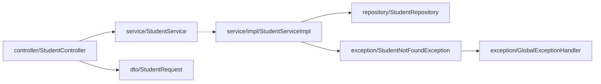
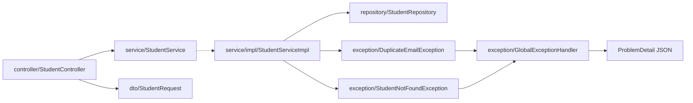

# 📦 Archive: early morning task files (Day 02-05)

  

> [!IMPORTANT]
> The four old split-style task files `tasks/day02-morning.md` to `tasks/day05-morning.md`, kept verbatim for history. From Day 06 on there is one file per day (`tasks/dayNN.md`). Nothing here is assigned or tracked; the questions are also in `spring-boot/interview-answers/` and the work they described is recorded in [PROGRESS.md](../../PROGRESS.md).

> [!NOTE]
> **Legend:** 📄 original file · statuses and wording inside are the old ones (Not started, Needs correction, ...). Each file is folded so this page stays short; open one to read it.

## 📄 Day 02 morning (`tasks/day02-morning.md`)

<b>Open the original Day 02 file</b>

### 🌅 Day 02 morning: Spring Boot practice (Week 1 · REST controllers, @RequestBody, @PathVariable)

  

> [!IMPORTANT]
> Finish the Student REST API (PUT, DELETE, search) with tests in the `spring-boot/course-practice` module, package `com.prashant.coursepractice.student`. Done when `mvn test` passes.

> [!NOTE]
> **Legend:** 🌅 morning · 🌙 evening · 🔥 revise first · ⬜ not started · 🟡 in progress · 🟠 attempted · 🔴 needs correction · 🔵 ready for revision · ✅ done · ⚠️ gotcha. Tick the `- [ ]` boxes as you finish each item.

#### 🛠️ Task: finish the Student REST API
- [ ] **1.** `PUT /api/students/{id}`: takes a `@Valid @RequestBody Student`, updates name and email of the existing student and returns it with 200. Unknown id gives 404 (reuse `StudentNotFoundException`); invalid body gives 400 with the field errors.
- [ ] **2.** `DELETE /api/students/{id}`: returns 204 No Content. Unknown id gives 404.
- [ ] **3.** `GET /api/students/search?name=...`: uses `@RequestParam` and a derived query `findByNameContainingIgnoreCase(String name)` in `StudentRepository`. A missing `name` param should give 400.
- [ ] **4.** Add tests to `StudentControllerTest` for each endpoint: the happy path, 404, and 400 cases (at least 7 tests).

> [!IMPORTANT]
> ✅ Done when `mvn test` passes inside `spring-boot/course-practice`.

#### 🎤 Interview questions (answer in chat or in a notes file)
1. What's the difference between `@PathVariable`, `@RequestParam` and `@RequestBody`? When would you use each?
2. `@RestController` vs `@Controller`: what does `@RestController` add?
3. Should PUT be idempotent? How is it different from PATCH, and what status codes would you return for create vs update vs delete?

> [!WARNING]
> **Note (structure update):** the module now uses a layered layout (see `course-practice/STRUCTURE.md`). Your PUT/DELETE/search fixes now go in `controller/StudentController.java` (endpoint mappings) and `service/impl/StudentServiceImpl.java` (lookup/delete logic). Request body is now `dto/StudentRequest`; tests are in `src/test/java/com/prashant/coursepractice/controller/StudentControllerTest.java`.

## 📄 Day 03 morning (`tasks/day03-morning.md`)

<b>Open the original Day 03 file</b>

### 🌅 Day 03 morning: Spring Boot practice (Week 1 · ResponseEntity, status codes, path vs param)

   

> [!IMPORTANT]
> Light Sunday round (~35 min): finish the Day 02 endpoints properly and add `ResponseEntity`. Done when `mvn test` passes inside `spring-boot/course-practice` and no endpoint reads the id from the request body.

> [!NOTE]
> **Legend:** 🌅 morning · 🌙 evening · 🔥 revise first · ⬜ not started · 🟡 in progress · 🟠 attempted · 🔴 needs correction · 🔵 ready for revision · ✅ done · ⚠️ gotcha. Tick the `- [ ]` boxes as you finish each item.
>
> It's Sunday, so this is a **light round (~35 min)**. It finishes the Day 02 endpoints properly and adds `ResponseEntity`. Work in `spring-boot/course-practice`, base package `com.prashant.coursepractice`, and follow `course-practice/STRUCTURE.md`.

#### 📚 Revise first (~15 min) in `spring-boot/prerequisites.md`
| Topic | What to recall |
|---|---|
| 🔥 **3. Request mapping** | `@PathVariable` vs `@RequestParam` defaults (`required = true` gives 400), and why a query string never goes in the mapping path. |
| 🔥 **4. HTTP semantics** | safe vs idempotent, PUT vs PATCH, the status code table, and why 201 comes with a `Location` header. |

> [!TIP]
> These two came up as weak spots in `interview-answers/day02-answers.md` (Q1 and Q3 at 5/10). After revising, add a row to the Revision log at the bottom of `prerequisites.md` with your confidence (1-5).

#### 🧱 Where each change goes

| Package | Class | What changes |
|---|---|---|
| `controller` | `StudentController` | Tasks 1-4: mappings and `ResponseEntity` return types |
| `service` | `StudentService` | Task 5: new method signatures that take the `id` |
| `service.impl` | `StudentServiceImpl` | Task 5: not-found checks for update and delete |
| `dto` | `StudentRequest` | Task 6: drop the `id` field |
| `exception` | `GlobalExceptionHandler` | Task 7: 400 handler for a missing request param |
| test `controller` | `StudentControllerTest` | Task 8: new tests |

#### 🛠️ Tasks
- [ ] **1. POST `/api/students`** returns `ResponseEntity<StudentResponse>` with **201 Created** and a `Location` header of `/api/students/{newId}` (use `ResponseEntity.created(...)`), instead of `@ResponseStatus`.
- [ ] **2. PUT `/api/students/{id}`** takes the id from the **path** (`@PathVariable Long id`) plus `@Valid @RequestBody StudentRequest`, and returns `ResponseEntity.ok(...)` (200). Unknown id gives 404. Invalid body gives 400 with field errors.
- [ ] **3. DELETE `/api/students/{id}`** takes the id from the path, has **no request body**, and returns `ResponseEntity<Void>` with **204 No Content**. Unknown id gives 404.
- [ ] **4. GET `/api/students/search?name=...`**: fix the mapping path so it actually matches, and make sure a missing `name` gives 400. Ask yourself whether `@Valid` on a `String` param does anything.
- [ ] **5. Service layer**: change `StudentService` / `StudentServiceImpl` to `update(Long id, StudentRequest request)` and `delete(Long id)`. `delete` must throw `StudentNotFoundException` for an unknown id (hint: what does `deleteById` do when the id doesn't exist?).
- [ ] **6. DTO**: remove the `id` field from `StudentRequest`, since the id now always comes from the path.
- [ ] **7. Errors**: in `GlobalExceptionHandler`, return a 400 JSON body like `{"error": "name parameter is missing"}` for `MissingServletRequestParameterException`.
- [ ] **8. Tests** in `src/test/java/com/prashant/coursepractice/controller/StudentControllerTest.java` (at least 6 new): POST asserts the `Location` header, PUT 200 and 404, DELETE 204 and 404, search 200 and missing-param 400.

> [!IMPORTANT]
> ✅ Done when `mvn test` passes inside `spring-boot/course-practice` and no endpoint reads the id from the request body.

> [!WARNING]
> ⚠️ `@ResponseStatus` and `ResponseEntity` on the same method: the `ResponseEntity` status wins. Pick one style per method (use `ResponseEntity` today).

#### 🎤 Interview questions (answer in chat)
1. What does idempotent mean? Is DELETE idempotent, and if a client deletes the same id twice, what status should the second call return? Does that break idempotency?
2. `ResponseEntity` vs `@ResponseStatus`: when would you use each, and why return a `Location` header with 201?
3. What happens when a required `@RequestParam` is missing? How do you make it optional, and what does `@Valid` on a plain `String` param do?

> [!TIP]
> Answer format: **definition → difference → when to use → example from your Student API**. Answer every part of each question.

## 📄 Day 04 morning (`tasks/day04-morning.md`)

<b>Open the original Day 04 file</b>

### 🌅 Day 04 morning: Spring Boot practice (Week 1 · DTOs, error responses, status codes)

   

> [!IMPORTANT]
> REST: `ResponseEntity`, status codes and DTOs. Part A finishes Day 03; Part B adds validation, a 409 for duplicate email and `ProblemDetail` errors in `spring-boot/course-practice`.

> [!NOTE]
> **Legend:** 🌅 morning · 🌙 evening · 🔥 revise first · ⬜ not started · 🟡 in progress · 🟠 attempted · 🔴 needs correction · 🔵 ready for revision · ✅ done · ⚠️ gotcha. Tick the `- [ ]` boxes as you finish each item.
>
> Plan for today: **REST: ResponseEntity, status codes, DTOs**. Work in `spring-boot/course-practice`, base package `com.prashant.coursepractice`, and follow `course-practice/STRUCTURE.md`.

> [!WARNING]
> ⚠️ **Day 03's Spring tasks aren't in the repo yet** (`StudentController` still reads the id from the body, and `/search?name=` is still in the mapping path). Do **Part A** first: it's tasks 1-6 of `tasks/day03-morning.md`, and today's work builds on it. If time runs out, finish Part A and push; Part B can move to a later slot.

#### 📚 Revise first (~15 min) in `spring-boot/prerequisites.md`
| Topic | What to recall |
|---|---|
| 🔥 **5. Validation & error handling** | what `@Valid` triggers, `MethodArgumentNotValidException` (400), `@RestControllerAdvice`, and the **ProblemDetail** fields (`type`, `title`, `status`, `detail`, `instance`). |
| 🔥 **2. Request flow** | where Jackson turns JSON into your DTO and back (HttpMessageConverter), and why controllers stay thin. |

> [!TIP]
> Next in the rotation after Day 03's sections 3 and 4. After revising, add a row per topic to the **Revision log** at the bottom of `prerequisites.md` with your confidence (1-5), so future rounds can target the weak ones.

#### 🧱 Where each change goes

| Package | Class | What changes |
|---|---|---|
| `controller` | `StudentController` | Part A (Day 03 tasks 1-4) |
| `dto` | `StudentRequest` | Part A: drop `id` · Task 1: `@Size` on `name` |
| `repository` | `StudentRepository` | Task 2: two derived `exists...` queries |
| `exception` | `DuplicateEmailException` (**new**) | Task 3 |
| `service.impl` | `StudentServiceImpl` | Part A (Day 03 task 5) · Task 3: duplicate-email checks |
| `exception` | `GlobalExceptionHandler` | Task 4: every handler returns `ProblemDetail` |
| test `controller` | `StudentControllerTest` | Task 5: new tests |

#### 🅰️ Part A: finish Day 03 (if not done)
- [ ] Day 03 tasks 1-6: POST returns 201 + `Location`, PUT/DELETE take `@PathVariable Long id`, DELETE returns 204 with no body, `/search` mapping fixed, `delete(Long id)` throws `StudentNotFoundException` for an unknown id, `id` removed from `StudentRequest`.

#### 🅱️ Part B: today's tasks
- [ ] **1. DTO validation**: in `dto/StudentRequest`, limit `name` to 2-50 characters with `@Size` (keep `@NotBlank`), with a clear `message`.
- [ ] **2. Repository**: add derived queries to `repository/StudentRepository`: one that checks whether an email already exists (ignore case), and one that checks the same thing **excluding a given id** (for updates). You name and write them.
- [ ] **3. Duplicate email = 409**: create `exception/DuplicateEmailException` (unchecked). In `service/impl/StudentServiceImpl`, `create` throws it if the email is taken; `update(id, request)` throws it only if **another** student has that email (updating a student with their own email must still work).
- [ ] **4. One error format**: change `exception/GlobalExceptionHandler` so every handler returns a `ProblemDetail`: 404 for not found, 409 for duplicate email, and 400 for validation with the field errors added as an extra `errors` property (hint: `problem.setProperty(...)`). Also handle `HttpMessageNotReadableException` (malformed JSON) as a 400 with a short `detail`.
- [ ] **5. Tests** in `src/test/java/com/prashant/coursepractice/controller/StudentControllerTest.java` (at least 5 new): duplicate email on POST gives 409; updating a student with their **own** email gives 200; a 1-character name gives 400 with `errors.name`; malformed JSON gives 400; GET of an unknown id gives 404 with content type `application/problem+json`.

> [!IMPORTANT]
> ✅ Done when `mvn test` passes inside `spring-boot/course-practice`, no handler returns a raw `Map`, and the controller never touches the repository.

> [!WARNING]
> ⚠️ A check-then-insert (`exists...` then `save`) can still race: two requests with the same email can both pass the check. Think about what else should guarantee uniqueness (you'll be asked).

> [!TIP]
> Stretch (optional): `PATCH /api/students/{id}` with a new `dto/StudentPatchRequest` where every field is optional, and the field copy done in `mapper/StudentMapper`.

#### 🎤 Interview questions (answer in chat)
1. Walk me through how a JSON body becomes a validated `StudentRequest`. Which component does the conversion, which exception is thrown when a field fails validation, and what happens (exception and status) when the JSON itself is malformed?
2. Why use separate request and response DTOs instead of accepting and returning the `Student` entity? Give at least two concrete risks of exposing the entity.
3. What is `ProblemDetail`? For a duplicate email, why is 409 better than 400, and why isn't the `exists...` check alone enough to guarantee unique emails?

> [!TIP]
> Answer format: **definition → difference → when to use → example from your Student API**. Day 03's three questions are still open too, so answer those if you have time.

## 📄 Day 05 morning (`tasks/day05-morning.md`)

<b>Open the original Day 05 file</b>

### 🌅 Day 05 morning: finish the Day 03 corrections + RPN redo

   

> [!IMPORTANT]
> Backlog day: fix the Day 03 Part A corrections in `spring-boot/course-practice` and redo `Day02RpnEvaluator` from memory (44/44).

> [!NOTE]
> **Legend:** 🌅 morning · 🌙 evening · 🔥 revise first · ⬜ not started · 🟡 in progress · 🟠 attempted · 🔴 needs correction · 🔵 ready for revision · ✅ done · ⚠️ gotcha. Tick the `- [ ]` boxes as you finish each item.
>
> Backlog day, no new material. The Day 03 Part A work you pushed in `11dfcc8` is 🔴 **Needs correction**, and §3/§4 must be verified before §5 (Day 04 Part B) or the banking-app V2 auth migration can start. Two buggy rounds (Day 03, Day 04) are still unattempted, so there's no new buggy round today.

#### 📚 Revise first (~10 min) in `spring-boot/prerequisites.md`
| Topic | What to recall |
|---|---|
| 🔥 **3. Request mapping** | what belongs in the mapping path vs. what `@RequestParam` reads from the query string. |
| 🔥 **4. HTTP semantics** | which status a successful DELETE should return, and why it has no body. |

> [!TIP]
> Add one row per topic to the **Revision log** at the bottom of `prerequisites.md` with your confidence (1-5).

#### 🅰️ Main task (~35 min): Day 03 Part A corrections in `spring-boot/course-practice`

| Package | Class | What you fix |
|---|---|---|
| `controller` | `StudentController` | `/search` mapping · DELETE status · no not-found logic in the controller |
| `service` / `service.impl` | `StudentService`, `StudentServiceImpl` | `delete(Long id)` throws `StudentNotFoundException` for an unknown id |
| test `controller` | `StudentControllerTest` | at least 6 new tests |

- [ ] `GET /api/students/search?name=...` returns 200 with matches (today it returns 400).
- [ ] `DELETE /api/students/{id}` returns the right success status with an empty body.
- [ ] The controller only calls the service; the "does this student exist?" decision lives in the service.
- [ ] DELETE of an unknown id gives 404 through `GlobalExceptionHandler`.
- [ ] 6+ new controller tests, one per behaviour: POST 201 + `Location` header, GET by id 200, GET unknown id 404, PUT 200, DELETE success status with empty body, DELETE unknown id 404, search 200.

> [!IMPORTANT]
> ✅ Done when `mvn test` passes inside `spring-boot/course-practice`, and the Postman collection's search and delete requests behave as above.

#### 🔁 Small item (~15 min): Day02RpnEvaluator redo from memory
- [ ] Without opening `Day02RpnEvaluator.java`, write `evaluate` in `src/main/java/com/prashant/dailytests/redo/Day02RpnEvaluatorRedo.java` (the spec is in its Javadoc).
- [ ] Run `mvn test -Dtest=Day02RpnEvaluatorRedoTest` until 44/44 pass. It's 0/44 right now.

> [!TIP]
> The Day 02 lesson was about tokens that *start* like an operator, and about overflow on every arithmetic operation.

#### 🎤 Still open (answer in chat when you can)
The three Day 03 questions in `tasks/day03-morning.md` are still ⬜ Pending (they're also in `interview-answers.md`). Day 04's wait until Part B.

