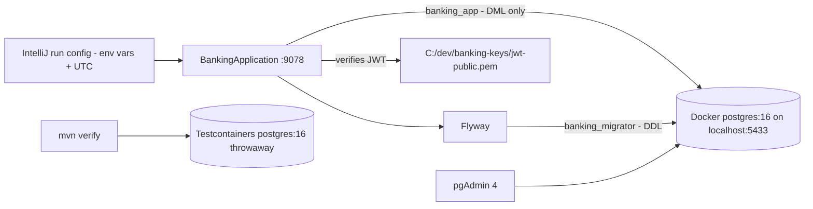

# 📓 banking-app: setup journal

   

> [!NOTE]
> What I actually did to get the banking app running locally, what broke, how I fixed it, and how to tell the story in an interview. Quick reference for the skeleton: [`README.md`](README.md).

## 🗺️ The big picture


---

## ✅ 1. Setup steps (in the order I did them)

### 1.1 🧰 Prerequisites
| Tool | Version | Note |
|---|---|---|
| Docker Desktop | latest | must be running for compose **and** tests |
| JDK | 21.0.10 | `C:\Program Files\Java\jdk-21.0.10` |
| PostgreSQL + pgAdmin 4 | 18 / v18 | installed locally, uses port **5432** |
| IntelliJ IDEA Community | 2024.3 | |
| Git Bash | with Git for Windows | has `openssl` |

> [!TIP]
> Pasting in Git Bash: **Shift + Insert** or **right-click → Paste** (Ctrl+V doesn't work).

### 1.2 📥 Pull and create `.env`
```bash
git pull
cd banking-app
copy .env.example .env
```
- [x] Replaced **every** `CHANGE_ME` in `.env` (`POSTGRES_SUPERUSER_PASSWORD`, `DB_MIGRATOR_PASSWORD`, `DB_APP_PASSWORD`).

> [!CAUTION]
> `.env` is git-ignored. Never commit it.

### 1.3 🐳 Start Postgres in Docker
```bash
docker compose up -d
docker compose ps          # banking-postgres  postgres:16  0.0.0.0:5433->5432  (healthy)
```
If the init script must run again (e.g. passwords changed):
```bash
docker compose down -v     # ⚠️ wipes the Docker DB volume
docker compose up -d
```

### 1.4 🐘 Register in pgAdmin and check roles
- [x] Host `localhost`, Port **5433**, DB `java_switch`, user `postgres` (password from `.env`).
```sql
SELECT rolname, rolcanlogin FROM pg_roles WHERE rolname LIKE 'banking%';
-- banking_app       | true
-- banking_migrator  | true
```

### 1.5 🔑 RSA key pair for JWT (Git Bash, outside the repo)
```bash
mkdir -p /c/dev/banking-keys && cd /c/dev/banking-keys
openssl genpkey -algorithm RSA -pkeyopt rsa_keygen_bits:2048 -out jwt-private.pem
openssl rsa -in jwt-private.pem -pubout -out jwt-public.pem
```
- [x] In `.env`: `JWT_PUBLIC_KEY_LOCATION=file:C:/dev/banking-keys/jwt-public.pem`

> [!CAUTION]
> `jwt-private.pem` stays secret and outside the repo.

### 1.6 🧪 `mvn verify`
```bash
mvn verify
```
- [x] Testcontainers pulled a throwaway `postgres:16`, Flyway applied **V1** (`auth`, `core`, `audit` schemas), `BankingApplicationIT` passed → **BUILD SUCCESS**.

### 1.7 ⚙️ IntelliJ run configuration
- [x] **Environment variables**: pasted all `.env` lines (`DB_URL`, `DB_APP_USER`, `DB_APP_PASSWORD`, `DB_MIGRATOR_USER`, `DB_MIGRATOR_PASSWORD`, `JWT_PUBLIC_KEY_LOCATION`, …).
- [x] **VM options**: `-Duser.timezone=UTC`
- [x] **Working directory**: `...\java-switch-journey\banking-app`

> [!WARNING]
> The EnvFile plugin was unreliable on IntelliJ 2024.3 Community — pasting env vars directly is what worked.

### 1.8 ▶️ Run and check health
- [x] `http://localhost:9078/actuator/health` → `{"status":"UP"}` 🎉 (I run on port 9078 via `SERVER_PORT`; default is 8080).

---

## 🔥 2. Challenges faced and fixes

### (a) pgAdmin: `password authentication failed for user "CHANGE_ME"`
| | |
|---|---|
| ❌ Problem | pgAdmin couldn't log in. |
| 🔍 Root cause | Placeholders left in `.env`; Postgres init scripts only run on an **empty** volume, so the wrong values were baked in. |
| ✅ Fix | Fixed `.env`, then `docker compose down -v` and `up -d`. |
| 📌 Lesson | Container init is one-shot. Changing config later needs a fresh volume (or an `ALTER ROLE`). |

### (b) `mvn verify`: `FATAL: invalid value for parameter "TimeZone": "Asia/Calcutta"`
| | |
|---|---|
| ❌ Problem | Integration test couldn't load the ApplicationContext. |
| 🔍 Root cause | The Windows JVM reports the **legacy** zone ID `Asia/Calcutta`; the JDBC driver sends it to Postgres, and the `postgres:16` image rejects it (current name `Asia/Kolkata`). |
| ✅ Fix | `<argLine>-Duser.timezone=UTC</argLine>` for surefire and failsafe ([commit e56f950](https://github.com/PrashantSury/java-switch-journey/commit/e56f95025cb6975f9ff7332f42ad2e14c6de51fe)) + `-Duser.timezone=UTC` VM option in IntelliJ. |
| 📌 Lesson | Store and process in **UTC**, convert to IST only at the edge (UI/reports). |

### (c) `Could not resolve placeholder 'JWT_PUBLIC_KEY_LOCATION'`
| | |
|---|---|
| ❌ Problem | App failed at startup from IntelliJ while `mvn verify` passed. |
| 🔍 Root cause | `.env` values never reached the IntelliJ process — no env vars in the run config. |
| ✅ Fix | Pasted env vars into the run config, set working dir to `banking-app`. |
| 📌 Lesson | Read the **last** `Caused by:`. Config comes from the environment, so each runner (IDE, Maven, CI) must supply it. |

### (d) Port clash avoided: local Postgres 5432 vs Docker 5433
Local PostgreSQL 18 already owns **5432**, so Docker publishes `5433:5432`. Both run side by side; the app's `DB_URL` points at 5433.

### (e) H2 can't run Postgres-specific DDL
H2 doesn't support `INET`, `JSONB` or Postgres triggers the way we use them → **Testcontainers** runs tests on the same `postgres:16` as dev. No H2 in the pom.

### (f) DB role design: owner could drop the audit trigger
If the app connected as the table owner, it could `DROP TRIGGER` and silently stop auditing → **two roles**: `banking_migrator` (owns schemas, DDL, used by Flyway) and `banking_app` (DML only).

### (g) Git Bash paste
Ctrl+V doesn't paste → **Shift + Insert** or right-click.

> [!WARNING]
> 🧹 To clean: my home folder showed `(master)` in Git Bash — a stray `git init` in `C:\Users\Prashant Suryawanshi`. Check with `git -C ~ rev-parse --show-toplevel`; if it's the home folder, remove only `~/.git` (after confirming nothing there matters).

---

## 🎤 3. How to tell this in an interview

### 3.1 STAR talking points
| Challenge | Situation | Task | Action | Result |
|---|---|---|---|---|
| Timezone | Integration tests failed on Windows only | Make the build reproducible | Read the root `Caused by`, found the legacy `Asia/Calcutta` ID rejected by Postgres 16; pinned JVM to UTC in surefire/failsafe and run config | Green build; UTC-everywhere policy |
| Env vars | App ran in Maven, failed in IDE | Get config to every runner | Traced the placeholder error to missing env vars; set them in run config | App UP; documented setup |
| CHANGE_ME | DB login failed | Fix credentials | Realised init scripts run once on empty volume; fixed `.env`, recreated volume | Roles verified via `pg_roles` |
| H2 → Testcontainers | Schema uses `JSONB`, `INET`, triggers | Test against real DB | Replaced H2 with Testcontainers `postgres:16` | Tests match prod behaviour |
| Two roles | App as owner could disable audit | Enforce least privilege | Split `banking_migrator` (DDL) and `banking_app` (DML) | Audit trail can't be dropped by the app |
| Port clash | Local PG on 5432 | Run both | Published Docker on 5433 | No conflict |

### 3.2 🧠 Key concept Q&A
<details><summary><b>Why Testcontainers over H2?</b></summary>

H2 only emulates Postgres; `JSONB`, `INET`, triggers and some SQL differ. Testcontainers runs the real `postgres:16` image, so "passes in test" means "works in prod". Cost: needs Docker, a few seconds slower.
</details>

<details><summary><b>Why Flyway + <code>ddl-auto=validate</code>?</b></summary>

Schema changes are versioned SQL (`V1__create_schemas.sql`), reviewed like code and applied the same way everywhere. Hibernate only **validates** that entities match — it never changes the schema itself.
</details>

<details><summary><b>Least-privilege DB roles and append-only audit</b></summary>

Flyway uses `banking_migrator` (DDL); the app uses `banking_app` (DML only, via default privileges). The app can't drop or alter the audit trigger, so audit is append-only. This is the same segregation-of-duties idea I worked with in IT controls — now enforced in the database, not just in policy.
</details>

<details><summary><b>Secrets handling</b></summary>

12-factor: config in environment variables, `application.yml` only has `${...}` placeholders, `.env` is git-ignored and never committed. On AWS, the same variables will come from SSM Parameter Store / Secrets Manager.
</details>

<details><summary><b>Why store time in UTC?</b></summary>

One unambiguous timeline across servers, no DST surprises, safe ordering of transactions. Convert to IST at the edge. Bonus: it sidestepped the `Asia/Calcutta` bug.
</details>

<details><summary><b>JWT resource server with an RSA public key</b></summary>

Asymmetric: the **private key signs** tokens (only the auth service has it), the **public key verifies** them. The API only holds `jwt-public.pem` via `JWT_PUBLIC_KEY_LOCATION`, so a leak of the API's config can't mint tokens.
</details>

<details><summary><b>Why <code>open-in-view: false</code>?</b></summary>

Open Session in View keeps the DB connection open during view rendering, hiding lazy-loading N+1 queries and holding connections longer. Turning it off forces data loading inside the service transaction — explicit and pool-friendly.
</details>

<details><summary><b>docker-compose healthcheck</b></summary>

`pg_isready` every 5s; `docker compose ps` shows `(healthy)` only when Postgres actually accepts connections, not merely when the container started.
</details>

### 3.3 🗣️ Sample spoken answers (30–60 sec)
> [!TIP]
> **"Tell me about a tricky bug."**
> "While setting up my banking project on Windows, the integration tests failed with a vague 'failed to load ApplicationContext'. Instead of guessing, I went to the failsafe report and read the last 'Caused by'. Postgres was rejecting the session time zone 'Asia/Calcutta' — the Windows JVM sends the legacy ID, and the Postgres 16 image only knows 'Asia/Kolkata'. I fixed it by running the JVM in UTC for tests and the app. That turned into a design rule: store everything in UTC and convert to IST only when displaying, which is what you want in banking anyway."

> [!TIP]
> **"How do you secure database access?"**
> "I use two roles. Flyway connects as a migrator role that owns the schemas and runs DDL. The application connects as a separate role that only has select, insert, update and delete. So even if the app is compromised, it can't drop tables or disable the audit trigger — the audit log stays append-only. Coming from IT controls, this is segregation of duties, but enforced by the database rather than by a policy document."

> [!TIP]
> **"Why not H2 for tests?"**
> "My schema uses Postgres features like JSONB, INET and triggers, which H2 doesn't handle the same way. So I use Testcontainers: each test run starts a real Postgres 16 in Docker, Flyway applies the migrations, and the test runs against exactly what production will use. It's a bit slower, but a green build actually means something."

---

## 📌 4. Daily checklist
```bash
# start
#  1. open Docker Desktop
cd banking-app
docker compose up -d && docker compose ps     # (healthy)
#  2. IntelliJ → Run BankingApplication
#  3. http://localhost:9078/actuator/health → UP

# stop
#  stop the app in IntelliJ
docker compose stop        # keeps data  (down -v would wipe it ⚠️)
```

## 🔜 Next
> [!IMPORTANT]
> **Monday:** write the **V2 auth migration by hand** (`V2__...sql` in `db/migration/`), run `mvn verify`, and check the new tables in pgAdmin.
