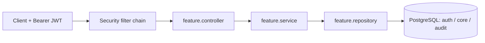

# 🗺️ banking-app structure (feature packages)

 

> [!IMPORTANT]
> The banking app groups code **by feature**, with the usual layers inside each feature.

> [!NOTE]
> **Legend:** 📦 package · 🧱 layer. The older practice modules use layer-first packages (see `spring-boot/course-practice/STRUCTURE.md`). That's fine: this module follows this file.

## 📦 Packages
```text
com.prashant.banking
├── BankingApplication.java
├── common/        BaseEntity, ApiError, GlobalExceptionHandler
├── config/        JpaAuditingConfig, ClockConfig, OpenApiConfig
├── security/      SecurityConfig, AccountSecurity (ownership checks)
├── auth/          users, roles, permissions, login (JWT)
├── customer/      customers, KYC (maker-checker)
├── account/       accounts, balances, beneficiaries
├── transaction/   deposit, withdraw, transfer, idempotency
├── admin/         staff/admin operations
└── audit/         append-only audit log
    each feature → controller/ service/ repository/ model/ dto/
```

## 🔀 Request flow


## 📌 Rules
- 📌 Controllers take and return **DTOs** (records), never entities.
- 📌 `@Transactional` lives in **services**.
- 📌 A feature talks to another feature through its **service**, not its repository.
- 📌 Entities extend `common.BaseEntity`; money is `BigDecimal` ↔ `NUMERIC(19,4)`; times are `Instant` ↔ `TIMESTAMPTZ`.

> [!TIP]
> Feature packages make a later split easy: e.g. `auth/` can be lifted out into its own service.
