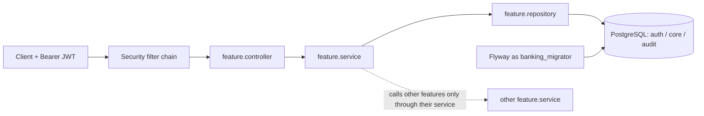
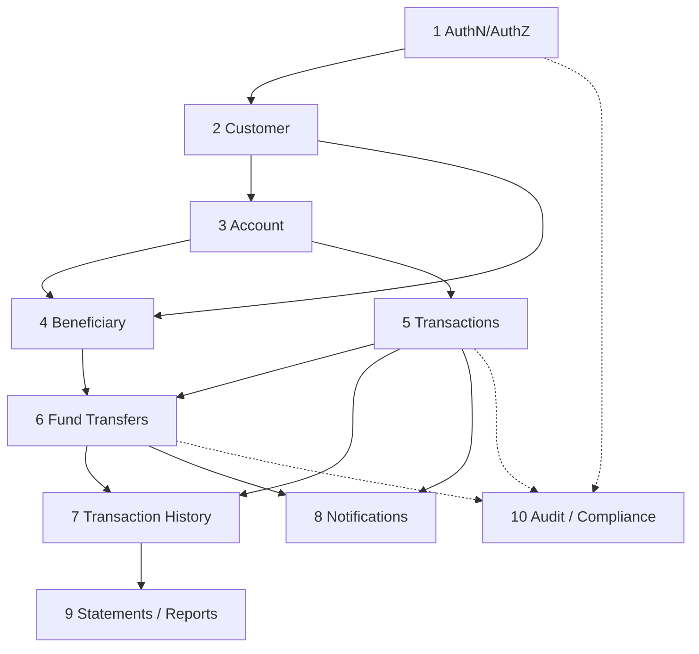

# 🏛️ banking-app: project architecture

    

> [!IMPORTANT]
> The design of the retail-banking project: architecture, module dependencies, API contracts, database schema, design decisions, security and deployment. Everything marked ✅ **built** is read from the code and config in this repo. Everything marked 📐 **planned** is intent that is not written yet, and it can change when a module is built.

> [!NOTE]
> **Legend:** ✅ built (in the code today) · 🟡 partly built · 📐 planned (not written) · 🏦 module · 🔐 security · 🛡️ database. Module status values are the program statuses in [docs/PROGRAM.md](../docs/PROGRAM.md); live status is in [PROGRESS.md](../PROGRESS.md). Setup story: [SETUP-JOURNAL.md](SETUP-JOURNAL.md). Package layout and rules: [README.md](README.md).

## 🎯 1. What exists today
| Area | State | Facts |
|---|---|---|
| Build | ✅ | Maven, Boot 4.1.2 parent, Java 21, no H2, no Lombok |
| Database and roles | ✅ | `postgres:16` in Docker on `localhost:5433`; roles `banking_migrator` (DDL) and `banking_app` (DML only) |
| Migrations | 🟡 | **Only `V1__create_schemas.sql`**: schemas `auth`, `core`, `audit`. No tables yet |
| Security | 🟡 | Stateless JWT resource server, RSA public key, method security enabled; no login endpoint, no users |
| Error model | ✅ | `ApiError` + `GlobalExceptionHandler` for 400, 404, 409, 403 |
| Persistence base | ✅ | `BaseEntity` (audit columns + `@Version`), `JpaAuditingConfig`, injectable `Clock` |
| API docs | ✅ | springdoc Swagger UI at `/swagger-ui.html`, Bearer JWT scheme |
| Tests | 🟡 | `AbstractIntegrationTest` (Testcontainers `postgres:16`) + `BankingApplicationIT` (V1 creates the 3 schemas) |
| Business modules | 📐 | 6 feature packages exist as empty `package-info.java` files (account, admin, audit, auth, customer, transaction); nothing else |

## 🧱 2. Architecture
A single Spring Boot application (a modular monolith), organised **package by feature**, with the same five layers inside each feature. It talks to one PostgreSQL database that has one schema per concern.



```text
com.prashant.banking
├── BankingApplication.java            ✅
├── common/    BaseEntity, ApiError, GlobalExceptionHandler            ✅
├── config/    JpaAuditingConfig, ClockConfig, OpenApiConfig           ✅
├── security/  SecurityConfig, AccountSecurity (deny-by-default stub)  🟡
└── auth/ customer/ account/ transaction/ admin/ audit/                📐 each: controller/ service/ repository/ model/ dto/
```

| Rule (already decided) | Why |
|---|---|
| Controllers take and return DTOs (records), never entities | The entity can leak internal fields and lazy relations, and it couples the API to the schema |
| `@Transactional` lives in services | One service call is one unit of work; controllers stay HTTP-only |
| A feature calls another feature through its **service**, not its repository | The other feature keeps its invariants, and a later split into services stays possible |
| Entities extend `common.BaseEntity`; money is `BigDecimal` ↔ `NUMERIC(19,4)`; times are `Instant` ↔ `TIMESTAMPTZ` | No floating-point money, one unambiguous timeline |

## 🏦 3. Modules and dependencies
The ten modules of the program, in the order they are introduced. The order follows the concepts each one needs, so the project teaches progressively. 📐 All modules are planned; none is started.

| # | Module | Package | Depends on | Concepts it introduces | Status |
|---|---|---|---|---|---|
| 1 | **AuthN / AuthZ** | `auth`, `security` | none | Flyway V2, password hashing, `JwtEncoder`, permissions claim → authorities, `@PreAuthorize`, method security | ⬜ NOT_STARTED |
| 2 | **Customer** | `customer` | 1 | JPA entities, relations, validation, KYC maker-checker, unique constraints | ⬜ NOT_STARTED |
| 3 | **Account** | `account` | 2 | Balances as `NUMERIC`, ownership checks (`AccountSecurity.isOwner`), `@Version`, pagination | ⬜ NOT_STARTED |
| 4 | **Beneficiary** | `account` (sub-feature) | 2, 3 | One-to-many with uniqueness rules, soft delete, cooling-off period using `Clock` | ⬜ NOT_STARTED |
| 5 | **Transactions** | `transaction` | 3 | Deposit and withdraw, `@Transactional` boundaries, pessimistic vs optimistic locking | ⬜ NOT_STARTED |
| 6 | **Fund Transfers** | `transaction` | 3, 4, 5 | Two-account atomicity, lock ordering, idempotency (key + request hash), conflict handling | ⬜ NOT_STARTED |
| 7 | **Transaction History** | `transaction` | 5, 6 | Read models, projections, keyset vs offset pagination, N+1 and how to fix it | ⬜ NOT_STARTED |
| 8 | **Notifications** | `notification` (new package) | 5, 6 | Domain events, `@TransactionalEventListener`, async, retry and failure isolation | ⬜ NOT_STARTED |
| 9 | **Statements / Reports** | `report` (new package) | 7 | Scheduled jobs, batch reads, large result sets, file generation | ⬜ NOT_STARTED |
| 10 | **Audit / Compliance** | `audit`, `admin` | all | Append-only audit trail, DB trigger, `REVOKE UPDATE, DELETE, TRUNCATE`, immutable records | ⬜ NOT_STARTED |



> [!NOTE]
> 📐 Planned design call, not yet decided with the code: `Beneficiary` lives in the `account` package, and `notification` and `report` are new feature packages. The old four-milestone plan mapped as: M1 Auth = module 1, M2 Customers and accounts = modules 2-3, M3 Transactions with locking and idempotency = modules 5-6, M4 Admin and audit = module 10.

## 🔌 4. API contracts
✅ **What is exposed today**

| Method and path | Auth | Notes |
|---|---|---|
| `GET /actuator/health` (and `/actuator/health/**`) | public | health probes enabled; only `health` and `info` are exposed |
| `GET /swagger-ui.html`, `/swagger-ui/**`, `/v3/api-docs/**` | public | springdoc |
| `/auth/**` | public in the filter chain | **no controller yet**, so there is nothing behind it |
| everything else | Bearer JWT | unauthenticated requests get 401 |

✅ **Error body** (`ApiError`, produced by `GlobalExceptionHandler`)

```json
{
  "timestamp": "2026-11-01T06:30:00Z",
  "status": 400,
  "error": "Bad Request",
  "message": "Validation failed",
  "path": "/api/v1/customers",
  "violations": [ { "field": "email", "message": "email must be valid" } ]
}
```

| Exception | Status | Message |
|---|---|---|
| `MethodArgumentNotValidException` | 400 | `Validation failed` + `violations[]` |
| `EntityNotFoundException` | 404 | the exception message |
| `DataIntegrityViolationException`, `OptimisticLockingFailureException` | 409 | `Request conflicts with current state` |
| `AccessDeniedException` | 403 | `Access denied` |
| anything else | 📐 planned: a catch-all 500 that never leaks internals; `InsufficientFundsException` and `IdempotencyKeyMismatchException` (422) are named in the code as TODOs | |

📐 **Planned contracts** (paths and fields are the intent, finalised when the module is written)

| Module | Endpoint | Purpose |
|---|---|---|
| AuthN | `POST /auth/login` | exchange credentials for a JWT |
| Customer | `POST /api/v1/customers`, `GET /api/v1/customers/{id}`, `POST .../{id}/kyc/approve` | onboarding, maker-checker |
| Account | `POST /api/v1/accounts`, `GET /api/v1/accounts/{id}` | open and read, owner-only |
| Beneficiary | `POST /api/v1/accounts/{id}/beneficiaries`, `GET`, `DELETE` | payees |
| Transactions | `POST /api/v1/accounts/{id}/deposits`, `.../withdrawals` | money movement |
| Fund Transfers | `POST /api/v1/transfers` with an `Idempotency-Key` header | atomic two-account transfer |
| Transaction History | `GET /api/v1/accounts/{id}/transactions?cursor=...` | paged statement lines |
| Statements | `GET /api/v1/accounts/{id}/statements/{yyyy-MM}` | monthly statement |
| Audit | `GET /api/v1/admin/audit?...` | read-only, privileged |

## 🛡️ 5. Database
✅ **What exists** (`db/migration/V1__create_schemas.sql`)

| Schema | Created by | Holds (planned) |
|---|---|---|
| `auth` | V1 | users, roles, permissions |
| `core` | V1 | customers, accounts, beneficiaries, transactions |
| `audit` | V1 | `audit_logs` (append-only) |
| `public` | PostgreSQL | only `flyway_schema_history` |

| Role | Used by | Can do |
|---|---|---|
| `banking_migrator` | Flyway | owns schemas and tables, runs DDL |
| `banking_app` | the running app | `SELECT, INSERT, UPDATE, DELETE` and sequence use, through default privileges; never DDL |

✅ **Conventions already fixed in code** (`BaseEntity`): every table gets `created_at TIMESTAMPTZ`, `updated_at TIMESTAMPTZ`, `created_by VARCHAR(100)` and `version BIGINT` (optimistic locking). Hibernate runs with `ddl-auto=validate`: it checks the schema, it never changes it. Migrations are never edited after they ran; a new version is added.

📐 **Planned** (no table exists yet; each arrives with its module)

| Module | Planned tables | Key design decisions already written down |
|---|---|---|
| AuthN/AuthZ | `auth.users`, `auth.roles`, `auth.permissions` (+ join tables) | hand-written V2; permissions go into the JWT as a claim |
| Customer, Account | `core.customers`, `core.accounts` | `BIGINT` identity + public `UUID` per entity; money `NUMERIC(19,4)` |
| Transactions, Transfers | `core.transactions`, an idempotency record (key + request hash) | lock accounts in a fixed order; `@Version` and `SELECT ... FOR UPDATE` |
| Audit | `audit.audit_logs` + trigger | `REVOKE UPDATE, DELETE, TRUNCATE ON audit.audit_logs FROM banking_app`; the app can never drop or change the trigger |

## 🧭 6. Design decisions
| Decision | Choice | Reason | Trade-off |
|---|---|---|---|
| Code layout | Package by feature | Features can be lifted out later | More packages up front |
| Schema changes | Flyway + `ddl-auto=validate` | Versioned, reviewable, identical everywhere | Every change is hand-written SQL |
| DB access | Two roles (migrator vs app) | A compromised app cannot drop tables or disable the audit trigger | Two sets of credentials to manage |
| Tests | Testcontainers `postgres:16`, no H2 | The real engine, so tests match production (JSONB, INET, triggers) | Needs Docker, a few seconds slower |
| Time | Store and process in UTC, injected `Clock` | One timeline, no DST bugs, testable time rules | Convert to IST at the edge |
| Persistence in web layer | `open-in-view: false` | No hidden lazy loading, shorter connection use | Data must be loaded inside the service transaction |
| Secrets | Environment variables only, `.env` git-ignored, no defaults in `application.yml` | 12-factor; nothing secret in git | Every runner (IDE, Maven, CI) must supply them |
| Ports | Docker Postgres on 5433, app on 9078 (`SERVER_PORT`) | Local PostgreSQL already owns 5432 | One more thing to remember |
| Money | `BigDecimal` / `NUMERIC(19,4)` | No rounding drift | Verbose arithmetic |
| Boilerplate | No Lombok | The code stays explicit for interviews | More typing |

## 🔐 7. Security design
✅ **Built**

| Piece | What it does |
|---|---|
| `SecurityConfig` | Stateless (`SessionCreationPolicy.STATELESS`), CSRF disabled because it is a Bearer-token JSON API with no cookies |
| Resource server | Validates JWTs with the **RSA public key** from `JWT_PUBLIC_KEY_LOCATION` |
| Public routes | `/auth/**`, `/actuator/health/**`, Swagger and OpenAPI paths; everything else needs authentication |
| `@EnableMethodSecurity` | Turns on `@PreAuthorize` |
| `AccountSecurity.isOwner` | A stub that **denies by default** until it is implemented |

📐 **Planned**

| Piece | Intent |
|---|---|
| `POST /auth/login` | Verifies the password (a `PasswordEncoder` bean) and issues a JWT with `JwtEncoder`, signed by the RSA **private** key (`JWT_PRIVATE_KEY_LOCATION`, outside the repo) |
| `JwtAuthenticationConverter` | Maps a `permissions` claim to authorities |
| Authorization | `@PreAuthorize("hasAuthority('ACCOUNT_READ') and @accountSecurity.isOwner(authentication, #accountId)")` |
| Maker-checker | A KYC change needs a second, different user to approve it |
| Audit | Every privileged action writes an append-only audit row |

> [!IMPORTANT]
> The private key signs, the public key verifies. The API holds only the public key, so a leak of the API's configuration cannot mint tokens. Keys, `.env` and any `*.pem` are never committed (see `.gitignore`).

## 🚀 8. Deployment and environments
| Environment | State | How |
|---|---|---|
| ✅ Local development | built | `docker compose up -d` (Postgres 16, healthcheck `pg_isready`), run `BankingApplication` from IntelliJ with the `.env` values as environment variables and `-Duser.timezone=UTC` |
| ✅ Tests | built | `mvn verify`: `BankingApplicationIT` starts a throwaway `postgres:16`; Flyway and the app both use the container superuser, so the role split is only enforced by the Docker init script |
| 📐 CI | planned | `mvn verify` with Docker available |
| 📐 Production | planned | The same environment variables supplied by a secret store (SSM Parameter Store / Secrets Manager), Flyway as the migrator role, the app as the DML-only role |

| Environment variable | Used for | Required |
|---|---|---|
| `DB_URL` | JDBC URL | yes |
| `DB_APP_USER`, `DB_APP_PASSWORD` | runtime datasource | yes |
| `DB_MIGRATOR_USER`, `DB_MIGRATOR_PASSWORD` | Flyway | yes |
| `JWT_PUBLIC_KEY_LOCATION` | verifying tokens | yes |
| `SERVER_PORT` | HTTP port | no (default `9078`) |
| `JWT_PRIVATE_KEY_LOCATION` | signing tokens | 📐 planned, with login |
| `POSTGRES_DB`, `POSTGRES_SUPERUSER`, `POSTGRES_SUPERUSER_PASSWORD` | the Docker Postgres container | local only |

## 📌 9. Open items
- [ ] V2 auth migration (hand-written), then module 1.
- [ ] `AccountSecurity.isOwner` is still deny-by-default.
- [ ] A catch-all 500 handler and the domain exceptions.
- [ ] A test that runs the Docker init script and proves `banking_app` cannot update or drop `audit_logs`.
- [ ] Decide where `Beneficiary`, `Notification` and `Report` live before module 4.
