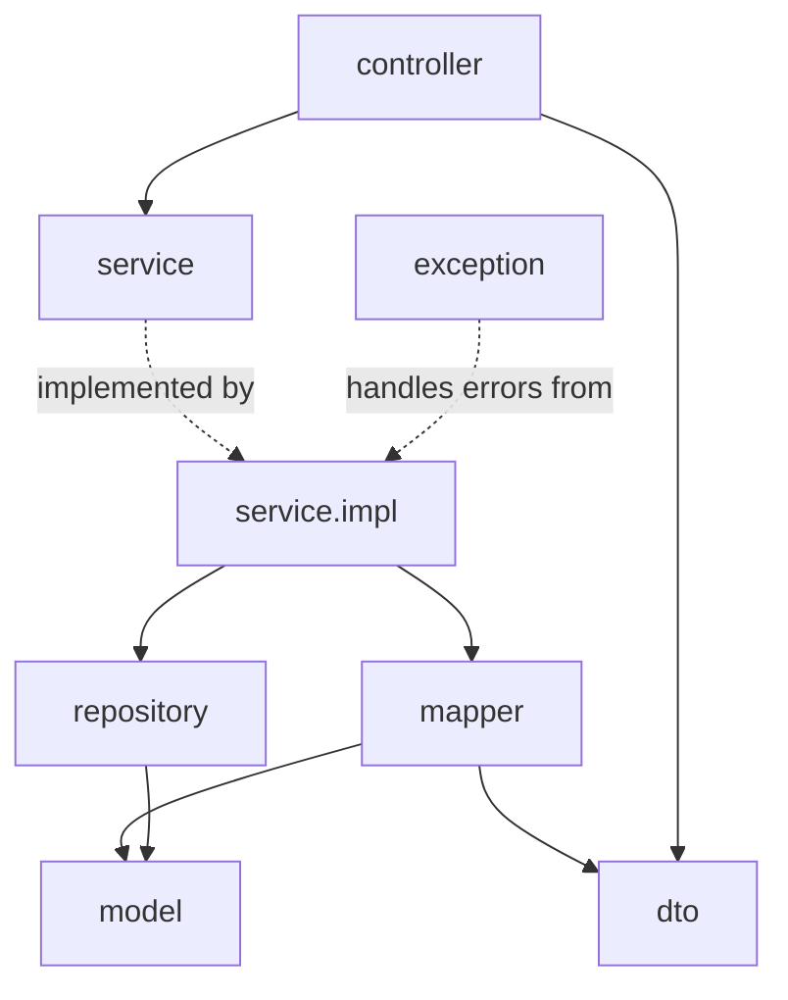
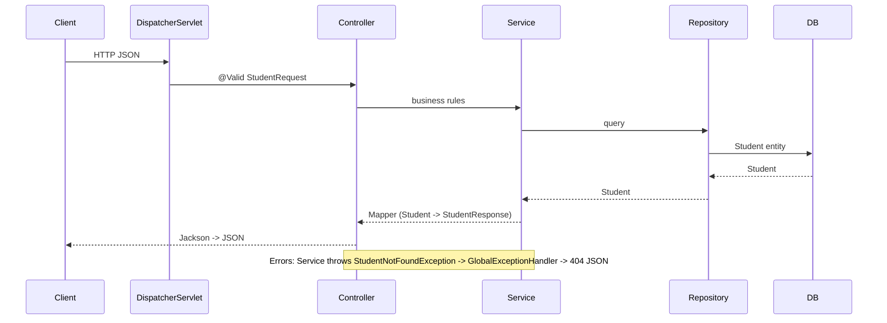

# 🏗️ course-practice: package structure

 

> [!NOTE]
> Base package: `com.prashant.coursepractice` (only `CoursePracticeApplication` lives here).

| Package | Responsibility | Example |
|---|---|---|
| `controller` | HTTP only: URL mapping, `@PathVariable`/`@RequestParam`/`@RequestBody`, `@Valid`, status codes. No business logic, never touches repositories. | `StudentController` |
| `service` | Business-logic interfaces. | `StudentService` |
| `service.impl` | `@Service` implementations: lookups, not-found checks, entity updates, transactions. | `StudentServiceImpl` |
| `repository` | Spring Data `JpaRepository` interfaces + derived queries. | `StudentRepository` |
| `model` | JPA `@Entity` classes (DB shape). Never returned directly to clients. | `Student` |
| `dto` | Request/response objects (API shape). Validation annotations go on request DTOs. | `StudentRequest`, `StudentResponse` |
| `mapper` | Entity <-> DTO conversion. | `StudentMapper` |
| `exception` | Custom exceptions + `@RestControllerAdvice` `GlobalExceptionHandler` (404/400 JSON). | `StudentNotFoundException` |
| `config` | `@Configuration` / `@Bean` / `@ConfigurationProperties` (create when needed). | — |

### 🧱 Layer diagram


## 🔀 Request flow


</details>

<details><summary>Text version</summary>

```text
HTTP JSON -> DispatcherServlet -> Controller (@Valid StudentRequest)
          -> Service (business rules) -> Repository -> DB (Student entity)
          <- Mapper (Student -> StudentResponse) <- Controller -> Jackson -> JSON
Errors: Service throws StudentNotFoundException -> GlobalExceptionHandler -> 404 JSON
```

</details>

## 🏷️ Naming conventions
- `XxxController`, `XxxService` + `XxxServiceImpl`, `XxxRepository`, `XxxRequest` / `XxxResponse`, `XxxMapper`, `XxxNotFoundException`.
- ⚠️ Constructor injection only (no field `@Autowired` in main code).
- Controllers depend on services (interfaces), services depend on repositories.
- Tests mirror main packages, e.g. `src/test/java/.../controller/StudentControllerTest`.

## 📌 Rule
> [!IMPORTANT]
> Every future Spring Boot task in this repo must follow this structure: new features add classes to the matching package, never back into one flat folder.
