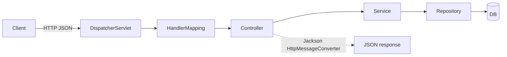

# 📘 Spring Boot Prerequisites — Revision Sheet

  

> [!TIP]
> Revise this before every Spring Boot task. Stack: **Spring Boot 4.x, Java 17**. Examples use the Student API (`Student`, `StudentController`, `StudentService`, `StudentRepository`, `StudentNotFoundException`).

## 🎯 How to answer any Spring interview question
1. **Definition**: what it is, in one sentence.
2. **Difference**: how it compares with the closest alternative.
3. **When to use**: the real situation where you'd pick it.
4. **Example**: one line from your Student API.

> [!NOTE]
> Also mention defaults (e.g. `required = true`) and the status code or behaviour you'd see.

---

## 🧠 1. Core: IoC, DI, beans
**📖 Explanation:** With IoC (Inversion of Control), the Spring container creates objects (beans) and wires them together, so your classes don't create their own dependencies. DI (Dependency Injection) is how the container supplies those dependencies.

> [!IMPORTANT]
> **📌 Key points / defaults**
> - Constructor injection is preferred: fields can be `final`, it's easy to unit test, and it fails fast. If a class has a single constructor, `@Autowired` isn't needed.
> - Stereotypes: `@Component` (generic), `@Service` (business logic), `@Repository` (data access, plus exception translation), `@Controller` / `@RestController` (web).
> - `@Configuration` + `@Bean` registers beans for classes you don't own, such as `ObjectMapper` or `RestClient`.
> - `@SpringBootApplication` = `@SpringBootConfiguration` (a `@Configuration`) + `@EnableAutoConfiguration` + `@ComponentScan` (the package of the main class and its sub-packages).
> - Bean scopes: **singleton** (the default, one per container), **prototype** (a new instance each time it's requested), plus web scopes: request, session and application.

**🎤 Interview questions**
- Constructor vs field vs setter injection: which do you prefer and why?
- `@Component` vs `@Bean`?
- What does `@SpringBootApplication` contain?
- What is the default bean scope? Is a singleton bean thread-safe?

**💡 Example:**
```java
public StudentService(StudentRepository repo) { this.repo = repo; }
```

- [ ] ✅ Revised

## 🔀 2. Request flow
**📖 Explanation:** HTTP request → **DispatcherServlet** (front controller) → HandlerMapping finds the controller method → arguments are bound (path, query, body via **Jackson**) → controller → service → repository → DB → the return value is serialized to JSON by Jackson (HttpMessageConverter) → response.



> [!IMPORTANT]
> **📌 Key points / defaults**
> - `@RestController` = `@Controller` + `@ResponseBody`, so the return value is written straight to the response body as JSON.
> - A plain `@Controller` treats a returned `String` as a **view name** (Thymeleaf/JSP), unless the method has `@ResponseBody`.
> - Keep controllers thin: put logic in the service and DB access in the repository.

**🎤 Interview questions**
- Walk me through what happens when a request hits your API.
- What is DispatcherServlet?
- `@RestController` vs `@Controller`?
- Who converts a Java object to JSON?

**💡 Example:**
```java
@RestController @RequestMapping("/api/students") public class StudentController { ... }
```

- [ ] ✅ Revised

## 🗺️ 3. Request mapping
**📖 Explanation:** These annotations map HTTP method + path to a handler method and bind request data to its parameters.

> [!IMPORTANT]
> **📌 Key points / defaults**
> - `@PathVariable` identifies a resource: `/students/{id}`. It's required. If the path segment is missing, the URL doesn't match (404).
> - `@RequestParam` is for filters, search, paging: `/students/search?name=x`. **It's `required = true` by default, so leaving it out gives a 400.** Use `required = false` or `defaultValue` to make it optional.
> - `@RequestBody` turns the JSON body into a DTO (via Jackson). Malformed JSON gives a 400.
> - **Never put a query string in the mapping path.** Use `@GetMapping("/search")`, not `"/search?name="`.
> - Use `@GetMapping`, `@PostMapping`, `@PutMapping`, `@PatchMapping` and `@DeleteMapping`.

**🎤 Interview questions**
- `@PathVariable` vs `@RequestParam` vs `@RequestBody`: when do you use each?
- What happens if a required `@RequestParam` is missing?
- How do you make a request param optional?
- How does the JSON body become a Java object?

**💡 Example:**
```java
@GetMapping("/search") List<Student> search(@RequestParam String name)
```

- [ ] ✅ Revised

## 🌐 4. HTTP semantics
**📖 Explanation:** HTTP methods each have a meaning, and the status code tells the client what happened.

> [!IMPORTANT]
> **📌 Key points / defaults**
> - **Safe** means no state change (GET, HEAD). **Idempotent** means repeating the request has the same effect as doing it once (GET, PUT, DELETE). POST is neither. PATCH is not guaranteed to be idempotent.
> - **PUT** replaces the whole resource. **PATCH** is a partial update (only the fields you send).
> - Status codes:
>   - 200 OK (read/update)
>   - 201 Created + `Location` header (create)
>   - 204 No Content (delete)
>   - 400 Bad Request (validation)
>   - 404 Not Found
>   - 409 Conflict (duplicate email)
>   - 500 Internal Server Error (unhandled)
> - `ResponseEntity` lets you control the status, headers and body.

**🎤 Interview questions**
- Is PUT idempotent? Is POST? Explain with an example.
- PUT vs PATCH?
- Which status codes for create, update, delete, not-found and duplicate?
- Why return a Location header on 201?

**💡 Example:**
```java
return ResponseEntity.created(URI.create("/api/students/" + saved.getId())).body(saved);
```

- [ ] ✅ Revised

## 🛡️ 5. Validation & error handling
**📖 Explanation:** Bean Validation (Jakarta) checks the input, and centralized handlers turn exceptions into clean error responses.

> [!IMPORTANT]
> **📌 Key points / defaults**
> - `@Valid` on a `@RequestBody` triggers validation. A failure throws `MethodArgumentNotValidException`, which gives a 400.
> - Constraints: `@NotNull`, `@NotBlank`, `@Size`, `@Email`, `@Min`/`@Max`, `@Pattern`, `@Positive`.
> - `@Valid` on a plain `String` param does nothing. Use constraints directly on the param, and `@Validated` on the class.
> - `@RestControllerAdvice` + `@ExceptionHandler(StudentNotFoundException.class)` gives a 404 in one place.
> - **ProblemDetail** (RFC 9457) is the standard error body: `type`, `title`, `status`, `detail`, `instance`.

**🎤 Interview questions**
- How do you validate a request body?
- `@Valid` vs `@Validated`?
- How do you handle exceptions globally?
- What is ProblemDetail?

**💡 Example:**
```java
@ExceptionHandler(StudentNotFoundException.class) ProblemDetail notFound(StudentNotFoundException e) { return ProblemDetail.forStatusAndDetail(HttpStatus.NOT_FOUND, e.getMessage()); }
```

- [ ] ✅ Revised

## 🗄️ 6. Spring Data JPA
**📖 Explanation:** You declare repository interfaces and Spring generates the implementation, with Hibernate as the JPA provider.

> [!IMPORTANT]
> **📌 Key points / defaults**
> - `@Entity` + `@Id` + `@GeneratedValue(strategy = GenerationType.IDENTITY)`.
> - `JpaRepository<Student, Long>` gives you `save`, `findById` (returns `Optional`), `findAll`, `existsById`, `deleteById`, `count` and paging/sorting.
> - Derived queries: `findByNameContainingIgnoreCase`, `existsByEmail`. Use `@Query` for custom JPQL.
> - `Optional.orElseThrow(...)` lets you fail with a 404 exception instead of returning null.
> - `@Transactional` on service methods: all or nothing, with rollback on unchecked exceptions by default. Use `readOnly = true` for reads.
> - Know these terms: lazy vs eager loading, the N+1 problem, `ddl-auto`.

**🎤 Interview questions**
- `CrudRepository` vs `JpaRepository`?
- How do derived query methods work?
- What does `@Transactional` do? Does it roll back on checked exceptions?
- What is the N+1 problem?

**💡 Example:**
```java
Student s = repo.findById(id).orElseThrow(() -> new StudentNotFoundException(id));
```

- [ ] ✅ Revised

## 🧪 7. Testing
**📖 Explanation:** Slice tests check one layer quickly, and full context tests check everything wired together.

> [!IMPORTANT]
> **📌 Key points / defaults**
> - `@WebMvcTest(StudentController.class)` loads only the web layer. Combine it with `MockMvc` and `@MockitoBean StudentService` (this replaces `@MockBean`, which is removed in Boot 4).
> - `@SpringBootTest` loads the full context. It's slower and is used for integration tests.
> - Test each endpoint for: happy path (200/201/204), not found (404) and invalid input (400).
> - `@DataJpaTest` is the repository slice, using an in-memory DB.

**🎤 Interview questions**
- `@WebMvcTest` vs `@SpringBootTest`?
- Why mock the service in controller tests?
- How do you assert the status and JSON fields with MockMvc?
- What is `@MockitoBean`?

**💡 Example:**
```java
mockMvc.perform(get("/api/students/99")).andExpect(status().isNotFound());
```

- [ ] ✅ Revised

## ⚙️ 8. Configuration
**📖 Explanation:** You configure the app from outside the code, using different values for each environment.

> [!IMPORTANT]
> **📌 Key points / defaults**
> - `application.properties` (flat `key=value`) vs `application.yml` (hierarchical). Both work. If both exist, `.properties` wins.
> - Profiles: `application-dev.yml` and `application-prod.yml`. Activate them with `spring.profiles.active=dev`. Use `@Profile("dev")` on beans.
> - `@Value("${app.page-size:20}")` is for a single value, with a default after the `:`.
> - `@ConfigurationProperties(prefix = "app")` binds a typed group of values (supports validation and relaxed binding). Prefer it for groups.
> - Precedence: command-line args > env vars > profile-specific files > `application.*`.

**🎤 Interview questions**
- `properties` vs `yml`?
- How do you use different DB settings in dev vs prod?
- `@Value` vs `@ConfigurationProperties`?
- How do you override a property at runtime?

**💡 Example:**
```java
@Value("${student.max-page-size:50}") private int maxPageSize;
```

- [ ] ✅ Revised

---

## 📊 Revision log

> [!NOTE]
> Rate confidence 1-5 — weaker topics get picked for the 6 AM round.

| Date | Topic | Confidence (1-5) |
|------|-------|------------------|
|      |       |                  |
