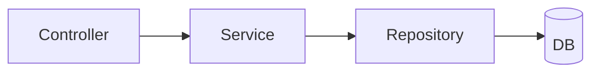

# 📘 Spring Boot Revision Workbook

   

> [!IMPORTANT]
> 📌 **This is the single Spring Boot revision file.** It has **concept notes and questions only, no answers.** You write the answer under every question, from memory, then paste the section back to Lumi for grading. Grades go to `interview-answers.md` and `spring-boot/interview-answers/`; status stays in [PROGRESS.md](../PROGRESS.md), the source of truth.

> [!TIP]
> **How to use (15 min/day):** read the **📌 Key points** once → close them → answer every **🎤 question** in its ✍️ slot, in your own words and aloud first → tick `✅ Revised` and write a `Score: _/5` → paste the section to Lumi. Anything you score 1-3 goes into the next 6 AM round.

> [!NOTE]
> Last reviewed: **30 Oct 2026** against the official Spring Boot 4.x docs and the [Boot 4.0 migration guide](https://github.com/spring-projects/spring-boot/wiki/Spring-Boot-4.0-Migration-Guide). Stack: `course-practice` = Boot 4.x on Java 17+, `banking-app` = Boot 4.1.2 on Java 21. Examples use the Student API (`Student`, `StudentRequest`, `StudentDto`, `StudentController`, `StudentService`, `StudentRepository`, `StudentNotFoundException`).

---

## 🎯 The answer template

Use it for every ✍️ slot: **Definition → Difference → When to use → Example from your Student API → Default / Gotcha**

> [!NOTE]
> Template: *"X is ___. Unlike Y, it ___. I'd use it when ___. In my Student API, ___. By default ___, and the gotcha is ___."*

---

## 🧭 Map: workbook sections ↔ prerequisites ↔ PROGRESS.md

> [!NOTE]
> **P§n** = section *n* of [prerequisites.md](prerequisites.md), the numbering [PROGRESS.md](../PROGRESS.md) tracks. **M1** = banking-app Milestone 1, "Auth tables + login returning a JWT". Statuses are a snapshot of PROGRESS.md (29 Oct 2026): ⬜ Not started · 🟡 In progress · 🟠 Attempted · 🔴 Needs correction · 🔵 Ready for revision · ✅ Completed and verified. PROGRESS.md has the live value. 🔥 marks the active section.

| # | Section | Prerequisite § | Status in PROGRESS.md |
|---|---|---|---|
| 1 | 🧠 Core: IoC, DI, beans, lifecycle, auto-config | **P§1** | 🔵 Ready for revision |
| 2 | 🔀 Request flow | **P§2** | 🟡 In progress (Day 04 Q1 pending) |
| 3 | 🗺️ Request mapping | **P§3** | 🔵 Ready for revision |
| 4 | 🌐 HTTP semantics and REST design | **P§4** | 🔵 Ready for revision |
| 5 | 🛡️ Validation and error handling | **P§5** 🔥 | 🔥 🟡 In progress (Part B1 / B2) |
| 6 | 📦 DTO vs Entity | **P§5** (bridges P§3) | 🟡 In progress |
| 7 | 🗄️ Spring Data JPA | **P§6** | ⬜ Not started |
| 8 | 🔗 Entity relationships and pagination | **P§6** | ⬜ Not started |
| 9 | 🔒 Transactions | **P§6** | ⬜ Not started |
| 10 | 🧪 Testing | **P§7** | ⬜ Not started |
| 11 | ⚙️ Configuration | **P§8** | ⬜ Not started |
| 12 | 📈 Actuator and logging | **P§8** (extension) | ⬜ Not started |
| 13 | 🔐 Spring Security basics | **M1** (beyond prerequisites) | ⬜ Not started |
| 14 | 🎫 JWT resource server and CORS | **M1** | ⬜ Not started |
| 15 | 🎭 AOP and proxies | **M1** (deepens §9, §13) | ⬜ Not started |
| 16 | 🔖 Optimistic locking (`@Version`) | **M1 → M3** | ⬜ Not started |
| 17 | 🧱 Flyway migrations | **M1** (V2+ hand-written) | ⬜ Not started |
| 18 | 🐳 Testcontainers `@ServiceConnection` | **M1** (and P§7) | ⬜ Not started |
| 19 | ☕ Java 17 essentials | support | n/a |
| 20 | ⏰ Cache, schedule, async | support | n/a |
| 21 | ⚡ Rapid-fire (answer from memory) | all | n/a |

---

## 📑 Contents

- [🆕 Reference: what changed in Boot 4](#-reference-what-changed-in-boot-4)
- **Prerequisites P§1 to P§8**
  - [🧠 1. Core: IoC, DI, beans, lifecycle, auto-config](#-1-core-ioc-di-beans-lifecycle-auto-config)
  - [🔀 2. Request flow](#-2-request-flow)
  - [🗺️ 3. Request mapping](#️-3-request-mapping)
  - [🌐 4. HTTP semantics and REST design](#-4-http-semantics-and-rest-design)
  - [🛡️ 5. Validation and error handling](#️-5-validation-and-error-handling)
  - [📦 6. DTO vs Entity](#-6-dto-vs-entity)
  - [🗄️ 7. Spring Data JPA](#️-7-spring-data-jpa)
  - [🔗 8. Entity relationships and pagination](#-8-entity-relationships-and-pagination)
  - [🔒 9. Transactions](#-9-transactions)
  - [🧪 10. Testing](#-10-testing)
  - [⚙️ 11. Configuration](#️-11-configuration)
  - [📈 12. Actuator and logging](#-12-actuator-and-logging)
- **Banking Milestone 1 extras**
  - [🔐 13. Spring Security basics](#-13-spring-security-basics)
  - [🎫 14. JWT resource server and CORS](#-14-jwt-resource-server-and-cors)
  - [🎭 15. AOP and proxies](#-15-aop-and-proxies)
  - [🔖 16. Optimistic locking (`@Version`)](#-16-optimistic-locking-version)
  - [🧱 17. Flyway migrations](#-17-flyway-migrations)
  - [🐳 18. Testcontainers `@ServiceConnection`](#-18-testcontainers-serviceconnection)
- **Support**
  - [☕ 19. Java 17 essentials](#-19-java-17-essentials)
  - [⏰ 20. Cache, schedule, async](#-20-cache-schedule-async)
  - [⚡ 21. Rapid-fire (answer from memory)](#-21-rapid-fire-answer-from-memory)
- [📊 Score board](#-score-board)
- [📚 Sources](#-sources)

---

## 🆕 Reference: what changed in Boot 4

> [!NOTE]
> Concept reference for sections 1, 10, 11 and 14. Read it, don't memorize the package names: you look them up in the migration guide.

| Area | Boot 3.x | Boot 4.x |
|---|---|---|
| Java | 17+ | **17+** minimum. Boot 4.1 docs list compatibility up to Java 27 (older 4.x lines list a lower maximum). Check the *System Requirements* page of your exact version. |
| Spring Framework | 6.x | **7.x** (Jakarta EE 11) |
| Servlet / Tomcat | Servlet 6.0 / Tomcat 10.1 | **Servlet 6.1 / Tomcat 11** |
| Web starter | `spring-boot-starter-web` | **`spring-boot-starter-webmvc`** |
| Test starters | one `spring-boot-starter-test` | plus focused ones: **`spring-boot-starter-webmvc-test`**, **`spring-boot-starter-data-jpa-test`** |
| `@WebMvcTest` package | `org.springframework.boot.test.autoconfigure.web.servlet` | **`org.springframework.boot.webmvc.test.autoconfigure`** |
| `@DataJpaTest` package | `org.springframework.boot.test.autoconfigure.orm.jpa` | **`org.springframework.boot.data.jpa.test.autoconfigure`** |
| `@EntityScan` package | `org.springframework.boot.autoconfigure.domain` | `org.springframework.boot.persistence.autoconfigure` |
| Mock a bean | `@MockBean` / `@SpyBean` | **removed**: `@MockitoBean` / `@MockitoSpyBean` (`org.springframework.test.context.bean.override.mockito`) |
| `MockMvc` in `@SpringBootTest` | provided automatically | **add `@AutoConfigureMockMvc`** (same for `TestRestTemplate`: `@AutoConfigureTestRestTemplate`) |
| JSON | Jackson 2 (`com.fasterxml.jackson`) | **Jackson 3** (`tools.jackson`), auto-configured **`JsonMapper`** |
| Jackson annotations | `com.fasterxml.jackson.annotation` | **same package** (`@JsonProperty`, `@JsonIgnore` unchanged); databind annotations such as `@JsonSerialize` moved to `tools.jackson.databind.annotation` |
| AOP starter | `spring-boot-starter-aop` | renamed **`spring-boot-starter-aspectj`** |
| Security starters | `spring-boot-starter-oauth2-*` | `spring-boot-starter-security-oauth2-client`, `...-resource-server`, `...-authorization-server` |

> [!IMPORTANT]
> **📌 Key points / defaults**
> - Jackson 3's `JsonMapper` is **immutable**: configure it through `JsonMapper.builder()`, a `JsonMapperBuilderCustomizer` or `spring.jackson.*`.
> - Stepping stones when migrating: `spring.jackson.use-jackson2-defaults=true`, the deprecated `spring-boot-jackson2` module, and `spring-boot-starter-classic` (+ `-test-classic`). Move to **Boot 3.5** first, then 4.0.
> - New in 4.0: auto-configuration for **HTTP Service Clients** and **API versioning**.

---

## 🧠 1. Core: IoC, DI, beans, lifecycle, auto-config


🔗 **P§1** · 🔵 Ready for revision

> [!IMPORTANT]
> **📌 Key points / defaults**
> - **Constructor injection** is preferred: `final` fields, easy `new` in tests, fails fast at startup. With a single constructor, `@Autowired` isn't needed.
> - **Stereotypes:** `@Component` (generic), `@Service`, `@Repository` (adds exception translation), `@Controller` / `@RestController`.
> - `@Configuration` + `@Bean` is for classes you **don't own** (`JsonMapper`, `RestClient`).
> - `@SpringBootApplication` = `@SpringBootConfiguration` + `@EnableAutoConfiguration` + `@ComponentScan` (the main class's package and below).
> - **Scopes:** `singleton` (default), `prototype`, `request`, `session`, `application`.
> - **Lifecycle:** instantiate → inject → `@PostConstruct` → ready → `@PreDestroy` on shutdown. Both annotations come from `jakarta.annotation`. `@PostConstruct` runs **after injection but before AOP proxies wrap the bean**, so `@Transactional`/`@Cacheable` calls on the bean itself are not applied inside it. `@PreDestroy` is not called for prototype beans.
> - Two beans of one type and no choice → `NoUniqueBeanDefinitionException`. `@Primary` = default winner, `@Qualifier("name")` = explicit choice at one injection point.
> - Singletons are **eager** by default; `@Lazy` delays creation. `@Profile` and `@ConditionalOnProperty` register a bean only in some situations.
> - **Starters** are dependency bundles. **Auto-configuration** creates beans from the classpath, properties and the beans you already defined. Candidates are listed in `META-INF/spring/org.springframework.boot.autoconfigure.AutoConfiguration.imports`; most are guarded by `@ConditionalOnClass`, `@ConditionalOnMissingBean`, `@ConditionalOnProperty`, so **most** auto-configured beans back off when you define your own.
> - `--debug` / `debug=true` prints the **conditions evaluation report**. Exclude with `@SpringBootApplication(exclude = ...)` or `spring.autoconfigure.exclude`.
> - A `DataSource` is auto-configured when a driver and a pool are on the classpath **and** `spring.datasource.url` is set (or an embedded DB is present).
> - Boot 4 is **modular**: auto-configuration moved out of one big jar into per-technology modules.

**💡 Example:**

```java
@Service
public class StudentService {
    private final StudentRepository repo;
    public StudentService(StudentRepository repo) { this.repo = repo; }
}
```

**🎤 Interview questions**

**1.1** Constructor vs field vs setter injection: which do you prefer and why?

> ✍️ My answer:

**1.2** `@Component` vs `@Bean`: when do you use each?

> ✍️ My answer:

**1.3** What does `@SpringBootApplication` contain, and what does the component scan cover?

> ✍️ My answer:

**1.4** What is the default bean scope? Is a singleton bean thread-safe? ⚠️ Trap: what makes it unsafe?

> ✍️ My answer:

**1.5** ⚠️ Trap: a prototype bean is injected into a singleton. How many instances exist and how would you get a fresh one each time?

> ✍️ My answer:

**1.6** Two beans implement the same interface. What happens at startup and how do you fix it? `@Primary` vs `@Qualifier`: which wins if both are present?

> ✍️ My answer:

**1.7** Why use `@PostConstruct` instead of the constructor? What is *not* yet in place when it runs?

> ✍️ My answer:

**1.8** How does Boot decide to configure a `DataSource`, and how do you override an auto-configured bean?

> ✍️ My answer:

**1.9** How would you find out *why* an auto-configuration did or did not apply?

> ✍️ My answer:

- [ ] ✅ Revised (answered from memory)

Score: _/5

[⬆ Back to contents](#-contents)

---

## 🔀 2. Request flow


🔗 **P§2** · 🟡 In progress (Day 04 Q1 pending)

> [!IMPORTANT]
> **📌 Key points / defaults**
> - `@RestController` = `@Controller` + `@ResponseBody`. A plain `@Controller` treats a returned `String` as a **view name**.
> - Keep controllers thin: logic in the service, DB access in the repository.
> - A **Filter** is Servlet-level and runs before Spring MVC. An **Interceptor** is Spring MVC-level (`preHandle`, `postHandle`, `afterCompletion`). `@RestControllerAdvice` handles exceptions thrown by handlers.
> - Java ⇄ JSON conversion is done by `HttpMessageConverter`s (Jackson-based). In Boot 4 that is Jackson 3.
> - Vocabulary for your answer: `DispatcherServlet`, `HandlerMapping`, `HandlerAdapter`, argument resolvers, `HttpMessageConverter`, `HandlerExceptionResolver`.

**💡 Example:**

> A concept aid only: the **layers** of your Student API. Your answer to question 1 also has to say what sits **before** the controller and what happens to the **return value**.



**🎤 Interview questions**

**2.1** Walk me through what happens when a request hits `GET /api/students/1`, from the client to the JSON response. Name where a not-found error is handled.

> ✍️ My answer:

**2.2** What is `DispatcherServlet`?

> ✍️ My answer:

**2.3** `@RestController` vs `@Controller`: what happens if a plain `@Controller` returns a `String`?

> ✍️ My answer:

**2.4** Who converts a Java object to JSON, and who converts JSON to a Java object?

> ✍️ My answer:

**2.5** Filter vs interceptor: where does each run and what can each see?

> ✍️ My answer:

- [ ] ✅ Revised (answered from memory)

Score: _/5

[⬆ Back to contents](#-contents)

---

## 🗺️ 3. Request mapping


🔗 **P§3** · 🔵 Ready for revision

> [!IMPORTANT]
> **📌 Key points / defaults**
> - `@PathVariable` identifies a resource (`/students/{id}`) and is required. A missing segment means no match → **404**. A wrong type (`/students/abc` for `Long`) → **400** (`MethodArgumentTypeMismatchException`).
> - `@RequestParam` is for filters, search, paging. `required = true` by default → missing = **400** (`MissingServletRequestParameterException`). Make it optional with `required = false`, `defaultValue` or `Optional<T>`.
> - `@RequestBody` converts JSON to a DTO through Jackson. Malformed JSON → **400** (`HttpMessageNotReadableException`).
> - Wrong HTTP method on a mapped path → **405**. Unsupported `Content-Type` → **415**.
> - **Never** put a query string in the mapping path: `@GetMapping("/search")`, not `"/search?name="`.
> - Shortcuts: `@GetMapping`, `@PostMapping`, `@PutMapping`, `@PatchMapping`, `@DeleteMapping`.

**💡 Example:**

```java
@GetMapping("/search")
List<StudentDto> search(@RequestParam String name) { return service.search(name); }
```

**🎤 Interview questions**

**3.1** `@PathVariable` vs `@RequestParam` vs `@RequestBody`: when do you use each?

> ✍️ My answer:

**3.2** What happens if a required `@RequestParam` is missing? What if a `@PathVariable` has the wrong type?

> ✍️ My answer:

**3.3** How do you make a request param optional? Name three ways.

> ✍️ My answer:

**3.4** How does the JSON body become a Java object? What must the DTO have for this to work?

> ✍️ My answer:

**3.5** Which status do you get for an unknown path, a wrong HTTP method and an unsupported content type?

> ✍️ My answer:

**3.6** ⚠️ Trap: what is wrong with `@GetMapping("/search?name=")`?

> ✍️ My answer:

- [ ] ✅ Revised (answered from memory)

Score: _/5

[⬆ Back to contents](#-contents)

---

## 🌐 4. HTTP semantics and REST design


🔗 **P§4** · 🔵 Ready for revision

> [!IMPORTANT]
> **📌 Key points / defaults**
> - **Safe** = no state change (GET, HEAD). **Idempotent** = repeating the request has the same effect as doing it once (GET, PUT, DELETE). POST is neither. PATCH is not guaranteed idempotent.
> - **PUT** replaces the whole resource; **PATCH** changes only the fields sent.
> - REST naming: **plural nouns**, no verbs in paths (`/api/students/{id}`, not `/getStudent`).
> - Versioning: in the path (`/api/v1/...`) or a header. Boot 4 adds API-versioning auto-configuration.
> - `ResponseEntity` controls status, headers and body.
> - Typical codes: 200, 201 + `Location`, 204, 400, 401, 403, 404, 405, 409, 415, 500.

**💡 Example:**

```java
return ResponseEntity.created(URI.create("/api/students/" + saved.id())).body(saved);
```

**🎤 Interview questions**

**4.1** What does *idempotent* mean? Is PUT idempotent? Is POST? Show it with `/api/students`.

> ✍️ My answer:

**4.2** ⚠️ Trap (your Day 03 Q1): a client sends `DELETE /students/5` twice. Is DELETE idempotent? What does the second call return in **your** API, and does that break idempotency?

> ✍️ My answer:

**4.3** PUT vs PATCH?

> ✍️ My answer:

**4.4** Which status code for: create, update, delete, validation error, not found, duplicate email, unhandled error?

> ✍️ My answer:

**4.5** Why return a `Location` header on 201?

> ✍️ My answer:

**4.6** 401 vs 403: what is the difference?

> ✍️ My answer:

**4.7** 400 vs 404 vs 409: how do you choose for a duplicate email?

> ✍️ My answer:

- [ ] ✅ Revised (answered from memory)

Score: _/5

[⬆ Back to contents](#-contents)

---

## 🛡️ 5. Validation and error handling


🔗 **P§5** 🔥 · 🔥 🟡 In progress (Part B1 / B2)

> [!IMPORTANT]
> **📌 Key points / defaults**
> - Bean Validation (Jakarta) constraints: `@NotNull`, `@NotBlank`, `@NotEmpty`, `@Size`, `@Email`, `@Min`/`@Max`, `@Pattern`, `@Positive`.
> - `@Valid` on a `@RequestBody` triggers validation of that one object.
> - **Spring 6.1+ built-in method validation:** constraints placed **directly on controller parameters** are validated by Spring MVC itself and raise `HandlerMethodValidationException`. **Do not** add class-level `@Validated` to a controller: it opts you out of the built-in support and switches to AOP validation (`ConstraintViolationException`). Class-level `@Validated` is still the right tool on **service and other non-controller beans**.
> - A single `@Valid @RequestBody` with no other constraints on the method raises `MethodArgumentNotValidException`. Once the method also has parameter constraints, the body is validated through method validation too. **Handle both exceptions** in your advice.
> - `@Valid` = Jakarta standard, supports **nested/cascading** validation. `@Validated` = Spring's, adds **validation groups** and AOP method validation on beans.
> - `@RestControllerAdvice` + `@ExceptionHandler` centralizes error handling. Extending `ResponseEntityExceptionHandler` gives `ProblemDetail` responses for Spring MVC's own exceptions.
> - **`ProblemDetail`** (RFC 9457) fields: `type`, `title`, `status`, `detail`, `instance`, plus custom properties.
> - A not-found `Student` must be a **404**, never a 500.

**🎤 Interview questions**

**5.1** How do you validate a request body, and which exception and status do you get when it fails?

> ✍️ My answer:

**5.2** `@Valid` vs `@Validated`: what does each add?

> ✍️ My answer:

**5.3** How do you handle exceptions globally? Which annotations, which return types?

> ✍️ My answer:

**5.4** What is `ProblemDetail` and which standard does it follow? Which fields does it have?

> ✍️ My answer:

**5.5** `@NotNull` vs `@NotEmpty` vs `@NotBlank`?

> ✍️ My answer:

**5.6** Fill in the table (Spring 6.1+). Exception and status for each situation:

> | Situation | Exception | Status |
> |---|---|---|
> | Only `@Valid @RequestBody` fails | ✍️ | ✍️ |
> | `@RequestParam @Min(1) int size` fails, no class-level `@Validated` | ✍️ | ✍️ |
> | Same constraint, but the controller has class-level `@Validated` | ✍️ | ✍️ |

> ✍️ My answer:

**5.7** Why is 409 better than 400 for a duplicate email, and why isn't an `existsByEmail` check alone enough to keep emails unique? (Day 04 Q3)

> ✍️ My answer:

**5.8** ⚠️ Trap: should a controller class carry `@Validated` in Spring 6.1+? Why or why not?

> ✍️ My answer:

- [ ] ✅ Revised (answered from memory)

Score: _/5

[⬆ Back to contents](#-contents)

---

## 📦 6. DTO vs Entity


🔗 **P§5** (bridges P§3) · 🟡 In progress

> [!IMPORTANT]
> **📌 Key points / defaults**
> - An **entity** maps to a table. A **DTO** is the shape of your API.
> - Reasons to keep entities out of controllers: leaked internal fields, API coupled to the DB schema, `LazyInitializationException` and infinite JSON recursion, **mass assignment** (a client sets `id` or `role`), different shapes needed for create / update / read.
> - Java **records** make compact, immutable DTOs. Use separate DTOs for create, update and read (`StudentRequest` vs `StudentDto`).
> - Map in the service or a mapper (MapStruct or hand-written), not in the entity or controller.

**💡 Example:**

```java
public record StudentRequest(@NotBlank String name, @Email String email) {}
public record StudentDto(Long id, String name, String email) {}
```

**🎤 Interview questions**

**6.1** Why use DTOs instead of returning entities? Give at least four reasons.

> ✍️ My answer:

**6.2** What is mass assignment and how do DTOs prevent it?

> ✍️ My answer:

**6.3** Where should the entity ⇄ DTO mapping live, and where must it not live?

> ✍️ My answer:

**6.4** Why separate `StudentRequest` and `StudentDto`?

> ✍️ My answer:

- [ ] ✅ Revised (answered from memory)

Score: _/5

[⬆ Back to contents](#-contents)

---

## 🗄️ 7. Spring Data JPA


🔗 **P§6** · ⬜ Not started

> [!IMPORTANT]
> **📌 Key points / defaults**
> - `@Entity` + `@Id` + `@GeneratedValue(strategy = GenerationType.IDENTITY)`.
> - **Repository hierarchy (Spring Data 3+):** `CrudRepository` (basic CRUD) and `PagingAndSortingRepository` (paging/sorting) are **separate** interfaces; `PagingAndSortingRepository` does not extend `CrudRepository`. `JpaRepository` extends `ListCrudRepository`, `ListPagingAndSortingRepository` and `QueryByExampleExecutor`, and adds JPA extras (`flush`, `saveAllAndFlush`, batch deletes). The `List` variants are why it returns `List` instead of `Iterable`.
> - `findById` returns an `Optional`; `orElseThrow(...)` turns "not found" into a 404 exception.
> - **Derived queries** are parsed from method names at startup (`findByNameContainingIgnoreCase`, `existsByEmail`). A bad property name fails startup. Use `@Query` for custom JPQL.
> - `save()` on a new entity (null id) inserts; on an existing id it merges (update).
> - **Lazy vs eager:** lazy loads on first access; eager loads immediately. Defaults: `@OneToMany` / `@ManyToMany` **lazy**, `@ManyToOne` / `@OneToOne` **eager**.
> - **N+1:** 1 query for the parents + N queries for lazy children. Fixes: `JOIN FETCH`, `@EntityGraph`, batch fetching.
> - `spring.jpa.hibernate.ddl-auto`: `none | validate | update | create | create-drop`. Use `validate` or `none` in prod with Flyway/Liquibase.
> - `spring.jpa.open-in-view` is **true by default** and keeps the JPA `EntityManager` open for the **whole web request** (controller and JSON serialization, not just views). That hides `LazyInitializationException` but lets lazy queries run in the controller and holds a DB connection longer. Boot logs a warning; many teams set it to `false` and fetch what they need in the service.

**💡 Example:**

```java
Student s = repo.findById(id).orElseThrow(() -> new StudentNotFoundException(id));
boolean taken = repo.existsByEmail(email);
```

**🎤 Interview questions**

**7.1** `CrudRepository` vs `JpaRepository`: what does `JpaRepository` add, and what does it extend in Spring Data 3+?

> ✍️ My answer:

**7.2** How do derived query methods work? What happens when you misspell a property?

> ✍️ My answer:

**7.3** What is the N+1 problem? Give a concrete example and two fixes.

> ✍️ My answer:

**7.4** Lazy vs eager: what are the defaults for each association type, and what do you set for `@ManyToOne`?

> ✍️ My answer:

**7.5** What does `save()` do for a new entity and for an existing id?

> ✍️ My answer:

**7.6** What does `ddl-auto=validate` do, and why use it in prod?

> ✍️ My answer:

**7.7** What is open-in-view, why is it on by default, and what is the risk?

> ✍️ My answer:

**7.8** Why does `findById` return `Optional`, and how do you turn it into a 404?

> ✍️ My answer:

- [ ] ✅ Revised (answered from memory)

Score: _/5

[⬆ Back to contents](#-contents)

---

## 🔗 8. Entity relationships and pagination


🔗 **P§6** · ⬜ Not started

> [!IMPORTANT]
> **📌 Key points / defaults**
> **Relationships**
> - `@ManyToOne` is the **owning side** (holds the FK, `@JoinColumn`). `@OneToMany(mappedBy = "course")` is the **inverse side**: it creates no FK of its own.
> - `@ManyToMany` needs a join table; it is often better modeled as a join entity.
> - **Cascade** (`PERSIST`, `MERGE`, `REMOVE`, `ALL`) pushes operations to children. `orphanRemoval = true` deletes children removed from the collection.
> - Set `@ManyToOne(fetch = LAZY)`. Keep both sides in sync with helper methods (`course.addStudent(s)`).
> - Bidirectional entities serialized directly cause **infinite recursion**, so use DTOs.
> - `@Enumerated(EnumType.STRING)`, not the default ordinal.
> - **Avoid Lombok `@Data` on entities:** the generated `equals`/`hashCode`/`toString` can trigger lazy loads and recursion. Base `equals`/`hashCode` on the id or a business key, deliberately.
>
> **Pagination**
> - Repository method takes a `Pageable` and returns `Page<T>` (extra **count query**, knows totals) or `Slice<T>` (no count, only knows if there is a next slice).
> - `PageRequest.of(page, size, Sort.by("name"))`. **Page index is 0-based.** A controller can accept `Pageable` directly: `?page=0&size=10&sort=name,asc`.
> - Default page size **20**. Cap it with `spring.data.web.pageable.max-page-size` (default 2000) to protect the DB.
> - Return a `Page<Dto>` from the **service** (`page.map(mapper::toDto)`), never `Page<Entity>`.
> - **Do not serialize a `Page` straight from a controller:** since Spring Data 3.3 the `PageImpl` JSON shape is not stable and Spring logs a warning. Return a **`PagedModel<StudentDto>`** (`new PagedModel<>(page)`), or enable `@EnableSpringDataWebSupport(pageSerializationMode = VIA_DTO)`, or map to your own response record.

**💡 Example:**

```java
@Entity class Course {
    @Id Long id;
    @OneToMany(mappedBy = "course", cascade = CascadeType.ALL, orphanRemoval = true)
    private List<Student> students = new ArrayList<>();
}
@Entity class Student {
    @Id Long id;
    @ManyToOne(fetch = FetchType.LAZY) @JoinColumn(name = "course_id")
    private Course course;
}
```

**🎤 Interview questions**

**8.1** Which side owns a relationship and what does `mappedBy` mean?

> ✍️ My answer:

**8.2** Cascade vs `orphanRemoval`: what is the difference?

> ✍️ My answer:

**8.3** Why prefer `@ManyToOne(fetch = LAZY)` and `@Enumerated(EnumType.STRING)`?

> ✍️ My answer:

**8.4** What goes wrong when you serialize a bidirectional entity directly?

> ✍️ My answer:

**8.5** Why is Lombok `@Data` dangerous on an entity?

> ✍️ My answer:

**8.6** `Page` vs `Slice`: what does each cost and know?

> ✍️ My answer:

**8.7** Why paginate at all, and why cap the maximum page size? What is the first page index?

> ✍️ My answer:

**8.8** What is wrong with returning a `Page<StudentDto>` straight from a controller in recent Spring Data versions, and what are your options?

> ✍️ My answer:

- [ ] ✅ Revised (answered from memory)

Score: _/5

[⬆ Back to contents](#-contents)

---

## 🔒 9. Transactions


🔗 **P§6** · ⬜ Not started

> [!IMPORTANT]
> **📌 Key points / defaults**
> - Put `@Transactional` on **service** methods. `readOnly = true` for reads.
> - **Rolls back on unchecked exceptions** (`RuntimeException`, `Error`). **Checked exceptions do not roll back** unless `rollbackFor = Exception.class`.
> - It works **through a proxy**, so it only applies to calls that arrive through the proxy.
> - **Visibility (Spring 6.0+):** with class-based (CGLIB) proxies, which Boot uses by default, `protected` and package-visible methods also work. With interface-based proxies, methods must be `public` and on the interface. `private` never works. Best practice: keep them `public`.
> - Swallowing the exception in a `try/catch` means the proxy never sees it → no rollback.
> - Propagation: `REQUIRED` (default: join or start) vs `REQUIRES_NEW` (suspend and start a new one).

**💡 Example:**

```java
@Service
public class StudentService {
    @Transactional
    public void enroll(Long id) { /* ... */ }

    public void bulk() { enroll(1L); }
}
```

**🎤 Interview questions**

**9.1** What does `@Transactional` do? Where should it go?

> ✍️ My answer:

**9.2** Does it roll back on checked exceptions? How do you change that?

> ✍️ My answer:

**9.3** ⚠️ Trap: look at the code below. Is `bulk()` transactional? Why, and how would you fix it?

> ✍️ My answer:

**9.4** List five reasons `@Transactional` appears not to work.

> ✍️ My answer:

**9.5** `REQUIRED` vs `REQUIRES_NEW`: what is the difference and when would you use `REQUIRES_NEW` (hint: audit logs)?

> ✍️ My answer:

**9.6** What does `readOnly = true` give you?

> ✍️ My answer:

- [ ] ✅ Revised (answered from memory)

Score: _/5

[⬆ Back to contents](#-contents)

---

## 🧪 10. Testing


🔗 **P§7** · ⬜ Not started

> [!IMPORTANT]
> **📌 Key points / defaults**
> - **Slice tests** load one layer fast (`@WebMvcTest`, `@DataJpaTest`). `@SpringBootTest` loads the whole context.
> - Boot 4 dependencies: **`spring-boot-starter-webmvc-test`** (and `spring-boot-starter-data-jpa-test` for repository slices).
> - `@MockBean` / `@SpyBean` were **removed** in Boot 4: use `@MockitoBean` / `@MockitoSpyBean`. They go on test **fields**, not in `@Configuration` classes.
> - `@SpringBootTest` no longer provides `MockMvc` automatically: add **`@AutoConfigureMockMvc`**.
> - `@DataJpaTest` is the repository slice (in-memory DB by default, rolls back each test).
> - `MockMvcTester` (AssertJ-style) is the newer alternative to classic `MockMvc` assertions.
> - Always test each endpoint for: **happy path** (200/201/204), **not found** (404), **invalid input** (400).
> - Service logic: plain JUnit 5 + Mockito, no Spring at all (fastest).

**💡 Example:**

```java
// Boot 4 imports: look them up, don't memorize them
import org.springframework.boot.webmvc.test.autoconfigure.WebMvcTest;
import org.springframework.boot.data.jpa.test.autoconfigure.DataJpaTest;
import org.springframework.test.context.bean.override.mockito.MockitoBean;
```

**🎤 Interview questions**

**10.1** `@WebMvcTest` vs `@SpringBootTest`: what does each load and when do you pick each?

> ✍️ My answer:

**10.2** Why mock the service in a controller test, and which annotation do you use in Boot 4?

> ✍️ My answer:

**10.3** What is `@MockitoBean` and what did it replace?

> ✍️ My answer:

**10.4** How do you assert the status and a JSON field with `MockMvc`?

> ✍️ My answer:

**10.5** ⚠️ Trap: you upgrade to Boot 4 and your `@SpringBootTest` that autowires `MockMvc` fails. What is missing?

> ✍️ My answer:

**10.6** ⚠️ Trap: your `@WebMvcTest` import no longer compiles after the upgrade. Why, and what do you add?

> ✍️ My answer:

**10.7** What is `@DataJpaTest` and why does it roll back?

> ✍️ My answer:

- [ ] ✅ Revised (answered from memory)

Score: _/5

[⬆ Back to contents](#-contents)

---

## ⚙️ 11. Configuration


🔗 **P§8** · ⬜ Not started

> [!IMPORTANT]
> **📌 Key points / defaults**
> - `application.properties` (flat) vs `application.yml` (hierarchical): same power. If both exist, **`.properties` wins**.
> - Profiles: `application-dev.yml`, `application-prod.yml`; activate with `spring.profiles.active=dev`; `@Profile("dev")` on beans.
> - `@Value("${app.page-size:20}")` for one value (default after `:`).
> - `@ConfigurationProperties(prefix = "student")` binds a **typed group** (validation, relaxed binding such as `max-page-size` ↔ `maxPageSize`). A properties class or record must be **registered**: `@ConfigurationPropertiesScan` (or `@EnableConfigurationProperties(StudentProps.class)`) on a configuration/main class, or `@Component` on a class. Records bind through the constructor automatically in Boot 3+.
> - **Precedence (simplified, high → low):** command-line args > Java system properties (`-D`) > OS env vars > profile-specific files > `application.*`. The full list is in the reference docs.
> - Never commit secrets: env vars or a secret manager.

**💡 Example:**

```java
@ConfigurationProperties(prefix = "student")
public record StudentProps(int maxPageSize, String defaultSort) {}
```
```yaml
student:
  max-page-size: 50
  default-sort: name
```

**🎤 Interview questions**

**11.1** `application.properties` vs `application.yml`: what differs, and which wins if both exist?

> ✍️ My answer:

**11.2** How do you use different DB settings in dev vs prod?

> ✍️ My answer:

**11.3** `@Value` vs `@ConfigurationProperties`: when do you use each?

> ✍️ My answer:

**11.4** How do you override a property at runtime, with and without rebuilding?

> ✍️ My answer:

**11.5** Order these from highest to lowest precedence: `application.yml`, env var, `--server.port`, `application-dev.yml`.

> ✍️ My answer:

**11.6** ⚠️ Trap: your `@ConfigurationProperties` record always has default values. What did you forget?

> ✍️ My answer:

- [ ] ✅ Revised (answered from memory)

Score: _/5

[⬆ Back to contents](#-contents)

---

## 📈 12. Actuator and logging


🔗 **P§8** (extension) · ⬜ Not started

> [!IMPORTANT]
> **📌 Key points / defaults**
> - Add `spring-boot-starter-actuator`. By default only **`/actuator/health`** is exposed over HTTP. Expose more with `management.endpoints.web.exposure.include=health,info,metrics`.
> - **Secure actuator endpoints**: they can leak details. Health groups give liveness and readiness probes for Kubernetes.
> - Default logging is **SLF4J + Logback** at **INFO**. Levels: `TRACE < DEBUG < INFO < WARN < ERROR`. Per package: `logging.level.com.example.student=DEBUG`.
> - Parameterized logging: `log.info("Created student {}", id)`. Never log secrets or personal data.

**🎤 Interview questions**

**12.1** What is Actuator and which endpoint is exposed by default? How do you expose more, and why must you secure them?

> ✍️ My answer:

**12.2** Which logging framework and default level does Boot use? How do you raise the level for one package?

> ✍️ My answer:

**12.3** Why use `log.info("Created {}", id)` instead of string concatenation, and what must you never log?

> ✍️ My answer:

- [ ] ✅ Revised (answered from memory)

Score: _/5

[⬆ Back to contents](#-contents)

---

## 🔐 13. Spring Security basics


🔗 **M1** (beyond prerequisites) · ⬜ Not started

> [!NOTE]
> Banking-app rule from its README: *explain every line of `SecurityConfig`* before you build on it (CSRF off, STATELESS, JWT validation, `@EnableMethodSecurity`).

> [!IMPORTANT]
> **📌 Key points / defaults**
> - Spring Security is a **chain of servlet filters** in front of your controllers. It authenticates the request, stores the result in the `SecurityContext`, then authorization rules decide access.
> - Adding the starter **secures everything by default**: a generated password is printed at startup, user `user`.
> - **Authentication** = who are you? **Authorization** = what may you do? **401** = not authenticated, **403** = authenticated but forbidden.
> - Configure a **`SecurityFilterChain`** bean with the lambda DSL. `WebSecurityConfigurerAdapter` is gone.
> - Hash passwords with a `PasswordEncoder` (**BCrypt**), never store them plain. The default `DelegatingPasswordEncoder` stores an id prefix such as `{bcrypt}`.
> - **CSRF** protection is on by default; stateless token APIs usually disable it and use a stateless session policy.
> - Method security: `@PreAuthorize("hasRole('ADMIN')")` needs `@EnableMethodSecurity`. `hasRole('ADMIN')` checks the authority `ROLE_ADMIN`; `hasAuthority('ADMIN')` checks exactly `ADMIN`.

**💡 Example:**

```java
@Bean
SecurityFilterChain chain(HttpSecurity http) throws Exception {
    return http
        .csrf(csrf -> csrf.disable())                       // stateless API only
        .authorizeHttpRequests(a -> a
            .requestMatchers(HttpMethod.GET, "/api/students/**").permitAll()
            .anyRequest().authenticated())
        .httpBasic(Customizer.withDefaults())
        .build();
}
```

**🎤 Interview questions**

**13.1** How does Spring Security work from request to controller? Name the `SecurityContext` and the filter chain.

> ✍️ My answer:

**13.2** Authentication vs authorization, and 401 vs 403?

> ✍️ My answer:

**13.3** Why BCrypt (and not SHA-256 or plain text)?

> ✍️ My answer:

**13.4** Why can a stateless JWT API disable CSRF, and when must you not?

> ✍️ My answer:

**13.5** `hasRole('ADMIN')` vs `hasAuthority('ROLE_ADMIN')` vs `hasAuthority('ADMIN')`?

> ✍️ My answer:

**13.6** What does `@EnableMethodSecurity` enable, and through what mechanism does `@PreAuthorize` work? (see section 15)

> ✍️ My answer:

- [ ] ✅ Revised (answered from memory)

Score: _/5

[⬆ Back to contents](#-contents)

---

## 🎫 14. JWT resource server and CORS


🔗 **M1** · ⬜ Not started

> [!NOTE]
> Your banking-app already verifies tokens with an **RSA public key** (`JWT_PUBLIC_KEY_LOCATION`); the private key signs tokens in the `/auth/login` you will write with `JwtEncoder`.

> [!IMPORTANT]
> **📌 Key points / defaults**
> **JWT**
> - Structure: `header.payload.signature`, each Base64URL-encoded. Common claims: `sub`, `iss`, `iat`, `exp`, plus your own (`roles`). A JWT is **signed, not encrypted**: anyone can read the payload.
> - **HS256** = one shared secret (symmetric). **RS256** = private key signs, public key verifies (asymmetric): the API only needs the public key.
> - Boot 4 starter: `spring-boot-starter-security-oauth2-resource-server`. Enable with `.oauth2ResourceServer(o -> o.jwt(Customizer.withDefaults()))`; the key can come from `spring.security.oauth2.resourceserver.jwt.public-key-location` or a `JwtDecoder` bean (`NimbusJwtDecoder.withPublicKey(...)`).
> - By default scopes map to `SCOPE_x` authorities. For a custom claim such as `roles`, configure a `JwtGrantedAuthoritiesConverter` (`setAuthoritiesClaimName`, `setAuthorityPrefix("ROLE_")`) inside a `JwtAuthenticationConverter`.
> - Always validate `exp`; keep access tokens short-lived. Stateless: `sessionCreationPolicy(STATELESS)`.
>
> **CORS**
> - The **same-origin policy** is enforced by the **browser**: an origin is scheme + host + port. CORS lets a server allow other origins.
> - For non-simple requests the browser first sends a **preflight** `OPTIONS` request (`Origin`, `Access-Control-Request-Method`) and the server answers with `Access-Control-Allow-*` headers.
> - In Spring: `@CrossOrigin` on a controller, or a `CorsConfigurationSource` bean plus `http.cors(Customizer.withDefaults())` so Security handles the preflight **before** authentication rejects it.
> - `allowedOrigins("*")` cannot be combined with `allowCredentials(true)`. CORS is **not** authentication, and curl/Postman ignore it.

**🎤 Interview questions**

**14.1** Explain the three parts of a JWT. Is the payload secret?

> ✍️ My answer:

**14.2** HS256 vs RS256: which do you use for the banking app and why does the API only hold a public key?

> ✍️ My answer:

**14.3** How does Spring turn a JWT into an authenticated user with authorities? How would you map a `roles` claim to `ROLE_*`?

> ✍️ My answer:

**14.4** What would you validate on every request (signature, `exp`, ...)? What happens on an expired token (which status)?

> ✍️ My answer:

**14.5** Why must `/auth/login` be `permitAll()` while everything else is authenticated?

> ✍️ My answer:

**14.6** What is CORS and why does the browser send a preflight request?

> ✍️ My answer:

**14.7** Why does a CORS call fail with 401 on the `OPTIONS` request when Security is configured wrongly, and how do you fix it?

> ✍️ My answer:

**14.8** ⚠️ Trap: can you set `allowedOrigins("*")` together with `allowCredentials(true)`? Why not?

> ✍️ My answer:

- [ ] ✅ Revised (answered from memory)

Score: _/5

[⬆ Back to contents](#-contents)

---

## 🎭 15. AOP and proxies


🔗 **M1** (deepens §9, §13) · ⬜ Not started

> [!IMPORTANT]
> **📌 Key points / defaults**
> - Spring AOP wraps a bean in a **proxy** so cross-cutting behaviour (transactions, security, caching, async, your own logging) runs around method calls. Callers hold the proxy, not the raw bean.
> - **JDK dynamic proxy** = implements the bean's interfaces. **CGLIB** = generates a **subclass**. Boot defaults to class-based proxies (`spring.aop.proxy-target-class=true`), so `final` classes and `final` methods cannot be intercepted, and `private` methods never are.
> - Vocabulary: **aspect** (the module), **advice** (`@Before`, `@After`, `@AfterReturning`, `@AfterThrowing`, `@Around`), **pointcut** (which methods), **join point** (in Spring AOP always a method execution), **weaving** (done at runtime by the proxy).
> - Custom aspects need `@Aspect` + `@Component` and the **`spring-boot-starter-aspectj`** starter (renamed from `-aop` in Boot 4). `@Transactional`, `@PreAuthorize`, `@Cacheable`, `@Async` use the same proxy idea.
> - **Self-invocation** (`this.method()`) skips the proxy. Fixes: move the method to another bean, inject the bean into itself (rarely), or use AspectJ weaving. `@Order` controls which advice wraps which.
> - `@PostConstruct` runs before the proxy exists (see section 1).

**🎤 Interview questions**

**15.1** What is a proxy in Spring and why do `@Transactional`, `@PreAuthorize` and `@Cacheable` need one?

> ✍️ My answer:

**15.2** JDK proxy vs CGLIB: what is the difference and which does Boot use by default? What can CGLIB not proxy?

> ✍️ My answer:

**15.3** Explain aspect, advice, pointcut and join point in one sentence each.

> ✍️ My answer:

**15.4** When would you use `@Around` instead of `@Before`?

> ✍️ My answer:

**15.5** ⚠️ Trap: why does `this.otherMethod()` bypass `@Transactional`, and what are two fixes?

> ✍️ My answer:

**15.6** If both `@Transactional` and `@PreAuthorize` apply to the same service method, which should run first and how is the order set?

> ✍️ My answer:

**15.7** Which starter do you need for your own `@Aspect` in Boot 4?

> ✍️ My answer:

- [ ] ✅ Revised (answered from memory)

Score: _/5

[⬆ Back to contents](#-contents)

---

## 🔖 16. Optimistic locking (`@Version`)


🔗 **M1 → M3** · ⬜ Not started

> [!IMPORTANT]
> **📌 Key points / defaults**
> - Add a `@Version` field (`Long`/`Integer`/`Short`/`Timestamp`) to the entity. Hibernate adds `WHERE id = ? AND version = ?` to every update and increments the version. **0 rows updated** → `OptimisticLockException`, which Spring translates to `ObjectOptimisticLockingFailureException`.
> - It detects **lost updates** without holding database locks. Typical HTTP mapping: **409 Conflict** (or 412 with an `ETag`/`If-Match`), and the client re-reads and retries.
> - Never set the version yourself; a new entity has `null`/0. The column needs a migration (`version BIGINT NOT NULL DEFAULT 0`) because `ddl-auto=validate`.
> - Bulk JPQL/SQL updates **bypass** `@Version`.
> - **Pessimistic locking**: `@Lock(LockModeType.PESSIMISTIC_WRITE)` on a repository query becomes `SELECT ... FOR UPDATE`. Banking rule: lock accounts in a **fixed order** to avoid deadlocks.
> - Optimistic = few conflicts, retry on failure. Pessimistic = high contention (e.g. the same account), blocks other writers.

**🎤 Interview questions**

**16.1** What problem does optimistic locking solve? Describe the lost-update scenario with two concurrent withdrawals.

> ✍️ My answer:

**16.2** How does Hibernate implement `@Version` (what SQL does it run) and what exception do you see on conflict?

> ✍️ My answer:

**16.3** Which HTTP status do you return on an optimistic-lock failure and what should the client do?

> ✍️ My answer:

**16.4** Optimistic vs pessimistic locking: when do you pick each for a bank transfer?

> ✍️ My answer:

**16.5** Why lock two accounts in a fixed order?

> ✍️ My answer:

**16.6** ⚠️ Trap: does `@Version` protect a bulk `UPDATE accounts SET balance = balance - ?` query? Why not?

> ✍️ My answer:

**16.7** What must you add in Flyway when you add `@Version` to an entity?

> ✍️ My answer:

- [ ] ✅ Revised (answered from memory)

Score: _/5

[⬆ Back to contents](#-contents)

---

## 🧱 17. Flyway migrations


🔗 **M1** (V2+ hand-written) · ⬜ Not started

> [!IMPORTANT]
> **📌 Key points / defaults**
> - Flyway applies **versioned SQL** in order and records each in the `flyway_schema_history` table with a **checksum**. Files: `V2__create_users.sql` (**two** underscores), repeatable `R__refresh_views.sql`. Default location `classpath:db/migration`.
> - **Never edit a migration that was already applied** (checksum mismatch fails startup). Add a new `V` file instead.
> - Boot 4 needs **`spring-boot-starter-flyway`** (the plain Flyway dependency is no longer enough). Flyway 10+ also needs the database module (for Postgres: `flyway-database-postgresql`).
> - Flyway runs at startup **before** JPA initializes. In your banking-app it uses `banking_migrator` (DDL) while the app runs as `banking_app` (DML only). Hibernate only **validates** (`ddl-auto=validate`).
> - Existing database without history: `baseline-on-migrate` / baseline version. Never use `clean` in prod (it drops everything).
> - In tests with Testcontainers, a service connection also supplies the connection details for Flyway.

**🎤 Interview questions**

**17.1** Why use Flyway instead of `ddl-auto=update`?

> ✍️ My answer:

**17.2** What does the `V2__create_users.sql` naming mean? What happens if the double underscore is wrong?

> ✍️ My answer:

**17.3** What does `flyway_schema_history` store and what is the checksum for?

> ✍️ My answer:

**17.4** ⚠️ Trap: you need to fix a typo in `V2__...` that is already applied on a shared database. What do you do?

> ✍️ My answer:

**17.5** Why does the banking app use two DB roles (migrator vs app)?

> ✍️ My answer:

**17.6** What is `baseline-on-migrate` for, and why is `clean` dangerous?

> ✍️ My answer:

**17.7** What do you add to the pom for Flyway + PostgreSQL in Boot 4?

> ✍️ My answer:

- [ ] ✅ Revised (answered from memory)

Score: _/5

[⬆ Back to contents](#-contents)

---

## 🐳 18. Testcontainers `@ServiceConnection`


🔗 **M1** (and P§7) · ⬜ Not started

> [!IMPORTANT]
> **📌 Key points / defaults**
> - **Testcontainers** starts a real throwaway Docker container (e.g. `postgres:16`) for a test, so you test against the same DB engine as prod (the banking-app has no H2). Docker Desktop must be running.
> - **`@ServiceConnection`** on a container field or `@Bean` makes Boot create the **connection details** from the container (random host port, user, password). No `@DynamicPropertySource`, and `spring.datasource.url` is ignored for that service.
> - Dependencies: `spring-boot-testcontainers` plus the Testcontainers modules. Boot 4 manages **Testcontainers 2**, where modules and classes were renamed (for example `org.testcontainers.postgresql.PostgreSQLContainer`, no generic type). Check the banking-app pom for the exact coordinates. With Boot 4's modular starters, JDBC service connections need the JDBC starter on the classpath.
> - Two ways to declare the container: static `@Container` field with `@Testcontainers` (one container per test class), or a `@Bean` in a `@TestConfiguration` (shared with the cached Spring context: one container for the suite).
> - `@DataJpaTest` replaces the DB with an embedded one by default; use `@AutoConfigureTestDatabase(replace = NONE)` to keep your container.

**🎤 Interview questions**

**18.1** Why test against a real PostgreSQL container instead of H2?

> ✍️ My answer:

**18.2** What does `@ServiceConnection` do and what did you need before it (`@DynamicPropertySource`)?

> ✍️ My answer:

**18.3** Static `@Container` field vs a `@Bean` in `@TestConfiguration`: which is better for a large suite and why?

> ✍️ My answer:

**18.4** Why does Flyway work in the test without any URL property?

> ✍️ My answer:

**18.5** ⚠️ Trap: your `@DataJpaTest` ignores the Postgres container and uses an in-memory DB. What did you forget?

> ✍️ My answer:

**18.6** What must be running on your machine for the Testcontainers tests to pass?

> ✍️ My answer:

- [ ] ✅ Revised (answered from memory)

Score: _/5

[⬆ Back to contents](#-contents)

---

## ☕ 19. Java 17 essentials


🔗 support · n/a

> [!IMPORTANT]
> **📌 Key points / defaults**
> - **Record:** immutable data carrier with generated `equals`/`hashCode`/`toString`/accessors; cannot extend classes. Ideal for DTOs.
> - **Text block** `"""..."""` for multi-line strings (JSON, SQL). **Switch expression:** `var r = switch (x) { case 1 -> "a"; default -> "b"; };`
> - **Pattern matching:** `if (o instanceof String s) { s.length(); }`. **Sealed classes:** `sealed ... permits ...`.
> - `Stream.toList()` returns an **unmodifiable** list; `List.of(...)` is immutable too.
> - `Optional`: `orElseThrow`, `map`, `ifPresentOrElse`. Don't use it for fields or parameters.
> - `==` compares references, `equals` compares values; override `hashCode` whenever you override `equals`.
> - Checked exceptions must be handled or declared; unchecked (`RuntimeException`) need not be. `try-with-resources` auto-closes `AutoCloseable`s.

**🎤 Interview questions**

**19.1** Why records for DTOs, and what can't a record do?

> ✍️ My answer:

**19.2** How do `HashMap` and the `equals`/`hashCode` contract work together? What breaks if you break it?

> ✍️ My answer:

**19.3** Checked vs unchecked exceptions, and how does that decide `@Transactional` rollback?

> ✍️ My answer:

**19.4** Give one example each of a text block, a switch expression and pattern matching for `instanceof`.

> ✍️ My answer:

**19.5** `Stream.toList()` vs `Collectors.toList()`: what is different?

> ✍️ My answer:

- [ ] ✅ Revised (answered from memory)

Score: _/5

[⬆ Back to contents](#-contents)

---

## ⏰ 20. Cache, schedule, async


🔗 support · n/a

> [!IMPORTANT]
> **📌 Key points / defaults**
> - **Caching:** `@EnableCaching` + `@Cacheable("students")` / `@CacheEvict` / `@CachePut`.
> - **Scheduling:** `@EnableScheduling` + `@Scheduled(cron = "0 0 6 * * *")` (or `fixedRate` / `fixedDelay`). Spring cron has 6 fields (seconds first).
> - **Async:** `@EnableAsync` + `@Async` (runs on another thread; returns `void` or `CompletableFuture`).
> - All three work **through the Spring proxy** (see section 15).

**🎤 Interview questions**

**20.1** What do `@Cacheable`, `@CacheEvict` and `@CachePut` each do?

> ✍️ My answer:

**20.2** ⚠️ Trap: why does `@Cacheable` on a method called from the same class never hit the cache?

> ✍️ My answer:

**20.3** `fixedRate` vs `fixedDelay` vs `cron`?

> ✍️ My answer:

**20.4** What can an `@Async` method return and what happens to exceptions in a `void` one?

> ✍️ My answer:

- [ ] ✅ Revised (answered from memory)

Score: _/5

[⬆ Back to contents](#-contents)

---

## ⚡ 21. Rapid-fire (answer from memory)


🔗 all prerequisites + M1 · cover the notes above and fill the right-hand column, one line each.

**🎤 Interview questions**

| # | Question | ✍️ My answer |
|---|---|---|
| 21.1 | Default bean scope, and is it thread-safe? |  |
| 21.2 | Missing required `@RequestParam`: status? |  |
| 21.3 | Wrong type in `@PathVariable`: status and exception? |  |
| 21.4 | Unknown path / wrong method / wrong content type: statuses? |  |
| 21.5 | Created / deleted: statuses and the extra header on create? |  |
| 21.6 | Duplicate email: status? |  |
| 21.7 | `@Valid @RequestBody` fails: exception and status? |  |
| 21.8 | Constraint directly on a controller param (no class `@Validated`): exception and status? |  |
| 21.9 | Class-level `@Validated` on a controller (Spring 6.1+): what do you get? |  |
| 21.10 | `@Transactional` rolls back on which exceptions by default? |  |
| 21.11 | Which method visibilities does `@Transactional` work on (Spring 6+, class-based proxy)? |  |
| 21.12 | Name three reasons `@Transactional` is ignored. |  |
| 21.13 | Mock a bean in Boot 4: which annotation, and what was removed? |  |
| 21.14 | `MockMvc` with `@SpringBootTest` in Boot 4: what do you add? |  |
| 21.15 | `.properties` vs `.yml` when both exist: which wins? |  |
| 21.16 | Config precedence: order command-line, env var, profile file, `application.*`. |  |
| 21.17 | Default page size and first page index? |  |
| 21.18 | Default fetch of `@ManyToOne` and of `@OneToMany`? |  |
| 21.19 | `ddl-auto` in prod? |  |
| 21.20 | Actuator endpoint exposed by default over HTTP? |  |
| 21.21 | Default log level and framework? |  |
| 21.22 | 401 vs 403? |  |
| 21.23 | Boot 4 minimum Java, web starter and JSON library? |  |
| 21.24 | Which package do Jackson annotations (`@JsonProperty`) live in under Boot 4? |  |
| 21.25 | Which exception does a stale `@Version` update raise, and which status do you return? |  |
| 21.26 | What does `V2__create_users.sql` mean to Flyway, and what happens if you edit it after it was applied? |  |
| 21.27 | JWT: which key signs and which verifies in RS256? |  |
| 21.28 | What does `@ServiceConnection` replace? |  |
| 21.29 | Why does self-invocation bypass `@Transactional`, `@Cacheable` and `@Async`? |  |
| 21.30 | Where does `@PostConstruct` run relative to AOP proxying? |  |

- [ ] ✅ Revised (answered from memory)

Score: _/5

[⬆ Back to contents](#-contents)

---

## 📊 Score board

> [!NOTE]
> Write the date and your `Score: _/5` for each section. Anything scored **1-3** goes into the next 6 AM round. The routine's own confidence rows still go in the Revision log of [prerequisites.md](prerequisites.md), because `tasks/*` point there. Grades from Lumi go to `interview-answers.md`.

Confidence colours:    

| § | Topic | Prereq | Date | Score (_/5) | Weak point → next action |
|---|---|---|---|:---:|---|
| 1 | 🧠 Core: IoC, DI, beans, lifecycle, auto-config | P§1 |  |  |  |
| 2 | 🔀 Request flow | P§2 |  |  |  |
| 3 | 🗺️ Request mapping | P§3 |  |  |  |
| 4 | 🌐 HTTP semantics and REST design | P§4 |  |  |  |
| 5 | 🛡️ Validation and error handling | P§5 |  |  |  |
| 6 | 📦 DTO vs Entity | P§5 |  |  |  |
| 7 | 🗄️ Spring Data JPA | P§6 |  |  |  |
| 8 | 🔗 Entity relationships and pagination | P§6 |  |  |  |
| 9 | 🔒 Transactions | P§6 |  |  |  |
| 10 | 🧪 Testing | P§7 |  |  |  |
| 11 | ⚙️ Configuration | P§8 |  |  |  |
| 12 | 📈 Actuator and logging | P§8 |  |  |  |
| 13 | 🔐 Spring Security basics | M1 |  |  |  |
| 14 | 🎫 JWT resource server and CORS | M1 |  |  |  |
| 15 | 🎭 AOP and proxies | M1 |  |  |  |
| 16 | 🔖 Optimistic locking (`@Version`) | M1–M3 |  |  |  |
| 17 | 🧱 Flyway migrations | M1 |  |  |  |
| 18 | 🐳 Testcontainers `@ServiceConnection` | M1 |  |  |  |
| 19 | ☕ Java 17 essentials | support |  |  |  |
| 20 | ⏰ Cache, schedule, async | support |  |  |  |
| 21 | ⚡ Rapid-fire | all |  |  |  |

## 🔁 5-day plan

- **Day 1:** sections 1-4 (P§1-P§4).
- **Day 2:** sections 5-6, then 7 (P§5, P§6). Write the Student controller and service from memory.
- **Day 3:** sections 8-10 (P§6, P§7). Write one `@WebMvcTest` from memory.
- **Day 4:** sections 11-12, then 13-14 (P§8, M1 security).
- **Day 5:** sections 15-18 (M1 extras), then 21 rapid-fire.
- Sections 19-20 whenever you have 10 spare minutes.

---

## 📚 Sources

- Spring Boot system requirements: https://docs.spring.io/spring-boot/system-requirements.html
- Spring Boot 4.0 Migration Guide: https://github.com/spring-projects/spring-boot/wiki/Spring-Boot-4.0-Migration-Guide
- Spring Framework controller validation: https://docs.spring.io/spring-framework/reference/web/webmvc/mvc-controller/ann-validation.html
- Spring Framework `@Transactional`: https://docs.spring.io/spring-framework/reference/data-access/transaction/declarative/annotations.html
- Spring Boot Testcontainers: https://docs.spring.io/spring-boot/reference/testing/testcontainers.html
- Jackson 3 in Spring: https://spring.io/blog/2025/10/07/introducing-jackson-3-support-in-spring/

> [!WARNING]
> Boot 4.x patch releases keep changing details. When something doesn't compile, check the official migration guide first, and re-verify any version-specific line before quoting it in an interview.
