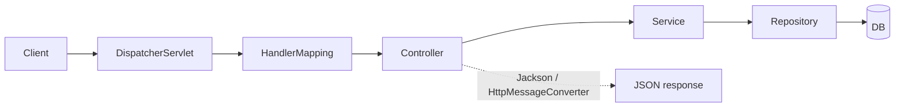

# 📘 Spring Boot Revision Sheet (v2)

`Spring Boot` `Java 17` `Interview prep`

> [!TIP]
> Revise this before every Spring Boot task. Stack: **Spring Boot 4.x, Java 17**. Examples use the Student API (`Student`, `StudentDto`, `StudentController`, `StudentService`, `StudentRepository`, `StudentNotFoundException`).
> Method: read the **Key points** first, try to say it aloud, then check the **Model answers**. Tick the box only when you could answer without looking.

---

## 🎯 How to answer any Spring interview question

1. **Definition:** what it is, in one sentence.
2. **Difference:** how it compares with the closest alternative.
3. **When to use:** the real situation where you'd pick it.
4. **Example:** one line from your Student API.
5. **Bonus:** mention the default value, the status code, and one gotcha.

> [!NOTE]
> Template: *"X is ___. Unlike Y, it ___. I'd use it when ___. In my Student API, ___. By default ___, and the gotcha is ___."*

---

## Contents

1. [Core: IoC, DI, beans](#1-core-ioc-di-beans)
2. [Bean lifecycle and multiple candidates](#2-bean-lifecycle-and-multiple-candidates)
3. [Auto-configuration and starters](#3-auto-configuration-and-starters)
4. [Request flow](#4-request-flow)
5. [Request mapping](#5-request-mapping)
6. [HTTP semantics](#6-http-semantics)
7. [DTO vs Entity](#7-dto-vs-entity)
8. [Validation and error handling](#8-validation-and-error-handling)
9. [Spring Data JPA](#9-spring-data-jpa)
10. [Entity relationships](#10-entity-relationships)
11. [Pagination and sorting](#11-pagination-and-sorting)
12. [Transactions (the proxy gotcha)](#12-transactions-the-proxy-gotcha)
13. [Testing](#13-testing)
14. [Configuration](#14-configuration)
15. [Actuator and logging](#15-actuator-and-logging)
16. [Spring Security basics](#16-spring-security-basics)
17. [Rapid-fire cheat table](#17-rapid-fire-cheat-table)
18. [Revision log](#18-revision-log)

> **Legend:** every `⚠️ Review:` line is a reviewer note that corrects or sharpens the statement just above it. Fix the note, then delete it.

---

## 1. Core: IoC, DI, beans

### 📖 Explanation

With **IoC (Inversion of Control)** the Spring container creates objects (beans) and wires them together, so your classes don't create their own dependencies. **DI (Dependency Injection)** is *how* the container supplies those dependencies.

### 📌 Key points / defaults

> [!IMPORTANT]
> - **Constructor injection is preferred:** fields can be `final`, it's easy to unit test (just call `new`), and it fails fast at startup. With a single constructor, `@Autowired` isn't needed.
> - **Stereotypes:** `@Component` (generic), `@Service` (business logic), `@Repository` (data access, plus exception translation), `@Controller` / `@RestController` (web).
> - `@Configuration` + `@Bean` registers beans for classes you **don't own** (`ObjectMapper`, `RestClient`).
> - `@SpringBootApplication` = `@SpringBootConfiguration` + `@EnableAutoConfiguration` + `@ComponentScan` (scans the main class's package and sub-packages).
> - **Scopes:** `singleton` (default, one per container), `prototype` (new each request for the bean), plus web scopes `request`, `session`, `application`.

### 💡 Example

```java
@Service
public class StudentService {
    private final StudentRepository repo;
    public StudentService(StudentRepository repo) { this.repo = repo; }
}
```

### 🎤 Model answers

- **Constructor vs field vs setter injection?** Constructor: immutable (`final`), testable without Spring, fails fast, makes circular dependencies obvious. Setter: for optional dependencies. Field: avoid, because it hides dependencies and needs reflection or Spring to test.
- **`@Component` vs `@Bean`?** `@Component` marks *your own class* and is found by component scan. `@Bean` is a method in a `@Configuration` class that returns an object, used for third-party classes or when construction needs custom logic.
- **What does `@SpringBootApplication` contain?** `@SpringBootConfiguration` (a `@Configuration`), `@EnableAutoConfiguration`, `@ComponentScan`.
- **Default scope? Is a singleton thread-safe?** Singleton. **Not automatically thread-safe**: one instance is shared by all request threads, so keep singleton beans **stateless** (no mutable instance fields). Use method-local variables or immutable state.

- [ ] **Revised**

[⬆ Back to contents](#contents)

---

## 2. Bean lifecycle and multiple candidates

### 📖 Explanation

The container instantiates a bean, injects dependencies, runs init callbacks, serves the bean, then runs destroy callbacks on shutdown.

### 📌 Key points / defaults

> [!IMPORTANT]
> - Order: **instantiate → inject → `@PostConstruct` → ready → `@PreDestroy` → destroyed**.
> - `@PostConstruct` / `@PreDestroy` are Jakarta annotations (`jakarta.annotation`).
> - **Two beans of the same type** cause `NoUniqueBeanDefinitionException`. Fix with `@Primary` (default winner) or `@Qualifier("name")` (explicit choice at the injection point).
> - `@Lazy` delays creation until first use. Singletons are **eager** by default.
> - `@Profile`, `@ConditionalOnProperty` register a bean only in some situations.

### 💡 Example

```java
@Component
class CacheWarmer {
    @PostConstruct void warm() { /* load data once at startup */ }
    @PreDestroy  void close() { /* release resources */ }
}
```

### 🎤 Model answers

- **`@Primary` vs `@Qualifier`?** `@Primary` sets a global default among candidates. `@Qualifier` picks one at a specific injection point and overrides `@Primary`.
- **When do you use `@PostConstruct`?** To run setup that needs injected dependencies (they're not available in field initializers).

- [ ] **Revised**

[⬆ Back to contents](#contents)

---

## 3. Auto-configuration and starters

### 📖 Explanation

**Starters** are dependency bundles (`spring-boot-starter-web...`). **Auto-configuration** creates beans for you based on what's on the classpath, what properties are set, and what beans you've already defined.

### 📌 Key points / defaults

> [!IMPORTANT]
> - `@EnableAutoConfiguration` loads auto-config classes listed in `META-INF/spring/org.springframework.boot.autoconfigure.AutoConfiguration.imports`.
> - Each auto-config is guarded by conditions: `@ConditionalOnClass` (library present), `@ConditionalOnMissingBean` (**back off if you defined your own**), `@ConditionalOnProperty`.
> - **Your own bean always wins** over the auto-configured one thanks to `@ConditionalOnMissingBean`.
>   - ⚠️ **Review:** Overstated: it holds for auto-configurations guarded by `@ConditionalOnMissingBean` (most, not all). Say "most auto-configured beans back off when you define your own".
> - Debug with `--debug` or `debug=true` to print the **conditions evaluation report** (what matched, what didn't).
> - Exclude one with `@SpringBootApplication(exclude = DataSourceAutoConfiguration.class)`.
> - Boot 4 splits the code into more **modular** jars and starters than Boot 3. Check the migration guide when a class or starter name "went missing".

### 🎤 Model answers

- **How does Boot know to configure a DataSource?** A JDBC driver and `spring-boot-starter-data-jpa` are on the classpath, `DataSourceAutoConfiguration` matches via `@ConditionalOnClass`, and it reads `spring.datasource.*` properties.
- **How do you override an auto-configured bean?** Define your own bean of that type. The auto-config backs off.

- [ ] **Revised**

[⬆ Back to contents](#contents)

---

## 4. Request flow

### 📖 Explanation

HTTP request → **DispatcherServlet** (front controller) → **HandlerMapping** finds the controller method → arguments bound (path, query, body via Jackson) → controller → service → repository → DB → return value serialized to JSON by **HttpMessageConverter** (Jackson) → response.



### 📌 Key points / defaults

> [!IMPORTANT]
> - `@RestController` = `@Controller` + `@ResponseBody`: the return value is written straight to the body as JSON.
> - A plain `@Controller` treats a returned `String` as a **view name** (Thymeleaf/JSP) unless `@ResponseBody` is present.
> - **Keep controllers thin:** logic in the service, DB access in the repository.
> - Filters run *before* DispatcherServlet. Interceptors run *around* the controller. `@ControllerAdvice` handles exceptions after.

### 💡 Example

```java
@RestController
@RequestMapping("/api/students")
public class StudentController { ... }
```

### 🎤 Model answers

- **Walk me through a request.** Client → DispatcherServlet → HandlerMapping picks the method → argument resolvers bind path/query/body → controller calls service → service calls repository → result returned → message converter writes JSON → response with status.
- **Who converts Java to JSON?** `HttpMessageConverter` implementations (Jackson's converter).
  > ⚠️ **Review:** Spring Boot 4 uses **Jackson 3** by default (packages `tools.jackson.*`, e.g. `JsonMapper` instead of `ObjectMapper`; only the annotations stay in `com.fasterxml.jackson.annotation`). The converter is `JacksonJsonHttpMessageConverter`. `@JsonComponent` became `@JacksonComponent`. In Boot 3 / Jackson 2 the statement is exactly right.
- **Filter vs Interceptor?** Filter is a Servlet-level component (runs before Spring MVC). Interceptor is a Spring MVC component with `preHandle`, `postHandle`, `afterCompletion`.

- [ ] **Revised**

[⬆ Back to contents](#contents)

---

## 5. Request mapping

### 📖 Explanation

These annotations map **HTTP method + path** to a handler and bind request data to its parameters.

### 📌 Key points / defaults

> [!IMPORTANT]
> - `@PathVariable` identifies a resource: `/students/{id}`. Missing segment → no match → **404**. **Wrong type** (`/students/abc` for `Long`) → **400** (`MethodArgumentTypeMismatchException`).
> - `@RequestParam` is for filters, search, paging: `/students/search?name=x`. `required = true` by default, so leaving it out → **400**. Make optional with `required = false` or `defaultValue`.
> - `@RequestBody` converts JSON to a DTO via Jackson. Malformed JSON → **400** (`HttpMessageNotReadableException`).
> - Wrong HTTP method on a mapped path → **405**. Unsupported `Content-Type` → **415**.
> - **Never** put a query string in the mapping path. Use `@GetMapping("/search")`, not `"/search?name="`.
> - Shortcuts: `@GetMapping`, `@PostMapping`, `@PutMapping`, `@PatchMapping`, `@DeleteMapping`.

### 💡 Example

```java
@GetMapping("/search")
List<StudentDto> search(@RequestParam String name) { return service.search(name); }

@GetMapping("/{id}")
StudentDto get(@PathVariable Long id) { return service.get(id); }
```

### 🎤 Model answers

- **`@PathVariable` vs `@RequestParam` vs `@RequestBody`?** Path variable = *which* resource. Request param = *how to filter/page* it. Request body = *the data* you're sending (POST/PUT/PATCH).
- **Required `@RequestParam` missing?** 400 Bad Request (`MissingServletRequestParameterException`).
- **Make a param optional?** `required = false`, `defaultValue = "..."`, or use `Optional<T>`.
- **JSON → Java object?** `@RequestBody` triggers the Jackson message converter, which deserializes using the DTO's constructor/setters/record components.

- [ ] **Revised**

[⬆ Back to contents](#contents)

---

## 6. HTTP semantics

### 📖 Explanation

Each HTTP method has a meaning, and the status code tells the client what happened.

### 📌 Key points / defaults

> [!IMPORTANT]
> - **Safe** = no state change (GET, HEAD). **Idempotent** = repeating gives the same result as doing it once (GET, PUT, DELETE). **POST is neither.** PATCH isn't guaranteed idempotent.
> - **PUT** replaces the whole resource. **PATCH** is a partial update.
> - `ResponseEntity` controls status, headers and body.

| Action | Status | Notes |
|---|---|---|
| Read / update | **200 OK** | |
| Create | **201 Created** + `Location` header | |
| Delete | **204 No Content** | no body |
| Validation / bad input | **400 Bad Request** | |
| Not authenticated | **401 Unauthorized** | |
| Not allowed | **403 Forbidden** | |
| Missing resource | **404 Not Found** | |
| Duplicate (email) | **409 Conflict** | |
| Unhandled error | **500 Internal Server Error** | |

### 💡 Example

```java
@PostMapping
ResponseEntity<StudentDto> create(@Valid @RequestBody StudentRequest req) {
    StudentDto saved = service.create(req);
    return ResponseEntity.created(URI.create("/api/students/" + saved.id())).body(saved);
}
```

### 🎤 Model answers

- **Is PUT idempotent? POST?** PUT yes: `PUT /students/1` with the same body ten times leaves one student with those values. POST no: `POST /students` ten times creates ten students (or ten duplicate-email conflicts).
- **PUT vs PATCH?** PUT sends the full representation and replaces it. PATCH sends only changed fields.
- **Why a `Location` header on 201?** It tells the client the URL of the newly created resource so it can fetch it.
- **401 vs 403?** 401 = "I don't know who you are". 403 = "I know who you are, but you can't do this".

- [ ] **Revised**

[⬆ Back to contents](#contents)

---

## 7. DTO vs Entity

### 📖 Explanation

An **Entity** maps to a DB table. A **DTO** (Data Transfer Object) is the shape you expose in the API.

### 📌 Key points / defaults

> [!IMPORTANT]
> - **Why not expose entities?**
>   1. Leaks internal fields (passwords, audit columns).
>   2. Couples your API to your DB schema (a column rename breaks clients).
>   3. Lazy relationships can trigger `LazyInitializationException` or infinite JSON recursion.
>   4. **Mass assignment**: a client could set fields like `id` or `role`.
>   5. You need different shapes for create, update and read.
> - Java 17 **records** make compact DTOs.
> - Map by hand, with MapStruct, or with a small mapper method. Keep mapping in the service or a mapper class.

### 💡 Example

```java
public record StudentRequest(@NotBlank String name, @Email String email) {}
public record StudentDto(Long id, String name, String email) {}
```

### 🎤 Model answers

- **Why use DTOs?** Decouple the API contract from the persistence model, control exactly what's exposed, and validate input per use case.
- **Where does mapping happen?** In the service (or a dedicated mapper), never in the entity or controller.

- [ ] **Revised**

[⬆ Back to contents](#contents)

---

## 8. Validation and error handling

### 📖 Explanation

Bean Validation (Jakarta) checks input, and centralized handlers turn exceptions into clean error responses.

### 📌 Key points / defaults

> [!IMPORTANT]
> - `@Valid` on a `@RequestBody` triggers validation. Failure → `MethodArgumentNotValidException` → **400**.
> - Constraints: `@NotNull`, `@NotBlank` (strings), `@NotEmpty` (collections/strings), `@Size`, `@Email`, `@Min/@Max`, `@Pattern`, `@Positive`.
> - **`@Valid` vs `@Validated`:** `@Valid` is Jakarta standard and supports **nested/cascading** validation. `@Validated` is Spring's and adds **validation groups** and enables **method-level validation** when put on the class (needed for constraints on `@RequestParam` / `@PathVariable`).
>   - ⚠️ **Review:** Same point as the next bullet: the "needed for `@RequestParam` / `@PathVariable`" part is outdated for Spring 6.1+ controllers (built-in method validation). Class-level `@Validated` is needed for method validation on **services and other beans**, not controllers.
> - `@Valid` on a plain `String` param does nothing by itself. Put the constraint on the param and `@Validated` on the class.
>   - ⚠️ **Review:** Outdated for Spring 6.1+ / Boot 3.2+ (and so Boot 4). Constraints placed **directly on controller parameters** (`@RequestParam @Min(1) int size`) are validated by Spring MVC's **built-in method validation** and raise `HandlerMethodValidationException` (400). Class-level `@Validated` is **not needed**, and if you add it, validation switches to the AOP proxy and throws `ConstraintViolationException` (500 unless you handle it). Handle **both** `MethodArgumentNotValidException` (single `@RequestBody`/`@ModelAttribute`) and `HandlerMethodValidationException` in your `@RestControllerAdvice`. Class-level `@Validated` is still the right tool for non-controller beans (e.g. services).
> - `@RestControllerAdvice` + `@ExceptionHandler` centralizes error handling.
> - **`ProblemDetail` (RFC 9457)** is the standard error body: `type`, `title`, `status`, `detail`, `instance`.
> - Always give the `Student` not-found case a **404**, not a 500.

### 💡 Example

```java
@RestControllerAdvice
class GlobalExceptionHandler {

    @ExceptionHandler(StudentNotFoundException.class)
    ProblemDetail notFound(StudentNotFoundException e) {
        return ProblemDetail.forStatusAndDetail(HttpStatus.NOT_FOUND, e.getMessage());
    }

    @ExceptionHandler(MethodArgumentNotValidException.class)
    ProblemDetail invalid(MethodArgumentNotValidException e) {
        ProblemDetail pd = ProblemDetail.forStatusAndDetail(HttpStatus.BAD_REQUEST, "Validation failed");
        pd.setProperty("errors", e.getBindingResult().getFieldErrors().stream()
            .map(f -> f.getField() + ": " + f.getDefaultMessage()).toList());
        return pd;
    }
}
```

### 🎤 Model answers

- **Validate a request body?** Add constraints on the DTO and `@Valid` on the `@RequestBody` parameter.
- **`@Valid` vs `@Validated`?** See above: cascading vs groups and class-level method validation.
- **Handle exceptions globally?** `@RestControllerAdvice` with `@ExceptionHandler` methods returning `ProblemDetail` or `ResponseEntity`.
- **What is `ProblemDetail`?** Spring's built-in model of RFC 9457 "problem details" JSON for HTTP APIs.
- **`@NotNull` vs `@NotEmpty` vs `@NotBlank`?** Not null / not null and length > 0 / not null and has at least one non-whitespace character.

- [ ] **Revised**

[⬆ Back to contents](#contents)

---

## 9. Spring Data JPA

### 📖 Explanation

You declare repository **interfaces**, Spring generates the implementation, and Hibernate is the JPA provider.

### 📌 Key points / defaults

> [!IMPORTANT]
> - `@Entity` + `@Id` + `@GeneratedValue(strategy = GenerationType.IDENTITY)`.
> - `JpaRepository<Student, Long>` gives `save`, `findById` (returns `Optional`), `findAll`, `existsById`, `deleteById`, `count`, plus paging and sorting.
> - **`CrudRepository`** = basic CRUD. **`PagingAndSortingRepository`** adds paging/sorting. **`JpaRepository`** adds JPA extras (`flush`, `saveAllAndFlush`, batch deletes) and returns `List` rather than `Iterable`.
>   - ⚠️ **Review:** Since Spring Data 3 the hierarchy is no longer a chain: `PagingAndSortingRepository` does **not** extend `CrudRepository`. `JpaRepository` extends `ListCrudRepository`, `ListPagingAndSortingRepository` and `QueryByExampleExecutor`. The List-returning variants are exactly why it returns `List` instead of `Iterable`.
> - **Derived queries** are parsed from the method name: `findByNameContainingIgnoreCase`, `existsByEmail`. Use `@Query` for custom JPQL.
> - `Optional.orElseThrow(...)` lets you throw a 404 exception instead of returning `null`.
> - **Lazy vs eager:** lazy loads related data on first access (default for `@OneToMany`, `@ManyToMany`). Eager loads immediately (default for `@ManyToOne`, `@OneToOne`).
> - **N+1 problem:** 1 query for the parents + N queries for each parent's lazy children. Fix with `JOIN FETCH`, `@EntityGraph`, or batch fetching.
> - `spring.jpa.hibernate.ddl-auto`: `none`, `validate`, `update`, `create`, `create-drop`. **Use `validate`/`none` in prod** with migrations (Flyway/Liquibase).
> - `spring.jpa.open-in-view` is on by default (keeps the session open during view rendering). Many teams turn it off.
>   - ⚠️ **Review:** Misleading. It keeps the JPA `EntityManager` open for the **whole web request** (controller, JSON serialization), not just view rendering. That hides `LazyInitializationException` but causes lazy queries in the controller and holds a DB connection longer. Boot logs a warning at startup when it is on. Typical fix: `spring.jpa.open-in-view=false`, and fetch what you need in the service.

### 💡 Example

```java
Student s = repo.findById(id).orElseThrow(() -> new StudentNotFoundException(id));
boolean taken = repo.existsByEmail(email);
```

### 🎤 Model answers

- **`CrudRepository` vs `JpaRepository`?** JpaRepository extends the others and adds JPA-specific operations like flush and batch operations.
  > ⚠️ **Review:** "Extends the others" is only loosely true in Spring Data 3+: it extends `ListCrudRepository` / `ListPagingAndSortingRepository` (see the note in the key points).
- **How do derived queries work?** Spring parses the method name (`findBy` + property + keyword) into a query at startup. A bad property name fails the app at startup.
- **What is the N+1 problem?** Loading N parents then lazily loading each one's children triggers N extra queries. Fix with fetch join or entity graph.
- **`save()` on an existing id?** It performs an update (merge). On a new entity (null id) it inserts.

- [ ] **Revised**

[⬆ Back to contents](#contents)

---

## 10. Entity relationships

### 📖 Explanation

JPA models table relationships with annotations. One side **owns** the foreign key.

### 📌 Key points / defaults

> [!IMPORTANT]
> - `@ManyToOne` (many students → one course) is the **owning side** and holds the FK column.
> - `@OneToMany(mappedBy = "course")` is the **inverse side**. `mappedBy` names the field on the owning side and means "don't create another FK".
> - `@ManyToMany` needs a join table (`@JoinTable`). Often better modeled as two `@ManyToOne` through a join entity.
> - **Cascade** (`PERSIST`, `MERGE`, `REMOVE`, `ALL`) propagates operations to children. `orphanRemoval = true` deletes children removed from the collection.
> - Prefer **`@ManyToOne(fetch = LAZY)`** to avoid surprise loads.
> - Keep **both sides in sync** with helper methods (`course.addStudent(s)`).
> - Bidirectional entities serialized directly cause **infinite recursion**, another reason to use DTOs.
> - `@Enumerated(EnumType.STRING)` over the default ordinal.

### 💡 Example

```java
@Entity class Course {
    @OneToMany(mappedBy = "course", cascade = CascadeType.ALL, orphanRemoval = true)
    private List<Student> students = new ArrayList<>();
}
@Entity class Student {
    @ManyToOne(fetch = FetchType.LAZY) @JoinColumn(name = "course_id")
    private Course course;
}
```

### 🎤 Model answers

- **What does `mappedBy` mean?** It marks the inverse side of a bidirectional relationship and points at the owning side's field, so the FK lives on the other table only.
- **Which side owns the relationship?** The side with the foreign key (usually the `@ManyToOne`).
- **Cascade vs orphanRemoval?** Cascade propagates operations from parent to child. Orphan removal deletes a child when it's removed from the parent's collection.

- [ ] **Revised**

[⬆ Back to contents](#contents)

---

## 11. Pagination and sorting

### 📖 Explanation

Return data in pages rather than loading the whole table.

### 📌 Key points / defaults

> [!IMPORTANT]
> - Repository method takes a `Pageable` and returns `Page<T>` (includes total count) or `Slice<T>` (no count query, cheaper).
> - Build with `PageRequest.of(page, size, Sort.by("name"))`. **Page numbers are 0-based.**
> - Controller can accept `Pageable` directly: `?page=0&size=10&sort=name,asc`.
> - Default page size is **20**. Cap the maximum size (`spring.data.web.pageable.max-page-size`, default 2000) to protect your DB.
> - `Page` exposes `getContent()`, `getTotalElements()`, `getTotalPages()`.

### 💡 Example

```java
@GetMapping
Page<StudentDto> list(@PageableDefault(size = 10, sort = "name") Pageable pageable) {
    return service.findAll(pageable);
}
```

> ⚠️ **Review:** Returning a `Page<StudentDto>` straight from a controller serializes the `PageImpl` internals, and Spring Data 3.3+ logs a warning that this JSON shape is **not stable**. Use `@EnableSpringDataWebSupport(pageSerializationMode = VIA_DTO)` (stable `{content, page}` shape), return `PagedModel<StudentDto>` (`new PagedModel<>(page)`), or map to your own response record.

### 🎤 Model answers

- **`Page` vs `Slice`?** Page runs an extra count query and knows the total. Slice only knows whether a next slice exists.
- **Why paginate?** Memory, response time and DB load all scale with result size.

- [ ] **Revised**

[⬆ Back to contents](#contents)

---

## 12. Transactions (the proxy gotcha)

### 📖 Explanation

A transaction is all-or-nothing. `@Transactional` makes Spring start, commit or roll back one around a method.

### 📌 Key points / defaults

> [!IMPORTANT]
> - Put `@Transactional` on **service** methods. Use `readOnly = true` for reads.
> - **Rolls back on unchecked exceptions** (`RuntimeException`, `Error`) by default. **Checked exceptions do not roll back** unless `rollbackFor = Exception.class`.
> - **It works through a proxy.** So:
>   - **Self-invocation bypasses it:** calling a `@Transactional` method from another method in the *same class* skips the proxy, so no transaction is applied.
>   - It only applies to **public** methods called from outside the bean (in the standard proxy mode).
>   - ⚠️ **Review:** Outdated since Spring 6.0: with class-based (CGLIB) proxies, which Boot uses by default, `@Transactional` also works on **protected and package-visible** methods. Still **not** on `private` methods, and still only for calls that go **through the proxy**.
> - Default propagation is `REQUIRED` (join the existing transaction, or start one). `REQUIRES_NEW` suspends the current one and starts a new one.
> - Swallowing an exception inside the method (try/catch) means no rollback, because the proxy never sees it.

### 💡 Example

```java
@Service
public class StudentService {
    @Transactional
    public void enroll(Long id) { ... }

    public void bulk() {
        enroll(1L);   // ❌ self-invocation: NOT transactional via the proxy
    }
}
```

### 🎤 Model answers

- **What does `@Transactional` do?** Wraps the method in a transaction: commit on success, rollback on unchecked exception.
- **Does it roll back on checked exceptions?** No, by default. Use `rollbackFor`.
- **Why might `@Transactional` not work?** Self-invocation, non-public method, bean not managed by Spring, or exception swallowed.
  > ⚠️ **Review:** "Non-public" is only right for `private` (and `final`/`static`) methods in Spring 6+. Better list: self-invocation, `private`/`final`/`static` method, bean created with `new`, exception swallowed, checked exception without `rollbackFor`.

- [ ] **Revised**

[⬆ Back to contents](#contents)

---

## 13. Testing

### 📖 Explanation

**Slice tests** check one layer fast. **Full-context tests** check everything wired together.

### 📌 Key points / defaults

> [!IMPORTANT]
> - `@WebMvcTest(StudentController.class)` loads only the web layer. Use `MockMvc` + `@MockitoBean StudentService`. (`@MockBean` was removed in Boot 4.)
> - `@SpringBootTest` loads the full context: slower, used for integration tests. Add `@AutoConfigureMockMvc` to use `MockMvc` with it.
> - `@DataJpaTest` is the repository slice with an in-memory DB (it rolls back each test by default).
> - Test every endpoint for: **happy path** (200/201/204), **not found** (404), **invalid input** (400).
> - Plain unit tests (JUnit 5 + Mockito, no Spring) are the fastest. Test service logic this way.
> - Check the Boot 4 migration notes for the exact test starter and import names, since modules were reorganized.

### 💡 Example

```java
@WebMvcTest(StudentController.class)
class StudentControllerTest {
    @Autowired MockMvc mockMvc;
    @MockitoBean StudentService service;

    @Test
    void notFound() throws Exception {
        when(service.get(99L)).thenThrow(new StudentNotFoundException(99L));
        mockMvc.perform(get("/api/students/99"))
               .andExpect(status().isNotFound());
    }

    @Test
    void createInvalid() throws Exception {
        mockMvc.perform(post("/api/students")
                .contentType(MediaType.APPLICATION_JSON)
                .content("{\"name\":\"\",\"email\":\"bad\"}"))
               .andExpect(status().isBadRequest());
    }
}
```

### 🎤 Model answers

- **`@WebMvcTest` vs `@SpringBootTest`?** Slice (web layer only, fast, services mocked) vs the whole application context (slow, realistic).
- **Why mock the service in controller tests?** To test only controller behaviour (mapping, validation, status codes) in isolation.
- **Assert JSON fields?** `.andExpect(jsonPath("$.name").value("Asha"))`.
- **What is `@MockitoBean`?** Spring's annotation that puts a Mockito mock in the context, replacing any existing bean of that type.

- [ ] **Revised**

[⬆ Back to contents](#contents)

---

## 14. Configuration

### 📖 Explanation

Configure the app from outside the code, with different values per environment.

### 📌 Key points / defaults

> [!IMPORTANT]
> - `application.properties` (flat) vs `application.yml` (hierarchical). If both exist, **`.properties` wins**.
> - **Profiles:** `application-dev.yml`, `application-prod.yml`. Activate with `spring.profiles.active=dev`. Use `@Profile("dev")` on beans.
> - `@Value("${app.page-size:20}")` for a single value (default after `:`).
> - `@ConfigurationProperties(prefix = "app")` binds a **typed group** (supports validation and relaxed binding like `page-size` ↔ `pageSize`). Prefer it for groups.
> - **Precedence (high → low):** command-line args > env vars > profile-specific files > `application.*`.
> - Never commit secrets. Use env vars or a secret manager.

### 💡 Example

```java
@ConfigurationProperties(prefix = "student")
public record StudentProps(int maxPageSize, String defaultSort) {}
```

> ⚠️ **Review:** Incomplete: the record is only picked up if it is **registered**: add `@ConfigurationPropertiesScan` (or `@EnableConfigurationProperties(StudentProps.class)`) on a configuration/main class. Records bind through the constructor automatically, no `@ConstructorBinding` needed in Boot 3+.
```yaml
student:
  max-page-size: 50
  default-sort: name
```

### 🎤 Model answers

- **properties vs yml?** Same capability. YAML is hierarchical and less repetitive. `.properties` wins if both exist.
- **Different DB settings for dev vs prod?** Profile-specific files plus `spring.profiles.active`.
- **`@Value` vs `@ConfigurationProperties`?** `@Value` is for a single value, with SpEL. `@ConfigurationProperties` is typed, grouped, validated, relaxed-binding.
- **Override a property at runtime?** `java -jar app.jar --server.port=9090` or `SERVER_PORT=9090`.

- [ ] **Revised**

[⬆ Back to contents](#contents)

---

## 15. Actuator and logging

### 📖 Explanation

**Actuator** adds production endpoints for health and metrics. Logging records what the app does.

### 📌 Key points / defaults

> [!IMPORTANT]
> - Add `spring-boot-starter-actuator`. Only **`/actuator/health`** is exposed over HTTP by default. Expose more with `management.endpoints.web.exposure.include=health,info,metrics`.
> - Secure actuator endpoints. They can leak sensitive details.
> - Health groups give liveness and readiness probes for Kubernetes.
> - Default logging uses **SLF4J + Logback**. Levels: `TRACE < DEBUG < INFO < WARN < ERROR`. Default is `INFO`.
> - Set levels in properties: `logging.level.com.example.student=DEBUG`.
> - Use parameterized logging: `log.info("Created student {}", id)`. Never log secrets or personal data.

### 💡 Example

```java
private static final Logger log = LoggerFactory.getLogger(StudentService.class);
log.info("Fetching student {}", id);
```

### 🎤 Model answers

- **What is Actuator?** A set of production-ready endpoints (health, metrics, info, etc.) for monitoring.
- **Default log level and framework?** INFO, via SLF4J with Logback.

- [ ] **Revised**

[⬆ Back to contents](#contents)

---

## 16. Spring Security basics

### 📖 Explanation

Spring Security protects your app through a **chain of servlet filters** that run before your controllers.

### 📌 Key points / defaults

> [!IMPORTANT]
> - Adding the starter **secures every endpoint by default** (a generated password is printed at startup, user is `user`).
> - **Authentication** = who are you? **Authorization** = what may you do?
> - You configure a **`SecurityFilterChain`** bean (the old `WebSecurityConfigurerAdapter` is gone).
> - Passwords are hashed with a `PasswordEncoder` (use **BCrypt**), never stored plain.
> - **CSRF** protection is on by default for browser sessions. Stateless token APIs (JWT) usually disable it and use stateless sessions.
> - Method security: `@PreAuthorize("hasRole('ADMIN')")` (needs `@EnableMethodSecurity`).
> - **401** = not authenticated, **403** = authenticated but forbidden.

### 💡 Example

```java
@Bean
SecurityFilterChain chain(HttpSecurity http) throws Exception {
    return http
        .csrf(csrf -> csrf.disable())            // stateless API only
        .authorizeHttpRequests(a -> a
            .requestMatchers(HttpMethod.GET, "/api/students/**").permitAll()
            .anyRequest().authenticated())
        .httpBasic(Customizer.withDefaults())
        .build();
}
```

### 🎤 Model answers

- **Authentication vs authorization?** Identity check vs permission check.
- **How does Spring Security work?** A filter chain intercepts each request, authenticates it, stores the result in the `SecurityContext`, then authorization rules decide access.
- **Why BCrypt?** Slow, salted hashing makes brute force costly.

- [ ] **Revised**

[⬆ Back to contents](#contents)

---

## 17. Rapid-fire cheat table

| Question | One-line answer |
|---|---|
| Default bean scope | Singleton |
| Singleton thread-safe? | No, keep it stateless |
| Missing required `@RequestParam` | 400 |
| Wrong type in `@PathVariable` | 400 |
| Unknown path | 404 |
| Wrong HTTP method | 405 |
| Unsupported content type | 415 |
| Created / deleted | 201 + `Location` / 204 |
| Duplicate email | 409 |
| Validation failure exception | `MethodArgumentNotValidException` |
| `@Transactional` rolls back on | Unchecked exceptions only (default) |
| Why `@Transactional` ignored | Self-invocation, non-public, swallowed exception |
| `@MockBean` in Boot 4 | Removed, use `@MockitoBean` |
| `.properties` vs `.yml` | `.properties` wins |
| Config precedence | CLI > env vars > profile files > application.* |
| Default page size | 20 (page index starts at 0) |
| Default log level | INFO (Logback) |
| Actuator exposed by default over HTTP | `/health` only |
| `@ManyToOne` default fetch | EAGER (set LAZY) |
| `@OneToMany` default fetch | LAZY |
| `ddl-auto` in prod | `validate` or `none` |

> ⚠️ **Review:** In the row "Why `@Transactional` ignored", "non-public" should read "private" for Spring 6+ (protected and package-visible methods work with class-based proxies).

[⬆ Back to contents](#contents)

---

## 18. Revision log

> [!NOTE]
> Rate confidence 1-5. **Anything 1-3 gets picked for the 6 AM round.** Re-rate after each round and watch the numbers climb.

| Date | Topic | Confidence (1-5) | Weak point / next action |
|---|---|:---:|---|
| 2026-10-29 | 1. Core: IoC, DI, beans | 3 | Singleton thread-safety wording |
| 2026-10-29 | 12. Transactions | 2 | Self-invocation gotcha |
| | | | |
| | | | |
| | | | |

### 🔁 Suggested schedule

- **Day 1:** Sections 1-5, then say each model answer aloud.
- **Day 2:** Sections 6-9, write the Student controller from memory.
- **Day 3:** Sections 10-13, write one `@WebMvcTest` from memory.
- **Day 4:** Sections 14-16, then the cheat table.
- **Day 5:** Mock interview. Pick 10 random questions and answer using the template.

> [!WARNING]
> Spring Boot 4 / Spring Framework 7 changed module layout, some starters and some test annotations. When something doesn't compile or resolve, check the official **Boot 4 migration guide** before assuming your code is wrong.

[⬆ Back to contents](#contents)
