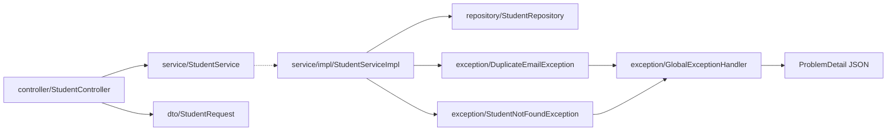

# 🌅 Day 04 morning: Spring Boot practice (Week 1 · DTOs, error responses, status codes)

   

> [!NOTE]
> Plan for today: **REST: ResponseEntity, status codes, DTOs**. Work in `spring-boot/course-practice`, base package `com.prashant.coursepractice`, and follow `course-practice/STRUCTURE.md`.

> [!WARNING]
> ⚠️ **Day 03's Spring tasks aren't in the repo yet** (`StudentController` still reads the id from the body, and `/search?name=` is still in the mapping path). Do **Part A** first: it's tasks 1-6 of `tasks/day03-morning.md`, and today's work builds on it. If time runs out, finish Part A and push; Part B can move to a later slot.

## 📚 Revise first (~15 min) in `spring-boot/prerequisites.md`
- 🔥 **5. Validation & error handling**: what `@Valid` triggers, `MethodArgumentNotValidException` (400), `@RestControllerAdvice`, and the **ProblemDetail** fields (`type`, `title`, `status`, `detail`, `instance`).
- 🔥 **2. Request flow**: where Jackson turns JSON into your DTO and back (HttpMessageConverter), and why controllers stay thin.

> [!TIP]
> Next in the rotation after Day 03's sections 3 and 4. After revising, add a row per topic to the **Revision log** at the bottom of `prerequisites.md` with your confidence (1-5), so future rounds can target the weak ones.

## 🧱 Where each change goes

| Package | Class | What changes |
|---|---|---|
| `controller` | `StudentController` | Part A (Day 03 tasks 1-4) |
| `dto` | `StudentRequest` | Part A: drop `id` · Task 1: `@Size` on `name` |
| `repository` | `StudentRepository` | Task 2: two derived `exists...` queries |
| `exception` | `DuplicateEmailException` (**new**) | Task 3 |
| `service.impl` | `StudentServiceImpl` | Part A (Day 03 task 5) · Task 3: duplicate-email checks |
| `exception` | `GlobalExceptionHandler` | Task 4: every handler returns `ProblemDetail` |
| test `controller` | `StudentControllerTest` | Task 5: new tests |

## 🅰️ Part A: finish Day 03 (if not done)
- [ ] Day 03 tasks 1-6: POST returns 201 + `Location`, PUT/DELETE take `@PathVariable Long id`, DELETE returns 204 with no body, `/search` mapping fixed, `delete(Long id)` throws `StudentNotFoundException` for an unknown id, `id` removed from `StudentRequest`.

## 🅱️ Part B: today's tasks
- [ ] **1. DTO validation**: in `dto/StudentRequest`, limit `name` to 2-50 characters with `@Size` (keep `@NotBlank`), with a clear `message`.
- [ ] **2. Repository**: add derived queries to `repository/StudentRepository`: one that checks whether an email already exists (ignore case), and one that checks the same thing **excluding a given id** (for updates). You name and write them.
- [ ] **3. Duplicate email = 409**: create `exception/DuplicateEmailException` (unchecked). In `service/impl/StudentServiceImpl`, `create` throws it if the email is taken; `update(id, request)` throws it only if **another** student has that email (updating a student with their own email must still work).
- [ ] **4. One error format**: change `exception/GlobalExceptionHandler` so every handler returns a `ProblemDetail`: 404 for not found, 409 for duplicate email, and 400 for validation with the field errors added as an extra `errors` property (hint: `problem.setProperty(...)`). Also handle `HttpMessageNotReadableException` (malformed JSON) as a 400 with a short `detail`.
- [ ] **5. Tests** in `src/test/java/com/prashant/coursepractice/controller/StudentControllerTest.java` (at least 5 new): duplicate email on POST gives 409; updating a student with their **own** email gives 200; a 1-character name gives 400 with `errors.name`; malformed JSON gives 400; GET of an unknown id gives 404 with content type `application/problem+json`.

> [!IMPORTANT]
> ✅ Done when `mvn test` passes inside `spring-boot/course-practice`, no handler returns a raw `Map`, and the controller never touches the repository.

> [!WARNING]
> ⚠️ A check-then-insert (`exists...` then `save`) can still race: two requests with the same email can both pass the check. Think about what else should guarantee uniqueness (you'll be asked).

> [!TIP]
> Stretch (optional): `PATCH /api/students/{id}` with a new `dto/StudentPatchRequest` where every field is optional, and the field copy done in `mapper/StudentMapper`.

## 🎤 Interview questions (answer in chat)
1. Walk me through how a JSON body becomes a validated `StudentRequest`. Which component does the conversion, which exception is thrown when a field fails validation, and what happens (exception and status) when the JSON itself is malformed?
2. Why use separate request and response DTOs instead of accepting and returning the `Student` entity? Give at least two concrete risks of exposing the entity.
3. What is `ProblemDetail`? For a duplicate email, why is 409 better than 400, and why isn't the `exists...` check alone enough to guarantee unique emails?

> [!TIP]
> Answer format: **definition → difference → when to use → example from your Student API**. Day 03's three questions are still open too, so answer those if you have time.
