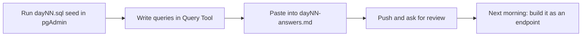

# 🗄️ Banking SQL practice

  

> [!NOTE]
> All banking SQL questions use the **same schema** as [`banking-app`](../../banking-app/README.md) (`auth` and `core` schemas, created by Flyway in your local `java_switch` database). What you query in the evening becomes a Spring endpoint the next morning.

## 📂 Files
| File | Who writes it | What's in it |
|---|---|---|
| `dayNN.sql` | 🤖 Lumi | questions + seed data (`INSERT`s) for that day |
| `dayNN-answers.md` | ✍️ you | your queries, pasted from pgAdmin, plus result notes |

## 🔁 Daily flow


## ✍️ Answer format
````text
## Q1
```sql
SELECT ...;
```
Rows returned: 4. Notes: why LEFT JOIN, edge cases checked.
````

> [!TIP]
> Run seed data inside `BEGIN; ... ROLLBACK;` if you want to experiment without changing your tables.

> [!CAUTION]
> Don't `ALTER` or `DROP` Flyway-managed tables by hand; Flyway will fail validation on the next app start. Ask for a new migration instead.
