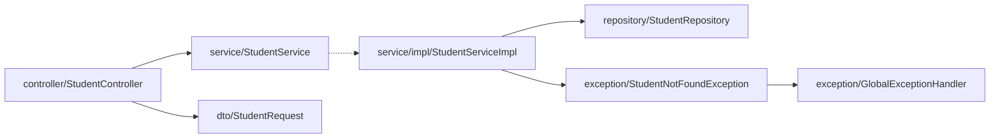

# 🌅 Day 03 morning: Spring Boot practice (Week 1 · ResponseEntity, status codes, path vs param)

   

> [!IMPORTANT]
> Light Sunday round (~35 min): finish the Day 02 endpoints properly and add `ResponseEntity`. Done when `mvn test` passes inside `spring-boot/course-practice` and no endpoint reads the id from the request body.

> [!NOTE]
> **Legend:** 🌅 morning · 🌙 evening · 🔥 revise first · ⬜ not started · 🟡 in progress · 🟠 attempted · 🔴 needs correction · 🔵 ready for revision · ✅ done · ⚠️ gotcha. Tick the `- [ ]` boxes as you finish each item.
>
> It's Sunday, so this is a **light round (~35 min)**. It finishes the Day 02 endpoints properly and adds `ResponseEntity`. Work in `spring-boot/course-practice`, base package `com.prashant.coursepractice`, and follow `course-practice/STRUCTURE.md`.

## 📚 Revise first (~15 min) in `spring-boot/prerequisites.md`
| Topic | What to recall |
|---|---|
| 🔥 **3. Request mapping** | `@PathVariable` vs `@RequestParam` defaults (`required = true` gives 400), and why a query string never goes in the mapping path. |
| 🔥 **4. HTTP semantics** | safe vs idempotent, PUT vs PATCH, the status code table, and why 201 comes with a `Location` header. |

> [!TIP]
> These two came up as weak spots in `interview-answers/day02-answers.md` (Q1 and Q3 at 5/10). After revising, add a row to the Revision log at the bottom of `prerequisites.md` with your confidence (1-5).

## 🧱 Where each change goes

| Package | Class | What changes |
|---|---|---|
| `controller` | `StudentController` | Tasks 1-4: mappings and `ResponseEntity` return types |
| `service` | `StudentService` | Task 5: new method signatures that take the `id` |
| `service.impl` | `StudentServiceImpl` | Task 5: not-found checks for update and delete |
| `dto` | `StudentRequest` | Task 6: drop the `id` field |
| `exception` | `GlobalExceptionHandler` | Task 7: 400 handler for a missing request param |
| test `controller` | `StudentControllerTest` | Task 8: new tests |

## 🛠️ Tasks
- [ ] **1. POST `/api/students`** returns `ResponseEntity<StudentResponse>` with **201 Created** and a `Location` header of `/api/students/{newId}` (use `ResponseEntity.created(...)`), instead of `@ResponseStatus`.
- [ ] **2. PUT `/api/students/{id}`** takes the id from the **path** (`@PathVariable Long id`) plus `@Valid @RequestBody StudentRequest`, and returns `ResponseEntity.ok(...)` (200). Unknown id gives 404. Invalid body gives 400 with field errors.
- [ ] **3. DELETE `/api/students/{id}`** takes the id from the path, has **no request body**, and returns `ResponseEntity<Void>` with **204 No Content**. Unknown id gives 404.
- [ ] **4. GET `/api/students/search?name=...`**: fix the mapping path so it actually matches, and make sure a missing `name` gives 400. Ask yourself whether `@Valid` on a `String` param does anything.
- [ ] **5. Service layer**: change `StudentService` / `StudentServiceImpl` to `update(Long id, StudentRequest request)` and `delete(Long id)`. `delete` must throw `StudentNotFoundException` for an unknown id (hint: what does `deleteById` do when the id doesn't exist?).
- [ ] **6. DTO**: remove the `id` field from `StudentRequest`, since the id now always comes from the path.
- [ ] **7. Errors**: in `GlobalExceptionHandler`, return a 400 JSON body like `{"error": "name parameter is missing"}` for `MissingServletRequestParameterException`.
- [ ] **8. Tests** in `src/test/java/com/prashant/coursepractice/controller/StudentControllerTest.java` (at least 6 new): POST asserts the `Location` header, PUT 200 and 404, DELETE 204 and 404, search 200 and missing-param 400.

> [!IMPORTANT]
> ✅ Done when `mvn test` passes inside `spring-boot/course-practice` and no endpoint reads the id from the request body.

> [!WARNING]
> ⚠️ `@ResponseStatus` and `ResponseEntity` on the same method: the `ResponseEntity` status wins. Pick one style per method (use `ResponseEntity` today).

## 🎤 Interview questions (answer in chat)
1. What does idempotent mean? Is DELETE idempotent, and if a client deletes the same id twice, what status should the second call return? Does that break idempotency?
2. `ResponseEntity` vs `@ResponseStatus`: when would you use each, and why return a `Location` header with 201?
3. What happens when a required `@RequestParam` is missing? How do you make it optional, and what does `@Valid` on a plain `String` param do?

> [!TIP]
> Answer format: **definition → difference → when to use → example from your Student API**. Answer every part of each question.
