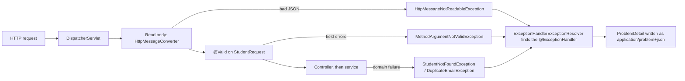
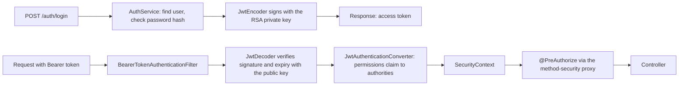

# 📅 Day 09 (31 Oct): two cold Stack redos, and the specs of every pending task

    

> [!IMPORTANT]
> Day 09 itself is finished (both cold redos are ✅ COMPLETED). This file is also the home of the **specs of everything still pending**, rewritten for the new program ([docs/PROGRAM.md](../docs/PROGRAM.md)): 🌱 Spring, 🧩 DSA and 🐞 buggy tasks, each with the template and tone of [STYLE-GUIDE.md](../docs/STYLE-GUIDE.md#-spec-templates-and-tone). Done criterion for each task is inside its spec.

> [!NOTE]
> **Legend:** 🌅 morning · 🌙 evening · 🔥 revise first · ⬜ `NOT_STARTED` · 🟡 `IN_PROGRESS` · ✅ `COMPLETED` (verified) · 🔴 `REVISION_REQUIRED` · ⛔ `BLOCKED` · ⚠️ gotcha. Tick the `- [ ]` boxes as you finish each item. Progress decides the next task, never the calendar.

## 🧭 What is pending now
> [!TIP]
> Work top to bottom. A row leaves this table only when it is ✅ COMPLETED (tests pass on your pushed code, or the answer is graded). The 🌅 morning gets the new work (Spring about 50 min, DSA about 35, buggy about 15); the 🌙 evening finishes whatever is left and scores each track out of 10. Each track works its own first open item: 🌱 Spring takes #1, then #5; 🧩 DSA takes #2 (then #8); 🐞 Buggy takes #3, then #4; 🔁 redos run in the evening. Tomorrow's morning file is generated from this table.

| # | Item | Track | Status | Spec |
|---|---|---|---|---|
| 1 | Day 04 Q1-Q3 re-answers (graded 15/30) | 🌱 Spring | 🔴 REVISION_REQUIRED | [Re-answer cards](#-re-answer-cards) |
| 2 | `CarFleet` (stub; the 2 passing tests pass by accident) | 🧩 DSA | ⬜ NOT_STARTED | [Car Fleet](#-car-fleet-dsa) |
| 3 | `Day04LargestRectangle` (15/36 tests pass) | 🐞 Buggy | ⬜ NOT_STARTED | [Day04LargestRectangle](#-day04largestrectangle-buggy-round) |
| 4 | `Day00BuggyExample` warm-up (4/10 tests pass) | 🐞 Buggy | ⬜ NOT_STARTED | [Day00BuggyExample](#-day00buggyexample-buggy-warm-up) |
| 5 | Day 04 Part B2: `ProblemDetail` everywhere, malformed JSON 400, +3 tests | 🌱 Spring | ⬜ NOT_STARTED | [Part B2](#-day-04-part-b2-problemdetail-in-every-error-response) |
| 6 | Banking module 1: AuthN/AuthZ foundation | 🏦 Banking | ⬜ NOT_STARTED (starts after #5 is ✅) | [Module 1](#-banking-module-1-authn--authz-foundation) |
| 7 | Redos due: `Day02RpnEvaluator` (+1), `ValidParentheses` (+1) | 🔁 Redo | 🟡 IN_PROGRESS (in the redo cycle) | [Redo cards](#-redo-cards) |
| 8 | Count-stack O(n) question re-ask (scored 3/5) | 🧩 DSA | 🔴 REVISION_REQUIRED | [Re-answer cards](#-re-answer-cards) |

> [!NOTE]
> 🗄️ **SQL is retired (31 Oct 2026).** Its tasks are not carried; everything SQL lives in [archive/](../archive/README.md). Database questions are asked only as Spring/JPA/Flyway questions.

## 📚 Specs of pending tasks

> [!NOTE]
> Every spec follows the templates in the [style guide](../docs/STYLE-GUIDE.md#-spec-templates-and-tone). 🧩 DSA specs keep the optimised algorithm, the dry run and the answers inside a collapsed block called **Open only after your attempt**. 🐞 Buggy specs state the expected behaviour and the test cases, and never point at the faulty lines.

### 🧩 Car Fleet (DSA)

   

> [!IMPORTANT]
> 📂 `src/main/java/com/prashant/dsa/stack/CarFleet.java` · tests `CarFleetTest` (37). ✅ Done when `mvn test -Dtest=CarFleetTest` shows 37/37 on your pushed code, with a written pattern line and the time and space complexity at the top of the file.

#### 1️⃣ Problem understanding

**Why Car Fleet matters.** It looks like a physics puzzle, but it is a test of modelling: can you turn "things moving at different speeds that cannot overtake" into one number per thing, and then into an ordering problem? At lead level there is a second test hiding inside it: the numbers you compare can be so large that a plain division rounds two different values to the same `double`. Interviewers ask "why not just use `double`?" almost every time.

**The story.** `n` cars drive on a one-lane road towards `target`. A car can never pass the car ahead. When a faster car catches a slower one it slows down, and they continue as one **fleet** at the slower speed. A single car is a fleet. A car that reaches a fleet exactly at the target is part of that fleet. Count the fleets that arrive.

**The variants you should be able to tell apart**

| Variant | Can a car pass? | What a "group" is | Result on the worked example below (`target=12`, positions `[10,8,0,5,3]`, speeds `[2,4,1,1,3]`) |
|---|---|---|---|
| **This task** (LeetCode 853) | no | a fleet, driving at the slowest speed in it | **3** |
| Passing allowed | yes | none; every car arrives alone | 5 |
| Everyone has the same speed | no | none, because nobody can catch up | not this input; with equal speeds every car is alone, so `n` |
| A meeting exactly at the target does **not** merge | no | a fleet, but only if the catch-up happens before the target | 4 (A and B meet exactly at the target, so they stay apart) |

**Worked example, step by step.** `target = 12`.

| Car | Position | Speed | Miles to go |
|---|---|---|---|
| A | 10 | 2 | 2 |
| B | 8 | 4 | 4 |
| D | 5 | 1 | 7 |
| E | 3 | 3 | 9 |
| C | 0 | 1 | 12 |

Cars are listed here from the one nearest the target to the one farthest from it. The input arrays are **not** in this order.

1. A is the car nearest the target, so nothing can hold it up. It starts a fleet.
2. B is faster than A, but it is behind A and cannot pass. If the road were empty B would reach the target no later than A, so it catches A at or before the target and they arrive together. Same fleet.
3. D is slow and far from the target. It would arrive much later than A and B, so nobody ahead can delay it. It starts a second fleet.
4. E is faster than D but stuck behind it; it joins D's fleet.
5. C is the slowest and farthest, and it arrives later than D's fleet. It starts a third fleet.

**Result: 3.** It means: three separate groups reach the target, in the order A+B, D+E, C. The answer counts arrivals, not cars.

#### 2️⃣ Input, output and constraints
| Part | Value |
|---|---|
| Signature | `public int carFleet(int target, int[] position, int[] speed)` |
| Output | the number of fleets that arrive (`int`) |
| `n` | `0 <= n <= 100_000` |
| `target` | `1 <= target <= Integer.MAX_VALUE` |
| `speed[i]` | `1 <= speed[i] <= Integer.MAX_VALUE` |
| `position[i]` | `0 <= position[i] < target`, all different |
| Target time | O(n log n) |

| Invalid input | Required behaviour |
|---|---|
| `position` or `speed` is `null` | `IllegalArgumentException` |
| lengths differ | `IllegalArgumentException` |
| `target <= 0` | `IllegalArgumentException` |
| a position outside `[0, target)` | `IllegalArgumentException` |
| a speed `<= 0` | `IllegalArgumentException` |
| two cars at the same position | `IllegalArgumentException` |
| no cars | returns `0` |
| the input arrays | must not be modified |

#### 3️⃣ Pattern identification
| Signal in the statement | What it tells you |
|---|---|
| "can never pass", "the order is fixed" | the **order of the cars on the road** is what matters, but the input is not in that order, so you must order them yourself |
| "catches up, then they move as one" | each car's fate depends only on the cars **in front** of it |
| "count the groups" | you are counting how many times something *new* appears while scanning in one direction |
| huge `target` and speeds | exact arithmetic matters; think about overflow and `double` precision before you divide |

> [!NOTE]
> Pattern: **sort by one key, then a single scan with a stack (a monotonic stack)**. The stack holds one entry per fleet found so far.

#### 4️⃣ Approach: brute force, then hints
**Brute force (event simulation).** Sort the cars by position. Repeatedly look at every pair of neighbouring cars, compute when (if ever) the rear one catches the front one, take the earliest event that happens before the target, merge those two into one fleet at the slower speed, and repeat until no event is left. Count what remains. Each event costs a scan of all neighbours, and there can be up to `n - 1` events, so it is **O(n²)** time. It is also easy to get wrong with fractions.

| Property | Brute force |
|---|---|
| Time | O(n²) |
| Extra space | O(n) |
| Weakness | many events, fractional times, easy to mis-merge |

**Hints, as questions. Try each one before you read the next.**
1. If the road were empty, how long would each car need to reach the target? Is that one number enough to say whether a car is held up by the one in front?
2. Walk the cars from the one nearest the target backwards. For each new car, what do you need to remember about everything in front of it: all the fleets, or less?
3. If a car's time is less than or equal to the time of the fleet in front, what happens to it? If it is greater, what happens?
4. How do you compare two times written as `a / b` and `c / d` without dividing? What is the largest value `a * d` can reach, and which type holds it?
5. How can you order the cars by position without touching the caller's arrays?

#### 6️⃣ Java stub (the file already exists; this is the shape to fill in)
```java
public int carFleet(int target, int[] position, int[] speed) {
    // TODO 1: validate -> IllegalArgumentException (null, lengths, target, ranges, speed, duplicate positions)
    // TODO 2: no cars -> return 0
    // TODO 3: order the cars by position without modifying the input arrays
    // TODO 4: walk the cars once and count fleets, comparing times EXACTLY (no rounding)
    return 0;
}
```

- [ ] Pattern line, time and space written as comments at the top of the file.
- [ ] All 37 tests of `CarFleetTest` pass, including the overflow and exact-fraction cases.
- [ ] `position` and `speed` are unchanged after the call.
- [ ] I can explain, out loud, why a joined car never changes the fleet's time.

#### 7️⃣ Complexity
| | Time | Space |
|---|---|---|
| Brute force (event simulation) | O(n²) | O(n) |
| Optimised | inside the block below, after your attempt | |

#### 8️⃣ Interview follow-ups
1. Why can't you just use `double` for the arrival time? Give two inputs that break it.
2. Can you drop the stack entirely? What is the space then?
3. What changes if cars may pass each other? If a meeting exactly at the target must **not** merge?
4. What if cars arrive as a stream, one at a time, in any order? What do you need to keep?
5. How would you return the fleet sizes instead of the count?

#### ❓ Knowledge check
1. Two cars arrive at exactly the same time. How many fleets are they?
   - (a) 1
   - (b) 2
   - (c) it depends on their speeds
   - (d) it depends on their positions
2. Car X is behind car Y, and X would arrive earlier than Y if the road were empty. What happens?
   - (a) X passes Y
   - (b) X catches Y and they arrive as one fleet at Y's pace
   - (c) X stops and waits at the target
   - (d) they count as two fleets
3. Why is `(double) (target - position[i]) / speed[i]` risky for this problem?
   - (a) it is slow
   - (b) two different exact times can look equal after rounding
   - (c) it throws on large values
   - (d) it is not allowed in Java

<details>
<summary><b>🔒 Open only after your attempt</b></summary>

#### 5️⃣ Optimised algorithm and dry run

**Algorithm.**
1. Validate everything (see the rules table), return `0` for no cars.
2. Build an ordering of the car indexes by position, **descending** (nearest the target first), without modifying `position` or `speed`. For example, sort an `Integer[]` of indexes, or pack `(position, speed)` pairs into a new array and sort that.
3. Scan the cars in that order. A car's *time to target* is `(target - position) / speed`. Keep a stack of fleet times.
4. If the stack is empty, or this car's time is **strictly greater** than the time on top, it cannot catch the fleet ahead: push it (a new fleet). Otherwise it catches the fleet (or meets it exactly at the target) and joins it: push nothing.
5. The answer is the stack size.

**Exact comparison.** Do not divide. For the new car `c` and the top car `t` (the car that sets the fleet's time), `time_c > time_t` is the same as

```text
(target - position[c]) * speed[t]  >  (target - position[t]) * speed[c]
```

Each factor is at most `Integer.MAX_VALUE` (about 2.1e9), so each product is below 4.7e18 and fits in a `long` (limit about 9.2e18). In `double`, two different fractions with 31-bit numerators and denominators can round to the same value, so the strict `>` and the "exactly at the target" rule would both be wrong.

**Dry run** on `target = 12`, positions `[10, 8, 0, 5, 3]`, speeds `[2, 4, 1, 1, 3]`:

| Step | Car (position, speed) | Miles to go | Time to target | Top of stack before | Compare | Action | Stack after |
|---|---|---|---|---|---|---|---|
| 1 | (10, 2) | 2 | 2/2 = 1 | empty | none | new fleet | [1] |
| 2 | (8, 4) | 4 | 4/4 = 1 | 1 | 1 > 1? no | joins (meets exactly at the target) | [1] |
| 3 | (5, 1) | 7 | 7/1 = 7 | 1 | 7 > 1? yes | new fleet | [1, 7] |
| 4 | (3, 3) | 9 | 9/3 = 3 | 7 | 3 > 7? no | joins | [1, 7] |
| 5 | (0, 1) | 12 | 12/1 = 12 | 7 | 12 > 7? yes | new fleet | [1, 7, 12] |

The stack has 3 entries, so the answer is **3**. Notice that a joined car never changes the time on top: a fleet always travels at the pace of its slowest car, so the time of the fleet is the **largest** time seen so far.

#### 7️⃣ Complexity (optimised)
| | Time | Space |
|---|---|---|
| Sort the indexes | O(n log n) | O(n) |
| Scan with the stack | O(n) | O(n) worst case |
| **Total** | **O(n log n)** | **O(n)** |

Because only the top time is ever read, the stack can be replaced by one variable (the current fleet time) and a counter. That is O(1) extra space for the scan, and it is a good follow-up answer.

#### ✅ Answers to the knowledge check
| Question | Answer | Why |
|---|---|---|
| 1. Two cars arrive at exactly the same time | (a) 1 fleet | meeting exactly at the target still counts as one fleet |
| 2. Car X behind Y would arrive earlier alone | (b) X catches Y and they arrive as one fleet at Y's pace | it cannot pass, and a fleet moves at its slowest car's speed |
| 3. Why is `double` division risky | (b) two different exact times can look equal after rounding | 31-bit numerators and denominators need more than the 53 bits of a `double` mantissa once divided and compared |

</details>

### 🐞 Day04LargestRectangle (buggy round)

   -lightgrey)

> [!IMPORTANT]
> 📂 `src/main/java/com/prashant/dailytests/Day04LargestRectangle.java` · tests `Day04LargestRectangleTest` (36). ✅ Done when all 36 pass on your pushed code, with the smallest fixes you can find (do not rewrite the class). The bugs are deliberately not described anywhere.

#### 1️⃣ Why this round matters
"Largest rectangle in a histogram" is the standard test of **boundary reasoning**: for every bar, how far can a rectangle of that bar's height stretch to the left and to the right before it hits a shorter bar? A solution that looks right usually fails on a few precise inputs, and an interviewer can see in minutes whether you debug by method or by guessing. It is also the hardest problem of the Stack pattern, so a clean pass is a strong signal.

#### 2️⃣ Expected behaviour
| Topic | Required behaviour |
|---|---|
| Input | each bar has width 1 and height `heights[i]` |
| Result | the exact area (a `long`) of the largest rectangle that fits fully inside the histogram |
| A height of 0 | allowed; it splits the histogram |
| A negative height | `IllegalArgumentException` |
| `null` | `IllegalArgumentException` |
| Empty array | `0` |
| One bar | its own height |
| Equal neighbouring bars | are combined: `[3, 3, 3]` is `9` |
| Time | O(n): each index is pushed and popped at most once |
| The input array | is not modified |

**What the expected result means, on the classic input `[2, 1, 5, 6, 2, 3]`.** For each bar, the widest rectangle of that bar's height runs until the first shorter bar on each side:

| Bar index | Height | First shorter bar on the left | First shorter bar on the right | Width | Area |
|---|---|---|---|---|---|
| 0 | 2 | none | index 1 | 1 | 2 |
| 1 | 1 | none | none | 6 | 6 |
| 2 | 5 | index 1 | index 4 | 2 | 10 |
| 3 | 6 | index 2 | index 4 | 1 | 6 |
| 4 | 2 | index 1 | none | 4 | 8 |
| 5 | 3 | index 4 | none | 1 | 3 |

The largest is **10**: the two bars of height 5 and 6, rectangle of height 5 and width 2. That table is the definition of the answer, not a method; how you find the boundaries quickly is the point of the round.

#### 3️⃣ Pattern
Monotonic stack, boundaries. The stack keeps bars that are still waiting for a shorter bar on their right.

#### 4️⃣ Test cases (what the suite runs)
**Normal**

| Heights | Result | What it checks |
|---|---|---|
| `[2, 1, 5, 6, 2, 3]` | 10 | the classic example |
| `[2, 4]` | 4 | two bars |
| `[6, 2, 5, 4, 5, 1, 6]` | 12 | a valley |
| `[1, 2, 3, 4, 5]` | 9 | strictly increasing |
| `[5, 4, 3, 2, 1]` | 9 | strictly decreasing |
| `[1, 1, 10, 1]` | 10 | one tall bar wins alone |
| `[2, 1, 2]` | 3 | a low, wide rectangle wins |

**Edge**

| Heights | Result | What it checks |
|---|---|---|
| `[]` | 0 | empty |
| `[5]`, `[1]`, `[0]` | 5, 1, 0 | one bar |
| `[3, 3, 3]`, `[2, 2]` | 9, 4 | all equal |
| `[1, 4, 4, 4, 1]` | 12 | a plateau |
| `[3, 1, 3]` | 3 | equal bars split by a dip |
| `[2, 0, 2]` | 2 | a zero splits the histogram |
| `[0, 0, 0]` | 0 | all zeros |
| `[0, 3, 3, 0]` | 6 | zeros at both ends |
| `[4, 0, 1, 1, 1]` | 4 | a tie between the two sides |
| `[5, 5, 1]`, `[1, 5, 5]` | 10 | the best rectangle touches an end |
| `[4, 5, 4, 6]` | 16 | the whole histogram is the answer |
| `[MAX]` | `MAX` | one bar of `Integer.MAX_VALUE` |
| `[MAX, MAX]` | `2 * MAX` | the exact area as a `long` |
| `[MAX, 1, MAX]` | `MAX` | a dip between two huge bars |
| `[1_000_000_000` × 3`]` | 3_000_000_000 | three large bars |
| 100,000 bars of `MAX` | `MAX * 100_000` | many huge bars |

**Failure**

| Heights | Result | What it checks |
|---|---|---|
| `null` | `IllegalArgumentException` | null input |
| `[-1]` | `IllegalArgumentException` | one negative bar |
| `[2, -3, 4]` | `IllegalArgumentException` | a negative bar in the middle |
| `[1, Integer.MIN_VALUE]` | `IllegalArgumentException` | the most negative `int` |

**Other:** the array is unchanged after the call; 200,000 equal, increasing or decreasing bars finish within 2 seconds; 500 random small arrays (with zeros and repeats) match a brute-force answer.

#### 5️⃣ How to work the round (method, not a hint about the code)
1. Run the suite once. Do not read the class yet. Sort the failing tests by group (normal, edge, failure, large, random).
2. Pick **one** failing test. Work out by hand what the correct answer is and why.
3. Trace the code on that input with a small table (index, stack, `best`). Find the first row where the code disagrees with your hand answer.
4. Change as little as possible. Re-run the **whole** suite: a fix must not break a test that passed.
5. Repeat until 36/36. Then read the whole class once more as a reviewer.

#### 6️⃣ Stub
Nothing to write: the class is given and contains bugs. Keep the signature `public static long largestRectangleArea(int[] heights)`.

- [ ] Pattern line and time/space comments added at the top of the file when you are done.
- [ ] 36/36 pass.
- [ ] I can explain each fix in one sentence: what the code did, what it should do.

#### 7️⃣ Complexity
Required: O(n) time, O(n) extra space.

#### 8️⃣ Interview follow-ups
1. How would you extend this to the largest rectangle of 1s in a binary matrix?
2. What if the histogram is huge and arrives as a stream?
3. Which inputs would you add to the suite to be more confident, and why those?

#### ❓ Knowledge check
1. For a chosen bar of height `h`, the widest rectangle of height `h` is limited on each side by:
   - (a) the nearest bar that is shorter than `h`
   - (b) the nearest bar that is taller than `h`
   - (c) the first and last bar of the array
   - (d) the two tallest bars
2. Which structure holds the bars that are still waiting for their right boundary?
   - (a) a queue
   - (b) a stack whose bars are in increasing height
   - (c) a max-heap
   - (d) a hash map from height to index
3. Why is the stack approach O(n) even though there is a loop inside a loop?
   - (a) the inner loop runs at most 2 times
   - (b) every index is pushed once and popped at most once
   - (c) the array is sorted first
   - (d) it is actually O(n log n)

<details>
<summary><b>🔒 Open only after your attempt</b></summary>

#### Answers to the knowledge check
| Question | Answer | Why |
|---|---|---|
| 1 | (a) | a rectangle of height `h` can extend over every neighbouring bar that is at least `h` tall; the first shorter bar stops it |
| 2 | (b) | the stack keeps indexes with increasing heights; a shorter bar arriving is the right boundary of every taller bar on top |
| 3 | (b) | the total number of pops is at most the total number of pushes, which is `n` (plus one flush at the end) |

</details>

### 🐞 Day00BuggyExample (buggy warm-up)

  -lightgrey)

> [!IMPORTANT]
> 📂 `src/main/java/com/prashant/dailytests/Day00BuggyExample.java` · tests `Day00BuggyExampleTest` (10). ✅ Done when all 10 pass on your pushed code. The bugs are not described.

#### 1️⃣ Why this warm-up matters
A real buggy round gives you a small class, a failing suite and about fifteen minutes. The skill is a method: read the failing test, decide which kind of input it represents, change as little as possible, re-run. This class is ten lines, so you practise only the method.

#### 2️⃣ Expected behaviour of `max(int[] nums)`
| Situation | Required behaviour |
|---|---|
| a normal array | returns the largest element |
| `null` | `IllegalArgumentException` |
| an empty array | `IllegalArgumentException` |
| any `int` values | including `Integer.MIN_VALUE` and `Integer.MAX_VALUE` |

#### 3️⃣ Test cases (what the suite runs)
| Kind | `nums` | Result |
|---|---|---|
| normal | `[3, 9, 2]` | 9 |
| edge | `[10, 1, 2]` | 10 (the largest is first) |
| edge | `[1, 2, 8]` | 8 (the largest is last) |
| edge | `[-5, -2, -8]` | -2 (all negative) |
| edge | `[7]` | 7 (one element) |
| edge | `[4, 4, 4]` | 4 (duplicates) |
| edge | `[-3, 0, -1]` | 0 (a zero among negatives) |
| edge | `[MIN]`, `[MIN, MAX]` | `MIN`, `MAX` |
| failure | `[]` | `IllegalArgumentException` |
| failure | `null` | `IllegalArgumentException` |

#### 4️⃣ How to work it
1. Run the suite, read only the **names** of the failing tests.
2. For one failing test, write the expected value, then trace the code on that input in a small table.
3. Make the smallest change, re-run all 10.
4. Repeat. Then re-read the class as a reviewer.

- [ ] 10/10 pass.
- [ ] I can say in one sentence what each fix changed and why the old code was wrong on that input.

#### ❓ Knowledge check
1. A test fails. What is the best first step?
   - (a) rewrite the method
   - (b) read the test name and its input, and decide which kind of input it represents
   - (c) delete the test
   - (d) add a `try/catch`
2. A test is named "edge: ...". What does that tell you?
   - (a) the test is optional
   - (b) the input sits at a boundary of what is valid or usual
   - (c) the test is expected to fail
   - (d) the test is slow
3. Which fix is best in a buggy round?
   - (a) the smallest change that fixes the failing tests without breaking the passing ones
   - (b) a full rewrite
   - (c) catching and ignoring the exception
   - (d) commenting out the failing tests

<details>
<summary><b>🔒 Open only after your attempt</b></summary>

#### Answers
| Question | Answer | Why |
|---|---|---|
| 1 | (b) | the test name and input tell you which class of input breaks the code; guessing wastes the 15 minutes |
| 2 | (b) | edge cases sit at the boundary: first/last position, empty, single, extreme values |
| 3 | (a) | the interviewer is grading your method and your restraint, not a rewrite |

</details>

### 🌱 Day 04 Part B2: ProblemDetail in every error response

   -lightgrey)

> [!IMPORTANT]
> 📂 `spring-boot/course-practice` (`exception/GlobalExceptionHandler`, `controller/StudentControllerTest`). ✅ Done when `mvn test` inside `spring-boot/course-practice` passes with **18 tests** (`StudentControllerTest` 17 + the context test 1), every error response is an RFC 9457 `ProblemDetail`, and the controller still never touches the repository.

#### 1️⃣ What are we building
Today `GlobalExceptionHandler` returns a different ad-hoc `Map` for each error (`{"error": "..."}` for some, a field map for validation). B2 makes **every** error response one standard shape, `ProblemDetail` (`application/problem+json`), and adds the missing case: a **malformed JSON body** must give a clean 400 in the same shape instead of falling through to Spring's default handling.

#### 2️⃣ Why it matters
A client that calls your API has to react to errors by code, not by reading English. With ad-hoc maps every endpoint invents its own keys, so each client writes special cases. With RFC 9457 the client always finds `type`, `title`, `status`, `detail` and `instance`, and your own extra fields next to them. In an interview at lead level the question is not "what is `ProblemDetail`"; it is "why did you pick it over your own error envelope, and what does a malformed body do in your service?"

#### 3️⃣ Concepts
| Term | One precise line |
|---|---|
| `ProblemDetail` | Spring's class for an RFC 9457 error body: `type`, `title`, `status`, `detail`, `instance`, plus custom properties |
| `application/problem+json` | the media type of that body |
| `@RestControllerAdvice` | a class whose `@ExceptionHandler` methods apply to every controller |
| `HttpMessageNotReadableException` | thrown while **reading** the request body (bad JSON, missing body) |
| `MethodArgumentNotValidException` | thrown after the body was read, when `@Valid` fails |
| `ErrorResponse` / `ErrorResponseException` | Spring's interface and base class for exceptions that already know their status and body |

#### 4️⃣ Approaches (pick one and defend it)
| Approach | How | When it fits | Cost or risk |
|---|---|---|---|
| **A. Your own handlers** | each `@ExceptionHandler` returns `ProblemDetail` | a small API; full control of each message | you must remember every Spring MVC exception yourself |
| **B. Extend `ResponseEntityExceptionHandler`** | override the methods you want to customise | you want Spring's own exceptions (415, 405, malformed JSON, missing params) covered at once | more indirection; you learn the base class API |
| **C. Switch the built-in on** | the `spring.mvc.problemdetails.enabled` property (check the Boot 4 reference for the exact name) | quick and standard for Spring's own exceptions | your domain exceptions still need handlers |
| **D. Domain exceptions that extend `ErrorResponseException`** | the exception carries its status and body | many domain exceptions with fixed status | couples exceptions to HTTP |

For B2, approach **A** is enough, but you must be able to say why you did not choose **B**.

#### 5️⃣ How it works internally


- The order matters: the body is **converted first**, then **validated**, then your code runs. That is why malformed JSON and a failed `@Valid` are two different exceptions at two different steps, and both are a 400.
- If no `@ExceptionHandler` matches, the next resolvers try (`ResponseStatusExceptionResolver`, then `DefaultHandlerExceptionResolver`), and finally the container's `/error` page produces Spring Boot's default JSON. That default is **not** `ProblemDetail`, which is exactly the gap you are closing for malformed JSON.
- When a handler returns a `ProblemDetail` without an `instance`, Spring MVC sets it from the request path.

#### 6️⃣ Banking use case
In the banking app the callers are mobile apps and other services. They branch on the error: a 409 means "someone else changed this, reload and retry", a 400 means "fix your input". If `Student` is replaced by `Account` the contract is the same, so the shape you choose here is the shape the banking error model will follow (the banking app's `ApiError` record is the thing you will compare it with).

| Request | Today | After B2 |
|---|---|---|
| `GET /api/students/99999` | 404, `{"error": "Student not found: 99999"}` | 404, `ProblemDetail`, `detail` = that text |
| `POST` with `name` too short | 400, `{"name": "..."}` | 400, `ProblemDetail`, field messages in an `errors` property |
| `POST` with `{"name":` (broken JSON) | Spring's default error body | 400, `ProblemDetail`, a safe `detail` |
| `POST` with an existing email | 409, `{"error": "email is duplicate and it is conflicting"}` | 409, `ProblemDetail` |
| `GET /api/students/search` without `name` | 400, `{"error": "name parameter is missing"}` | 400, `ProblemDetail`, same text in `detail` |

#### 7️⃣ Implementation requirements
- [ ] Every handler in `GlobalExceptionHandler` returns a `ProblemDetail` (no more `Map`).
- [ ] Validation errors: `status` 400, a short `detail`, and the field messages as a custom property named `errors` (a map from field name to message).
- [ ] New handler for `HttpMessageNotReadableException`: 400, a **fixed** `detail` such as `Malformed JSON request`. Do not copy the exception message into the body.
- [ ] Optional but recommended: a last-resort `Exception` handler that returns a 500 `ProblemDetail` with a generic `detail` and logs the real cause.
- [ ] Move the three existing assertions on `$.error` to `$.detail`, and the validation assertions from `$.name` / `$.email` to `$.errors.name` / `$.errors.email`. This is a deliberate contract change, not a regression.
- [ ] Add exactly the three tests in section 11.
- [ ] The controller and service code do not change.

#### 8️⃣ Sample requests and responses
`POST /api/students` with a broken body:

```http
POST /api/students
Content-Type: application/json

{"name": "Asha",
```

```json
{
  "type": "about:blank",
  "title": "Bad Request",
  "status": 400,
  "detail": "Malformed JSON request",
  "instance": "/api/students"
}
```

`POST /api/students` with `{"name": "A", "email": "not-an-email"}`:

```json
{
  "type": "about:blank",
  "title": "Bad Request",
  "status": 400,
  "detail": "Validation failed",
  "instance": "/api/students",
  "errors": {
    "name": "name must be between 2 and 50 characters",
    "email": "email must be valid"
  }
}
```

`GET /api/students/99999`:

```json
{
  "type": "about:blank",
  "title": "Not Found",
  "status": 404,
  "detail": "Student not found: 99999",
  "instance": "/api/students/99999"
}
```

#### 9️⃣ DB changes
None. (The unique constraint on `email` that closes the check-then-save race is a JPA/Flyway topic for section 6 and for the banking app; do not add it here.)

#### 🔟 Edge and failure cases
| Case | Expected | Note |
|---|---|---|
| Broken JSON syntax | 400 `ProblemDetail`, fixed `detail` | the parser message can leak class and field names |
| Empty body on POST | 400 `ProblemDetail` | same exception as broken JSON |
| Valid JSON, wrong shape (for example an array) | 400 `ProblemDetail` | same exception |
| Several invalid fields | one 400 listing all of them in `errors` | do not stop at the first |
| Unknown id | 404 | already works; only the body changes |
| Unsupported method or media type (405, 415) | not part of B2 | check with a quick test what you get today; approach B or C would cover them |
| Unexpected `RuntimeException` | 500, generic `detail` | never return the stack trace or the exception message |

#### 1️⃣1️⃣ Testing requirements
| # | New test in `StudentControllerTest` | What it proves |
|---|---|---|
| 1 | `malformedJsonReturnsProblemDetail`: POST `{"name":` gives 400, content type `application/problem+json`, `detail` equals your fixed text, and the body does not contain `Unexpected` or `JsonParseException` | the new handler and the "no leak" rule |
| 2 | `notFoundIsProblemDetail`: GET unknown id gives 404 with `status` 404, `title` `Not Found`, `detail` `Student not found: 99999` | the shape of a domain error |
| 3 | `validationErrorsAreListed`: POST with a 1-character name and a bad email gives 400 and `errors.name` and `errors.email` both exist | field errors in the standard shape |

Plus the updated assertions from section 7. Run: `mvn test` inside `spring-boot/course-practice`.

#### 1️⃣2️⃣ Interview questions
1. Walk me through what happens, step by step, when the body is `{"name":` and when the body is valid JSON that fails `@Valid`. Which exception, which step, which handler?
2. `ProblemDetail` vs your own error envelope: when would you keep a custom envelope?
3. Why must you not copy `ex.getMessage()` of a JSON parse failure into the response?
4. What is `type` for, and why is `about:blank` a weak choice for a public API?
5. 400 or 422 for a request that is well-formed but breaks a business rule? Defend one.

**Knowledge check**
1. Which exception is thrown first for a request whose body is broken JSON?
   - (a) `MethodArgumentNotValidException`
   - (b) `HttpMessageNotReadableException`
   - (c) `ConstraintViolationException`
   - (d) `HttpMediaTypeNotSupportedException`
2. What is the media type of a `ProblemDetail` response?
   - (a) `application/json`
   - (b) `application/problem+json`
   - (c) `text/plain`
   - (d) `application/error+json`
3. If no `@ExceptionHandler` matches an exception, what happens?
   - (a) the request hangs
   - (b) the next exception resolvers try, and finally Spring Boot's default error response is returned
   - (c) the controller is called again
   - (d) a 200 with an empty body

<details>
<summary><b>Answers (try first)</b></summary>

| Question | Answer | Why |
|---|---|---|
| 1 | (b) | the body is read before it is validated, so a broken body fails at conversion |
| 2 | (b) | RFC 9457 defines `application/problem+json` |
| 3 | (b) | unhandled exceptions fall through to the default resolvers and the `/error` mapping |

</details>

#### 🧱 Stubs (empty; you write the bodies)
```java
// package com.prashant.coursepractice.exception  (the class exists; you change what the handlers return)
@RestControllerAdvice
public class GlobalExceptionHandler {
    // TODO(write by hand): ProblemDetail notFound(StudentNotFoundException ex)
    // TODO: ProblemDetail invalid(MethodArgumentNotValidException ex)        // field errors -> property "errors"
    // TODO: ProblemDetail missingParam(MissingServletRequestParameterException ex)
    // TODO: ProblemDetail duplicate(DuplicateEmailException ex)
    // TODO: ProblemDetail malformed(HttpMessageNotReadableException ex)      // NEW, fixed detail text
    // TODO (optional): ProblemDetail unexpected(Exception ex)                // 500, generic detail, log the cause
}
```

**Acceptance criteria**
- [ ] No handler returns a `Map` any more.
- [ ] The three new tests exist and pass; the updated assertions pass; `mvn test` shows 18 tests green.
- [ ] I can draw the request-to-response flow of section 5 from memory.
- [ ] Day 04 Q1-Q3 are re-answered (see the [re-answer cards](#-re-answer-cards)).

### 🏦 Banking module 1: AuthN / AuthZ foundation

   

> [!IMPORTANT]
> 📂 `banking-app/` · design context: [project-architecture.md](../banking-app/project-architecture.md). This module starts only when Part B2 is ✅ COMPLETED. ✅ Done when a user can log in and get a JWT, a protected endpoint returns 401 without a token, 403 without the permission and 200 with it, and the tests that prove it pass with `mvn verify` in `banking-app`. It will take several mornings; the checklist below is the unit of progress.

#### 1️⃣ What are we building
The security foundation for every other banking module: a hand-written **V2 Flyway migration** for users, roles and permissions; a `POST /auth/login` that checks a password and issues a signed **JWT** carrying the user's permissions; and method-level authorization (`@PreAuthorize`) that reads those permissions. Today the app can only **verify** a token with the RSA public key; nothing can create one and there are no users.

#### 2️⃣ Why it matters
Every banking rule that follows ("only the owner reads this account", "a checker must approve what a maker created") sits on this. At lead level, interviewers ask about the decisions behind it: why asymmetric keys, why permissions in the token, what you do when a token must be revoked, and how you avoid telling an attacker which usernames exist.

#### 3️⃣ Concepts
| Term | One precise line |
|---|---|
| Authentication | proving who the caller is (login) |
| Authorization | deciding what that caller may do (permissions) |
| JWT | three Base64URL parts, `header.payload.signature`; the payload holds **claims** such as `sub`, `iat`, `exp` and `permissions` |
| RS256 | the token is signed with an RSA **private** key and verified with the **public** key |
| Authority | the string Spring Security checks, for example `ACCOUNT_READ` |
| Password hash | a one-way, salted, slow hash of the password; the password itself is never stored |
| Resource server | the app that accepts and validates tokens on its endpoints |

#### 4️⃣ Variants and trade-offs
| Decision | Option | Fits when | Cost or risk |
|---|---|---|---|
| Session style | **Stateless JWT** (chosen) / server session | many instances, mobile clients | revocation is hard (short expiry, deny-list) |
| Signing | **RS256** (chosen) / HS256 | only the auth side must be able to sign | key management; HS256 shares one secret with every verifier |
| Access model | roles only / **roles that map to permissions** (chosen) | fine-grained rules like `ACCOUNT_READ` | more tables |
| Password hash | **BCrypt** / Argon2 / PBKDF2 | BCrypt is the Spring default and enough here | cost factor must be tuned, 72-byte input limit for BCrypt |
| Token content | permissions inside the token (chosen) / look them up on every request | no DB call per request | a permission change takes effect only when the token expires |

#### 5️⃣ How it works internally

- `SecurityConfig` already builds the filter chain (stateless, CSRF off, `/auth/**` public, everything else authenticated) and the resource server with the public key.
- `@EnableMethodSecurity` is already on; method security works through a **proxy**, so a self-call inside the same class bypasses it.

#### 6️⃣ Banking use case
| User | Permissions in the token | `GET /api/v1/accounts/{id}` (planned) |
|---|---|---|
| customer A | `ACCOUNT_READ` | 200 for A's own account, 403 for B's (ownership check, module 3) |
| teller | `ACCOUNT_READ`, `CUSTOMER_WRITE` | 200 |
| user without that permission | none | 403 |
| no token or an expired token | not applicable | 401 |

#### 7️⃣ Implementation requirements
- [ ] `V2__create_auth_tables.sql` (by hand): `auth.users`, `auth.roles`, `auth.permissions` and the join tables, with a unique constraint on the username (compare case-insensitively), a password-hash column, an `enabled` flag, and the `BaseEntity` columns. **No seed user with a password in any migration or config.**
- [ ] JPA entities `User`, `Role`, `Permission` in `auth.model` extending `BaseEntity` where it fits, mapped to the `auth` schema.
- [ ] A `PasswordEncoder` bean (BCrypt).
- [ ] A `JwtEncoder` bean that signs with the RSA private key read from `JWT_PRIVATE_KEY_LOCATION` (a file outside the repo; add it to `.env`, never to git).
- [ ] `POST /auth/login`: same 401 and same message for an unknown user and a wrong password.
- [ ] `JwtAuthenticationConverter` that maps the `permissions` claim to authorities.
- [ ] One protected sample endpoint guarded with `@PreAuthorize("hasAuthority('ACCOUNT_READ')")`.
- [ ] A way to create the first admin that does **not** put a password in git: a one-off SQL you run yourself, or a bootstrap that reads the password from an environment variable.
- [ ] Add the new environment variable to `.env.example` as a name with `CHANGE_ME`, never a real value.

#### 8️⃣ Sample API
Request (the password is a placeholder, never a real one in a doc or a test file in git):

```json
{ "username": "teller01", "password": "<password>" }
```

Response 200:

```json
{ "tokenType": "Bearer", "accessToken": "<jwt>", "expiresInSeconds": 900 }
```

Response 401 (wrong password or unknown user, identical). This uses the banking app's current `ApiError` shape; whether the banking app moves to `ProblemDetail` is decided after Part B2:

```json
{
  "timestamp": "2026-11-02T06:30:00Z",
  "status": 401,
  "error": "Unauthorized",
  "message": "Invalid credentials",
  "path": "/auth/login",
  "violations": []
}
```

Decoded token payload (planned, illustrative values):

```json
{ "sub": "<public user id>", "iat": 1790922600, "exp": 1790923500, "permissions": ["ACCOUNT_READ"] }
```

#### 9️⃣ DB changes
| Migration | Tables | Rules |
|---|---|---|
| `V2__create_auth_tables.sql` (planned, by hand) | `auth.users`, `auth.roles`, `auth.permissions`, `auth.user_roles`, `auth.role_permissions` | `banking_migrator` owns them; `banking_app` gets DML only through the default privileges already in `docker/init/01-roles.sh`; never edit a migration after it ran |

#### 🔟 Edge and failure cases
| Case | Expected |
|---|---|
| Wrong password | 401, message identical to "unknown user" (no user enumeration) |
| Unknown user | 401, same body and similar timing (hash a dummy value if needed) |
| Disabled user | 401 |
| Token signed with a different key | 401 |
| Expired token | 401 |
| Valid token, missing permission | 403 |
| Password logged anywhere | never; check logs and `toString()` of every DTO |
| Private key missing at startup | the app fails fast with a clear message |
| Two users registered with `Teller01` and `teller01` | the second is rejected by the unique constraint |

#### 1️⃣1️⃣ Testing requirements
| Test | What it proves |
|---|---|
| Integration test on Testcontainers: Flyway applies V2 and the five tables exist | the migration |
| Login success returns a token whose `permissions` claim is correct | issuing and claims |
| Wrong password and unknown user return the same 401 body | no user enumeration |
| Protected endpoint: 401 without a token, 403 without the permission, 200 with it | the whole chain |
| The stored password hash does not equal the password and starts with the BCrypt prefix | no plaintext passwords |
| A token signed with another key is rejected | signature verification |

#### 1️⃣2️⃣ Interview questions
1. Why RS256 instead of HS256 in a system with several services?
2. Where do permissions live, in the token or in the database, and what does each choice cost when a permission is revoked?
3. How do you revoke a token that is still valid?
4. Why must "unknown user" and "wrong password" be indistinguishable? What else leaks the difference?
5. Why does a method-security annotation not work on a self-invocation?

**Knowledge check**
1. Which key does the API need in order to verify tokens?
   - (a) the private key
   - (b) the public key
   - (c) both
   - (d) a shared HMAC secret
2. A valid token reaches an endpoint that needs `ACCOUNT_READ`, and the token has no such permission. The response is:
   - (a) 401
   - (b) 403
   - (c) 404
   - (d) 200
3. Where must the first admin's password come from?
   - (a) a default in `application.yml`
   - (b) a seed row in `V2`
   - (c) something you supply outside git (a manual step or an environment variable)
   - (d) the text "admin"

<details>
<summary><b>Answers (try first)</b></summary>

| Question | Answer | Why |
|---|---|---|
| 1 | (b) | the public key verifies, the private key signs and stays with the auth side |
| 2 | (b) | the caller is authenticated but not authorised |
| 3 | (c) | no default passwords in config or migrations, ever |

</details>

#### 🧱 Stubs (empty; you write the bodies)
```text
banking-app/src/main/resources/db/migration/V2__create_auth_tables.sql        // TODO(write by hand)

com.prashant.banking.auth.model        User, Role, Permission                  // TODO entities
com.prashant.banking.auth.repository   UserRepository                          // TODO Optional<User> findByUsername(String username)
com.prashant.banking.auth.dto          LoginRequest(record), LoginResponse(record)   // TODO
com.prashant.banking.auth.service      AuthService, TokenService               // TODO LoginResponse login(LoginRequest r); String issue(User u)
com.prashant.banking.auth.controller   AuthController                          // TODO POST /auth/login
com.prashant.banking.security          SecurityConfig                          // TODO PasswordEncoder, JwtEncoder, JwtAuthenticationConverter beans
src/test/java/com/prashant/banking/auth  AuthLoginIT                           // TODO the tests of section 11
```

**Acceptance criteria**
- [ ] `mvn verify` in `banking-app` is green, with the tests of section 11.
- [ ] `git status` shows no `.env`, `*.pem` or password anywhere.
- [ ] I can explain every line of `SecurityConfig` (why CSRF is off, what STATELESS means, how the token is validated, what `@EnableMethodSecurity` turns on).
- [ ] The module is ✅ COMPLETED only after the review has run the tests and read the code.

### 🔁 Redo cards

> [!NOTE]
> Redos follow [revision/redo-schedule.md](../revision/redo-schedule.md): blank file, 20-30 minutes, three comment lines first (pattern, time, space), then `mvn test -Dtest=<Problem>Test`. They run in the 🌙 evening after the review and after pending morning work, at most two a day. If the blank redo stub does not exist yet, ask for it; do not copy the old solution.

| Redo | Due | Gap | What the problem is | What to be able to say afterwards |
|---|---|---|---|---|
| 🐞 `Day02RpnEvaluator` | 1 Nov (reset after the 31 Oct conceptual misses) | +1 | evaluate a Reverse Polish expression with a stack; negative numbers like `"-3"` are numbers, not operators | which pop is the right operand; why `"-3"` is not `"-"`; why the end check is `size() != 1`; where overflow can happen; why `null` and empty input need an explicit guard |
| 🧩 `ValidParentheses` | 1 Nov (late, never redone) | +1 | brackets `()[]{}` are valid if every opener is closed by the same type, in the right order | why a stack and not a counter; the empty-stack case on a closer; the leftover openers case; O(n) time and O(n) space |

**Result rules.** ✅ clean cold pass moves up one step; 🔶 a pass with a hint or a fix repeats the gap; ❌ a conceptual miss resets to day 1 and is logged in [revision/mistakes/dsa.md](../revision/mistakes/dsa.md).

### 🎤 Re-answer cards

> [!WARNING]
> These are graded answers that came back below 7. Re-answer in chat with the format **definition → difference → when to use → example from your Student API**, then add one **production angle** (what breaks in a real service). Status stays 🔴 REVISION_REQUIRED until the re-answer is graded 7 or more.

| Card | Question | What was missing (from the grading) | Model answer lives in |
|---|---|---|---|
| Day 04 Q1 (5/10) | How does a JSON body become a validated `StudentRequest`? Which component converts it, which exception is thrown when validation fails, and what happens with malformed JSON? | named the malformed-JSON exception for the validation failure; the failed `@Valid` throws `MethodArgumentNotValidException`; two exceptions at two steps (convert, then validate) | [day04-answers.md](../spring-boot/interview-answers/day04-answers.md) |
| Day 04 Q2 (4/10) | Why separate request and response DTOs instead of exposing the `Student` entity? Give two concrete risks. | vague; mass assignment half-covered; missed leaking internal fields and lazy relations, and schema coupling | same file |
| Day 04 Q3 (6/10) | What is `ProblemDetail`? Why is 409 better than 400 for a duplicate email, and why isn't the "does it exist" check alone enough? | the race: check-then-save is not atomic; the real guarantee is a database unique constraint, with `DataIntegrityViolationException` mapped to 409 | same file |
| Count-stack O(n) (3/5) | In `RemoveKAdjacentDuplicates`, why is the count-stack solution O(n) and not O(n²)? | the amortised argument: every character is pushed once and popped at most once | [revision/mistakes/dsa.md](../revision/mistakes/dsa.md) |

**Senior add-ons to prepare for the next scoring:** (1) What does Q3's unique constraint look like for case-insensitive emails, and what does the loser of the race get back? (2) Which of the three DTO risks would be a security finding in an audit, and why? (3) Write the one-minute spoken answer for Q1.

> [!NOTE]
> **Record of 31 Oct.** The Morning, Evening and End-of-day sections below are what happened on 31 Oct, kept as written (only the status words were updated to the new names).

## 🌅 Morning: cold redos (Stack pattern)

> [!NOTE]
> Backlog day, no new material. Nothing is in REVISION_REQUIRED, so redos due today come first (they rank above pending Q&A). No new buggy round (`Day04LargestRectangle` is unattempted and two redos are open) and no new Spring task: §5 Validation & error handling is still active and Part B2 is next once the backlog shrinks.

> [!TIP]
> ✅ Great late-night push yesterday: **Part B1 is verified (15/15)**, **`AsteroidCollision` 28/28** and **SQL learn lesson 02 5/5** are all ✅ COMPLETED in `PROGRESS.md`.

### 📚 Revise first (~5 min)
| Topic | What to recall |
|---|---|
| 🔥 | Read the Day 01 and Day 02 rows in [revision/mistakes/dsa.md](../revision/mistakes/dsa.md), then close it before you start coding. |

### 🅰️ Main task (~30 min): Day02RpnEvaluator day-7 redo, cold
- [x] Without opening `Day02RpnEvaluator.java` or `Day02RpnEvaluatorRedo.java`, write `src/main/java/com/prashant/dailytests/redo/Day02RpnEvaluatorRedo7.java` (spec in its Javadoc).
- [x] Run `mvn test -Dtest=Day02RpnEvaluatorRedo7Test` until 44/44 pass. Done: 44/44 (31 Oct, after the fall-through, end-check and null-guard fixes).

> [!WARNING]
> ⚠️ Last time this redo passed only after re-reading the original, so it stayed 🟡 IN_PROGRESS. This one counts only if it's written cold.

> [!TIP]
> Think about which pop is the right operand, tokens that only *start* like an operator, and every arithmetic op that can overflow.

> [!TIP]
> ✅ **Fixed (31 Oct):** the operator fall-through (`else`), the end check (`stack.size() != 1`) and the null/empty guard are all in. The mistake is logged in [revision/mistakes/dsa.md](../revision/mistakes/dsa.md); redo again on 3 Nov and 7 Nov.

### 🔁 Small item (~15 min): Day01ArrayStack day-7 redo, cold (carried from Day 08)
- [x] Without opening `Day01ArrayStack.java` or `Day01ArrayStackRedo.java`, write `src/main/java/com/prashant/dailytests/redo/Day01ArrayStackRedo7.java` (spec in its Javadoc).
- [x] Run `mvn test -Dtest=Day01ArrayStackRedo7Test` until 17/17 pass. Done: 17/17 (31 Oct).

> [!TIP]
> The three Day 01 traps: when exactly is the array full, what does "empty" mean, and what does doubling a capacity of 0 give you?

### ✅ How it's verified
| Item | Check | Status |
|---|---|---|
| `Day02RpnEvaluatorRedo7` | `mvn test -Dtest=Day02RpnEvaluatorRedo7Test` 44/44, written cold | ✅ COMPLETED (44/44, checked 31 Oct, 37f6c11 + Lumi's indentation clean-up; first push 15/44, fixed in 3 rounds) |
| `Day01ArrayStackRedo7` | `mvn test -Dtest=Day01ArrayStackRedo7Test` 17/17, written cold | ✅ COMPLETED (17/17, checked 31 Oct, d5c0ee9) |

## 🌙 Evening (31 Oct): assigned `CarFleet`

 

> [!NOTE]
> Checked at 8 PM with `mvn test`: `CarFleetTest` 2/37 (both pass by accident on the stub). `CarFleet` was assigned as the backlog item; no push followed, so it stays ⬜ NOT_STARTED and is specified in [Car Fleet](#-car-fleet-dsa) above. SQL, which was also on tonight's list, was cancelled when it was retired on 31 Oct 2026 ([archive/](../archive/README.md)).

> [!IMPORTANT]
> ✅ Done when `CarFleetTest` is 37/37 on your pushed code. `git pull` first, run `mvn test`, and reply in chat when you are ready for grading.

## 🌃 End of day (31 Oct, 10 PM check)

| Item | Outcome |
|---|---|
| 🔁 `Day02RpnEvaluatorRedo7` (day-7 redo, cold) | ✅ COMPLETED (44/44, 37f6c11) · passed after 3 conceptual fixes, so reset to day 1, redo 1 Nov |
| 🔁 `Day01ArrayStackRedo7` (day-7 redo, cold) | ✅ COMPLETED (17/17, d5c0ee9) · clean pass, next redo 7 Nov |
| 🎤 Day 04 Q1-Q3 | 🔴 REVISION_REQUIRED (graded 15/30: 5 / 4 / 6) · re-answer by Tue 3 Nov |
| 🧩 `CarFleet` | ⬜ NOT_STARTED (2/37, no push after the 8 PM assignment) · carried |
| 🗄️ SQL (learn lesson 03, 03 Q1) | 🗃️ Retired 31 Oct 2026, archived in [archive/](../archive/README.md) · not carried |
| 🐞 `Day04LargestRectangle` | ⬜ NOT_STARTED (15/36) · carried |
| 🌱 Day 04 Part B2 | ⬜ NOT_STARTED · next Spring task after the re-answers (see the pending table) |

> [!NOTE]
> No pushes from Prashant after the 8 PM evening assignment, so nothing new to test tonight. No new mistakes and no cosmetic fixes needed.

> [!IMPORTANT]
> **Next task:** decided by progress, not by the calendar. The pending table at the top of this file lists the order; the redos due 1 Nov (`Day02RpnEvaluator`, `ValidParentheses`) and the Day 04 Q1-Q3 re-answers come first, then `CarFleet`. SQL is retired and no longer carried. From 1 Nov the day follows [docs/PROGRAM.md](../docs/PROGRAM.md) (2 h morning, 1 h evening).
