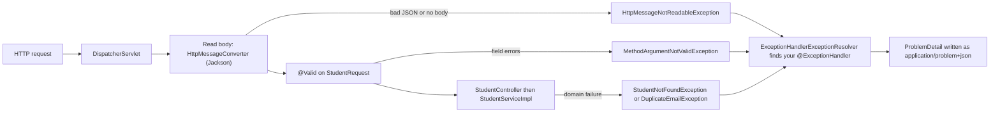

# 📅 Day 10 (Sun 1 Nov): first day of the three-track program, all on carried work

    

> [!IMPORTANT]
> Progress decides the work, not the calendar. Every track still has an open item, so **no new material today**: each track works its first open item from the pending table in [day09.md](day09.md#-what-is-pending-now). The full specs (12-part Spring, 8-part DSA, buggy round) are already written there and are linked below, not copied.

> [!NOTE]
> **Legend:** 🌅 morning · 🌙 evening · 🌱 Spring · 🧩 DSA · 🐞 buggy · 🔁 redo · ⬜ `NOT_STARTED` · 🟡 `IN_PROGRESS` · ✅ `COMPLETED` (verified) · 🔴 `REVISION_REQUIRED`. Tick the `- [ ]` boxes as you go.

## 🌅 Morning

> [!NOTE]
> Checked at 6 AM: no pushes from you since the 31 Oct evening. `CarFleetTest` 2/37 and `Day04LargestRectangleTest` 15/36 were unchanged. **Update 8:40 AM:** Day 04 Q1-Q3 re-answered and graded **26/30 ✅**. You pushed `f4cb8b9`, which moves four handlers in `GlobalExceptionHandler` to `ProblemDetail`. Part B2 is 🟡 in progress, and its full spec (what is done, what is left, exact tests) is in the [Part B2 section](#-day-04-part-b2-problemdetail-in-every-error-response) at the bottom of this file.

### ⏱️ Time plan (120 min)
| Minutes | Track | Item | Spec |
|---|---|---|---|
| 0-5 | 🔥 Revise first | Read the Day 04 rows in [mistakes/spring.md](../revision/mistakes/spring.md), then close it | |
| 5-20 | 🌱 Spring | Re-answer Day 04 Q1-Q3 in chat (definition → difference → when to use → example, plus a production angle) | [Re-answer cards](day09.md#-re-answer-cards) |
| 20-55 | 🌱 Spring | Day 04 Part B2: `ProblemDetail` in every error response, malformed JSON → 400, +3 tests | [Part B2](#-day-04-part-b2-problemdetail-in-every-error-response) (full spec below) |
| 55-90 | 🧩 DSA | `CarFleet` (NeetCode 150, Stack): pattern line and complexity first, then code | [Car Fleet](day09.md#-car-fleet-dsa) |
| 90-105 | 🐞 Buggy | `Day04LargestRectangle` (monotonic stack): make the suite pass without changing tests | [Day04LargestRectangle](day09.md#-day04largestrectangle-buggy-round) |
| 105-120 | Buffer | Finish whichever item ran over; push | |

### 🌱 Spring (~50 min)
- [x] Re-answer Day 04 Q1, Q2, Q3 in chat: graded 8 / 9 / 9 = **26/30**, ✅ COMPLETED.
- [ ] Part B2 in `spring-boot/course-practice`: finish the checklist in [section 7 of the Part B2 spec](#-day-04-part-b2-problemdetail-in-every-error-response) (items 1-6 are left). Done when `mvn test` shows **18 tests, 0 failures** there and the review reads the handler.

> [!TIP]
> Senior angle to have ready for scoring: in a banking API, what must **never** appear in a `ProblemDetail` `detail` field, and where does the full cause go instead?

### 🧩 DSA (~35 min)
- [ ] `src/main/java/com/prashant/dsa/stack/CarFleet.java`. Done when `mvn test -Dtest=CarFleetTest` is 37/37 on your pushed code, with the pattern line and complexity at the top. The optimised approach stays in the collapsed **Open only after your attempt** block in the spec.

### 🐞 Buggy (~15 min)
- [ ] `src/main/java/com/prashant/dailytests/Day04LargestRectangle.java`. Done when `mvn test -Dtest=Day04LargestRectangleTest` is 36/36 with only logical fixes in the main code. Read the failing tests, localise, fix with the smallest change.

### 🔁 Due redos (2, run in the 🌙 evening after the review, per [PROGRAM.md](../docs/PROGRAM.md))
Blank stubs are ready; each test class was checked against a correct version (all green) and fails on the empty stub.

| Redo | File | Tests | Gap | Timebox |
|---|---|---|---|---|
| 🐞 `Day02RpnEvaluator` | `src/main/java/com/prashant/dailytests/redo/Day02RpnEvaluatorRedoNov01.java` | `Day02RpnEvaluatorRedoNov01Test` 0/44 | +1 (reset after 31 Oct) | 20-30 min, cold |
| 🧩 `ValidParentheses` | `src/main/java/com/prashant/dailytests/redo/ValidParenthesesRedoNov01.java` | `ValidParenthesesRedoNov01Test` 0/18 | +1 (8 days late) | 20-30 min, cold |

> [!WARNING]
> Cold means cold: don't open `Day02RpnEvaluator*`, `ValidParentheses.java` or old redos. Write the three comment lines (pattern, time, space) before any code. The new `ValidParentheses` suite is stricter than the 2-test starter: empty string, closers on an empty stack, non-bracket characters, `null`, deep nesting and a 100 000-character input.

### 📦 Carried backlog (not for this morning)
| Item | Track | Status | When |
|---|---|---|---|
| `Day00BuggyExample` warm-up (4/10) | 🐞 | ⬜ NOT_STARTED | after `Day04LargestRectangle` is ✅ |
| Count-stack O(n) re-ask (3/5) | 🧩 | 🔴 REVISION_REQUIRED | evening, in chat |
| `ScoreOfParentheses` follow-up questions | 🧩 | ⬜ NOT_STARTED | after the re-ask |
| Day 02 Q1, Q3 and Day 03 Q1, Q2 re-answers | 🌱 | 🟡 IN_PROGRESS | after Part B2 |
| Banking module 1 (AuthN / AuthZ) | 🏦 | ⬜ NOT_STARTED | starts when Part B2 is ✅ |

### ✅ How it's verified
| Item | Check | Status |
|---|---|---|
| Day 04 Q1-Q3 | graded in chat, 7+ each | ✅ COMPLETED (26/30) |
| Part B2 | `mvn test` in `spring-boot/course-practice` (18 tests), code read | 🟡 IN_PROGRESS (11/15 green, 4 old assertions to move) |
| `CarFleet` | `CarFleetTest` 37/37 | ⬜ NOT_STARTED (2/37) |
| `Day04LargestRectangle` | `Day04LargestRectangleTest` 36/36 | ⬜ NOT_STARTED (15/36) |
| `Day02RpnEvaluatorRedoNov01` | 44/44, cold | 🟡 IN_PROGRESS (0/44) |
| `ValidParenthesesRedoNov01` | 18/18, cold | 🟡 IN_PROGRESS (0/18) |

```bash
git pull
mvn test -Dtest='CarFleetTest,Day04LargestRectangleTest,*RedoNov01Test'
```

## 🌱 Day 04 Part B2: ProblemDetail in every error response

   -lightgrey)  

> [!IMPORTANT]
> 📂 All work is in `spring-boot/course-practice` (the practice app, **not** `banking-app`): `exception/GlobalExceptionHandler.java` and `controller/StudentControllerTest.java`. ✅ **Done when** `mvn test` inside `spring-boot/course-practice` shows **18 tests, 0 failures** (`StudentControllerTest` 17 + `CoursePracticeApplicationTests` 1), every error response is an RFC 9457 `ProblemDetail` with content type `application/problem+json`, and `StudentController`, `StudentServiceImpl` and the repository are **unchanged**.

> [!NOTE]
> **Legend:** ✅ already done in your push `f4cb8b9` · ⬜ still to do · 🧪 test · ⚠️ gotcha · 📌 rule. This spec replaces the shorter one in [day09.md](day09.md#-day-04-part-b2-problemdetail-in-every-error-response); the sample bodies below match what your handler really returns (it has an extra `errorCode` property, which is fine).

### 📍 Where you are right now
Checked with `mvn test` on your pushed code (`f4cb8b9`, 8:38 AM):

| Handler in `GlobalExceptionHandler` | Exception | Status | Returns `ProblemDetail`? |
|---|---|---|---|
| `notFound` | `StudentNotFoundException` | 404 | ✅ yes |
| `invalid` | `MethodArgumentNotValidException` | 400 | ✅ yes, field messages in `errors` |
| `missingParameter` | `MissingServletRequestParameterException` | 400 | ✅ yes |
| `handleDuplicateEmail` | `DuplicateEmailException` | 409 | ✅ yes |
| *(missing)* | `HttpMessageNotReadableException` | 400 | ⬜ **no handler yet**: a broken body gives a 400 with an **empty body** in the test, and Spring Boot's own default JSON on a running server |
| *(optional)* | `Exception` (last resort) | 500 | ⬜ not written |

| Test run | Result |
|---|---|
| `CoursePracticeApplicationTests` | 1 / 1 ✅ |
| `StudentControllerTest` | 10 / 14 ✅, **4 red** because they still assert the old shapes: `createInvalid` (`$.name`), `searchMissingName` (`$.error`), `updateNonExisting` (`$.error`), `deleteUnknown` (`$.error`) |

> [!TIP]
> The 4 red tests are **not** a bug in your handler. The error body changed on purpose, so the assertions must move with it (item 4 below). That is a contract change you make deliberately, not a regression.

### 1️⃣ What are we building
Before B2 every error had its own shape: a `Map` with `error`, a `Map` of field names, and nothing at all for broken JSON. B2 makes **every** error response one standard shape, `ProblemDetail` (`application/problem+json`), and closes the one gap you have left: a **malformed or missing JSON body** must give a clean 400 in the same shape, with a fixed message that does not leak parser internals.

### 2️⃣ Why it matters
A caller (mobile app, another service, a test) reacts to errors **by code, not by reading English**. With ad-hoc maps each endpoint invents its own keys and each client needs special cases. With RFC 9457 the client always finds `status`, `title`, `detail`, `instance`, and your own fields (`errorCode`, `errors`) next to them. In a banking API there is a second reason: an error body is an output channel. A raw Jackson message can contain class names, field names and even a fragment of the request, so the rule is **fixed text to the client, full cause to the log**. At lead level the interviewer asks "why `ProblemDetail` over your own envelope, and what does a malformed body do in your service?"

### 3️⃣ Concepts
| Term | One precise line |
|---|---|
| `ProblemDetail` | Spring's class for an RFC 9457 error body: `type`, `title`, `status`, `detail`, `instance`, plus custom properties via `setProperty` |
| `application/problem+json` | the media type Spring uses when a handler returns a `ProblemDetail` |
| `@RestControllerAdvice` | one class whose `@ExceptionHandler` methods apply to every controller |
| `HttpMessageNotReadableException` | thrown while **reading** the body: broken JSON, empty body, JSON of the wrong shape, an unparseable value |
| `MethodArgumentNotValidException` | thrown **after** the body was read, when `@Valid` fails |
| `ErrorResponse` / `ErrorResponseException` | the interface and base class for exceptions that already carry their status and body |
| `type` = `about:blank` | the default `type`; Spring leaves it out of the JSON, which is why your 404 body has no `type` field |

### 4️⃣ Approaches (pick one and defend it)
| Approach | How | When it fits | Cost or risk |
|---|---|---|---|
| **A. Your own handlers** (what you are doing) | each `@ExceptionHandler` returns `ProblemDetail` | small API, full control of each message | you must remember every Spring MVC exception yourself (405, 415, missing body...) |
| **B. Extend `ResponseEntityExceptionHandler`** | override the methods you want to customise | you want Spring's own exceptions covered at once | more indirection; you must learn the base class |
| **C. Built-in switch** | a Spring Boot property that turns on `ProblemDetail` for Spring's own exceptions (find the exact name in the Boot 4.1 reference) | quick and standard for framework exceptions | your domain exceptions still need handlers |
| **D. Exceptions extend `ErrorResponseException`** | the exception carries its status and body | many domain exceptions with a fixed status | couples the domain to HTTP |

For B2, approach **A** is enough. Be ready to say in one sentence why you did not choose **B**.

### 5️⃣ How it works internally


```text
Fallback if the diagram does not render:
request -> read body (E1 if broken) -> @Valid (E2 if invalid) -> controller/service (E3 if domain failure)
        -> ExceptionHandlerExceptionResolver -> your @ExceptionHandler -> ProblemDetail
```

- The body is **converted first, then validated, then your code runs**. So broken JSON and a failed `@Valid` are two different exceptions at two different steps, and both are 400.
- If no `@ExceptionHandler` matches, the next resolvers try (`ResponseStatusExceptionResolver`, then `DefaultHandlerExceptionResolver`). `DefaultHandlerExceptionResolver` sets a bare 400 and, on a running server, the container's `/error` page then produces Spring Boot's default JSON. That is **not** `ProblemDetail`, and it is exactly the gap you are closing.
- When a handler returns a `ProblemDetail` without an `instance`, Spring MVC fills it in from the request path (`"instance": "/api/students/9999"` in your 404).

> [!WARNING]
> ⚠️ **Gotcha for the optional catch-all:** `@ExceptionHandler(Exception.class)` runs **before** `DefaultHandlerExceptionResolver`. If you add it carelessly, a `405` (wrong method) or `415` (wrong media type) from Spring turns into your generic **500**. A catch-all is only correct if those keep their status. That is why it is optional today and why approach B exists.

### 6️⃣ Banking use case
The callers of a banking API branch on the error: 409 means "someone else changed this, reload and retry", 400 means "fix your input", 404 means "that account does not exist". If `Student` is replaced by `Account`, the contract is the same, so the shape you settle on here is the shape the banking error model will follow (the banking app's `ApiError` record is what you compare it with before module 1).

| Request to `course-practice` | Before B2 | After B2 |
|---|---|---|
| `GET /api/students/99999` | 404, `{"error": "Student not found: 99999"}` | 404, `ProblemDetail` ✅ done |
| `POST` with a 1-character name | 400, `{"name": "..."}` | 400, `ProblemDetail` with `errors` ✅ done |
| `GET /api/students/search` without `name` | 400, `{"error": ...}` | 400, `ProblemDetail` ✅ done |
| `POST` with an existing email | 409, `{"error": ...}` | 409, `ProblemDetail` ✅ done |
| `POST` with `{"name":` (broken JSON) | 400 with **no body** (Boot default JSON on a real server) | 400, `ProblemDetail`, fixed `detail` ⬜ **to do** |

### 7️⃣ Implementation requirements (checklist, in order)
All edits are in two files you already own. No new class, no new dependency, no new file.

- [ ] **1. Add the missing handler** in `GlobalExceptionHandler`: a method with `@ExceptionHandler(HttpMessageNotReadableException.class)` that returns a `ProblemDetail` with status **400**, title `Malformed Request`, and `detail` set to exactly this fixed string: `Request body is missing or not valid JSON.`. Also add `errorCode` = `MALFORMED_REQUEST` (same convention as your other handlers). 📌 Do **not** put `ex.getMessage()` into the body.
- [ ] **2. Log the real cause** in that handler (a `Logger` field via `LoggerFactory`, one `warn` line with the exception). The client gets the fixed text; the log gets the detail. This is the "where does the full cause go" answer from the TIP above.
- [ ] **3. Clean the handler class** (these two are cosmetic, you may do them in the same commit): remove the now-unused `import ...ResponseStatus`, and make sure the file has one consistent style for building `ProblemDetail` (you currently use two layouts).
- [ ] **4. Move the 4 old assertions** in `StudentControllerTest` to the new shape: `createInvalid` `$.name` / `$.email` → `$.errors.name` / `$.errors.email`; `searchMissingName`, `updateNonExisting`, `deleteUnknown` `$.error` → `$.detail` (the expected texts stay: `name` missing text becomes `Required parameter 'name' is missing.`, and `Student not found: 99999`).
- [ ] **5. Add exactly the three tests** in section 11 to `StudentControllerTest`.
- [ ] **6. Run** `mvn test` inside `spring-boot/course-practice`: **18 tests, 0 failures**. Then `git push`.
- [ ] **7. (Optional stretch, only after 1-6)** last-resort `Exception` handler returning a 500 `ProblemDetail` with `detail` = `An unexpected error occurred.` and `errorCode` = `INTERNAL_ERROR`, logging the real exception with `error`. Read the gotcha in section 5 first; if you cannot keep 405 and 415 working, skip it and note why.

> [!CAUTION]
> `StudentController`, `StudentServiceImpl`, `StudentRepository` and the DTOs are **not** part of B2. If you feel you must change one of them, stop and tell me why first.

### 8️⃣ Sample requests and responses
All bodies are what your handler produces today (fields appear in this order in the JSON; `type` is absent because it is `about:blank`). Content type is `application/problem+json` in every case.

**1. Malformed JSON** (⬜ to do). `POST /api/students`, body `{"name":`:

```json
{
  "detail": "Request body is missing or not valid JSON.",
  "instance": "/api/students",
  "status": 400,
  "title": "Malformed Request",
  "errorCode": "MALFORMED_REQUEST"
}
```

**2. Validation failure** (✅ done). `POST /api/students` with `{"name": "A", "email": "not-an-email"}`:

```json
{
  "detail": "One or more fields have validation errors.",
  "instance": "/api/students",
  "status": 400,
  "title": "Validation Failed",
  "errors": {
    "name": "name must be between 2 and 50 characters",
    "email": "email must be valid"
  },
  "errorCode": "VALIDATION_FAILED"
}
```

**3. Not found** (✅ done). `GET /api/students/99999`:

```json
{
  "detail": "Student not found: 99999",
  "instance": "/api/students/99999",
  "status": 404,
  "title": "Student Not Found",
  "errorCode": "STUDENT_NOT_FOUND"
}
```

**4. Duplicate email** (✅ done). `POST /api/students` with an email that exists:

```json
{
  "detail": "Email already exists. Please use a different email address.",
  "instance": "/api/students",
  "status": 409,
  "title": "Duplicate Email",
  "errorCode": "DUPLICATE_EMAIL"
}
```

**5. Missing request parameter** (✅ done). `GET /api/students/search`:

```json
{
  "detail": "Required parameter 'name' is missing.",
  "instance": "/api/students/search",
  "status": 400,
  "title": "Missing Request Parameter",
  "errorCode": "MISSING_REQUEST_PARAMETER",
  "parameter": "name"
}
```

**6. Unexpected failure** (⬜ optional, item 7). Any unhandled `RuntimeException`:

```json
{
  "detail": "An unexpected error occurred.",
  "instance": "/api/students",
  "status": 500,
  "title": "Internal Server Error",
  "errorCode": "INTERNAL_ERROR"
}
```

> [!NOTE]
> The `errorCode` field is **your** addition and a good one: clients switch on a stable code, not on the human `title`. Keep it on every handler, including the new one.

### 9️⃣ DB changes
**None.** `Student.email` still has no `UNIQUE` constraint, so the check-then-save race from your Q3 answer is still open here on purpose. That is the JPA topic for the banking app (module 2), where the pattern becomes: `UNIQUE` constraint in the migration, catch `DataIntegrityViolationException`, **check the constraint name** and only then map to 409. Do not add the constraint in B2.

### 🔟 Edge and failure cases
| Case | Expected | Note |
|---|---|---|
| Broken JSON syntax (`{"name":`) | 400 `ProblemDetail`, fixed `detail` | the parser message can leak class and field names |
| Empty body on POST or PUT | 400 `ProblemDetail`, same fixed `detail` | same exception as broken JSON |
| Valid JSON of the wrong shape (an array instead of an object, or an object where a string is expected) | 400 `ProblemDetail`, same fixed `detail` | still `HttpMessageNotReadableException` |
| Several invalid fields | one 400 listing **all** of them in `errors` | already works, do not stop at the first |
| Unknown id on GET, PUT or DELETE | 404 `ProblemDetail` | already works; PUT and DELETE assertions move to `$.detail` |
| `GET /api/students/abc` (id is not a number) | 400 today, **empty body** | out of scope for B2 (it is `MethodArgumentTypeMismatchException`); note it for approach B or C |
| `POST` with `Content-Type: text/plain` | 415 today, empty body | out of scope; the reason the catch-all is risky |
| Unexpected `RuntimeException` | 500, generic `detail` | never return the stack trace or `ex.getMessage()` |

### 1️⃣1️⃣ Testing requirements
Add these three to `StudentControllerTest` with exactly these method names. They sit next to your existing tests and reuse `mvc` and `createStudent`.

| # | 🧪 Test name | Request | Must assert | What it proves |
|---|---|---|---|---|
| 1 | `malformedJsonReturnsProblemDetail` | `POST /api/students`, `Content-Type: application/json`, body `{"name":` | status **400**; content type compatible with `application/problem+json`; `$.status` = 400; `$.title` = `Malformed Request`; `$.detail` = `Request body is missing or not valid JSON.`; `$.errorCode` = `MALFORMED_REQUEST`; and the body string does **not** contain `Unexpected`, `JsonParseException` or `com.fasterxml` | the new handler and the no-leak rule |
| 2 | `notFoundIsProblemDetail` | `GET /api/students/99999` | status **404**; content type `application/problem+json`; `$.status` = 404; `$.title` = `Student Not Found`; `$.detail` = `Student not found: 99999`; `$.errorCode` = `STUDENT_NOT_FOUND`; `$.instance` = `/api/students/99999` | the shape of a domain error, including `instance` |
| 3 | `validationErrorsAreListed` | `POST /api/students`, body `{"name":"A","email":"not-an-email"}` | status **400**; `$.title` = `Validation Failed`; `$.errors.name` and `$.errors.email` both exist; `$.errorCode` = `VALIDATION_FAILED` | all field errors in the standard shape |

Plus the 4 moved assertions from item 4. Expected count: `StudentControllerTest` 14 + 3 = **17**, plus the context test = **18**.

> [!TIP]
> Write test 1 first and run it **before** you write the handler. It must fail (you will see a 400 with an empty body). Then write the handler and watch it go green. That is the red-green habit the interview round asks about.

### 1️⃣2️⃣ Interview questions
1. Walk me through what happens, step by step, when the body is `{"name":` and when it is valid JSON that fails `@Valid`. Which exception, at which step, which handler?
2. `ProblemDetail` or your own error envelope: when would you keep a custom envelope?
3. Why must you never copy `ex.getMessage()` of a JSON parse failure into the response? Where does the full cause go instead?
4. What is `type` for, and why is `about:blank` a weak choice for a public banking API?
5. 400 or 422 for a request that is well-formed but breaks a business rule? Defend one.
6. You add `@ExceptionHandler(Exception.class)`. What breaks, and how do you avoid it?

**Knowledge check**
1. Which exception is thrown first for a request whose body is broken JSON?
   - (a) `MethodArgumentNotValidException`
   - (b) `HttpMessageNotReadableException`
   - (c) `ConstraintViolationException`
   - (d) `HttpMediaTypeNotSupportedException`
2. What is the media type of a `ProblemDetail` response?
   - (a) `application/json`
   - (b) `application/problem+json`
   - (c) `text/plain`
   - (d) `application/error+json`
3. What happens to a `415` if you add a catch-all `@ExceptionHandler(Exception.class)` and do nothing else?
   - (a) nothing, Spring still returns 415
   - (b) your catch-all handles it and returns your 500
   - (c) the request hangs
   - (d) Spring returns 200 with an empty body

<details>
<summary><b>Answers (try first)</b></summary>

| Question | Answer | Why |
|---|---|---|
| 1 | (b) | the body is read before it is validated, so a broken body fails at conversion |
| 2 | (b) | RFC 9457 defines `application/problem+json` |
| 3 | (b) | your resolver (`ExceptionHandlerExceptionResolver`) runs before `DefaultHandlerExceptionResolver`, so the broad handler wins |

</details>

### ✅ Done when (tick all before you push)
- [ ] `GlobalExceptionHandler` has a handler for `HttpMessageNotReadableException` with the fixed `detail`, `errorCode` and a log line, and no `ex.getMessage()` in the body
- [ ] No handler returns a `Map` and no unused import is left
- [ ] The 4 old assertions use `$.errors.*` / `$.detail`
- [ ] The 3 new tests exist with the exact names above
- [ ] `mvn test` in `spring-boot/course-practice`: **18 tests, 0 failures**
- [ ] `StudentController`, `StudentServiceImpl`, `StudentRepository` and the DTOs have **no diff** in your commit
- [ ] You can answer interview question 6 out loud in 60 seconds

## 🧱 Empty stubs for B2
Everything is in the existing class, so there is no new file. The only skeleton is the handler signature you must add. The body is yours.

```java
// GlobalExceptionHandler.java (add by hand, no body provided)
@ExceptionHandler(HttpMessageNotReadableException.class)
public ProblemDetail malformedBody(HttpMessageNotReadableException ex) {
    // TODO(write by hand): log the real cause, then build the ProblemDetail
    //   status 400, title "Malformed Request", fixed detail, errorCode MALFORMED_REQUEST
    throw new UnsupportedOperationException("TODO");
}
```

Acceptance: test 1 in section 11 is green and the response body never contains the parser's message.

## 🌙 Evening (1 Nov): review, scores and tonight's work

    

> [!NOTE]
> Checked at 8 PM on `bc6df22` with JDK 21 and Maven. Your only code push today is `f4cb8b9` (08:38 IST, `GlobalExceptionHandler`). Test results: `course-practice` **11/15** (the same 4 old assertions are red), `CarFleetTest` **2/37** (stub, passes by accident), `Day04LargestRectangleTest` **15/36**, `Day02RpnEvaluatorRedoNov01Test` **0/44**, `ValidParenthesesRedoNov01Test` **0/18**. No new conceptual mistakes, so nothing was added to the mistake logs. The one cosmetic issue (the unused `ResponseStatus` import) was left in place on purpose: you are mid-edit in that file, and it is item 3 of the B2 checklist, so a fix from me would only give you a merge conflict.

### 📝 Scores (rubric in [PROGRAM.md](../docs/PROGRAM.md#-evening-scoring-rubric))

| Track | Score | Evidence |
|---|---|---|
| 🌱 Spring Boot | **7 / 10** 🟡 Moderate | Strong concepts (Day 04 re-answers 26/30) and four clean `ProblemDetail` handlers, but B2 is half done and the push left the suite red |
| 🧩 DSA | **can't be scored yet** | no DSA work today: `CarFleet` is still the stub (2/37 by accident) |
| 🐞 Buggy | **can't be scored yet** | no buggy work today: `Day04LargestRectangle` is unchanged at 15/36 |

**🌱 Spring, by dimension** (the track score is the rounded average of the dimensions that applied):

| Dimension | Score | Why |
|---|---|---|
| 🧠 Concept understanding | 8 | Q1 8 / Q2 9 / Q3 9 this morning: converter-then-validation order, mass assignment, check-then-save race and the DB constraint. Missing pieces were internals (`RequestResponseBodyMethodProcessor`, `@Valid` vs `@Validated`), not the model |
| 🛠️ Implementation | 6 | The four handlers are correct, consistent, and the stable `errorCode` property is a lead-level touch. But the commit changed the error contract **without moving the 4 tests that pin it**, so `main` went 15/15 → 11/15; the malformed-body handler (the actual gap B2 closes) and the 3 new tests are not written; one unused import left |
| 🧩 Problem solving | 7 | Approach A (own handlers) is the right size for this app, and `missingParameter` now uses `ex.getParameterName()` instead of a hard-coded `"name"`. Not yet shown: why not `ResponseEntityExceptionHandler` (approach B) |
| 🎤 Interview readiness | 7 | The re-answers would hold up in a 60-90 second answer. B2 questions 3 and 6 (no parser text in `detail`, the catch-all that eats 405 and 415) are not answered yet, and those are the ones a banking interviewer pushes on |
| 🐞 Debugging · ⏱️ Complexity | n/a | nothing failed that you had to debug; complexity does not apply to this task |

> [!WARNING]
> 📌 The one habit to fix from today: **a contract change and the tests that pin it go in the same commit.** At lead level a reviewer reads "4 red tests on `main`" as "broken build", even when the reason is a deliberate change. Write the new assertions first, watch them fail, then change the handler.

### 🧪 Topic classification

| Topic | Class | Reason |
|---|---|---|
| 🌱 Day 04 Q&A (JSON → DTO flow, DTO vs entity, unique-data race) | 🟢 Strong | 26/30 graded, every answer 8+; move on |
| 🌱 §5 `ProblemDetail` error contract (Part B2) | 🟡 Moderate | 7/10; weakest dimension is implementation (red suite, malformed-body handler missing). Finish B2 tonight |
| 🧩 `CarFleet` | ⬜ Pending | not attempted (2/37) |
| 🐞 `Day04LargestRectangle` | ⬜ Pending | not attempted (15/36) |
| 🔁 `Day02RpnEvaluator` and `ValidParentheses` cold redos | ⬜ Pending | stubs 0/44 and 0/18, due tonight |
| 🧩 Amortised O(n) reasoning for stack solutions | 🔴 Weak (carried) | count-stack quiz 3/5 on 29 Oct and the re-ask is still open; pack below |
| ⛔ Blocked | none | nothing outside your control is stopping any task |

> [!NOTE]
> No topic scored Weak **tonight**. The other 🔴 Weak rows in [PROGRESS.md](../PROGRESS.md#-weak-topics) come from older answers (HTTP semantics, `ResponseEntity` vs `@ResponseStatus`, the binding annotations, RPN evaluation). Their packs are made when each is picked up; the RPN pack waits until **after** tonight's cold RPN redo so it does not spoil it.

### 🎒 Weak-topic pack: amortised O(n) for stack solutions

> [!IMPORTANT]
> Do the count-stack **re-ask first, in chat, without opening this pack**: "Why is the count-stack `RemoveKAdjacentDuplicates` O(n) and not O(n·k), even though there is a `while`/pop inside the loop?" Then open the pack.

<details>
<summary><b>Open after the re-ask</b></summary>

**1. Notes**

*Why it matters.* Every monotonic-stack and count-stack solution has a loop inside a loop, and the first thing an interviewer does is point at it and say "so that's O(n²)?". A senior answer proves it isn't, in two sentences, and knows when that proof is not enough.

*The variants of "how long does it take":*

| Kind | Question it answers | Example |
|---|---|---|
| Worst case per operation | how slow can **one** call be? | one `ArrayList.add` that triggers a resize copies all n elements: O(n) |
| Amortised | what is the **total** cost of any sequence of n calls, divided by n? | n `ArrayList.add` calls copy at most about 2n elements in total, so O(1) amortised |
| Average case | what is the **expected** cost over random inputs? | `HashMap.get` with a good hash: O(1) expected, O(n) worst if every key collides (O(log n) after treeification) |

*How the stack argument works (aggregate method).* Count operations per **element**, not per loop iteration. Each element is pushed exactly once, and it can be popped at most once, because once popped it is gone. So over the whole run there are at most n pushes and n pops, plus one comparison that *stops* each inner `while` (at most n of those). Total work ≤ 3n = O(n), no matter how the pops are spread across iterations.

| Input `[5, 4, 3, 2, 6]`, pop while top < current | i=0 | i=1 | i=2 | i=3 | i=4 | Total |
|---|---|---|---|---|---|---|
| pushes | 1 | 1 | 1 | 1 | 1 | 5 |
| pops | 0 | 0 | 0 | 0 | 4 | 4 |

One iteration did 4 pops, but the total pops (4) can never exceed the total pushes (5). That is the whole proof.

*When amortised is not enough.* An online API (one call per request) inherits the **worst case per call**: a single request may do O(n) pops. Fine for a batch job, worth saying out loud for a latency SLA.

**2. Conceptual question (5 min)**

Explain the difference between worst-case per operation, amortised and average-case cost using `ArrayList.add` and `HashMap.get`. Which one is `ArrayDeque.push`, and why?

**3. Implementation task (15 min)**

Write `StockSpanner` (LeetCode 901, not in the NeetCode 150, so it spoils nothing): `next(int price)` returns how many consecutive days, ending today, had a price ≤ today's. Example: prices `100, 80, 60, 70, 60, 75, 85` → `1, 1, 1, 2, 1, 4, 6`. Put the pattern line and the time and space complexity at the top first, then state both the worst case of **one** `next` call and the amortised cost. Write it in chat or in a scratch class; it is graded in chat.

**4. Debugging task (10 min)**

A teammate says this is correct and O(n). The comment is the contract.

```java
// For each index i, the distance back to the previous element that is STRICTLY greater
// than a[i]; 0 if there is none.
static int[] prevGreaterDistance(int[] a) {
    int[] out = new int[a.length];
    Deque<Integer> stack = new ArrayDeque<>(); // indices
    for (int i = 0; i < a.length; i++) {
        while (!stack.isEmpty() && a[stack.peek()] < a[i]) {
            stack.pop();
        }
        out[i] = stack.isEmpty() ? 0 : i - stack.peek();
        stack.push(i);
    }
    return out;
}
```

Find an input where it breaks the contract, fix it with the smallest change, and then prove (or disprove) the O(n) claim.

**5. Interview scenario (5 min)**

In a code review on your team, a colleague blocks your PR: "`while` inside `for`, this is O(n²) on 10 million rows." Talk for 60 seconds: defend the complexity with the counting argument, and say in which situation their concern would still be valid.

</details>

### ⏳ Pending morning work = tonight's work (in this order)

> [!IMPORTANT]
> The rule in [PROGRAM.md](../docs/PROGRAM.md): pending morning work first, redos only after. 60 minutes will not hold everything below, so stop at the line where your time runs out and push what is green. Whatever is left is the first thing tomorrow.

| # | Minutes | Item | Track | Done when |
|---|---|---|---|---|
| 1 | 25 | Part B2 items 1-6 ([checklist in section 7](#-day-04-part-b2-problemdetail-in-every-error-response)): test `malformedJsonReturnsProblemDetail` first (red), then the handler with the log line, the 4 moved assertions, the other 2 tests | 🌱 | `mvn test` in `spring-boot/course-practice` shows **18 tests, 0 failures** |
| 2 | 30 | `CarFleet` ([spec](day09.md#-car-fleet-dsa)): pattern line and complexity at the top before any code | 🧩 | `CarFleetTest` 37/37 on your pushed code |
| 3 | 5 | Count-stack O(n) re-ask, in chat | 🧩 | graded 4/5 or better |
| 4 | if time | `Day04LargestRectangle` ([spec](day09.md#-day04largestrectangle-buggy-round)) | 🐞 | 36/36, only logical fixes |
| 5 | if time | 🔁 cold redos `Day02RpnEvaluatorRedoNov01` (0/44) and `ValidParenthesesRedoNov01` (0/18) | 🔁 | 44/44 and 18/18, cold |

> [!NOTE]
> If the two redos don't happen tonight, nothing is lost: they stay first in the queue and take Monday's two evening slots (the reset RPN redo and the most overdue item), and `MinStack` and `ScoreOfParentheses` move back a day. The 10 PM check rewrites [redo-schedule.md](../revision/redo-schedule.md) from what you actually push.

- [ ] B2 18/18 pushed
- [ ] `CarFleet` 37/37 pushed
- [ ] count-stack re-ask answered in chat
- [ ] `Day04LargestRectangle` 36/36 pushed (if time)
- [ ] the two cold redos pushed (if time)

### 🎯 Tomorrow's focus (Mon 2 Nov), from tonight's assessment

| Track | Focus | Why |
|---|---|---|
| 🌱 Spring | If B2 is ✅ tonight: start [banking module 1 (AuthN / AuthZ)](day09.md#-banking-module-1-authn--authz-foundation). If not: finish B2 first, contract and tests in one commit, then answer B2 interview questions 3 and 6 out loud. | Implementation was the weakest dimension (6); module 1 is blocked behind B2 by plan, not by an outside obstacle |
| 🧩 DSA | `CarFleet` if still open. This is its fourth session, so spend the first 10 minutes only on the pattern line, a hand-sorted example and the complexity, then code. Count-stack re-ask if it was not done. | No DSA has been scored since 31 Oct; the gap is starting the problem, not solving it |
| 🐞 Buggy | `Day04LargestRectangle`: list the 21 failing tests and group them by symptom **before** touching code, then make the smallest fix per group. | Debugging is the dimension this round scores; it has not been attempted |
| 🔁 Redos (evening) | `Day02RpnEvaluator` and `ValidParentheses` if not done tonight, otherwise `MinStack` and `ScoreOfParentheses` | the cap of 2 a day, most overdue first |

> [!TIP]
> Reply in chat when something is pushed or when you want the re-ask, the pack answers or the B2 interview questions graded. Each answer is graded and recorded the same night.

## 🌃 End of day (1 Nov, 10 PM check)


| Item | Outcome |
|---|---|
| 🎤 Day 04 Q1-Q3 re-answers | ✅ COMPLETED (26/30: 8 / 9 / 9, graded in chat this morning) |
| 🌱 Day 04 Part B2 | 🟡 IN_PROGRESS · `f4cb8b9` converts 4 handlers, `course-practice` 11/15 (4 old assertions), malformed-body handler and +3 tests open · carried |
| 🧩 `CarFleet` | ⬜ NOT_STARTED (2/37, no push after the 8 PM review) · carried |
| 🧩 Count-stack O(n) re-ask | 🔴 REVISION_REQUIRED (not answered in chat yet) · carried |
| 🐞 `Day04LargestRectangle` | ⬜ NOT_STARTED (15/36) · carried |
| 🔁 `Day02RpnEvaluatorRedoNov01` / `ValidParenthesesRedoNov01` | 🟡 IN_PROGRESS (0/44, 0/18, not attempted) · moved to Mon 2 Nov evening, the rest of the queue shifts one day |

> [!NOTE]
> No commits from Prashant after the 8 PM evening review (last one `bc6df22`, 08:43 IST), so there was nothing new to test. No new mistakes and no cosmetic fixes. [redo-schedule.md](../revision/redo-schedule.md) is rewritten for the two missed redos, and the Sunday plan projection in [PROGRESS.md](../PROGRESS.md#-plan-projection-3-h-a-day) is refreshed.

> [!IMPORTANT]
> **First task tomorrow (Mon 2 Nov, 6 AM):** 🌱 finish Day 04 Part B2 items 1-6 from [section 7](#-day-04-part-b2-problemdetail-in-every-error-response): write `malformedJsonReturnsProblemDetail` first (red), then the `HttpMessageNotReadableException` handler, move the 4 old assertions and add the other 2 tests, until `mvn test` in `spring-boot/course-practice` shows **18 tests, 0 failures**, all in one commit. Then 🧩 `CarFleet` (pattern line, a hand-sorted example and complexity first) and 🐞 `Day04LargestRectangle` (group the 21 failing tests by symptom first). 🌙 Evening redos: `Day02RpnEvaluatorRedoNov01` and `ValidParenthesesRedoNov01`.
