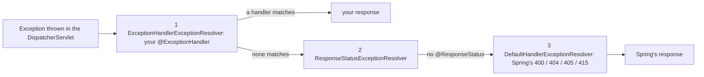

# 📅 Day 13 (Wed 4 Nov): close Part B2 with Drill 1, start banking module 1, carried DSA and buggy items

     

> [!IMPORTANT]
> Progress decides the work, not the calendar. Today: 🌱 **Drill 1** (15 min, closes the last open Part B2 gap) then **banking module 1, step 1** (the V2 migration and its test), 🧩 the three `CarFleet` comment lines (pushed first), the count-stack re-ask and a cold RPN redo, 🐞 the `Day04LargestRectangle` symptom table. Every item ends in a push, even if red. No new Stack problem and no new buggy round: both tracks still have open items.

> [!NOTE]
> **Legend:** 🌅 morning · 🌙 evening · 🌱 Spring · 🏦 banking · 🧩 DSA · 🐞 buggy · 🔁 redo · ⬜ `NOT_STARTED` · 🟡 `IN_PROGRESS` · ✅ `COMPLETED` (verified) · 🔴 `REVISION_REQUIRED`. Tick the `- [ ]` boxes as you go. Run `git pull` first: three commits landed late on 3 Nov, 22:39 to 23:15 IST (`ff79dbf`, `5918263`, `80d98f1`).

## 🌅 Morning

> [!NOTE]
> Checked at 6 AM on `80d98f1` (JDK 21, Maven). `course-practice` is **19/19** (`StudentControllerTest` 18 + context 1): your `ff79dbf` (22:39 IST) made the catch-all log the cause and return a fixed `Unexpected error`, and added the 415 test; `5918263` and `80d98f1` are tidy-ups (explicit 405 and 415 handlers that keep the `Allow` and `Accept` headers, and the controller, tests and handler reordered by status). The 405 and 415 cases are now right. **One gap is left**, probed on the pushed code: `GET /api/students/abc` and `GET /api/nothing` still answer **500** `Unexpected error`, where Spring's own answers are 400 and 404. That is the same catch-all lesson, so it becomes Drill 1 below. Unchanged and re-run: `CarFleetTest` **37/37**, `Day04LargestRectangleTest` **15/36**, `Day02RpnEvaluatorRedoNov01Test` **0/44**, `ValidParenthesesRedoNov01Test` **0/18**.

> [!WARNING]
> **Why today is shaped this way.** Part B2 moved last night (the first Spring push since 2 Nov) and the catch-all is mostly fixed: well done. DSA and buggy have not moved for a week of sessions, so the three small DSA deliverables go **first**. Spring now follows your own rule from 3 Nov: small practice examples that build the whole idea (Drill 1), and what is unfinished moves to the carried list instead of blocking new content (module 1 starts today).

### ⏱️ Time plan (120 min)
| Minutes | Track | Item | Push it |
|---|---|---|---|
| 0-10 | 🧩 DSA | `CarFleet` pattern line, time and space as 3 comment lines at the top of `CarFleet.java` | yes, first, `CarFleetTest` stays 37/37 |
| 10-25 | 🌱 Spring | **Drill 1**: Spring defaults vs the catch-all (3 tests, 2 small handlers) | yes, `course-practice` green |
| 25-65 | 🏦 Banking | **Module 1, step 1**: `V2__create_auth_tables.sql` by hand and `AuthSchemaIT` | yes, even if the IT is red |
| 65-70 | 🧩 DSA | Count-stack O(n) re-ask, answered in chat | graded tonight |
| 70-95 | 🔁🧩 DSA | Cold redo `Day02RpnEvaluatorRedoNov01` (0/44), timed 25 min | yes, even if red |
| 95-110 | 🐞 Buggy | `Day04LargestRectangle`: symptom table and a blank hand trace, as a comment block, no code change | yes |
| 110-120 | Buffer | `mvn test`, push whatever is left | |

> [!TIP]
> Ask for a hint after 15 minutes on any step. The RPN redo is in the morning today because it has slipped from the evening four times; `ValidParentheses` stays in the evening.

---

## 🌱 Drill 1: Spring defaults vs the catch-all (about 15 min)

  

> [!IMPORTANT]
> 📂 `spring-boot/course-practice` · stub `src/test/java/com/prashant/coursepractice/controller/SpringDefaultsDrillTest.java` (3 tests, red until you write them). ✅ Done when the 3 tests pass with your handler changes, `mvn test` shows **22 tests, 0 failures** in `course-practice`, and you can say in one sentence why the catch-all hid Spring's answers. Closing this closes Part B2.

#### 1️⃣ What we are building
Two small handlers (or one change of approach) so that a client mistake never comes back as a 500, plus three tests that prove 400, 404 and 405.

#### 2️⃣ Why it matters
The most common production mistake in exception handling is a `@ExceptionHandler(Exception.class)` that is too greedy. A bad URL becomes a 500, the on-call engineer gets paged for a client typo, error-rate dashboards lie, and real bugs hide in the noise. At lead level the interview question is: "what does Spring answer by itself, and what must you add?"

#### 3️⃣ Concepts
| Term | One precise line |
|---|---|
| `HandlerExceptionResolver` chain | the list Spring walks, in order, to turn an exception into a response |
| `ExceptionHandlerExceptionResolver` | runs your `@ExceptionHandler` methods (first in the chain) |
| `ResponseStatusExceptionResolver` | honours `@ResponseStatus` and `ResponseStatusException` |
| `DefaultHandlerExceptionResolver` | Spring's built-in mapping of its own exceptions to 4xx codes (last in the chain) |
| `ResponseEntityExceptionHandler` | a ready-made `@ControllerAdvice` base class that maps the same Spring exceptions to `ProblemDetail` |
| catch-all | `@ExceptionHandler(Exception.class)`: it matches **everything**, so the resolvers after yours never get a turn |

#### 4️⃣ Approaches and variants
| Approach | What you write | Fits when | Cost |
|---|---|---|---|
| A. No catch-all | nothing | you accept Spring's default bodies | raw 500 pages for real bugs |
| B. Catch-all plus one handler per Spring exception you care about (**today**) | a few small handlers | you want one error contract | you must remember each new framework exception |
| C. `extends ResponseEntityExceptionHandler` | override `handleExceptionInternal` to add `errorCode` | many framework exceptions to cover | a bigger base class to understand |

#### 5️⃣ How it works internally

With `@ExceptionHandler(Exception.class)` present, step 1 always matches, so step 3 never runs. That is why `/abc` and an unknown path became 500.

#### 6️⃣ Banking use case
`GET /api/v1/accounts/abc` and a mistyped `/api/v1/acounts/1` must answer 400 and 404 with the same error body as every other error, and must not page anyone.

#### 7️⃣ Implementation requirements
- [ ] Run the experiment first (5 min): comment out the catch-all, run the 4 requests of the table below with the 3 tests as a quick check, and fill the "Spring's own answer" column. Then put the catch-all back and fill "with the catch-all".
- [ ] Add only what is missing (approach B): a handler for the exception behind `/abc` and a handler for the exception behind an unknown path. Both return `ProblemDetail` with an `errorCode`, a fixed `detail` (no class names, no stack text), and the right status. Keep the catch-all last.
- [ ] Write the 3 tests in `SpringDefaultsDrillTest`.

| Request | Today with the catch-all | Spring's own answer (you fill it) | Exception behind it (you find it) |
|---|---|---|---|
| `GET /api/students/abc` | 500 | | |
| `GET /api/nothing` | 500 | | |
| `PATCH /api/students/1` | 405 (own handler) | | |
| `POST` with `text/plain` | 415 (own handler) | | |

#### 8️⃣ Sample API
`GET /api/students/abc` should answer (wording is yours, the shape is the contract):

```json
{ "type": "about:blank", "title": "Invalid Parameter", "status": 400, "detail": "Parameter 'id' has an invalid value.", "instance": "/api/students/abc", "errorCode": "INVALID_PARAMETER" }
```

#### 9️⃣ DB changes
None.

#### 🔟 Edge and failure cases
| Case | Expected |
|---|---|
| `/abc` | 400, no exception class name and no conversion text in the body |
| unknown path | 404, same body shape, `errorCode` present |
| wrong verb | 405 with the `Allow` header (the header is easy to lose when you build the body yourself) |
| a real bug (e.g. a `NullPointerException` in a service) | still 500, generic `detail`, full cause in the log |

#### 1️⃣1️⃣ Testing requirements
| Test | Proves |
|---|---|
| `nonNumericIdReturns400` | type mismatch is a client error |
| `unknownPathReturns404` | no handler for a path is a client error |
| `wrongVerbKeepsAllowHeader` | your 405 handler did not drop what Spring sends |

#### 1️⃣2️⃣ Interview questions
1. Which resolver runs first, and why does a catch-all on `Exception` hide `DefaultHandlerExceptionResolver`?
2. Approach B or C for 30 framework exceptions? Say the trade-off.
3. A client sends `GET /api/accounts/abc`. Which exception, which status, and what may the body say?

**Knowledge check**
1. With no `@ExceptionHandler` at all, a `GET` on an unknown path answers:
   - (a) 500
   - (b) 404
   - (c) 400
   - (d) 200 with an empty body
2. With a catch-all on `Exception`, the same request answers:
   - (a) 404, as before
   - (b) 500, because your handler matches first
   - (c) 400
   - (d) the request never reaches the servlet

<details>
<summary><b>🔒 Open only after your attempt</b></summary>

| Question | Answer | Why |
|---|---|---|
| 1 | (b) | Spring 6+ raises `NoResourceFoundException` for an unmapped path and maps it to 404 |
| 2 | (b) | your resolver is first in the chain and matches every exception, so the defaults never run |

</details>

> [!WARNING]
> Do not log the full cause for a 400 or a 404. The logs of a public API fill up with scanners probing paths. `warn` or `debug` for client errors, `error` with the stack trace only for the 500.

---

## 🏦 Banking module 1, step 1: the V2 auth migration and its test (about 40 min)

   

> [!IMPORTANT]
> The full 12-part module spec is in [day09.md](day09.md#-banking-module-1-authn--authz-foundation); do not re-read all of it today. **Step 1 only:** decide the table design in writing (10 min), then write `banking-app/src/main/resources/db/migration/V2__create_auth_tables.sql` by hand and the two tests of `AuthSchemaIT`. ✅ Done when Flyway applies V2 on a fresh Testcontainers database and both `AuthSchemaIT` tests pass (`mvn verify` in `banking-app`, Docker Desktop running). The login endpoint, JWT issue and `@PreAuthorize` are steps 2 and later, not today.

> [!CAUTION]
> The migration file is **only created by you**; no stub is committed, on purpose. Flyway checksums a migration once it has run, and editing it afterwards breaks startup. If V2 ran on your local database and you then change it, add a V3 or reset the dev database, never edit V2 in place. No password, hash or seed user goes into the file.

#### Decide first (write these 5 answers as comment lines at the top of the V2 file)
| # | Decision | Options from the spec |
|---|---|---|
| 1 | Which tables and which join tables? | `users`, `roles`, `permissions`, `user_roles`, `role_permissions` |
| 2 | Primary key type for `users` (public id in the token `sub` claim) | `bigint` identity or `uuid`; say which and why |
| 3 | How is "Teller01 = teller01" prevented? | unique index on `lower(username)` or a `citext` column |
| 4 | What does the password column hold, and how wide must it be? | BCrypt hash string, not the password |
| 5 | Which columns come from `BaseEntity`? | read [`BaseEntity.java`](../banking-app/src/main/java/com/prashant/banking/common/BaseEntity.java) and copy its columns |

#### Stubs
```text
banking-app/src/main/resources/db/migration/V2__create_auth_tables.sql            // you create it, by hand
banking-app/src/test/java/com/prashant/banking/auth/AuthSchemaIT.java             // given: 2 red tests, bodies are yours
```

- [ ] Five decisions written as comments in V2.
- [ ] V2 written; `AuthSchemaIT` (run from your IDE, or `mvn verify` in `banking-app`) applies it on a fresh container.
- [ ] `v2CreatesFiveAuthTables` and `usernameIsUniqueIgnoringCase` pass.
- [ ] Interview line, said out loud in 60 seconds: why a unique index on `lower(username)` and not an `exists` check in the service (the same lesson as the Day 04 email race).

---

## 🧩 DSA

### 1️⃣ `CarFleet`: three comment lines (5-10 min, **push first**)
- [ ] At the top of `src/main/java/com/prashant/dsa/stack/CarFleet.java` add three comment lines: the pattern, the time and the space. Then `mvn test -Dtest=CarFleetTest` must stay **37/37**.

> [!TIP]
> *Hint, one question each.* Time: which single step costs the most, the sort or the one pass over the stack? Space: in the worst case, how many fleets can the stack hold, and what else did you allocate (sorted copy)? Write the reason in one sentence next to each cost, not just the big-O.

### 2️⃣ Count-stack O(n) re-ask (5 min, in chat)
Answer in 3-4 lines: `RemoveKAdjacentDuplicates` keeps a stack of (character, count). A run can be popped many times. Why is the total still O(n)?

> [!TIP]
> Guiding questions: (1) how many times can one character be **pushed** in total? (2) how many times can one entry be **popped**? (3) so what is the most work the whole loop can do, and where does that cost come from, in one sentence?

### 3️⃣ 🔁 Cold redo `Day02RpnEvaluatorRedoNov01` (25 min)
| Redo | File | Tests | Gap | Timebox |
|---|---|---|---|---|
| 🐞 `Day02RpnEvaluator` | `src/main/java/com/prashant/dailytests/redo/Day02RpnEvaluatorRedoNov01.java` | `Day02RpnEvaluatorRedoNov01Test` 0/44 | +1 (reset 31 Oct, 3 days late) | 25 min, cold |

- [ ] Before any Java, write **3 comment lines** (pattern, time, space) and **3-5 lines of plain-English pseudocode**: what happens for a number token, what happens for an operator token, what the end check is.
- [ ] Cold means cold: do not open `Day02RpnEvaluator*` or older redos. Set a 25-minute timer. Push whatever you have at the end, even if red.

> [!WARNING]
> Pass condition for the ladder: all 44 green with no peeking. A pass needing a hint repeats the gap, a conceptual slip (operand order, the `-3` token, the end check, the null guard) resets it to day 1.

---

## 🐞 Buggy: `Day04LargestRectangle` symptom table (15 min)

> [!IMPORTANT]
> Done when `Day04LargestRectangle.java` starts with a comment block holding the two tables below, filled in, pushed. **No code change today.** Spec: [day09.md](day09.md#-day04largestrectangle-buggy-round). The bugs are not described anywhere; your tables will point at them.

**Table 1: the failing tests by group** (run `mvn test -Dtest=Day04LargestRectangleTest`, 21 fail)
| Group | Failing test names | What the wrong answers have in common (you write) |
|---|---|---|
| normal | | |
| edge | | |
| failure (exceptions) | | |
| large / random | | |

**Table 2: a blank hand trace on `[2, 1, 2]`** (expected answer 3). Fill it **by hand, with the correct algorithm in your head, not from the code**. Then compare each row with what the code does for the same input.
| Step | Current index `i` and height | Stack before (indices) | What is popped and which area is computed | Stack after | `best` |
|---|---|---|---|---|---|
| 1 | | | | | |
| 2 | | | | | |
| 3 | | | | | |
| 4 (flush at the end) | | | | | |

> [!TIP]
> Method of the round: pick the smallest failing test, find the first row of the trace where the code disagrees with your hand answer. That is where you look next time. Do not fix anything today.

---

## 🌙 Evening plan (60 min)
| Order | Item | Track |
|---|---|---|
| 1 | Review and score each track out of 10 | all |
| 2 | Finish whatever is pending from the morning (most likely the IT or the RPN redo) | all |
| 3 | In chat: Q3 and Q6 of the B2 interview questions (graded), and the `CarFleet` single-pair follow-up | 🌱🧩 |
| 4 | 🔁 cold redo `ValidParenthesesRedoNov01` (0/18), 20 min, pattern note and complexity first | 🧩 |

## 📦 Carried backlog (not for this morning)
| Item | Track | Status | When |
|---|---|---|---|
| Part B2 | 🌱 | 🟡 IN_PROGRESS (19/19; closes with Drill 1, then ✅ after review) | today, Drill 1 |
| Drill 2 (`@Valid` and 400) and Drill 3 (a MockMvc happy-path plus error test) | 🌱 | ⬜ NOT_STARTED | the next two mornings, 15 min each, before module 1 work |
| Count-stack O(n) re-ask (3/5) | 🧩 | 🔴 REVISION_REQUIRED | today, in chat |
| `CarFleet` single-pair follow-up | 🧩 | ⬜ NOT_STARTED | tonight, in chat |
| `Day00BuggyExample` warm-up (4/10) | 🐞 | ⬜ NOT_STARTED | after `Day04LargestRectangle` is ✅ |
| `ScoreOfParentheses` follow-up questions | 🧩 | ⬜ NOT_STARTED | after the re-ask |
| Day 02 and Day 03 re-answers | 🌱 | 🟡 IN_PROGRESS | evenings with spare time |
| Next new Stack problem (NeetCode order, see PROGRESS.md) | 🧩 | ⬜ not assigned | only when `CarFleet` comments and the re-ask are done |

> [!TIP]
> Reply in chat when something is pushed, or when you want an answer graded. Each answer is graded and recorded the same night.
