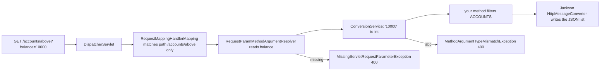

# 📅 Day 26 (Tue 17 Nov): first day of the new pace, Stack closes, Arrays & Hashing opens

     

> [!IMPORTANT]
> First day of the new pace (one new DSA problem every weekday, buggy rounds Tuesday and Friday, cold-only redos). One item per track: 🌱 labs Chapter 2 **Task 4 (carried over) then Task 5**, 🧩 **Contains Duplicate** (first Arrays & Hashing problem), 🐞 Tuesday buggy round **`Day05DecodeString`** (Stack), then the 🔁 evening redos `Day03NextGreaterIndex` + `AsteroidCollision`. Done when each item is green on your pushed code.

> [!NOTE]
> **Legend:** 🌅 morning · 🌱 Spring · 🧩 DSA · 🐞 buggy · 🔁 redo · ⬜ `NOT_STARTED` · 🟡 `IN_PROGRESS` · ✅ `COMPLETED` (verified). Run `git pull` on **both** repos first. In `spring-boot-labs` stay on `my-solutions`.
>
> State at 6 AM on tip `c50293d`: your `221069b` (5:00 AM IST) **`GenerateParentheses` 17/17** on a fresh clone, concept MCQs B B A all right → **9/10, ✅ COMPLETED** (1 off: `main` printed nothing; Lumi made it print the n = 3 result, cosmetic). Labs `my-solutions` tip `828c168`: `Chapter02CheckTest` **7/19** re-run this morning (Task 4 not pushed yet, the wrong `"/accounts/above?balance=N"` mapping is still there). New red-by-design stubs here: `ContainsDuplicateTest` 0/17, `Day05DecodeStringTest` 12/25 (buggy), `Day03NextGreaterIndexRedoNov17Test` 0/37, `AsteroidCollisionRedoNov17Test` 0/28. Full root `mvn test`: 701 run, only these four classes red.

## 🌅 Morning

### 🧭 Why the DSA pattern changes today

> [!IMPORTANT]
> With `GenerateParentheses` ✅, every one of the **7 NeetCode 150 Stack problems** has a verified solve of yours: Valid Parentheses, Min Stack, Generate Parentheses, Daily Temperatures and Car Fleet as DSA problems, Evaluate RPN (`Day02RpnEvaluator`, plus a clean cold redo 44/44 on 5 Nov) and Largest Rectangle (`Day04LargestRectangle`, 36/36) as buggy rounds. All seven stay on the redo ladder. So the Stack pattern is ✅ and the DSA track moves to **Arrays & Hashing**, the first NeetCode pattern, skipped only because the program started at Stack. This week's buggy pattern stays **Stack** (the week started on it); Friday's round follows the pattern open that day. If you would rather go forward to Binary Search, say so in chat and Thursday's problem switches.

### ⏱️ Time plan (120 min morning + evening redos)

| Minutes | Track | Item | Done when |
|---|---|---|---|
| 0-3 | 🌱 | `git pull` both repos; `git checkout my-solutions` in labs | clean pull |
| 3-20 | 🌱 | **Chapter 2 Task 4** (carried over, must-do): one line first, "the path is ___, the param is ___ as ___" | `task4a`-`task4d` green on pushed `my-solutions` → **11/19** |
| 20-53 | 🌱 | **Chapter 2 Task 5** (`/fee`, one required and one optional param) | `task5a`-`task5d` green → **15/19** |
| 53-88 | 🧩 | **Contains Duplicate** (new, Arrays & Hashing 1 of 9): pseudocode + brute force first | `ContainsDuplicateTest` **17/17** pushed |
| 88-108 | 🐞 | **`Day05DecodeString`** (Tuesday buggy round, Stack) | `Day05DecodeStringTest` **25/25** pushed, smallest changes |
| 108-120 | — | Push, buffer, hint requests | nothing left unpushed |
| Evening ② | 🧩 | `DailyTemperatures` brute-force + pseudocode comments (5 min, pending since 12 Nov) | comment-only push |
| Evening ③ (cap 2) | 🔁 | `Day03NextGreaterIndex` then `AsteroidCollision`, cold, 20-30 min each | see the redo table below |

> [!TIP]
> Stuck 15 minutes on any step? Ask for a hint. Push after each item, even if red. 3-5 lines of plain-English pseudocode before any Java, every time.

### 🌱 1. Chapter 2, Task 4 (carried over) and Task 5 (~50 min)

Where: [`spring-boot-labs`](https://github.com/PrashantSury/spring-boot-labs), branch `my-solutions`, file `chapters/02-first-spring-boot-app/src/main/java/ledgerly/AccountController.java` (the `// Task 4` and `// Task 5` comments are already there; nothing new is added to that repo). Tests: `mvn -pl chapters/02-first-spring-boot-app test`.

#### 1️⃣ What are we building
Two read endpoints that take their input from the **query string**: `GET /accounts/above?balance=N` (accounts with a balance more than N, JSON, in `ACCOUNTS` order) and `GET /fee?amount=N&express=true` (the transfer fee as a plain number). ✅ Done when `task4a`-`task4d` and `task5a`-`task5d` are green on the pushed `my-solutions` branch: Chapter 2 **15/19** (Task 6 is next).

#### 2️⃣ Why it matters
Every banking list screen is a filter ("accounts above 10 000", "transactions after 1 Nov"), and every quote is a calculation from parameters. If you put a filter in the path you get a 404 that looks like a deployment problem at 3 AM; if you make an optional flag a primitive you get a 500 the first time a mobile client leaves it out. Interviewers use exactly these two to see whether you know what Spring binds for you and what it can't.

#### 3️⃣ Concepts

| Term | One precise line |
|---|---|
| Path pattern | What `@GetMapping("...")` matches: **only the path**, never the query string. In a pattern, `?` means "any one character" and `*` "any characters in one segment" |
| Query string | Everything after `?` in the URL, read with `@RequestParam` (or a bound object) |
| `@RequestParam` | Binds one query (or form) parameter by name; **required by default** |
| `required = false` | Missing parameter → `null` is passed, so the type must be able to hold `null` (a primitive `boolean` is the one special case: it gets `false`) |
| `defaultValue = "..."` | Missing parameter → this text is converted and passed; also makes it non-required |
| Type conversion | `"10000"` → `int` by the `ConversionService`; `"abc"` → `MethodArgumentTypeMismatchException` → **400** |

#### 4️⃣ Approaches / variants (binding an optional and a required parameter)

| Variant | Missing value gives | When it fits | Failure mode |
|---|---|---|---|
| No annotation (`int amount`, `boolean express`) | simple types fall back to an **optional** `@RequestParam` by name (needs `-parameters`, which Boot sets) | never in an API: the rule is invisible | a missing `int` → `null` into a primitive → `IllegalStateException` → **500**, not 400 |
| `@RequestParam int amount` | **400** `MissingServletRequestParameterException` | a required number | none; this is the contract |
| `@RequestParam(required = false) int page` | `null` into a primitive | never | **500** `IllegalStateException` |
| `@RequestParam(required = false) boolean flag` | `false` (Spring special-cases primitive `boolean`) | works, but only by that special case | copy the same line to an `int` and you get the 500 above |
| `@RequestParam(required = false) Boolean flag` | `null` | when "missing" must differ from `false` | `NullPointerException` on unboxing if you forget |
| `@RequestParam(defaultValue = "false") boolean flag` | `false`, written in the signature | a flag with a clear default | none |
| `@RequestParam Optional<Boolean> flag` | `Optional.empty()` | explicit handling | more code for a simple flag |

#### 5️⃣ How it works internally



**What does Spring already handle?** Ask it before you type. Spring already does: the 200, the JSON list, the `Content-Type`, the 400 for a missing or non-numeric `balance` or `amount`, and the 405 for a `POST`. You write only: the mapping, the parameter binding, the filter and the fee arithmetic. No `try/catch`, no `@ExceptionHandler`, no `ResponseEntity`.

#### 6️⃣ Banking use case (the `ACCOUNTS` data, unchanged)

| # | number | holder | balance | `?balance=10000` | `?balance=52000` | `?balance=200000` |
|---|---|---|---|---|---|---|
| 1 | 1000234567 | Asha Rao | 52 000 | ✅ in (52 000 > 10 000) | ❌ out (52 000 is not **more** than 52 000) | ❌ out |
| 2 | 1000234568 | Vikram Shah | 8 500 | ❌ out (8 500 < 10 000) | ❌ out | ❌ out |
| 3 | 1000234569 | Neha Iyer | 125 000 | ✅ in | ✅ in | ❌ out |
| 4 | 1000234570 | Imran Khan | 300 | ❌ out | ❌ out | ❌ out |
| | | | **answer** | Asha Rao, Neha Iyer | Neha Iyer | `[]` |

Fee table for Task 5 (1% with whole-number division, minimum 10, then doubled when express):

| amount | 1% (`amount / 100`) | after minimum 10 | express=false | express=true |
|---|---|---|---|---|
| 5 000 | 50 | 50 | **50** | **100** |
| 200 | 2 | 10 | **10** | **20** |
| 999 | 9 | 10 | **10** | **20** |

Row 3 is the trap: the minimum applies **before** doubling, so 999 express is 20, not 18 and not 10.

#### 7️⃣ Implementation requirements

- [ ] Write the one line first: "the path is ___, the param is ___ as ___" (for Task 4, then again for Task 5).
- [ ] Task 4: replace the wrong `@GetMapping("/accounts/above?balance=N")` with a **path-only** mapping and bind `balance` as an `int` query parameter. Filter with **more than**, keep `ACCOUNTS` order, return a `List<Account>`.
- [ ] Task 5: map `/fee`; `amount` required `int`; `express` optional, defaults to false; the answer is a plain number.
- [ ] No code for missing or bad parameters (Spring answers 400 for you).
- [ ] Push to `my-solutions` after Task 4 (even if Task 5 isn't started), then again after Task 5.

#### 8️⃣ Sample requests and responses

```bash
curl -s 'localhost:8080/accounts/above?balance=52000'
# [{"number":"1000234569","holder":"Neha Iyer","balance":125000}]
curl -s 'localhost:8080/accounts/above?balance=200000'
# []
curl -s -o /dev/null -w '%{http_code}\n' 'localhost:8080/accounts/above?balance=abc'
# 400
curl -s 'localhost:8080/fee?amount=5000&express=true'
# 100
curl -s -o /dev/null -w '%{http_code}\n' 'localhost:8080/fee?express=true'
# 400   (amount is required)
```

(`curl` works after Task 6; the checks run without starting the server, so Tasks 4 and 5 pass in any order.)

#### 9️⃣ DB changes
None.

#### 🔟 Edge and failure cases

| Case | Expected |
|---|---|
| `balance=52000` (equal to an account) | that account is **not** included |
| nothing above the limit | `200` with `[]` |
| `balance=abc` | `400`, by Spring |
| `/fee` with no `amount` | `400`, by Spring |
| `/fee?amount=5000` (no `express`) | `50`, not a 400 or a 500 |
| `/fee?amount=200&express=true` | `20` (minimum first, then double) |

#### 1️⃣1️⃣ Testing requirements (already written in `Chapter02CheckTest`)

| Test | Proves |
|---|---|
| `task4a_above` | `balance=10000` → Asha Rao, Neha Iyer, in order |
| `task4b_strict` | more than, not at least (52000 is skipped) |
| `task4c_empty` | no match → empty JSON list |
| `task4d_badBalance` | a non-number is 400 and you wrote no code for it |
| `task5a_onePercent` · `task5b_minimum` · `task5c_express` · `task5d_optionalAndRequired` | 1%, minimum 10, doubling, `express` optional and `amount` required |

#### 1️⃣2️⃣ Interview questions (copied to [interview-answers.md](../interview-answers.md) as ⬜ pending)

1. A client calls `GET /accounts/above?balance=10000` and gets 404, but `/accounts` works. Walk through how `RequestMappingHandlerMapping` matches the request and why `@GetMapping("/accounts/above?balance=N")` never matches.
2. `@RequestParam(required = false) int page` and the client leaves `page` out: what does Spring do, which status does the client see, and why does the same line with `boolean` not fail? Give two correct fixes and their trade-offs.
3. A filter endpoint like `/accounts/above` grows to 6 optional filters. When would you bind them into one object (a record) instead of six `@RequestParam`s, and how does validation change?

**Knowledge checks** (answers in the block below):

1. `@GetMapping("/accounts/above?balance=N")` is deployed. What happens to `GET /accounts/above?balance=10000`?
   - A. Matches, `balance` is bound automatically
   - B. 404: the pattern is matched against the path only, and `?` is a one-character wildcard
   - C. 400: the query string is invalid
   - D. 500 at startup: `?` is illegal in a mapping
2. `@GetMapping("/fee") int fee(int amount, boolean express)` with **no** annotations on the parameters, and the request is `GET /fee?express=true` (no `amount`). The client sees:
   - A. 400 Bad Request, `amount` is missing
   - B. 200 with `10`
   - C. 500, because the unannotated `int` is treated as optional and `null` can't go into a primitive
   - D. 404
3. `GET /fee?amount=999&express=true` with the Task 5 rules returns:
   - A. 18
   - B. 20
   - C. 10
   - D. 19

<details>
<summary><b>🔒 Open only after your attempt</b></summary>

**Answers.** (1) **B**. The handler mapping compares the request **path** `/accounts/above` with the pattern `/accounts/above?balance=N`; the pattern needs one more character plus `balance=N`, so nothing matches and the resource handler answers 404. The query string is read later, by the argument resolver. (2) **C**. An unannotated simple-type parameter is resolved like `@RequestParam(required = false)`; a missing value becomes `null`, and Spring refuses to put `null` into a primitive `int` (`IllegalStateException`: "...cannot be translated into a null value due to being declared as a primitive type"), which ends as a 500. A primitive `boolean` is the one special case (missing → `false`). That is why "what does Spring already handle?" includes "only if you declare the contract": the 400 for a missing `amount` comes from `@RequestParam` being required. (3) **B**. 999 / 100 = 9 → minimum makes it 10 → express doubles it to 20.

</details>

### 🧩 2. DSA: Contains Duplicate (~35 min)

  

> [!IMPORTANT]
> 📂 `src/main/java/com/prashant/dsa/arrayshashing/ContainsDuplicate.java` · tests `src/test/java/com/prashant/dsa/arrayshashing/ContainsDuplicateTest.java` (17). ✅ Done when all 17 pass on your pushed code, with **3-5 lines of pseudocode and a brute-force comment before any Java**, plus pattern / time / space lines that each say where the cost comes from. LeetCode 217, NeetCode 150 Arrays & Hashing, problem 1 of 9.

#### 1️⃣ Problem understanding (why it matters, then a worked example)
A nightly settlement file carries one `int` reference per payment. A reference that appears twice means a payment may settle twice, so the batch is held. Answer one question: **does any value appear more than once?** It is the simplest hashing problem, and the senior conversation is about the trade-off: extra memory for linear time versus sorting, and whether you may touch the caller's array.

| Input | Output | Why |
|---|---|---|
| `[1, 2, 3, 1]` | `true` | `1` is at index 0 and index 3 |
| `[1, 2, 3, 4]` | `false` | all four values differ |
| `[1, 1, 1, 3, 3, 4, 3, 2, 4, 2]` | `true` | `1` repeats at index 1 already |
| `[-5, 5, 0]` | `false` | `-5` and `5` are different values |

#### 2️⃣ Input / output and constraints
- `boolean containsDuplicate(int[] nums)`.
- `null` → `IllegalArgumentException`; empty or one element → `false`.
- Any `int`, including `Integer.MIN_VALUE` and `Integer.MAX_VALUE`.
- **Do not modify** the caller's array (another step is still reading it).
- 1 000 000 elements must finish within 2 s.

#### 3️⃣ Pattern identification
**Arrays & Hashing: "have I seen this before?"** Whenever the question is about membership, counting or pairing values regardless of their position, a hash-based structure turns a re-scan into one O(1)-average lookup. The recognition cue here: the answer depends only on *which* values occur, not on their order.

#### 4️⃣ Approach (brute force only; write this first)
Compare every pair `i < j`. Write it as 3-5 plain-English lines in the pseudocode comment, then answer in a comment: *how many comparisons for n = 1 000 000, and why does the large test fail with it?*

Hints, as questions:
1. What could you remember about the values already passed, so each new value is checked in one step?
2. Does `Set.add` tell you anything useful through its return value?
3. Sorting also makes duplicates easy to see. Where would equal values end up, and what rule of this problem stops you from sorting `nums` itself?

#### 5️⃣ Dry run of the optimised algorithm
Inside the locked block below.

#### 6️⃣ Java stub
Already in the repo: `throw new UnsupportedOperationException("TODO: Contains Duplicate")`, with the pseudocode / pattern / time / space comment lines waiting at the top of the class and a `main` that prints two examples.

#### 7️⃣ Complexity
Brute force: you state it (and the reason) in the comment. Optimised: state time and space after your attempt, each with one sentence on where the cost comes from.

#### 8️⃣ Interview follow-ups
1. Hash set or sort a copy: compare time, extra memory and the worst case for each. Which would you pick for 10 million ids on a 512 MB container, and why?
2. Why is a `HashSet<Integer>` of 1 million ints far bigger than 4 MB? Name the two costs.
3. Contains Duplicate II: return `true` only if equal values are at most `k` indices apart. What changes in your structure?
4. In a payments system the "seen" set must survive restarts and be shared by 4 pods. What replaces the in-memory set (and what is the race)?

**Knowledge checks:**

1. Which line correctly detects the first repeat in one step?
   - A. `if (seen.contains(x)) seen.add(x);`
   - B. `if (!seen.add(x)) return true;`
   - C. `seen.add(x); if (seen.size() > 1) return true;`
   - D. `if (seen.add(x)) return true;`
2. Sorting `nums.clone()` and then checking neighbours costs:
   - A. O(n) time, O(1) extra space
   - B. O(n log n) time, O(n) extra space for the clone
   - C. O(n²) time, O(1) space
   - D. O(n log n) time, O(1) extra space
3. Why does `Arrays.stream(nums).distinct().count() != nums.length` lose in an interview, even though it is correct?
   - A. It is O(n²)
   - B. It never stops early: it always reads the whole array and builds the whole distinct set
   - C. It fails on negative numbers
   - D. It modifies the input

<details>
<summary><b>🔒 Open only after your attempt</b></summary>

**Idea.** Walk the array once with a `HashSet<Integer>`. `add` returns `false` when the value is already there: that is the duplicate, return `true` at once. If the loop ends, return `false`. Pre-sizing (`new HashSet<>(n * 2)` or `HashSet.newHashSet(n)` on Java 19+) avoids rehashing while it grows.

**Dry run, `[1, 2, 3, 1]`:**

| i | x | `seen` before | `seen.add(x)` | Action |
|---|---|---|---|---|
| 0 | 1 | `{}` | `true` | continue |
| 1 | 2 | `{1}` | `true` | continue |
| 2 | 3 | `{1, 2}` | `true` | continue |
| 3 | 1 | `{1, 2, 3}` | **`false`** | return `true` |

**Cost.** Time O(n) average: each value is hashed and added once, O(1) on average per `add`; the worst case is worse only if many keys collide (Java 8+ turns a crowded bucket into a tree, O(log n) per lookup). Space O(n): in the worst case (no duplicate) every value sits in the set. Brute force: n(n-1)/2 ≈ 5 × 10^11 comparisons for 1 million, far past 2 s. Sort-a-copy: O(n log n) time, O(n) for the copy (O(1) extra only if you were allowed to sort in place, which this problem forbids).

**Answers.** Checks: (1) **B**. (2) **B**. (3) **B**. Follow-ups, short: (1) hash set is O(n) time but about 40-50 bytes per entry; sorting a copy is O(n log n) and only 4 bytes per entry, so at 10 million on 512 MB the sorted copy (40 MB) is the safer pick. (2) Each `Integer` is an object (header + value, about 16 bytes) and each entry is a `HashMap.Node` (hash, key, value, next, about 32 bytes) plus the bucket array. (3) Keep only the last `k` values: a sliding window set (remove `nums[i - k]` as you move) or a map value → last index. (4) A shared store with an atomic insert: a DB unique constraint on the payment reference (or Redis `SET NX` with a TTL); check-then-insert in two steps races between pods.

</details>

- [ ] 3-5 lines of plain-English pseudocode **and** a brute-force comment before any Java.
- [ ] Pattern / time / space comment lines with reason sentences.
- [ ] `mvn test -Dtest=ContainsDuplicateTest` → **17/17**. Push.

### 🐞 3. Tuesday buggy round: `Day05DecodeString` (Stack, ~20 min)

  

> [!IMPORTANT]
> 📂 `src/main/java/com/prashant/dailytests/Day05DecodeString.java` · tests `src/test/java/com/prashant/dailytests/Day05DecodeStringTest.java` (25). The class compiles and has bugs. Run the tests, read the failures, and make the **smallest** fixes until every test passes. Don't rewrite it. ✅ Done when **25/25** on your pushed code, plus one comment line per fix saying which failing test led you to it.

#### 1️⃣ Why it matters
Expanding nested templates ("3 statement lines, each with 2 sub-lines") is the classic two-stack problem (LeetCode 394, Decode String): each `[` must remember the state outside it, and each `]` must restore it. In production the same code is a **decompression-bomb** risk: a 19-character template can ask for a billion characters, so the expected behaviour includes a hard output limit.

#### 2️⃣ The pattern in two sentences
When a bracket opens, push the context you are leaving (the repeat count and the text built so far) and start a fresh builder. When it closes, pop that context and combine it with what was built inside.

#### 3️⃣ Expected behaviour (rules)

| # | Rule | Example |
|---|---|---|
| 1 | `k[body]` expands to `body` repeated `k` times, from the inside out | `"3[a2[c]]"` → `"accaccacc"` |
| 2 | `k` is a decimal whole number, possibly several digits, always followed by `[` | `"10[a]"` → ten `a`s |
| 3 | `k = 0` removes the group; an empty body gives nothing | `"a0[bc]d"` → `"ad"`, `"2[]x"` → `"x"` |
| 4 | Letters (`a-z`, `A-Z`) are copied as they are, and keep their position before, between and after groups | `"2[abc]3[cd]ef"` → `"abcabccdcdcdef"` |
| 5 | `""` → `""` | |
| 6 | `null`, a `]` with no open `[`, or a `[` never closed → `IllegalArgumentException` | `"a]b"`, `"2[ab"` |
| 7 | The decoded text may be at most **1 000 000** characters (`MAX_OUTPUT`); past that → `IllegalArgumentException`, before the big string is built | `"1000[1000[1000[a]]]"` → IAE |
| 8 | Time proportional to input plus output; no recursion depth limit (1 000 nested levels must work) | |

#### 4️⃣ Test cases

| Group | Input | Expected | What it checks |
|---|---|---|---|
| normal | `"3[a]2[bc]"` | `"aaabcbc"` | LeetCode example 1 |
| normal | `"3[a2[c]]"` | `"accaccacc"` | nesting |
| normal | `"2[abc]3[cd]ef"` | `"abcabccdcdcdef"` | trailing text |
| normal | `"abc"` | `"abc"` | no brackets |
| normal | `"a2[b]c"` | `"abbc"` | text before and after a group |
| normal | `"2[x3[y]]"` | `"xyyyxyyy"` | inner group after a prefix |
| normal | `"2[a]3[b]"` | `"aabbb"` | two groups side by side |
| normal | `"2[AB]c"` | `"ABABc"` | uppercase |
| normal | `"3[z]2[2[y]pq4[2[jk]e1[f]]]ef"` | 61 characters | deep mix |
| edge | `""` · `"1[a]"` · `"2[]x"` · `"a0[bc]d"` | `""` · `"a"` · `"x"` · `"ad"` | empty, count 1, empty body, count 0 |
| edge | `"10[a]"` · `"100[xy]"` · `"12[a]2[b10[c]]"` | 10 · 200 · 34 characters | multi-digit counts |
| edge | `"2[2[2[a]]]"` · 1 000 × `"1["` | 8 `a`s · `"q"` | nesting depth |
| edge | `"1000[1000[a]]"` | 1 000 000 characters | exactly at the limit is allowed |
| failure | `null` · `"a]b"` · `"2[a]]"` · `"2[ab"` | IAE | null, stray `]`, extra `]`, unclosed `[` |
| failure | `"1000[1000[1000[a]]]"` | IAE within 2 s | template bomb |
| large | `"300[300[a]]"` | 90 000 `a`s within 2 s | performance |

> [!WARNING]
> Gotchas of the pattern (not of this code): the context is saved **before** the new group starts and restored **after** it ends; a count is built digit by digit; and anything that multiplies lengths needs a size check done in `long`, not `int`.

#### 5️⃣ Knowledge checks (about the pattern)
1. Why two stacks (or one stack of pairs) rather than one counter?
   - A. To sort the groups
   - B. Each open bracket has its own repeat count **and** its own outer text, and both must come back in LIFO order
   - C. Because `StringBuilder` is not thread-safe
   - D. To use less memory
2. An iterative version is preferred over recursion here mainly because:
   - A. Recursion can't handle letters
   - B. Deep nesting (1 000+ levels) can overflow the thread stack, while a heap `Deque` grows as needed
   - C. Iteration is always faster
   - D. Recursion can't return a String
3. Why check the size in `long` before calling `repeat`?
   - A. `repeat` is slow
   - B. `length * times` can overflow `int` and turn negative, so the guard would pass and the bomb would still run
   - C. `long` is faster than `int`
   - D. Strings can't be longer than 1 000 000

<details>
<summary><b>🔒 Open only after your attempt</b></summary>

**Answers.** (1) **B**. (2) **B**. (3) **B**.

</details>

- [ ] Run `mvn test -Dtest=Day05DecodeStringTest`; group the failures by symptom **before** changing code (which inputs fail, which pass).
- [ ] Smallest fixes, one comment line each naming the test that led you there.
- [ ] **25/25**. Push.

### 🔁 Evening redos (cap 2, most overdue first, 20-30 min each, cold)

| Redo | File (blank stub) | Tests | Gap | Why now |
|---|---|---|---|---|
| 🐞 `Day03NextGreaterIndex` | `src/main/java/com/prashant/dailytests/redo/Day03NextGreaterIndexRedoNov17.java` | `mvn test -Dtest=Day03NextGreaterIndexRedoNov17Test` (0/37) | +1, due 30 Oct | most overdue (never redone); write the whole method, there is no buggy code this time |
| 🧩 `AsteroidCollision` | `src/main/java/com/prashant/dailytests/redo/AsteroidCollisionRedoNov17.java` | `mvn test -Dtest=AsteroidCollisionRedoNov17Test` (0/28) | +1, due 1 Nov | next most overdue (never redone) |

> [!CAUTION]
> **Cold means cold.** Do not open `dailytests/Day03NextGreaterIndex`, `dsa/stack/DailyTemperatures` or `dsa/stack/AsteroidCollision`. A redo whose body matches the original counts as **not passed** (yesterday's two copied redos scored 2/10 and were re-queued). A red push from memory beats a green copy.

- [ ] Each starts with a **pattern line + time and space comments** (one sentence each saying where the cost comes from), then 3-5 lines of pseudocode, then code. 25-minute timer.
- [ ] Push at the end of each, even if red.

### 📦 Carried backlog (not for today)

| # | Item | Track | Status |
|---|---|---|---|
| 1 | `DailyTemperatures` brute-force + pseudocode comments (5 min, evening ②) | 🧩 | 🟡 IN_PROGRESS |
| 2 | `CarFleet` single-pair follow-up; PR [#1](https://github.com/PrashantSury/java-switch-journey/pull/1) still open | 🧩 | 🟡 IN_PROGRESS |
| 3 | B2 interview Q3 and Q6, plus "why the catch-all hid Spring's own answers" | 🌱 | ⬜ NOT_STARTED |
| 4 | Banking module 1 step 1, Drills 2 and 3 (parked; Spring slot is `spring-boot-labs`) | 🏦🌱 | ⬜ NOT_STARTED (parked) |
| 5 | `ScoreOfParentheses` follow-up questions (with the Sun 22 Nov redo) | 🧩 | ⬜ NOT_STARTED |
| 6 | Day 02 and Day 03 re-answers | 🌱 | 🟡 IN_PROGRESS |
| 7 | Chapter 2 Task 6 + its interview question (next Spring item after Task 5) | 🌱 | ⬜ NOT_STARTED |
| 8 | `Day00BuggyExample` symptom groups (write-up) | 🐞 | ⬜ NOT_STARTED |
| 9 | 🔁 `RemoveKAdjacentDuplicates` + `ScoreOfParentheses` cold redos (Sun 22 Nov, blank files) | 🔁 | 🟡 IN_PROGRESS |

### ✅ Morning checklist

- [x] `GenerateParentheses` graded **9/10**, ✅ COMPLETED (`221069b`, 17/17); joins the redo ladder at +1
- [ ] Chapter 2 Task 4 pushed on `my-solutions` → 11/19
- [ ] Chapter 2 Task 5 pushed → 15/19
- [ ] `ContainsDuplicate` pseudocode + code pushed → 17/17
- [ ] `Day05DecodeString` fixes pushed → 25/25
- [ ] Evening: `DailyTemperatures` comments, then the two cold redos

### 🧹 Housekeeping (Lumi, this morning)
- `GenerateParentheses.main` now prints the n = 3 result (it built the list and threw it away); cosmetic, not logged.
- [interview-answers.md](../interview-answers.md): labs Chapter 1 marked ✅ (graded 7/10 in chat on 15 Nov, it still said NOT_STARTED); Day 04 row shows the 1 Nov re-answers (26/30); labs Chapter 2 questions added as pending.
- [redo-schedule.md](../revision/redo-schedule.md): `GenerateParentheses` row added (+1, queued in the first free slot, Fri 27 Nov); Tue 17 Nov stubs created.
